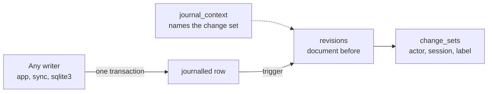

# ADR 0061: Agent changes are restorable through a change journal beside the store

```meta
date: 2026-11-24
related: [".devbook/arc42/adr/0003-sqlite-is-the-canonical-local-task-store.md", ".devbook/arc42/adr/0005-azure-hosted-task-replica-for-multi-device-sync.md", ".devbook/arc42/adr/0010-backup-is-the-database-committed-to-a-repository.md", ".devbook/arc42/adr/0012-backlog-is-an-mcp-server-inside-the-desktop-app.md", ".devbook/arc42/adr/0058-agents-and-devices-authenticate-by-grant-and-key-the-owner-by-github-sign-in.md", ".devbook/arc42/adr/0059-tokenless-mcp-calls-get-the-scopes-the-person-opens-to-them.md", ".devbook/design/interaction-guidelines.md#undo-and-history", ".devbook/arc42/11-risks-and-technical-debt.md#architectural-risks"]
c4: [backlog.taskStore, backlog.desktop.persistence]
c4-touches: [backlog.desktop.mcp, backlog.desktop.tasks, backlog.cloud, github]
```

Backlog keeps its SQLite rows canonical and does not adopt event sourcing. Beside them,
an append-only **change journal** records, for every journalled document, the state
before each **change set** touched it. A person can restore a change set as a new,
later save; an agent can only propose one.

## Status

```meta
```

Proposed, 2026-11-24. Not yet built.

A **local** decision, numbered in the local sequence. Every bare ADR number below
means the local one.

It adds to ADR 0003 a second kind of table in `backlog.db`, and to ADR 0058 §4's scope
table two tools (§5).

## Context

```meta
```

**An agent's mistake cannot be taken back.** An agent writes through the MCP server
inside the desktop app (ADR 0012), and the write overwrites the row: a task save is
one upsert, and only a delete leaves anything behind, as a tombstone. Three things
follow.

- **The earlier version is gone.** Nothing keeps the document a write replaced.
- **Who called is logged, not what changed.** Since ADR 0058 every MCP call names its
  grant and leaves a row in `mcp-audit.db`: tool, target, outcome, for 30 days. It
  keeps no prior document, and a write by the person, by sync or by a direct database
  edit leaves nothing there.
- **Undo does not see agents.** `TaskUndoHistory` keeps 100 steps in memory for what
  the Tasks pane did. An MCP write never enters it.

The last breaks a written rule: an AI-applied change MUST be undoable like any other
edit ([Undo and History](../../design/interaction-guidelines.md#undo-and-history)).

Agents reach Backlog three ways: 45 write tools on the MCP server, each behind a scope;
skills that produce files the person imports, such as a plan (ADR 0013); and plain
file access as the signed-in user, which includes opening `backlog.db` with `sqlite3`.
A plan import, an inbox triage and a `close-merged` run each touch several bounded
contexts in one go.

## Decision

```meta
```

**The rows stay the truth; a journal beside them keeps what each change set replaced.**



### 1. No event sourcing

```meta
```

Event sourcing would keep the same information, but it fits this codebase poorly:

- **A task edit has no verbs.** Every write is one whole-text save through the entry
  grammar (ADR 0002); `transition` rewrites the `!status` token and saves the text. The
  events would be "text changed", a snapshot under another name. Real verbs need the
  second write path ADR 0012 §5 rejected.
- **Sync never moves a document backwards** (ADR 0005). The replica refuses an older
  `updated_at`, so rewinding a stream would never reach another device. A restore has
  to be a new, later write, which needs no event store.
- **Replay answers a different question.** It gives "the state at 10:00"; the need is
  "take back that run, keep what I did since". That needs a change-set boundary and a
  conflict check on either design.
- **The cost spans every document kind.** Each has its own repository and replica path,
  and the sync service holds whole documents. Merging event streams from several
  devices would replace last-write-wins throughout.

### 2. Two shared tables, filled by triggers

```meta
```

Two tables in `backlog.db`, shared across bounded contexts the way Sync is, because one
change set can span several:

- **`change_sets`:** id; actor kind `person`, `agent`, `sync`, `system` or unknown; the
  MCP caller; session id; the correlation id of its first MCP call; label; start time;
  the change set that undid it.
- **`revisions`:** sequence; change set; document kind; document id; the document before
  the change set touched it, or null when the change set created it; the `updated_at`
  the change set left; time.

**SQLite triggers on each journalled table write the revisions,** so a write from any
process is caught, including an agent running `sqlite3`. The app names the change set in
a single-row `journal_context` table inside the same write transaction. A write without
one is recorded under an unknown writer. Revisions share the file with the rows, so the
two cannot disagree and need no outbox.

A revision keeps the document before the change set first touched it, so repeated saves
in one change set leave one revision per document.

### 3. The actor and the change set of an MCP write

```meta
```

- **The actor is the principal ADR 0058 already names on every call:** the grant by
  name and id, or `unauthenticated` under ADR 0059.
- **An optional `sessionId` argument on every write tool names the session,** the way
  `notify` already takes one.
- **Writes join one change set** when they come from one session, or from one grant
  without a session id, within 30 minutes of the previous write.
- **Each change set keeps the correlation id of its first call,** so it can be read
  beside the MCP audit log. That log stays in its own file with its 30-day retention.
  The journal lives in `backlog.db` because it is backlog data.

### 4. A restore is a later save the person makes

```meta
```

Restoring a change set walks its revisions newest first:

- **A document whose `updated_at` still matches** what the change set left is saved
  again with its prior content, stamped now. One the change set created is tombstoned.
- **A document whose `updated_at` no longer matches is a conflict the person decides.**
- **The restore is a change set of its own,** and the undone one records it.

A restore is never a rewind, so it reaches other devices through ordinary sync, with no
replica change.

### 5. Agents list and propose; the person restores

```meta
```

Agents get two tools. A proposal only asks; restoring is the person's action in the app.

| Tool | Scope |
| --- | --- |
| `list_change_sets` | `tasks:read` |
| `propose_restore` | `tasks:write` |

Both join ADR 0058 §4's scope table.

### 6. Local, kept 90 days, inside the backup

```meta
```

- **The journal is local to the device that took the write** and is not replicated. An
  agent writes through the desktop MCP server only, so that device holds its journal.
- **Revisions are kept 90 days by default,** with an action that clears the history.
- **They travel inside the backup of ADR 0010,** because they are rows in the database
  it commits.

### 7. A checkpoint and a stale-save refusal

```meta
```

- **A checkpoint copy of the database is taken before an agent's first write,** as a
  stopgap until the journal ships, and for the files the journal does not cover.
- **A task save refuses a write based on an older `updated_at`,** so two sessions cannot
  silently overwrite each other (R11).

### 8. Out of scope

```meta
```

- **GitHub pull requests.** Backlog records which change set acted; GitHub keeps the
  history, and the person reverts there.
- **The Brain folder,** including the links the app writes into Brain notes under
  ADR 0052. Its files sit outside every repository and fit git better than a table.
- **The settings that ride the task feed** (ADRs 0018, 0021, 0025, 0032, 0036), beyond
  the checkpoint.

## Consequences

```meta
```

- **An agent's run can be taken back without losing later edits,** and the conflict check
  names every document edited since.
- **Ctrl+Z still covers the pane only.** The journal is longer-term version history,
  which the design guidelines left open.
- **Deleted text is retained** until the 90 days pass or the person clears the history.
- **Backups grow by the revisions they carry.** Their size has to be measured against the
  GitHub Contents API's file limit before this ships.
- **A schema change leaves old revisions in old payloads** (ADR 0006), so a restore reads
  past formats. Retention bounds how far back.
- **Every journalled table gains triggers,** and every app write a `journal_context` row
  in its transaction.
- **A restore can still overwrite an unsynced edit on another device** (R5). Accepted, as
  for any edit today.
- **A restore works only on the device that took the write.** Restoring from another
  device would need the journal replicated, a Cosmos container of its own.
- **Nothing new goes on the wire,** so a lagging sync service drops nothing.

## Rejected

```meta
```

- **Full event sourcing.** §1.
- **A domain-event log beside the tables.** It serves audit as well as the journal, but
  restoring needs inverse logic per event type; whole-document revisions need none.
- **A checkpoint alone.** It restores the whole file or nothing, so it cannot keep the
  edits made since the run. It stays as the stopgap of §7.
- **Recording revisions in the repositories rather than in triggers.** It would miss a
  write from any other process.
- **Keeping the journal in the MCP audit file.** The journal is backlog data and travels
  with the backup; the audit log is operational and kept 30 days.
- **Letting an agent restore its own run.** An agent proposes; the person confirms.

## History

```meta
```

| Date | Change | Why |
| --- | --- | --- |
| 2026-11-24 | §2's `revisions` and `journal_context` built for `tasks`: insert and update triggers; a write that finds `journal_context` empty gets an unknown-writer change set per document it touches; noting a use is kept out. | The journal's first journalled table. |
| 2026-11-24 | Proposed: a change journal of shared change sets and trigger-written revisions in `backlog.db`; restore as a later save by the person; `list_change_sets` and `propose_restore` for agents; 90-day local retention inside the backup; a checkpoint and a stale-save refusal. | An agent's write could not be taken back, and the design guidelines require that it can. |
