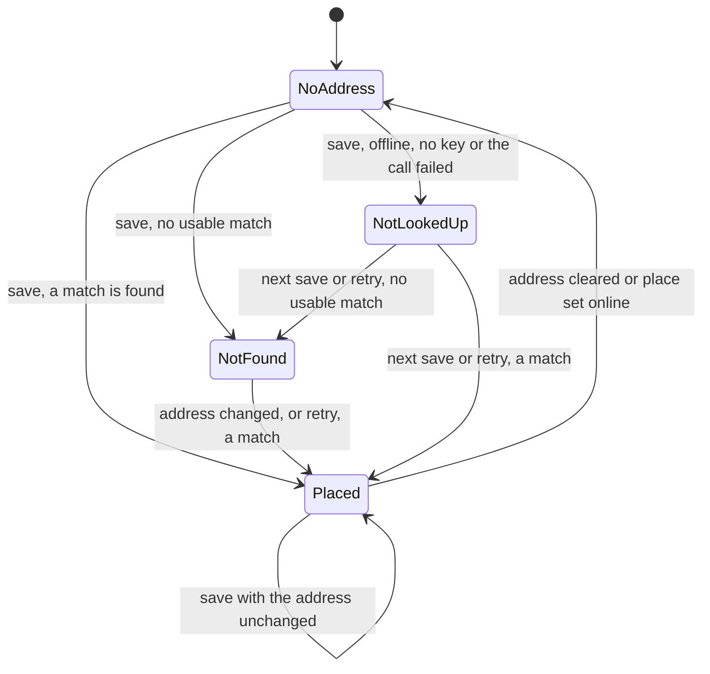

# ADR 0061: The Events map uses online tiles and geocodes an address on save

```meta
date: 2026-11-24
related: [".devbook/arc42/02-constraints.md#technical-constraints", ".devbook/arc42/07-deployment-view.md#cloud-deployment-azure", ".devbook/arc42/adr/0023-inbox-items-may-be-read-by-the-foundry-model.md", ".devbook/arc42/adr/0030-stored-credentials-go-through-the-os-protected-envelope.md", ".devbook/arc42/adr/0045-the-sync-service-relays-dictation-audio-to-foundry-and-keeps-none-of-it.md", ".devbook/arc42/adr/0050-events-is-its-own-bounded-context.md", ".devbook/arc42/adr/0057-archify-is-retired-and-mermaid-draws-every-chapter-diagram.md", ".devbook/arc42/adr/guidelines/0005-modular-monolith-structure.md", ".devbook/arc42/adr/guidelines/0010-opentelemetry-observability.md", ".devbook/arc42/adr/guidelines/0013-authorization-zero-trust.md", ".devbook/arc42/adr/guidelines/0015-resilience-for-outbound-dependencies.md", ".devbook/domain/events/context.md#events-area", ".devbook/domain/events/features.md#events-pane", ".devbook/domain/events/domain.md#place", ".devbook/design/component-libraries.md#diagram-and-graph-strategy"]
c4: [backlog.desktop.events]
c4-touches: [backlog.desktop.sync, azureMaps]
```

The Events map draws online map tiles from Azure Maps, and the desktop sends an
in-person event's address to the Azure Maps geocoder once, when the person saves
the address new or changed. The point found is stored on the event, and the map
never geocodes while it draws. So two things leave the machine: the address text
of a saved venue, and the tile coordinates of the part of the world on screen.

## Status

```meta
```

Accepted, 2026-11-25, by the person at the flow-spec run's Personal Validation;
proposed 2026-11-24 by that run. The
domain chapters of the same run add the [Address](../../domain/events/domain.md#address)
and the [Map Point](../../domain/events/domain.md#map-point) to a
[Place](../../domain/events/domain.md#place) and link here for why the address leaves
the machine. Not built.

A **local** decision, numbered in the local sequence. Every bare ADR number below
means the local one; an inherited one is named "guideline".

The person settled three choices before this record. They are inputs here, not
open questions:

| Choice | Settled as |
|---|---|
| What a venue is | A venue name and a structured address: street, postcode, town and country, each optional. An online place has neither. |
| How a point is found | Geocoding the address once on save. A lookup that finds nothing stores no point, and the event is not on the map. |
| What the map is | A slippy map with online tiles. Offline, the map shows a note, and the list keeps working. |

## Context

```meta
```

**Backlog is local-first.** `02-constraints.md` says every core workflow runs without
connectivity and the cloud is additive only
([Technical Constraints](../02-constraints.md#technical-constraints)). Until now, an
event's place was free text that never left the machine. The pane's "Open in maps"
link hands the text to the person's own browser and nothing more.

**Nothing in the repository draws a map or geocodes.** A search of `src/`, `.devbook/`
and the package manifests for Leaflet, MapLibre, OpenStreetMap, Nominatim, geocoding,
latitude and longitude found nothing. Vendored JavaScript has one precedent:
Mermaid sits under `src/Core/Backlog.UI.Components/wwwroot/lib/mermaid/`, served from
the library's static web assets with no network, per ADR 0057.

**Backlog already runs in Azure.** The sync service, Key Vault `kv-backlog-sync-we`
and the Foundry account sit in resource group `JS-AI`, in West Europe
([Cloud Deployment](../07-deployment-view.md#cloud-deployment-azure)). The desktop
already holds one Azure key, Foundry's, entered in Settings and sealed by ADR 0030,
and ADR 0023 calls configuring it the person's consent.

**Two records set the precedent for data leaving the machine.** ADR 0023 lets an
inbox item reach Foundry only on the reader's action. ADR 0045 lets a dictation reach
Foundry only when the person picks the Cloud engine, and keeps on-device as the
fallback. Both say what is sent, when, and what happens without the service.

**What the providers publish.** The facts below decide the options. Each was read on
2026-11-24.

| Fact | Source | What it decides here |
|---|---|---|
| OSM's tile servers run with "no SLA or guarantee" and "may block access, without notice". "Offline use is not permitted." | [OSMF tile usage policy](https://operations.osmfoundation.org/policies/tiles/) | OSM's own tiles are not a dependency for a shipped app. |
| Nominatim allows "an absolute maximum of 1 request per second". It asks apps to be switchable "without requiring a software update", and asks for no personal data. | [OSMF Nominatim usage policy](https://operations.osmfoundation.org/policies/nominatim/) | OSM's own geocoder is not one either. |
| Azure Maps Gen2 gives 5,000 free Base Map Tile and 5,000 free Search transactions a month. Fifteen tiles count as one transaction. | [Azure Maps pricing](https://azure.microsoft.com/en-us/pricing/details/azure-maps/), [Understanding Azure Maps transactions](https://learn.microsoft.com/en-us/azure/azure-maps/understanding-azure-maps-transactions) | A personal map stays inside the free tier. |
| Failed calls (`401`, `403`, `408`, `429`, `5xx`) are not billed. | Understanding Azure Maps transactions | A failure costs nothing. |
| The endpoint `eu.atlas.microsoft.com` keeps requests, input included, in the EU geography. | [Azure Maps geographic scope](https://learn.microsoft.com/en-us/azure/azure-maps/geographic-scope) | The address stays in the EU. |
| Get Geocoding `2026-01-01` takes a structured address (`addressLine`, `postalCode`, `locality`, `countryRegion`). It answers with a point, a `confidence` and `matchCodes`. | [Search - Get Geocoding](https://learn.microsoft.com/en-us/rest/api/maps/search/get-geocoding) | The four address parts map one to one, and a weak match can be refused. |
| A shared key works as "a master key" for the account. A SAS token is created through the management plane, lives at most 24 hours, and carries a rate limit and allowed regions. | [Authentication with Azure Maps](https://learn.microsoft.com/en-us/azure/azure-maps/azure-maps-authentication) | The trade-off in §4 and under **Rejected**. |
| MapTiler's free plan suits "personal, or non-commercial use", has 100k API requests a month, and pauses the service until the next month when exceeded. | [MapTiler Cloud pricing](https://www.maptiler.com/cloud/pricing/) | The runner-up, under **Rejected**. |
| Leaflet is BSD 2-Clause and "about 40 KB of JS". Its 2.0 line is in beta. | [Leaflet](https://leafletjs.com/), [Leaflet LICENSE](https://github.com/Leaflet/Leaflet/blob/main/LICENSE) | The map library in §2. |
| MapLibre GL JS is 3-Clause BSD and renders vector tiles on the GPU. | [maplibre-gl-js](https://github.com/maplibre/maplibre-gl-js) | Weighed under **Rejected**. |

## Decision

```meta
```

### 1. The provider

```meta
```

One Azure Maps account, Gen2, serves both halves through the EU endpoint
`https://eu.atlas.microsoft.com`:

- **Tiles** come from Render's Get Map Tile as raster road tiles, 256 pixels square.
- **Points** come from Search's Get Geocoding, `api-version=2026-01-01`, with the
  structured parameters. Street goes to `addressLine`, postcode to `postalCode`, town
  to `locality` and country to `countryRegion`.

The endpoint, the tileset and the api-version are settings, so a newer version is a
setting change, not a decision.

### 2. The map library

```meta
```

Leaflet draws the tiles and handles panning and zooming. Backlog vendors it under
`src/Core/Backlog.UI.Components/wwwroot/lib/leaflet/`, the way Mermaid is vendored:

- the release's own files, copied unchanged, with its `LICENSE`;
- a `README.md` naming the version, the tarball hash and the update steps;
- no CDN, so the library loads with the network down, and only the tiles need it.

Pin the newest stable release when it is vendored. The 2.0 line is in beta and waits
until it is stable.

Leaflet draws nothing the person interacts with. The pins, the edge pills, the zoom
and fit controls and the legend are the component library's own buttons, drawn by
Blazor. They are placed at the screen position Leaflet's projection gives for each
point. This keeps every interactive mark a real button, as
`.devbook/design/component-libraries.md#diagram-and-graph-strategy` asks.

### 3. What leaves the machine

```meta
```

| Sent to | What | When | Never |
|---|---|---|---|
| The geocoder | The address's four parts, as typed, and the request headers of the desktop's HTTP client | When the person saves an address new or changed, or presses the retry | The venue name, title, dates, state, notes or any other event |
| The tile service | The zoom and tile coordinates of the view, and the WebView's ordinary request headers | While the Events pane is open with the map shown | Any event data: the pins are drawn locally |

The Azure Maps key travels with both, as §4 says. The person's IP address reaches
Microsoft with every request, as with any web request.

### 4. The key and the path

```meta
```

The desktop calls Azure Maps directly. The person enters the account's key in
Settings, and the desktop seals it through the OS-protected envelope of ADR 0030, as
it does Foundry's key. Entering the key is the consent, as ADR 0023 argues for
Foundry: a desktop with no key sends nothing.

- **The geocoder** sits behind a port in the Events module. Its adapter lives in a
  project of its own, so only that project references the provider (guideline 0005).
  It sends the key in the `subscription-key` header, never in the URL.
- **The tiles** are requested by the WebView. The key rides in the tile URL, because
  an image request cannot carry a header. The URL stays inside the person's own
  WebView and is never logged.
- **No sync route.** The sync service plays no part, so the map works on a desktop
  that never paired, and a sync redeploy is not needed for it.
- **No key.** The map shows a note that it needs an Azure Maps key in Settings. An
  address saves with no point, and nothing is sent.

### 5. A lookup runs once per saved address

```meta
```



- **Only a changed address is looked up.** The desktop compares the four parts with
  the ones the stored point was found for. A save that leaves them alone sends nothing.
- **A usable match** is the first answer whose `confidence` is `High` or `Medium` and
  whose type is finer than a province. Its `Display` point is stored. An answer only
  at province or country level counts as not found.
- **A failure stores no point,** and the event is not on the map. Being offline,
  having no key, a timeout, a `429` and a `5xx` are failures, not "not found". The
  hint for each is the domain's and the design's to word.
- **Nothing retries in the background.** No timer, no startup pass and no queue
  re-sends a failed lookup. The next save of that event, or the person's explicit
  retry, sends it again. A long offline spell therefore ends in no burst of calls.
- **Resilience,** per guideline 0015, sits on the adapter's `HttpClient`: a 10-second
  timeout, at most one retry on a `408`, `429` or `5xx`, and a circuit breaker.
- **Nothing personal is logged.** Telemetry carries the outcome, the status code and
  the duration. No log, trace or metric carries the address or the point, and no
  enricher may add one (guideline 0010).

### 6. Caching, attribution and limits

```meta
```

- **Tiles** are cached by the WebView's own HTTP cache, which honours the service's
  cache headers. Nothing prefetches tiles outside the view, and there is no
  "download for offline".
- **A point** is its own cache: it is stored on the event, so the map never asks
  again. The event replicates with its point, so a second desktop does not look the
  same address up again.
- **Attribution** shows at the map's bottom right, always visible, with the copyright
  text Azure Maps requires for the tiles in view.
- **Limits.** One person's map stays far inside the free tier. A `429` is a failure
  like any other: the tiles that did not load stay blank, and a lookup stores no point.

### 7. Offline, and the `events` switch

```meta
```

- **Offline,** the map shows a note that it needs a connection. The list, the
  numbers, the editor and every stored point are unaffected, because none of them
  needs the network. A save while offline makes no call and leaves the address not
  looked up.
- **The `events` switch** ([Events area](../../domain/events/context.md#events-area))
  gates the whole map. With it off there is no map, no lookup and no tile request.
- **The phone** is unchanged. It shows no map and looks nothing up.

## Consequences

```meta
```

**How it meets the other records:**

- **Local-first holds.** Every event, its address and its point live in the local
  store, and every workflow but the map's background works offline. The map is
  additive, like the cloud (`02-constraints.md`).
- **The thin cloud is untouched.** No sync route is added, and the replica only
  carries the point as another field of the event's document (ADR 0050).
- **ADR 0023's consent model carries over.** A configured key is the consent, and
  an unconfigured desktop sends nothing.
- **ADR 0045's caution about Microsoft carries over.** Microsoft receives the address
  and the view in the EU geography.

Positive:

- Street-level maps and addresses in many countries, from a provider Backlog already
  pays and administers.
- No sync change and no new Azure resource beside one Maps account.
- One key, one bill, one data-residency setting.

Negative, and accepted:

- **An address leaves the machine.** It reaches Microsoft once per change.
- **The view leaves the machine.** The tiles requested say which part of the world
  the person looks at.
- **The shared key is the account's master key.** It sits on the desktop, sealed, and
  can call every Azure Maps API on that account. A dedicated account limits what it
  can reach to billing on that account.
- **No map offline.** The pins have nothing to stand on until the connection returns.
- **The terms on keeping geocodes are not settled.** See the open question below.

**What the implementation has to build**, as a later flow-code change:

- the vendored Leaflet, with its README, and the map component over it;
- the geocoder port in the Events module and its Azure Maps adapter project;
- the key in Settings, through the envelope of ADR 0030;
- the lookup on save and the explicit retry, with the states of §5;
- the attribution, the offline note and the missing-key note.

**Follow-ups outside this record:**

- The deployed sync service strips document fields it does not know. Until it is
  redeployed, a point saved on one desktop does not reach the other.

**Open questions for the person:**

- **Keeping geocodes.** A Microsoft Q&A answer reads the product terms as allowing
  geocodes to be kept while the Azure account is active, but stored in Azure. It
  says storage outside Azure falls back to the response's validity period or six
  months
  ([Microsoft Q&A, 2024-09-23](https://learn.microsoft.com/en-us/answers/questions/2076846/can-i-store-geocode-data-forever-in-my-database)).
  The local SQLite store is outside Azure, and the replica in Cosmos is inside. This
  record has not verified the current terms. Recommendation: read the Azure Maps
  section of the Product Terms before accepting.
- **A pass after the key is first saved.** Events saved before a key exists have no
  point. Recommendation: when the key is first saved, look up each unplaced address
  once, one call at a time, as the person's own action.
- **Who provisions the account.** Recommendation: by hand in `JS-AI` first, in West
  Europe, and in `infra/` once the map is built.

## Rejected

```meta
```

- **OSM's own tile servers.** They run on donations with no SLA, may block an app
  without notice, and forbid offline use. A shipped app cannot depend on them.
- **Nominatim on OSM's servers.** Its policy caps every user of an app at one request
  per second together, and asks for no personal data. It also asks that the app can
  be switched off without an update, and Backlog has no remote switch to do so.
- **MapTiler.** Its free plan fits personal use and covers tiles and geocoding with one
  key. It would add a vendor and a bill outside Azure, and the service pauses for the
  rest of the month once the plan is exceeded. It is the runner-up if Azure Maps' terms
  on keeping geocodes rule it out.
- **OpenFreeMap.** It serves vector tiles with no key and no limit, but with no SLA and
  on donations. It has no geocoder, so a second provider would still be needed.
- **MapLibre GL JS.** Its vector rendering and styling need WebGL and weigh far more
  than Leaflet. Raster tiles and Blazor-drawn pins need none of it.
- **A SAS token minted by the sync service.** No key would sit on the desktop, and the
  token caps the rate and the regions. But the map would need a paired, redeployed
  sync service, and creating a token needs `Contributor` on the Maps account and the
  identity, which is broad for a service identity. Revisit it if the shared key on the
  desktop proves too broad.
- **Proxying tiles and lookups through the sync service.** Every tile would cross a
  scale-to-zero service, and the cloud would do work beyond coordination.
- **A bundled gazetteer and an offline outline map.** It works offline and sends
  nothing, but places a venue only by town and shows no streets. The person chose
  addresses and a street map.
- **Geocoding while the map draws.** Every draw would send every address, and the map
  would break offline. The person chose a stored point.

## History

```meta
```

| Date | Change | Why |
| --- | --- | --- |
| 2026-11-25 | Accepted. | The person approved the spec at Personal Validation. |
| 2026-11-24 | Proposed: Azure Maps on the EU endpoint serves the Events map's tiles and geocodes an in-person event's address once on save, with Leaflet vendored and the key sealed on the desktop. | The person chose a street map with online tiles and addresses over an offline outline. |
