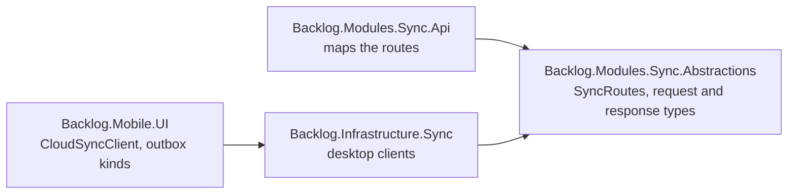

# ADR 0064: The sync clients share the service's contract assembly instead of a client generated from OpenAPI

```meta
date: 2026-11-25
related: [".devbook/arc42/adr/0005-azure-hosted-task-replica-for-multi-device-sync.md", ".devbook/arc42/adr/guidelines/0007-minimal-apis-over-controllers.md", ".devbook/arc42/adr/guidelines/0017-http-error-contract-and-problem-details.md", ".devbook/arc42/05-building-block-view.md", ".devbook/arc42/09-architecture-decisions.md"]
c4: [backlog.cloud]
c4-touches: [backlog.desktop, backlog.mobile]
```

The desktop and the phone call the sync service through hand-written clients. Those
clients compile against the same `Backlog.Modules.Sync.Abstractions` assembly as the
service: its routes (`SyncRoutes`) and its request and response types. None of the
clients is generated from the OpenAPI document, although the **Clients** rule of org
ADR 0004 asks for that.

## Status

```meta
```

Proposed, 2026-11-25. Plan `app-defaults-rollout`, entry 37 (`backlog-deviation-adrs`).

A **local** decision. It records a deliberate difference from
[org ADR 0004: HTTP API](https://github.com/JSdotNet/app-defaults/blob/main/defaults/arc42/adr/0004-http-api.md),
its **Clients** rule only. The endpoint, validation and error rules of that ADR still
apply, and plan entry 35 closes their gaps.

## Context

```meta
```

Org ADR 0004 generates every client from the OpenAPI document, so no hand-written
client can drift from the contract. The ADR assumes a client in another language, or in
another repository, that cannot see the server's types.

Backlog's clients are in the same solution and the same language as the service:



A renamed route or a changed field breaks the build on both sides of the wire, which
is the guarantee a generated client exists to give. The OpenAPI document is served in
Development only (`MapOpenApi()`), and nothing reads it at build time.

The clients do more than a generated client would. They sign a device assertion for
the token exchange (local ADR 0058 §2), turn the coded 503 into "come back later",
retry through the phone's outbox, and stream attachments. A generated client would
still need all of that wrapped around it.

## Decision

```meta
```

**Keep.** The sync clients stay hand-written over `Backlog.Modules.Sync.Abstractions`.
A route or a type the clients and the service share is declared once there, never
repeated as a string or a copy in a client.

A client of the sync service in another language or another repository, such as the
VS Code extension under `src/App/Backlog.Ide.VsCode` if it ever calls the service, is
generated from the OpenAPI document, as org ADR 0004 says.

## Consequences

```meta
```

- The contract holds only where both sides use the shared assembly. A client that
  types a route as a string literal escapes the check.
- The OpenAPI document is documentation, not the source of a client. Its accuracy
  rests on the endpoint metadata.
- An app-defaults review reads this record for the 0004 Clients row.

## Rejected

```meta
```

- **Generate the desktop and phone clients from OpenAPI (L).** A build-time document
  export, a generator, and about a dozen clients would move onto the generated
  surface. The shared assembly already catches drift at compile time, and the
  behaviour wrapped around each call would stay hand-written anyway.

## History

```meta
```

| Date | Change | Why |
| --- | --- | --- |
| 2026-11-25 | Proposed: keep the hand-written sync clients over the shared contract assembly; a client in another language or repository is generated. | Step 15 of plan `app-defaults-rollout` (PR #1967) listed the org ADR 0004 Clients difference as L with no local decision. |
