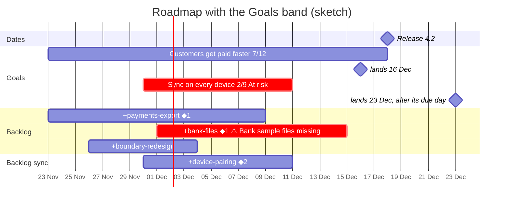

# ADR 0074: Goals stay their own context, and the Roadmap draws them

```meta
date: 2026-11-27
related: [".devbook/arc42/adr/0073-the-bounded-contexts-are-redrawn.md", ".devbook/arc42/adr/0035-goals-and-impediments-replace-sprints.md", ".devbook/arc42/adr/0028-progress-is-its-own-boundary-and-tasks-knows-no-sprints.md", ".devbook/arc42/adr/0018-roadmap-plan-and-pace-ride-the-task-feed.md", ".devbook/arc42/adr/0067-each-module-ships-its-own-ui-project-and-the-apps-compose-them.md", ".devbook/domain/context-map.md", ".devbook/domain/goals/context.md", ".devbook/domain/goals/domain.md#goal", ".devbook/domain/goals/domain.md#goal-forecast", ".devbook/domain/goals/domain.md#holds-back", ".devbook/domain/work/context.md", ".devbook/domain/work/domain.plan.md#plan", ".devbook/domain/work/domain.md#band"]
c4: [backlog.desktop.goals, backlog.desktop.work]
c4-touches: [backlog.desktop.shell]
```

Goals is not merged into Work. The Roadmap draws the goals in a **Goals** band at the
top of its timeline: each goal as a span to its due day, its landing date, its standing,
and the plans it holds. A plan an open impediment holds back is marked on its bar. Goals
supplies that read the way it already supplies the goal control and the plan
impediments: as a hook the desktop composition cascades into Work's screens. No stored
value, sync kind or MCP tool changes.

## Status

```meta
```

Proposed, 2026-11-27. Answers the person's question on the plan `+boundary-redesign`:
*should goals go into Work and be shown on the roadmap?* Read from
`plan/boundary-redesign` at `a84925a`.

A **local** decision, numbered in the local sequence. Every bare ADR number below means
the local one. It keeps ADR 0073 §4 and adds the Roadmap's goal band.

## Context

```meta
```

Code facts below are reference counts in `src/` on `plan/boundary-redesign`, not
runtime checks.

**Work's merge had a seam to remove; Goals has none.** ADR 0073 §1 merged Tasks and
Roadmap Planning on evidence of one context split in two: ids crossing both ways, eight
adapters between them in both directions, and the My Day rule split across them. Goals'
adapters in `Infrastructure.FileSystem/Goals/` are four — `GoalsTaskSource`,
`PlanningVelocityStandUpPace`, `RepositoriesGoalPullRequests` and the iteration
settings store — and every one reads *into* Goals. Work answers no Goals port and
stores no goal or impediment id (ADR 0035 §6).

**No rule spans a goal and a plan.** A goal's invariants — one title, one item attached
once, an item in at most one goal (Goal Assignment), the counting rules of Goal
Progress — read only goals. A plan's — acyclic dependencies, a hand move hands the
window to the person, planning priority never touches the task — read only the plan.
An aggregate boundary is drawn around rules that must hold together; none crosses here.

**The two vocabularies collide inside one context.** Goals' *Done* is a status of Done
or every linked pull request merged; Work's *Completed* is the day the status became
Done. Goals' *Planned* is the stand-up's derived next-window work; Work's Roadmap Item
carries the aliases *planned work* and *planned item*. Goals' *Progress* is `done/total`
over attachments; a Roadmap Item shows the progress of the tasks it gathers. Merged,
each pair needs a new name.

**Goals already reaches Work's screens without Work knowing it.** `GoalControlSlot` and
`PlanImpedimentSource` in `Backlog.UI.Components.Goals` are hooks the desktop
composition cascades (`AddGoalControls`, `AddPlanImpediments` in
`DesktopCompositionRegistration`). The Roadmap's item editor draws the goal control for
a plan, and the Tasks pane's plan rail names the impediment holding a Blocked plan.
Neither Work project references `Backlog.Modules.Goals`. The context map draws neither
hook.

**What the Roadmap would need is already published.** `list_goals` and `IStandUp`
answer each goal's due day — its own, or the end of next — its landing date and
standing, and `done/total`. A goal names its plans by tag, the tag the Roadmap's items
carry. `PlanImpedimentSource` answers the open impediment holding a plan or one of its
entries.

**Goals was just renamed.** The plan's own entries moved `progress_goals` and
`progress_impediments` to `goals_goals` and `goals_impediments`, and the error codes
`progress.*` to `goals.*`, each with a compatibility read (ADR 0073 §10). A merge would
rename each a second time before the first has reached every device.

## Options considered

```meta
```

| | A. Goals separate, Roadmap reads goals | B. Goal and Impediment as Work aggregates | C. Between: goal lanes in Work's plan |
| --- | --- | --- | --- |
| Language | unchanged | *Done*, *Planned* and *Progress* each need a new name in Work | Work gains *goal lane*; Goals keeps *Goal* |
| Invariants | unchanged | unchanged, now in one context; Goal Assignment moves | *an item in at most one goal* needs both contexts, or a plan's lane and a goal's plan attachment disagree |
| Stored values (ADR 0073 §10) | none | `goals_goals`, `goals_impediments` → `work_goal`, `work_impediment`; journal owners; `goals.iteration-length`, `goals.iteration-anchor` → `work.*`; error codes `goals.*` → `work.*`; each with a migration and a compatibility read, a second time | a `goal` field on the Roadmap Item: the `work-plan` document's shape and its version |
| Sync kinds | none | `goal`, `impediment`, `stand-up-context`, `impediment-edit` kept as names of things; routed to Work | `work-plan` gains a field older devices drop on write |
| MCP tools and scopes | none; `list_goals` already answers the span | tool names and their `work:*` scopes kept (`McpToolScopes`); `GoalTools` and `ImpedimentTools` pass through to Work's Abstractions | `get_planned_work` returns a goal per item, a second source beside `list_goals` |
| Skills | none | `track-goals` and `weekly-review` keep their tools; their prose and ADR citations name Work | `track-goals` must keep a lane and an attachment in step |
| Code | a hook, a Goals-side reader, a band in `RoadmapPlanView` | three Goals projects (about 6,500 lines) and four adapters folded into Work; the Goals view, weekly review and stand-up move under Work.UI | a lane on the Roadmap Item, its editor, and a sync between lane and attachment |
| What the Roadmap shows | the goal band, standing, landing date, plans held, impediment marks | the same, read in process | lanes by goal; no landing date or impediment without Goals' reading |
| Size, points | 13 | 40 | 21, and a rule split across contexts |

## Decision

```meta
```

### 1. Goals stays its own context

```meta
```

ADR 0073 §4 stands: Goal and Impediment are Goals' aggregates, and Work knows no goals.
No task field, plan field, tag or entry-text token names a goal or an impediment
(ADR 0035 §6).

### 2. The Roadmap draws a Goals band

```meta
```



The band sits at the top of the timeline, below the milestones' Dates band, with one row
per goal in the person's goal order. A row draws:

- the goal's **span**: from the earliest start among the windows of the plans it holds,
  or the day its first item was attached when it holds no plan on the Roadmap, to its
  due day — its own, or the end of next as Goals works it out;
- its title, `done/total` and its standing, **At risk** drawn in the warning colour;
- its **landing date** as a marker, after the due day when it lands late; a goal with no
  landing date draws none;
- a goal mark on each **plan it holds**, by tag, and selecting the span picks out those
  bars; a plan whose entry another goal holds as a task keeps its own goal's mark.

A plan an open **impediment** holds back — by its tag or through one of its entries —
draws a warning mark on its bar, titled with the impediment, as the Tasks pane's plan
rail names it. Tasks, pull requests and sessions a goal holds are counted in
`done/total` and not drawn: the Roadmap draws plans.

The band is read-only on the timeline: a span is not dragged, and a due day changes in
the goal's editor. Attaching a plan stays where it is, in the item editor's goal control.
With no goal, the band is not drawn. The phone draws no Roadmap and is unchanged.

### 3. Goals supplies the band through the composition

```meta
```

`Backlog.UI.Components.Goals` gains a third hook beside `GoalControlSlot` and
`PlanImpedimentSource`: the goal timeline, each goal's id, title, due day, landing date,
standing, `done/total` and the tags of the plans it holds, read from `IStandUp` and
raised again when a goal, an impediment or the work changes. `Backlog.Modules.Goals.UI`
registers it and the desktop composition cascades it. `Backlog.Modules.Work.UI` draws the
band when the hook is cascaded and nothing when it is not, as it does for the goal
control. Work's model, Abstractions and stored plan stay goal-free.

### 4. Nothing stored changes

```meta
```

No table, column, settings key, feature flag, sync kind, document version, MCP tool name
or scope changes, so ADR 0073 §10 asks for no migration. `get_planned_work` stays
goal-free; an agent that wants goals beside the plan calls `list_goals`, which already
answers the due day, the forecast and the attachments.

### 5. The context map draws the hooks

```meta
```

The map draws Goals as a supplier to the desktop shell: the goal control and the plan
impediments, built, and the goal timeline, dashed until it is. The strategic rule on
Goals says Work's screens draw what the composition cascades from Goals while Work's
model knows no goals.

## Consequences

```meta
```

- **A person sees on one timeline whether the plans reach their goals,** and which goal
  a late or blocked plan puts at risk.
- **Two readings of a goal on screen:** the Goals view and the Roadmap band, both from
  `IStandUp`, so they never count differently.
- **No migration, no device left behind:** an older desktop or phone reads the same
  documents and simply draws no band.
- **The hooks pattern grows to three.** Each is a seam a reviewer can find in
  `Backlog.UI.Components.Goals`; a fourth is a sign the boundary deserves a new look.
- **A goal's span start is a Roadmap reading,** from plan windows Goals never reads, so
  it moves when a plan is moved and is never stored.

## Rejected

```meta
```

- **Merge Goals into Work as a third aggregate.** No invariant crosses a goal and a
  plan, every adapter already points one way, *Done*, *Planned* and *Progress* collide
  with Work's words, and it renames every Goals stored value a second time within one
  plan. The Roadmap gains nothing a published read does not give.
- **Goal lanes on Work's plan.** A Roadmap Item naming its goal is a second home for the
  attachment, so *an item belongs to at most one goal* would hold in two contexts, and
  the `work-plan` document would gain a field older devices drop.
- **Goals as milestones on the plan.** A goal has a due day, a forecast and an
  outcome; a milestone has one day and no standing, and Goals would write into Work.
- **Draw goals only in the Goals view.** It leaves the question the person asked
  unanswered: which plans carry a goal and whether they land in time.
- **Extend `get_planned_work` with each item's goal.** Two tools would answer the same
  attachment, and Work's tool would read Goals.

## History

```meta
```

| Date | Change | Why |
| --- | --- | --- |
| 2026-11-27 | Proposed: Goals stays its own context; the Roadmap draws a Goals band through a hook the composition cascades; nothing stored changes; the map draws Goals' hooks into the shell. | The person asked whether goals should go into Work and show on the roadmap. |
