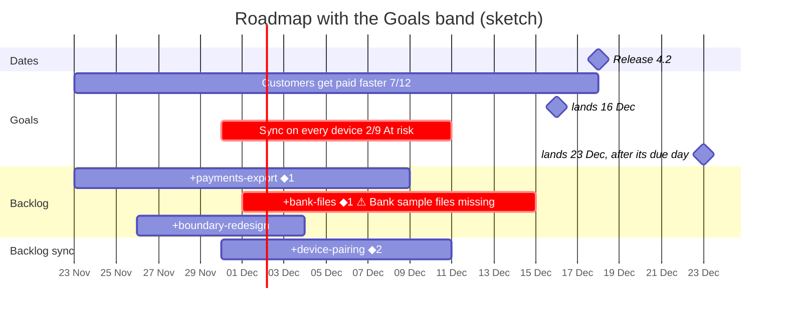

# ADR 0075: Goals merge into Work, and the Roadmap draws them

```meta
date: 2026-11-27
related: [".devbook/arc42/adr/0073-the-bounded-contexts-are-redrawn.md", ".devbook/arc42/adr/0074-infrastructure-is-organised-by-technology-never-by-context.md", ".devbook/arc42/adr/0035-goals-and-impediments-replace-sprints.md", ".devbook/arc42/adr/0028-progress-is-its-own-boundary-and-tasks-knows-no-sprints.md", ".devbook/arc42/adr/0018-roadmap-plan-and-pace-ride-the-task-feed.md", ".devbook/arc42/adr/0067-each-module-ships-its-own-ui-project-and-the-apps-compose-them.md", ".devbook/domain/context-map.md", ".devbook/domain/goals/context.md", ".devbook/domain/goals/domain.md#goal", ".devbook/domain/goals/domain.md#goal-forecast", ".devbook/domain/goals/domain.md#done", ".devbook/domain/goals/domain.md#holds-back", ".devbook/domain/work/context.md", ".devbook/domain/work/domain.plan.md#plan", ".devbook/domain/work/domain.plan.md#roadmap-item", ".devbook/domain/work/domain.md#roadmap-item-gathering", ".devbook/domain/work/domain.md#band"]
c4: [backlog.desktop.work, backlog.desktop.goals]
c4-touches: [backlog.desktop.shell, backlog.desktop.mcp, backlog.desktop.sync, backlog.mobile]
```

Goals merges into **Work**. **Goal** and **Impediment** become Work's third and fourth
aggregates, beside Task and Plan, and the stand-up and the iteration come with them. Work
then reads as the person works: a goal, the plans that reach it, the tasks that carry
them out, and what holds them back. The Roadmap draws the goals in a **Goals** band above
the plans. Task and Plan still name no goal; a goal holds them. Every stored value that
carries the Goals context name is renamed under local ADR 0073 §10.

## Status

```meta
```

Proposed, 2026-11-27. Answers the person's question on the plan `+boundary-redesign`:
*should goals go into Work and be shown on the roadmap?* Read from
`plan/boundary-redesign` at `c2af7f8`.

A **local** decision, numbered in the local sequence. Every bare ADR number below means
the local one. It reverses ADR 0073 §4 and the line of its *Rejected* that kept Goals
out of Work, and it narrows ADR 0035 §6 and ADR 0028 §3: no task or plan field names a
goal, but Work now knows goals.

## Context

```meta
```

Code facts below are reference counts in `src/` on `plan/boundary-redesign`, not
runtime checks.

**The work starts with a goal.** A person sets a goal, makes plans that reach it, and
works the tasks that carry each plan out. Today that one flow crosses a context
boundary between the goal and the plan.

**The traffic already runs both ways.** Goals reads Work through its adapters in
`Infrastructure.FileSystem/Goals/` — `GoalsTaskSource` and
`PlanningVelocityStandUpPace` — for tasks by id, every task under a plan tag, the plan
order and the pace. Work's screens read Goals back through hooks in
`Backlog.UI.Components.Goals` that the desktop composition cascades: `GoalControlSlot`,
the goal control in the Roadmap's item editor and the task panel, and
`PlanImpedimentSource`, the impediment the Tasks pane's plan rail names for a Blocked
plan. Drawing goals on the Roadmap adds a third. Ids crossing both ways was the evidence
ADR 0073 §1 merged Tasks and Roadmap Planning on; the hooks only keep it out of the
project references.

**One rule already spans the two.** A goal counts exactly the entries a plan's Roadmap
Item [gathers by tag](../../domain/work/domain.md#roadmap-item-gathering), "so a goal and
the roadmap never count a plan differently". Work holds that rule and hands Goals its
tasks by it, across the boundary. The Planned block takes a plan's first ready entry in
the plan's order, and an impediment's age counts Work's working week.

**Nothing reads Goals but the screens of Work, the agents and the phone.** Goals has no
inbound context on the map. Its other readers are the MCP channel, whose goal and
impediment tools are already mapped to `work:*` scopes (`McpToolScopes`), and the phone's
goals view.

**Some words collide.** Goals' *Done* is a status of Done or every linked pull request
merged; Work's task status *Done* and its *Completed* day are the status alone. Work's
Roadmap Item carries the aliases *planned work* and *planned item*, and the stand-up's
*Planned* is its derived next-window work.

## Decision

```meta
```

### 1. Work owns goals and impediments

```meta
```

Work holds four aggregates:

| Aggregate | Holds |
| --- | --- |
| Task | one piece of work |
| Plan | the forward plan, as Roadmap Items |
| Goal | what the person works towards, its due date, and the plans, tasks, pull requests and sessions attached to it |
| Impediment | what holds work back, its state and history, and the tasks, pull requests and plans it holds back |

Goal Assignment, Stand-up Reading and the Iteration move with them unchanged, as do the
rules of each aggregate. A goal still holds its work by identity — a plan by its tag, a
task by its id — and reads its state on every reading. **Task and Plan name no goal or
impediment:** no field, tag, status or entry-text token on either does, and attaching
work to a goal changes nothing on it. A task's blocked mark still raises no impediment
(ADR 0035 §5). Goal Progress counts a plan through Roadmap Item Gathering in process, so
the rule that a goal and the Roadmap count a plan alike lives in one context.

### 2. The words

```meta
```

| Was | Becomes | Why |
| --- | --- | --- |
| Goals' *Done* | **Delivered**: a task is delivered when its status is Done or every pull request it links is merged | Task status *Done* stays the status alone |
| Roadmap Item aliases *planned work*, *planned item* | dropped | *Planned* is the stand-up's next-window work |
| *Goal Progress*, *Goal Forecast* | kept | already qualified by *Goal* |
| *Iteration*, *Stand-up*, *Settled*, *Ready to resolve*, *Pace* | kept | no Work term has the name |

The screens keep their labels: the stand-up's Finished and Planned blocks and the Goals
view. Only the model's terms change.

### 3. The modules

```meta
```

`Backlog.Modules.Goals`, `Backlog.Modules.Goals.Abstractions` and
`Backlog.Modules.Goals.UI` fold into Work's three projects, under
`Backlog.Modules.Work.Goals`, as ADR 0073 §1 placed the task and the plan. The Goals
view, the stand-up and the weekly review are Work.UI's screens. The adapters that read
Work for Goals, `GoalsTaskSource` and `PlanningVelocityStandUpPace`, become reads inside
the module. `RepositoriesGoalPullRequests` stays an adapter over Repositories' contract,
in Work's adapters project under ADR 0074. Work's own screens read goals in process; the
hooks in `Backlog.UI.Components.Goals` stay only for screens outside Work, such as the
pull requests pane.

### 4. The Roadmap draws a Goals band

```meta
```



The band sits at the top of the timeline, below the milestones' Dates band, with one row
per goal in the person's goal order. A row draws:

- the goal's **span**: from the earliest start among the windows of the plans it holds,
  or the day its first item was attached when it holds no plan on the Roadmap, to its
  due day — its own, or the end of next;
- its title, `done/total` and its standing, **At risk** drawn in the warning colour;
- its **landing date** as a marker, after the due day when it lands late; a goal with no
  landing date draws none;
- a goal mark on each **plan it holds**, and selecting the span picks out those bars; a
  plan whose entry another goal holds as a task keeps its own goal's mark.

A plan an open **impediment** holds back — by its tag or through one of its entries —
draws a warning mark on its bar, titled with the impediment. Tasks, pull requests and
sessions a goal holds count in `done/total` and are not drawn. The span is read-only on
the timeline: a due day changes in the goal's editor. With no goal, the band is not
drawn. The phone draws no Roadmap.

### 5. Stored values

```meta
```

Under ADR 0073 §10, a value named for the Goals context is renamed with a migration and
a compatibility read; a value named for the thing — a goal, an impediment, the goals
view — keeps its name.

| Value | Today | Becomes |
| --- | --- | --- |
| SQLite tables | `goals_goals`, `goals_impediments` | `work_goal`, `work_impediment`, each row copied once and the old table kept unread, as `work_plan` was |
| Stamp and journal owners | `goals_goals`, `goals_impediments`, `journal:goals_goals`, `journal:goals_impediments` | `work_goal`, `work_impediment`, `journal:work_goal`, `journal:work_impediment`, the old owners still restored |
| Error codes | `goals.*`, `goals.goal_not_found` and `goals.item_in_other_goal` among them | `work.*`, with no read for the old codes: they are answers, never stored |
| Setting keys in the chapters | `goals.iteration-length`, `goals.iteration-anchor` | `work.iteration-length`, `work.iteration-anchor`; the stored file `iteration-settings.json` and its fields keep their names |

Kept, as names of a thing: the sync kinds `goal`, `impediment`, `stand-up-context`,
`impediment-edit` and `iteration-settings` and the `impediment` document's version; the
journal kinds `goal` and `impediment`; the phone's `goals` view table; the `goals`
surface id; the `weekly-review` flag; every MCP tool name and its `work:*` scope. The
sync client routes the kinds to Work; no device sees a new token, so no paired device is
left behind.

### 6. Channels and skills

```meta
```

`GoalTools` and `ImpedimentTools` pass through to `Backlog.Modules.Work.Abstractions`,
with their names and scopes unchanged, so no alias is needed. `track-goals` names
Work as the owner and the `work.*` error codes in the same change, as does any other
`backlog-tools` skill that names Goals.

### 7. The context map

```meta
```

Goals leaves the map: the landscape reads five core contexts — Capture, Inbox, Work,
Brain, Devbook — and five supporting — Sessions, Insights, Repositories, Dev PCs,
Events. The edges into Goals point at Work: Repositories' registry lookup and pull
request status, and Sessions' attached session (not built). The Work → Goals edge goes.
`.devbook/domain/goals/` folds into `.devbook/domain/work/` as the Goal and Impediment
chapters, their invariants, features and requirements.

## Consequences

```meta
```

- **Work reads as the person works,** from the goal down to the task, in one model,
  one module and one set of chapters.
- **The Roadmap shows whether the plans reach their goals,** read in process from the
  same Stand-up Reading the Goals view draws, so the two never count differently.
- **Work grows to four aggregates** and the largest module in the product; each
  aggregate keeps its own rules, and Task and Plan still name no goal.
- **Goals' stored names move a second time inside one plan:** `progress_*` became
  `goals_*` and becomes `work_*`. Each compatibility read stays until no install can
  carry the old table.
- **The hooks shrink to the screens outside Work.**
- **ADR 0035's options table keeps its history:** *Goals as tags on tasks, in Tasks*
  stays rejected — a goal is still an aggregate, not a task fact.

## Rejected

```meta
```

- **Keep Goals separate and draw goals on the Roadmap through a published read.** It
  keeps the model goal-free only on paper: Work's screens would read goals through three
  hooks, and the plan-counting rule would still be held across a boundary. The flow the
  person works in would stay split in the model. It was this record's first proposal.
- **Goal lanes on Work's plan.** A Roadmap Item naming its goal is a second home for the
  attachment, so *an item belongs to at most one goal* would hold in two places, and the
  `work-plan` document would gain a field older devices drop.
- **Goals as milestones on the plan.** A goal has a due date, a forecast, an outcome and
  attachments of four kinds; a milestone has one day and no standing.
- **A goal field on the task.** It would put a goal into the task's entry text and sync
  it with every task, which ADR 0028 and ADR 0035 rejected for reasons that still hold.
- **Keep the `goals_*` table names.** The prefix is the context's, as `roadmap_plan`'s
  was; ADR 0073 §10 renames it.
- **Extend `get_planned_work` with each item's goal.** `list_goals` answers the
  attachment; two tools would answer the same fact.

## History

```meta
```

| Date | Change | Why |
| --- | --- | --- |
| 2026-11-27 | Proposed: Goals merges into Work as the Goal and Impediment aggregates; the Roadmap draws a Goals band; Goals' context-named stored values are renamed; the map drops Goals. Replaces this record's first proposal, which kept Goals separate. | The person's review: work starts with a goal, then plans, then tasks, and the Roadmap needs Work to read goals. |
