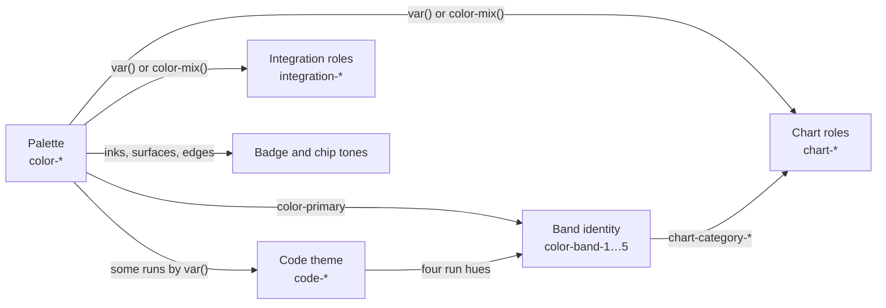

# Color Scheme

```meta
related: [".devbook/design/design-principles.md#dark-mode-only", ".devbook/design/accessibility.md#contrast", ".devbook/arc42/04-solution-strategy.md#technology-choices"]
```

> The materialized dark-mode color palette and semantic design tokens for the
> Backlog product. Values were adapted from the JSdotNet design style guide
> `01-color-palette` ("Style Guide: Color Palette"), imported 2026-08-27.
> Because the product is **dark mode only**, only the dark-mode column
> of the org palette is adopted here; the light column is intentionally dropped.
> Brand, semantic and text tokens are the guide's values unchanged. **Surface and
> border tokens are a deliberate project deviation**; see
> [Surface and Border Deviation](#surface-and-border-deviation).
> This file is the single source of token *values*; all other `.devbook/design` files and
> product code reference token **names** only.

## Provenance

```meta
```

- **Source:** the JSdotNet design style guide, document `01-color-palette`,
  imported 2026-08-27. This file is authoritative from that date.
- **Selection:** dark-mode values only (the product has no light theme).
- **Deviation:** the surface and border ramps are project values, not the
  guide's. [Surface and Border Deviation](#surface-and-border-deviation) records
  them with the measured contrast pairs that the guide's
  `05-customization-guide` asks an override to show.
- **Contrast rules, elevation-by-color, and focus-ring rules** are also
  sourced from that guide and from `04-motion-and-interaction`.
- The palette **includes a defined dark mode**, so no draft/invented palette was
  needed; this file is `active`, not `draft`.

## Dark Palette

```meta
related: [".devbook/design/design-principles.md#dark-mode-only"]
```

All tokens below are the **dark-mode** values. These are the only color values
the product uses.

### Brand

```meta
```

| Token | Value (dark) | Usage |
|---|---|---|
| `color-primary` | `#F2C14E` | Primary actions, active links, key highlights |
| `color-primary-light` | `#FFD166` | Hover states, tinted backgrounds |
| `color-primary-dark` | `#D4A72C` | Pressed states, high-contrast variant |
| `color-secondary` | `#ADB5BD` | Secondary buttons, less prominent labels |

### Semantic (soft surface tokens)

```meta
```

Semantic colors are **surface and background tokens first**. Render readable
foreground text and icons on top of them. Do not treat them as strong standalone
UI colors, and do not invent a second, stronger semantic palette.

| Token | Value (dark) | Usage |
|---|---|---|
| `color-success` | `#1A3A22` | Success banners, confirmation panels, positive status surfaces |
| `color-success-text` | `#72C086` | Success text and icons — the legible foreground for the `color-success` surface, and for a confirmation line with no surface behind it |
| `color-warning` | `#3D2E00` | Warning banners, caution panels, non-blocking alert surfaces |
| `color-error` | `#3D0A0D` | Error banners, validation summaries, destructive-status surfaces |
| `color-error-text` | `#EC8E97` | Error text, icons and input outlines — the legible foreground for the `color-error` surface, and for error text with no surface behind it |
| `color-info` | `#0A2C31` | Informational notices, neutral announcement surfaces |

`color-error-text` and `color-success-text` are the two exceptions to "surfaces
only". A bare status line, a status icon or an input outline has no semantic
surface behind it, and without these two it would have no sanctioned colour.
Both are **foregrounds only**: neither is ever painted as a background. They do
not open the door to a second semantic palette, because they serve only the two
meanings that needed a foreground. `color-warning` and `color-info` get no
counterpart. No rule paints either as text, and a token nothing uses is a value
nothing measures.

Each foreground is a legibility correction to the colour already in use, not a
new colour. It keeps the hue and the saturation and lifts only the lightness,
until its [binding pair](#contrast-rules-wcag-aa-minimum) passes. The binding
pair is `color-background-raised` in both cases. It is the lightest surface
either ink sits on, and dropdowns, popovers and badges are built on it.

**`color-error-text`.** Before this token, the desktop stylesheet repeated a raw
`#E4626F`, and product code referenced a `--color-danger` that nothing declared.
This token is the sanctioned answer to both.

**The value is derived, not picked.** The incumbent `#E4626F` is
hsl(354, 70.7%, 63.9%). It measures 5.59:1 on `color-background`, 4.86:1 on
`color-background-alt` and **3.65:1** on `color-background-raised`, so it fails
the 4.5:1 this document requires of a foreground on a semantic surface. No error
message sits on a raised surface today, because dialogs and modals are built on
`color-background`. Keeping the incumbent and restricting it to the two surfaces
it clears was therefore an option, and it was rejected. The author of every
future error rule would have to honour the restriction, and nothing would
enforce it. The contrast table below also states the requirement for a
foreground on *any* semantic surface. `#EC8E97` is hsl(354, 70.7%, **74.0%**).

| Pairing | Required | `color-error-text` |
|---|---|---|
| on `color-background` | 4.5:1 | **7.91:1** |
| on `color-background-alt` | 4.5:1 | **6.87:1** |
| on `color-background-raised` | 4.5:1 | **5.17:1** |
| on the `color-error` surface | 4.5:1 | **7.12:1** |
| as a border vs `color-background` | 3:1 | **7.91:1** |
| as a border vs `color-background-alt` | 3:1 | **6.87:1** |
| as a border vs `color-background-raised` | 3:1 | **5.17:1** |

Every ratio is computed with the WCAG 2.1 relative-luminance formula. The
binding pair is the raised surface, as it was for the incumbent. The lowest
lightness that passes at all is 72% (`#EA858F`, 4.80:1 on raised). The token
uses 74% so its binding pair does not sit 0.3 above the threshold, where a later
surface adjustment would push it back under.

**`color-success-text`.** The success meaning had the same gap. The Settings
confirmation line (`.setting__status--ok` in the desktop stylesheet) was painted
in `color-success` itself, the surface token used as ink. That measures
**1.49:1** on `color-background`, 1.29:1 on `color-background-alt` and 1.03:1 on
`color-background-raised`. A near-black green on a near-black page is not a weak
colour choice; it is an invisible line. This token is the ink that rule uses.

**The value is derived, not picked**, the same way. `#72C086` is
hsl(135, 38.2%, **60.0%**), and `color-success` (`#1A3A22`) is
hsl(135, 38.1%, 16.5%): the same hue and saturation, with only the lightness
lifted.

| Pairing | Required | `color-success-text` |
|---|---|---|
| on `color-background` | 4.5:1 | **8.55:1** |
| on `color-background-alt` | 4.5:1 | **7.43:1** |
| on `color-background-raised` | 4.5:1 | **5.58:1** |
| on the `color-success` surface | 4.5:1 | **5.74:1** |
| as a border vs `color-background` | 3:1 | **8.55:1** |
| as a border vs `color-background-alt` | 3:1 | **7.43:1** |
| as a border vs `color-background-raised` | 3:1 | **5.58:1** |

The binding pair is again the raised surface, at 5.58:1. That keeps the same
margin above 4.5:1 that `color-error-text` was tuned for.

### Neutral / Text

```meta
```

| Token | Value (dark) | Usage |
|---|---|---|
| `color-text-primary` | `#F8F9FA` | Body text, headings, primary labels (content) |
| `color-text-secondary` | `#CED4DA` | Supporting text, metadata, placeholders, chrome |
| `color-text-disabled` | `#6C757D` | Disabled controls, non-interactive text |
| `color-text-inverse` | `#212529` | Text on brand / light-colored fills (e.g. on `color-primary`) |
| `color-text-link` | `#F2C14E` | Hyperlinks (same value as `color-primary`) |

### Background / Surface

```meta
```

| Token | Value (dark) | Usage |
|---|---|---|
| `color-background` | `#121214` | Primary page / panel background (base surface) |
| `color-background-alt` | `#202023` | Sidebar, card surface, alternating rows (surface +1) |
| `color-background-raised` | `#353539` | Elevated surfaces: dialog, popover, dropdown (surface +2) |
| `color-background-overlay` | `rgba(0,0,0,0.60)` | Modal backdrop / scrim |

### Border

```meta
```

| Token | Value (dark) | Usage |
|---|---|---|
| `color-border` | `#545459` | Default dividers, input outlines, card edges |
| `color-border-strong` | `#737379` | Emphasized borders, fallback focus ring |
| `color-border-focus` | `#F2C14E` | Keyboard focus ring (same value as `color-primary`) |

## Surface and Border Deviation

```meta
related: [".devbook/design/accessibility.md#contrast", ".devbook/design/design-principles.md#dark-mode-only"]
```

The org guide's `05-customization-guide` permits overriding brand and semantic
colors only, and lists `color-background-*` and `color-border-*` as
non-overridable. Its stated rationale is that those tokens are coupled to
contrast pairs validated for the default palette. **This product overrides them
anyway**, and discharges that rationale by re-validating every affected pair.

**What changed and why.** The guide's dark surfaces are a slate ramp
(`#0F172A` / `#1E293B` / `#334155`, borders `#475569` / `#64748B`). Slate has a
blue cast, so the background reads as tinted rather than neutral, and it tints
the whole product against a warm gold brand. The product uses a neutral grey at
a darker base instead. It keeps slate's rhythm: each surface has about 2.4 times
the luminance of the one below, so elevation by colour reads at the same
strength.

| Token | Guide (dark) | This product |
|---|---|---|
| `color-background` | `#0F172A` | `#121214` |
| `color-background-alt` | `#1E293B` | `#202023` |
| `color-background-raised` | `#334155` | `#353539` |
| `color-border` | `#475569` | `#545459` |
| `color-border-strong` | `#64748B` | `#737379` |

`color-background-overlay` and `color-border-focus` are unchanged.

**Measured pairs.** Every pairing the guide validates, measured against the
values above. Ratios are as reported by the Foundations page of
`Backlog.UI.Storybook`, which computes them from the live tokens.

| Pairing | Required | This product | Guide values |
|---|---|---|---|
| `color-text-primary` on `color-background` | 7:1 | **17.75:1** | 16.94:1 |
| `color-text-primary` on `color-background-alt` | 4.5:1 | **15.42:1** | 13.88:1 |
| `color-text-primary` on `color-background-raised` | 4.5:1 | **11.58:1** | 9.82:1 |
| `color-text-secondary` on `color-background-alt` | 4.5:1 | **10.88:1** | 9.79:1 |
| `color-primary` on `color-background` | 4.5:1 | **11.15:1** | 10.64:1 |
| `color-border-focus` vs `color-background` | 3:1 | **11.15:1** | 10.64:1 |
| `color-border-strong` vs `color-background` | 3:1 | **3.97:1** | 3.75:1 |
| `color-border` vs `color-background` | 3:1 | **2.49:1** ✗ | 2.36:1 ✗ |

Every pair improved on the guide's own values.

**Known gap.** `color-border` does not meet the 3:1 this document requires of UI
component boundaries. It did not meet it under the guide's values either
(2.36:1), so the gap is inherited from the org palette rather than introduced by
the deviation. A neutral around `#616166` clears 3:1 against the current base, if
the heavier divider weight is judged acceptable.
`[TODO: clarify]` whether to raise this against the org guide or override locally.

## Full Token Reference

```meta
```

Copy-paste reference of every color token and its single dark value.

| Token | Value |
|---|---|
| `color-primary` | `#F2C14E` |
| `color-primary-light` | `#FFD166` |
| `color-primary-dark` | `#D4A72C` |
| `color-secondary` | `#ADB5BD` |
| `color-success` | `#1A3A22` |
| `color-success-text` | `#72C086` |
| `color-warning` | `#3D2E00` |
| `color-error` | `#3D0A0D` |
| `color-error-text` | `#EC8E97` |
| `color-info` | `#0A2C31` |
| `color-text-primary` | `#F8F9FA` |
| `color-text-secondary` | `#CED4DA` |
| `color-text-disabled` | `#6C757D` |
| `color-text-inverse` | `#212529` |
| `color-text-link` | `#F2C14E` |
| `color-background` | `#121214` |
| `color-background-alt` | `#202023` |
| `color-background-raised` | `#353539` |
| `color-background-overlay` | `rgba(0,0,0,0.60)` |
| `color-border` | `#545459` |
| `color-border-strong` | `#737379` |
| `color-border-focus` | `#F2C14E` |

The tokens above are the whole colour palette. Every other colour family in this
file takes its values from it:



The code theme spends a few hues of its own; the band set and the role tokens add
no value the palette and the code theme do not already carry. `components.css`
declares exactly the palette, plus the code theme in
[Syntax Highlighting Tokens](#syntax-highlighting-tokens), the band identity set
in [Band Identity Tokens](#band-identity-tokens), and the derived role tokens in
[Role Tokens](#role-tokens). Anything else in product code is a literal and MUST
be replaced by a token.

## Syntax Highlighting Tokens

```meta
related: [".devbook/design/design-principles.md#dark-mode-only", ".devbook/design/content-editing.md#supported-constructs"]
```

`design-principles.md#dark-mode-only` requires syntax-highlight themes to be
authored for dark surfaces rather than borrowed from a light editor, so the code
theme is a token set of its own. It is a **theme, not a second semantic
palette**: each token names what a run of code *is*, never what a piece of UI
*means*, and nothing outside a code block may use one.

| Token | Value | Run |
|---|---|---|
| `code-plain` | `color-text-primary` | Everything unclassified |
| `code-keyword` | `color-primary` | Keywords — the "key highlight" the brand token is named for |
| `code-type` | `#7FD1C1` | Type names |
| `code-string` | `#9BD17F` | String literals |
| `code-number` | `#F0A868` | Numeric literals |
| `code-comment` | `#8595AD` | Comments |
| `code-operator` | `color-text-secondary` | Operators and punctuation |
| `code-tag` | `color-primary-light` | Markup tags |
| `code-attribute` | `#7FD1C1` | Markup attributes |
| `code-line-number` | `#7A8AA3` | Gutter line numbers |

Rules:

- Every value is measured against `color-background`, which is what a code block
  sits on. Runs of actual code clear 9.3:1. The two deliberately quiet greys
  still clear AA: the comment grey at 6.1:1 and the line-number grey at 5.3:1.
  These figures are against the neutral base in
  [Surface and Border Deviation](#surface-and-border-deviation).
- The hues here are ones the product palette does not otherwise spend, so no two
  kinds of run read as the same thing.
- A new language MUST map onto these tokens; it MUST NOT add a colour.

## Band Identity Tokens

```meta
related: [".devbook/design/design-principles.md#dark-mode-only", ".devbook/design/accessibility.md#contrast", ".devbook/domain/roadmap/features.md#repository-scoped-planning"]
```

A workspace holds several repositories at once. A reader needs to tell one
project's work from another's at a glance in three places:

- on a portfolio plan,
- in a list of entries,
- on the filter that scopes the whole app.

Like the code theme above, the band set is **a theme, not a second semantic
palette**. Each token names *which repository* something belongs to, an
identity, and never what a piece of UI *means*.

The set is the product's **repository identity**. Exactly these consumers may
use one:

| Consumer | Mark |
|---|---|
| Roadmap band label and its bars | the band painting below |
| Repository scope filter chip in the app header | the identity edge below, along the chip's bottom |
| An entry row whose area resolves to a repository | the identity edge below |
| An agent session row under such an entry | the identity edge below |
| The repository cell of a row in the Sessions area | the identity edge below |
| A repository's band in the dashboard's sessions-by-repository columns (`MetricStackedBars` with `IdentityOf`), while the header's Colors switch is on | the band painting below — a fill, as the roadmap's bars are, with the alias beside it in the legend so the fill is never the sole carrier |
| A repository box in the Inbox triage picker, "Move to backlog in" | the identity edge below, along the box's leading edge |
| The colour picker in Settings → Repositories | a solid swatch of the hue itself |
| The **Brain** chip leading the repository scope in the app header | the identity edge below, in `color-band-2`; see [The Brain's accent](#the-brains-accent) |
| The header's Devbook toggle while it reads **Brain**, the **Brain** badge after the Devbook pane's title, the **From your Brain** box under a repository chapter, a Brain note's Tasks section, the **◆ n note** badge on a task row, and a Brain note's edges in the Brain's atlas | `color-band-2`, as [The Brain's accent](#the-brains-accent) paints it |

The roadmap's bars, the dashboard's repository bands and the Settings picker
paint a hue as a fill; every other consumer takes the identity edge. The
picker's fill follows from the rules below rather than breaking them. A control
whose subject *is* the colour has to show the colour: a swatch that showed
band 3 as a 4px sliver would be a picker you cannot pick from. Every swatch is
labelled and the chosen one is marked, so the fill is still not the sole
carrier.

No other surface may use the set. A new consumer is a row added to that table,
argued here, and never a hue added to the set.

The triage picker earns its row on the same ground as the entry row. The reader
decides there which repository the entry will belong to, so the box wears the hue
the entry will wear afterwards. Each box is labelled with the alias, and the edge
is added to an otherwise unchanged box. With the layer off, the picker reads
exactly as it does with the layer on, less the stripe.

**No new colour value is introduced.** Every value below already appears in this
document: one is `color-primary`, and the other four are hues the code theme
already spends. [Role Tokens](#role-tokens) are *derived* from palette tokens.
The band tokens are not derived, but they are not new either, so the product's
set of colours does not grow and no value here can disagree with another.

They are token names of their own rather than references to `code-type` and the
other code tokens, because nothing outside a code block may use a code token. The
rule reserves the code token names, not their values.

| Token | Value | Source in this file |
|---|---|---|
| `color-band-1` | `#F2C14E` | the same value as `color-primary` |
| `color-band-2` | `#7FD1C1` | the same value as `code-type` |
| `color-band-3` | `#9BD17F` | the same value as `code-string` |
| `color-band-4` | `#F0A868` | the same value as `code-number` |
| `color-band-5` | `#8595AD` | the same value as `code-comment` |

### Band painting

```meta
```

A band colour is painted three ways: a 4px left border on the band's own label,
the label's surface as `color-mix(in srgb, <token> 24%, color-background)`, and
`color-text-primary` on that surface. A border is a non-text mark and owes 3:1.
Ink on a surface owes the 4.5:1 in
[#contrast-rules-wcag-aa-minimum](#contrast-rules-wcag-aa-minimum).

| Token | Border vs `color-background` | Border vs `color-background-alt` | 24% label surface | `color-text-primary` on it |
|---|---|---|---|---|
| `color-band-1` | 11.15:1 | 9.68:1 | `#483C22` | 10.24:1 |
| `color-band-2` | 10.51:1 | 9.13:1 | `#2C403E` | 10.43:1 |
| `color-band-3` | 10.53:1 | 9.15:1 | `#33402E` | 10.41:1 |
| `color-band-4` | 9.36:1 | 8.13:1 | `#473628` | 10.91:1 |
| `color-band-5` | 6.15:1 | 5.34:1 | `#2E3139` | 12.34:1 |

Every ratio uses the WCAG 2.1 relative-luminance formula. The binding pair is
`color-band-5` as a border on `color-background-alt`, at 5.34:1. That is 1.78
times the 3:1 it owes. The margin comes from choosing the set from values already
measured against these surfaces, not from values picked for looks.

### The identity edge

```meta
```

Off the roadmap the hue is **additive only**. It is a 4px rule along one edge of
a control that was already there. The rule is painted as an inset shadow rather
than a border, so the element's own box, padding and alignment stay as they
were. Nothing is tinted or recoloured, and the control keeps every surface,
border and text token it already wore. A chip that read correctly before its
repository had a colour reads the same afterwards, with a stripe along its edge.

Each control takes the edge nothing else on it uses:

- A row takes its leading edge.
- The header's scope chips take the bottom edge. They are fused into one strip,
  so their leading edges are the hairlines between them, and a 4px rule against
  a 1px hairline reads as a thick border on some chips and not others. The bottom
  is free, because the anchor's mark is an underline under the word rather than
  on the box.

That restraint is the reason the set may leave the roadmap. A band is a region of
a chart and can afford a 24% wash. A filter chip and an entry row sit inside
dense chrome that already spends its contrast on status, priority and selection.
A wash there would put an identity hue in competition with colours that carry
meaning, which the rules below forbid.

The edge is a non-text mark and owes 3:1 against the control's fill. Two of the
fills it lands on are not in the table above. One is `color-background-raised`,
the resting scope chip and a selected entry row. The other is `color-primary`,
the active scope chip.

| Token | Edge vs `color-background-raised` |
|---|---|
| `color-band-1` | 7.28:1 |
| `color-band-2` | 6.86:1 |
| `color-band-3` | 6.87:1 |
| `color-band-4` | 6.11:1 |
| `color-band-5` | 4.01:1 |

`color-band-5` at 4.01:1 is the binding pair for the edge, a third above the 3:1
it owes.

**The active scope chip is the one case the ratio cannot answer.** It is filled
with `color-primary`, and `color-band-1` *is* `color-primary`, so a band-1 edge on
that chip would measure 1:1 and disappear. A 1px seam in `color-background`
therefore separates the edge from the fill. The seam clears 3:1 on both sides:
11.15:1 against `color-band-1` and 11.15:1 against `color-primary`. Only the
active chip draws the seam, because it is the only place two sanctioned colours
meet. The seam runs along whichever edge the mark took.

Rules:

- **Colour here is identity, never meaning.** A band's hue says which repository.
  It carries no severity, no status and no priority. Priority on a roadmap is the
  ordinal shade ramp on the bars, which is one hue and stays that way.
- **Colour is never the sole carrier.** Every band is also labelled with its
  repository alias, written down its own side. Every bar names its band in its
  accessible name, and the repository filter lists repositories by full name.
  The band sidebar and every identity edge are `aria-hidden`. A reader who never
  sees a hue loses nothing, because each surface above also writes the alias in
  words.
- **Colour never competes with meaning.** Status, priority, severity and selection
  keep the colours they have. An identity hue is only ever an edge beside them,
  never the fill behind them, so both can be read at once without either becoming
  ambiguous.
- **One choice, one place.** A repository's hue is chosen in Settings, and every
  surface reads that one answer. The same project is then the same colour on the
  roadmap, on the filter and on a row. A surface that picked its own hue would
  give the same repository a second identity.
- **The layer is opt-in, and off is the default.** Which hue a repository wears is
  chosen in Settings. Whether the hues are drawn at all is a switch on the main
  page, off until somebody turns it on. These are two controls because they answer
  two questions: the hue is set once and left alone, and the switch is about the
  screen in front of you. The consumer table therefore says which surfaces *may*
  carry an identity, not which ones always do. With the layer off, each surface
  renders the uncoloured presentation it has for a repository with no colour,
  and the Settings picker still shows its swatches. Because the whole layer can be
  off, *colour is never the sole carrier* is not a formality: with the hues gone,
  the alias in words is all that is left.
- **Hues are assigned by position** in the configured-repository list and wrap after
  five, so a sixth repository repeats the first hue. An explicit choice in Settings
  overrides the position. An automatic hue skips the hues already claimed, so it
  never lands on a neighbour's. Two repositories may share a hue, because the
  label identifies a repository and the hue does not.
- A new consumer wanting categorical colour MUST justify itself against this
  section rather than adding hues, exactly as a new language MUST map onto the code
  theme rather than adding a colour.

Provenance note: the organization's `01-color-palette` guide defines five token
groups (brand, semantic, text, background and border). It has **no categorical or
identity group** to conform to, so there was nothing upstream to adopt. Its
`05-customization-guide` makes colour the one thing a project may customize, and
this set stays inside that allowance. That guide's override rules ask for both
light and dark variants. The requirement does not apply here, because the product
is dark only and every value in the set is one this file already carries.

### The Brain's accent

```meta
related: [".devbook/arc42/adr/0027-the-brain-is-a-scope-beside-the-repositories.md", ".devbook/design/interaction-guidelines.md#shell-header", ".devbook/domain/devbook/features.md#brain-mode-of-the-devbook-pane", ".devbook/domain/devbook/features.md#repo-links-and-backlinks"]
```

The person's [Brain](../domain/devbook/domain.md#brain) sits in the repository
scope beside the repositories (local ADR 0027), so it takes an identity from the
same set rather than a hue of its own: **`color-band-2`, teal `#7FD1C1`**. Gold,
`color-primary`, stays what marks a repository devbook. Two devbooks can be on
screen at once: a Brain note and the repository chapter it links to. The two
colours tell them apart. Teal says *your own notes*, and gold says *a
repository's devbook*.

| Surface | Mark |
|---|---|
| The Brain chip in the header's repository scope | the identity edge along the chip's bottom, as a repository chip's |
| The header's Devbook toggle, which reads **Brain** while the pane shows the Brain | the identity edge along its bottom, pressed or not; pressed, `color-band-2` takes `color-primary`'s place on its border and a 16% fill, with `color-text-primary` ink |
| The Brain badge after the Devbook pane's title, while the pane shows the Brain | a badge in the band painting: 4px `color-band-2` leading border, its 24% surface, `color-text-primary` ink |
| The **From your Brain** box under a repository chapter | the band painting on the box's leading edge and surface |
| The **Brain** card on Settings › Storage | a 1px `color-band-2` border round the card and a 10px `color-band-2` swatch before its title, which reads *Brain* |
| The edge from a Brain note in the Brain's atlas | `color-band-2` stroke, solid when the link resolves and dashed when it does not |
| A resolved `repo:` link chip in a Brain note | gold: the `live` tone of [Badge and chip tones](#badge-and-chip-tones), the followable-badge rule, since following it opens a repository devbook |
| An unresolved `repo:` link chip | the `quiet` tone inside a dashed `color-border-strong` edge, with *not on this machine* in words |
| The **Tasks** section of a Brain note, and the **◆ n note** badge on a task row naming the Brain notes that link to it | the band painting: 4px `color-band-2` leading border, its 24% surface, `color-text-primary` ink |
| A task chip in a note's Tasks section | gold, the `live` tone, when this backlog holds the task, since following it opens the task; the `quiet` tone inside a dashed `color-border-strong` edge, with *not in this backlog* in words, when it does not |

Rules:

- **No new value.** `color-band-2` already exists, as the code theme's
  `code-type`. The Brain spends nothing the palette does not already carry.
- **The Brain's accent is always drawn.** It does not wait on the header's Colors
  switch. It marks the Brain, a place that is always in the scope, and not a
  repository identity the person opted into. A repository chip keeps the
  switch's rule.
- **Never the sole carrier.** The chip reads **Brain**, sits first, and a
  divider sets it off from the repository chips; the badge and the box say
  *Brain* in words. Band 2 is shared: a repository whose hue is band 2 wears the
  same teal edge, and place, divider and word are what tell the two apart.
- **Gold is not a second identity.** The repository-link chip is gold because
  it is a followable badge, and the scope's active fill is gold because it is
  `color-primary`. Neither names which repository: the alias written on the chip
  does.

## Role Tokens

```meta
related: [".devbook/design/design-principles.md#dark-mode-only", ".devbook/design/accessibility.md#contrast"]
```

Two component families need role names the palette does not provide:

- A chart needs a series colour, a track, a gridline and a baseline.
- An integration affordance needs a live state, a landed one, a quiet one, and
  the two surfaces the product acts on.

Like the code theme, these are **themes, not a second palette**. Unlike the code
theme, **every value below is derived.** Each is a `var()` of a palette token, or
a `color-mix()` of one against the surface it is drawn on. None holds a colour of
its own, so the palette does not grow and no value here can disagree with it. The
diagram in [Full Token Reference](#full-token-reference) shows where each family
takes its values from.

### Badge and chip tones

```meta
```

A badge is a value with a class on it, and the class is what says which family
the value belongs to. Each family maps its own vocabulary onto **one shared tone
scale**, so a reader learns the scale once and reads it in every family. The
vocabulary is always the caller's; the tone is always this file's.

`components.css` is the authority on which badge families exist, and this file
is the authority on what any of them may look like.

| Tone | What it means | Palette derivation |
|---|---|---|
| `quiet` | Nothing has happened to it yet — draft, proposed, unset | `color-secondary` ink on `color-background-alt` |
| `live` | In progress, and the product may act on it | `color-primary-light` ink, `color-primary-dark` edge |
| `alert` | Wants attention, but is not a fault | `color-warning` as a **surface** |
| `fault` | Failed, blocked, or contradicted | `color-error` as a **surface** |
| `settled` | Finished, and correct — done, merged, adopted | `color-success` as a **surface** |
| `archived` | Out of force, and spends no colour: a transparent surface inside a border | `color-border-strong` edge only |

Rules:

- A badge MUST take its tone from this scale. A family that needed a sixth tone
  would be a second palette, which `design-principles.md#dark-mode-only` does not
  allow.
- **Filled means the product acts on it.** `alert`, `fault` and `settled` are
  filled surfaces; everything else is outlined, so a filled chip in a list is
  always the one to look at. A state that is merely information MUST NOT be
  filled.
- A filled chip takes `color-border-strong` as its boundary rather than a mix of
  its own surface. The semantic tokens are 1.04:1 to 1.31:1 against the raised
  surface, so as boundaries they are invisible. [Integration roles](#integration-roles)
  records the same finding for state chips.
- A badge's text is small, so it MUST clear the 4.5:1 that
  `#contrast-rules-wcag-aa-minimum` sets for supporting text. `color-text-disabled`
  is **not** available to a badge: an out-of-force value is information, not a
  disabled control, and takes `archived` instead.
- Colour MUST NOT be the only carrier. Every badge prints its value as text, and
  a badge carrying a glyph keeps the words beside it (see
  `accessibility.md#iconography-accessibility`).
- **A value in no vocabulary is flagged, not styled.** A folder or family may
  define a vocabulary. A value not in it MUST render verbatim, wear `archived`,
  and name the expected values on its `title`. Painting
  an unrecognised value like every other word would let a typo sit in a file
  indefinitely.
- A status that can be changed MUST be drawn as the same badge as one that cannot.
  A reader must never learn from a colour or a shape that an editable status is a
  different kind of status.
- **A badge that can be followed MUST say so at rest.** Some families draw the
  same value as a link in one place and as plain text in another, such as an
  alias one host can resolve and another cannot. The followable one takes the
  `live` ink and edge, and the other keeps its quiet treatment. Hover and focus
  are not enough, because a reader who does not already suspect a link never
  finds out. The fill stays out of it: filled means the product acts on it, and
  following a link is the reader acting. `gh` badges are exempt, and they are why
  the rule is worded this way. They are already anchors, and their state colours
  are the cue.

Knowledge chapters are the largest consumer of this scale: five folders spell
their lifecycles five different ways. `DevbookStatus`
(`src/Core/Backlog.UI.Components/Devbook/DevbookStatus.cs`) maps each folder's
words onto one set of status tones. Review surface: storybook → *Badges*, and
*Devbook* → **State**.

### Chart roles

```meta
```

Measured on `color-background-alt`, which is the card a chart sits on.

| Token | Derivation | Measured |
|---|---|---|
| `chart-surface` | `color-background-alt` | — |
| `chart-series` | `color-primary` | 9.68:1 |
| `chart-ramp-1` | `color-primary` at 45% on the surface | 3.05:1 |
| `chart-ramp-2` | `color-primary` at 60% on the surface | 4.38:1 |
| `chart-ramp-3` | `color-primary` at 80% on the surface | 6.69:1 |
| `chart-ramp-4` | `color-primary` | 9.68:1 |
| `chart-track` | `color-primary` at 20% on the surface | 1.59:1 |
| `chart-grid` | `color-border` | 2.16:1 |
| `chart-axis` | `color-border-strong` | 3.45:1 |
| `chart-ink` | `color-text-primary` | 15.42:1 |
| `chart-ink-muted` | `color-text-secondary` | 10.88:1 |
| `chart-category-1` … `-5` | `color-band-1` … `-5` | as the band hues |

Rules:

- The palette carries exactly one saturated hue, so charts are **single-hue by
  rule**. Part-to-whole takes the ordinal ramp. Two measures or two providers are
  drawn as two charts, never as two series on one plot.
  [Band Identity Tokens](#band-identity-tokens) does not contradict this: that set
  colours an *identity*, which repository a row belongs to, and this rule is about
  a *measure*. A second hue on one plot would say that one quantity is a different
  kind of quantity, which is the claim the single hue exists to avoid.
- **Deviation: category hues on a stack.** A stacked chart whose bands are
  repositories or models, not measures, may ask for `chart-category-*` so each
  band's size reads against its neighbours. Shades of one hue stop doing that past
  two or three bands. The hues are the band identity set, reused by position, so
  the palette gains nothing. They are drawn only while no band on the chart wears
  an identity: with the header's Colors switch on, a category hue beside a
  repository's would read as one more repository. The legend names every band, so
  the hue is never the sole carrier. Consumer: the dashboard's Sessions part
  (`MetricStackedBars` with `Categorical`).
- Every ramp step clears the 3:1 a non-text mark owes its background. The track
  is deliberately below it, because it is the absence of data rather than data.
- The baseline takes `chart-axis` rather than `chart-grid`, because a baseline
  carries meaning and a gridline does not.

### Integration roles

```meta
```

Measured on `color-background-alt`, which is what a state chip sits on.

| Token | Derivation | Measured |
|---|---|---|
| `integration-surface` | `color-background-alt` | — |
| `integration-ink` | `color-text-primary` | 15.42:1 |
| `integration-ink-muted` | `color-text-secondary` | 10.88:1 |
| `integration-ink-quiet` | `color-secondary` | 7.83:1 |
| `integration-ink-off` | `color-text-disabled` | exempt |
| `integration-edge` | `color-border` | 2.16:1 |
| `integration-edge-strong` | `color-border-strong` | 3.42:1 |
| `integration-live` | `color-primary-light` | 11.27:1 |
| `integration-live-edge` | `color-primary-dark` | 7.19:1 |
| `integration-alert-surface` | `color-warning` | ink on it: 13.2:1 |
| `integration-fault-surface` | `color-error` | ink on it: 16.8:1 |
| `integration-ai-surface` | `color-primary` at 12% on the surface | ink on it: 12.9:1 |
| `integration-ai-edge` | `color-primary` at 55% on the surface | 4.1:1 |

Rules:

- `color-text-disabled` is **not** the quiet-state ink. It measures 3.43:1 here,
  and a closed pull request is information rather than an unavailable control, so
  quiet states take `color-secondary`. The disabled token stays on disabled
  controls, which is the one place `#contrast-rules-wcag-aa-minimum` exempts it.
- The two filled chips take `integration-edge-strong` as their boundary rather
  than a mix of their own surface: `color-warning` is 1.31:1 and `color-error`
  1.04:1 against this surface, so as boundaries they are invisible. The semantic
  tokens are backgrounds, as this file requires.
- `integration-edge` misses the 3:1 a component boundary owes its surface. That
  is the inherited `color-border` gap recorded in
  [Surface and Border Deviation](#surface-and-border-deviation). It is acceptable
  in this family only because an edge is never a sole carrier: every chip also
  has a stroked icon at or above 3:1 and a text label.
- `integration-ai-edge` is the tint that says a machine wrote something. It is a
  mix rather than a new hue because the palette carries one saturated hue and
  this file forbids inventing a second semantic set to get another.
- A provider mark MUST be drawn on an affordance exactly when the work it names
  leaves this application: a hand-off to a Claude or GitHub Copilot session, or
  the session that comes back to be tracked.
- A provider mark MUST NOT be drawn on the product's own AI features, whose output
  is attributed to "AI" and to no vendor. The mark is the reader's only cue that
  something went somewhere; it is not a logo.

A new role token MUST be derived from a palette token. A family that needed a
value of its own would be a second palette, which
`design-principles.md#dark-mode-only` does not allow.

## Contrast Rules (WCAG AA minimum)

```meta
related: [".devbook/design/accessibility.md#contrast"]
```

WCAG 2.1 AA is the **minimum** bar; the org guide targets AAA for primary body
text. Every color pairing MUST be verified against these rules.

| Pairing | Minimum ratio | Notes |
|---|---|---|
| `color-text-primary` on `color-background` | **7:1** (AAA target) | Primary content must be maximally legible. |
| `color-text-secondary` on `color-background` / `color-background-alt` | **4.5:1** (AA) | Supporting text and chrome. |
| Foreground text/icons on any `color-*` semantic surface | **4.5:1** (AA) | Semantic surfaces are backgrounds; pick a passing foreground. |
| Large text (≥ 24 px, or ≥ 18.66 px bold) | **3:1** (AA) | Applies to headings only. |
| Focus ring (`color-border-focus`) vs adjacent background | **3:1** | Non-text contrast for focus visibility. |
| UI component boundaries (`color-border`) vs adjacent surface | **3:1** | Non-text contrast for perceivable controls. |

A token's **binding pair** is the pairing, among those it is measured in, with
the smallest margin over the ratio it owes. It is the pairing that fails first
when a surface or the token moves, so it is the one this file reports and the one
a change re-measures.

Rules:

- `color-text-disabled` is **exempt** from contrast requirements — it
  intentionally signals unavailability.
- State MUST NOT be conveyed by color alone; always pair color with text, icon,
  or shape (see `accessibility.md`).
- On `color-primary` fills, use `color-text-inverse` for label text.

## Elevation by Color

```meta
related: [".devbook/design/design-principles.md#dark-mode-only"]
```

| Elevation level | Surface token | Typical use |
|---|---|---|
| Base (0) | `color-background` | Page / editor canvas |
| Raised (+1) | `color-background-alt` | Cards, sidebars, list rows, panels |
| Overlay (+2) | `color-background-raised` | Dropdowns, popovers, dialogs, command palette |
| Scrim | `color-background-overlay` | Behind modals and side drawers |

Rules:

- Elevated surfaces MUST use the raised surface token as the primary elevation
  cue. Shadows are secondary.
- Shadow tokens (see `typography-and-layout.md#shadows-and-elevation`) MAY be
  layered under overlays but MUST have reduced opacity in dark mode (~30% less)
  so they do not muddy the surface.
- Do not stack more than two surface steps in a single visual context; if more
  depth is needed, reconsider the layout.

## Per-Stack Token Mapping

```meta
related: [".devbook/design/component-libraries.md", ".devbook/arc42/04-solution-strategy.md#technology-choices"]
```

The **same logical token set** is the shared layer across all channels. Each
stack maps token names to its native theming mechanism. Names MUST match exactly
(kebab-case here; adapt casing per platform convention but keep the stem).

| Logical token | Desktop (.NET MAUI Blazor Hybrid, CSS custom property) | Mobile — .NET MAUI (Resources) | Web / webview (CSS custom property) |
|---|---|---|---|
| `color-primary` | `--color-primary: #F2C14E;` | `<Color x:Key="ColorPrimary">#F2C14E</Color>` in `Resources/Styles` | `--color-primary: #F2C14E;` |
| `color-background` | `--color-background: #121214;` | `<Color x:Key="ColorBackground">#121214</Color>` | `--color-background: #121214;` |
| `color-text-primary` | `--color-text-primary: #F8F9FA;` | `<Color x:Key="ColorTextPrimary">#F8F9FA</Color>` | `--color-text-primary: #F8F9FA;` |
| `color-border-focus` | `--color-border-focus: #F2C14E;` | `<Color x:Key="ColorBorderFocus">#F2C14E</Color>` | `--color-border-focus: #F2C14E;` |

Rules:

- **One source of truth:** a single token definition file per stack, generated
  from this table — do not scatter literals across components.
- **Dark only:** desktop's CSS custom properties and mobile's MAUI resource
  dictionary MUST define only the dark theme (or a single default dictionary);
  do not ship a `Light` theme.
- **No raw literals in components:** components reference the keyed resource /
  CSS variable, never the hex value.
- **Webview parity:** the VS Code / Visual Studio webview MUST expose the same
  `--color-*` custom properties so shared web components render identically. Where
  a webview also runs inside an IDE theme, product tokens take precedence over
  host theme variables for content surfaces.
- A build-time token pipeline (e.g. a shared JSON/Style Dictionary source
  emitting XAML + CSS) is the recommended mechanism to keep the three stacks in
  sync. `[TODO: clarify]` whether such a pipeline is in scope for the first
  release or tokens are hand-maintained per stack.

## Materialization

```meta
related: [".devbook/design/README.md#living-reference-the-ui-storybook"]
```

| Aspect | Where |
|---|---|
| Declaration | `src/Core/Backlog.UI.Components/wwwroot/components.css`, `:root` — the only place these values exist in code. The desktop's `app.css` links it and adds app-specific values only. |
| Review surface | Storybook → *Foundations* → **Colour** |

The Foundations page does not transcribe this file. It reads the tokens out of
the live document, computes each ratio, and scores it against the thresholds in
[Contrast Rules](#contrast-rules-wcag-aa-minimum). A value edited in
`components.css` and not here therefore shows up as a mismatch rather than
passing unnoticed. The measured pairs in
[Surface and Border Deviation](#surface-and-border-deviation) come from the same
page, so the evidence the customization guide asks of an override is generated
rather than asserted.

`DesignTokenTests.Every_colour_the_library_declares_matches_the_value_in_dotdesign`
closes the same loop at build time. It fails when any of these holds:

- a value here and a value in `components.css` disagree;
- this file's own tables disagree with each other;
- the stylesheet declares a colour this file does not name.

The deviation chapter is excluded from that comparison, because its second column
is deliberately a value the product does not use.

Materialized: every palette token, every code-theme token, and every band
identity token. The band set adds no colour value of its own, because each band
is a value the palette or the code theme already carries.

Not yet materialized: the per-stack mapping above is web-only in practice.
There is no mobile MAUI `ResourceDictionary` and no IDE webview yet, so the CSS
custom properties are currently the whole story.
