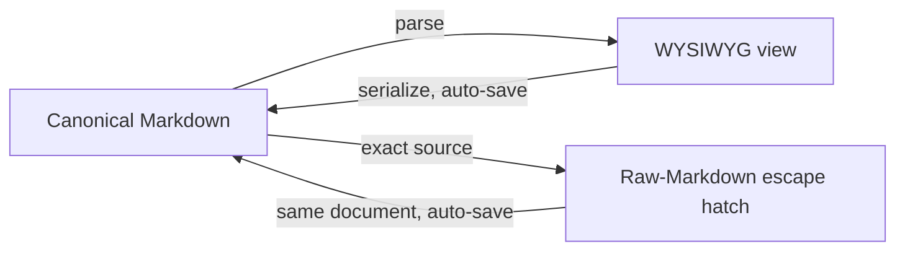

# Content Editing

```meta
related: [".devbook/arc42/02-constraints.md#technical-constraints", ".devbook/design/interaction-guidelines.md#auto-save-no-save-buttons", ".devbook/design/typography-and-layout.md#type-scale", ".devbook/design/accessibility.md"]
```



> Rules for the product's core editing surface: **direct Markdown editing through
> a rich text (WYSIWYG-style) editor**. Markdown is a task's canonical content,
> stored as text in SQLite
> (`.devbook/arc42/adr/0003-sqlite-is-the-canonical-local-task-store.md`). The
> editor is a view over that Markdown and MUST never corrupt it.
> Rendering uses the tokens in `typography-and-layout.md`; editor persistence
> follows `interaction-guidelines.md#auto-save-no-save-buttons`.

## Editing Model

```meta
related: [".devbook/arc42/02-constraints.md#technical-constraints"]
```

| Rule | Requirement |
|---|---|
| Markdown is canonical | The stored artifact is Markdown; the editor is a WYSIWYG **view** over it. |
| Edit in place | Users edit formatted content directly and see the result inline, as the primary mode. |
| No lossy intermediate format | The editor MUST NOT store a proprietary format as canonical. |
| Auto-save | Editor changes persist per `interaction-guidelines.md#auto-save-no-save-buttons`; there is no save button. |
| Content vs chrome | Editor content uses `color-text-primary`; editor chrome/placeholder uses `color-text-secondary` (see `design-principles.md#low-chrome-content-first`). |

Any internal document model exists only to render and serialize Markdown. A split
"write raw / preview" is not the primary mode.

## Round-Trip Fidelity

```meta
```

Round-trip fidelity is the single most important correctness rule for the editor.

| Rule | Requirement |
|---|---|
| Lossless round-trip | `parse(serialize(doc)) === doc` for all supported constructs; saving MUST NOT rewrite or reorder untouched content. |
| Stable serialization | Serialization MUST be deterministic and stable, so diffs stay minimal and Git-friendly. |
| Preserve unknown/unsupported | Constructs the WYSIWYG layer does not render richly (see `#unsupported-syntax-preservation`) MUST be preserved verbatim, never dropped. |
| Whitespace discipline | The serializer MUST NOT introduce gratuitous whitespace/reflow churn; it SHOULD preserve the author's existing formatting where reasonable. |
| No silent normalization | Any unavoidable normalization MUST be documented and predictable; it MUST NOT change document meaning. |

The case to hold is opening a Markdown file, editing an unrelated part, and
saving. Stability covers consistent list markers, heading style, emphasis
characters and fence style.

## Raw-Markdown Escape Hatch

```meta
related: [".devbook/design/typography-and-layout.md#font-families"]
```

Power users and edge cases need direct access to the source.

| Rule | Requirement |
|---|---|
| Always available | A **raw Markdown** view/mode MUST be available for the current document, toggleable via a command and keyboard shortcut. |
| Faithful source | The raw view shows the exact canonical Markdown that will be stored, in `font-family-mono`. |
| Two-way | Edits in raw mode MUST update the same canonical document; switching back to WYSIWYG re-renders from that source. |
| Block-level hatch | For a single tricky block, the editor SHOULD allow inline editing of that block's raw Markdown. |
| Same auto-save | Raw-mode edits auto-save under the same rules; there is no separate save step. |

## Supported Constructs

```meta
```

The editor MUST render and edit these as first-class WYSIWYG constructs, and MUST
serialize them to canonical Markdown.

### Block Constructs

```meta
```

| Construct | Notes |
|---|---|
| Headings `#`–`######` | Rendered per `typography-and-layout.md` heading defaults; heading level drives chapter reorder/nesting (`interaction-guidelines.md#nesting--indent-rules-chapters`). |
| Paragraphs | Default body text. |
| Unordered / ordered lists | Including nested lists; stable marker style on serialize. |
| Task lists `- [ ] / - [x]` | Interactive checkboxes; a toggle auto-saves. |
| Blockquotes `>` | Including nested. |
| Code blocks (fenced) | `font-family-mono`, language hint preserved; not spell-checked; content never "smart-formatted". |
| Tables (GFM) | Editable grid; serialize to pipe tables. |
| Horizontal rules `---` | |
| Images / embeds | Rendered for dark surfaces (see `design-principles.md#dark-mode-only`); alt text required (see `accessibility.md`). |
| Front-matter / metadata block | Preserved verbatim; not silently reformatted. |

A task-list line is distinct from a `##` sub-item heading; see `#task-structure`.

### Inline Constructs

```meta
related: [".devbook/design/content-editing.md#paste-behavior", ".devbook/design/interaction-guidelines.md#task-rows"]
```

| Construct | Notes |
|---|---|
| Bold, italic, strikethrough | `**`, `*`/`_`, `~~`. |
| Inline code | Backticks; `font-family-mono`. |
| Links | Editable target + text; keyboard-accessible link editing. Only some schemes render as a link. |
| Bare web addresses | A bare `http://` or `https://` address in prose renders as a link. |
| Addresses among other inlines | A code span, written link or image, autolink, or backed footnote mark binds before an address. |
| `#tags` | Recognized inline per `.devbook/arc42/08-crosscutting-concepts.md#tagging-and-organization`; rendered as a subtle chip but stored as literal `#tag` text. |
| Mentions / references | If supported, stored as their canonical Markdown/text form. |

- **Links:** a link renders only for `http`, `https`, `mailto` or a relative
  path. Anything else (`javascript:`, `data:`) MUST render as the literal text
  the author typed, readable but inert. The read view is a webview, and an `href`
  is the one place typed text could otherwise become behaviour.
- **Bare web addresses:**
  - The link is the same anchor a written `[url](url)` draws. A `<…>` autolink
    with one of those two schemes also renders as a link, its brackets dropped.
  - Every other address stays the literal text typed, bare or bracketed: `www.`
    without a scheme, `mailto:`, `ftp:` and the rest.
  - An address runs to whitespace, `<` or `>`, then sheds trailing `.,:;!?*_~'"`
    and an unbalanced `)`, as GFM's extended autolinks do. A scheme glued to the
    word before it starts no link.
  - A task title finds and ends its addresses the same way, per
    `interaction-guidelines.md#task-rows`.
- **Addresses among other inlines:**
  - The footnote mark counts only with a note behind it; one that opens inside an
    address ends the address there.
  - Emphasis, strikethrough and a tag do not bind first, so the `*`, `_`, `~` and
    `#` inside an address stay in it. An address inside code or emphasis is not
    linked.
  - Linking is display only: the source keeps the text as typed, and
    `#paste-behavior` still governs what the editor inserts.

Anything not in these tables falls under `#unsupported-syntax-preservation`.

## Task Structure

```meta
related: [".devbook/domain/tasks/domain.md#task", ".devbook/domain/tasks/domain.md#sub-item", ".devbook/design/interaction-guidelines.md#nesting--indent-rules-chapters"]
```

> A Task is edited as one Markdown document, with headings carrying
> entry-specific meaning beyond the generic chapter nesting in
> `interaction-guidelines.md#nesting--indent-rules-chapters`.

| Construct | Renders as |
|---|---|
| First line | The entry title; whatever is typed on the first line becomes the `#` title on save. |
| `##` heading | A **Sub-Item**: a distinct unit indented one level below the entry title; a heading, not a checkbox. |
| `- [ ]` / `- [x]` | A checklist step, rendered as a real checkbox affordance (`#supported-constructs`). Checkbox syntax is reserved exclusively for task-list lines. |
| Metadata line | Backtick-quoted tokens for type, priority, status, area and tags. |

- **First line:** the text may have a leading `#` or not. An entry is never left
  without a title.
- **Metadata line:** the source line, see `#structured-metadata-sigils`.
  `typography-and-layout.md#metadata-lines` says how its facts are drawn.

| Rule | Requirement |
|---|---|
| Title normalization on flush | The first-line-becomes-title rule applies on blur or auto-save flush, not per keystroke, so the caret never jumps mid-word. |
| Sub-item ≠ checkbox | A `##` sub-item and a `- [ ]` checklist item MUST remain visually and semantically distinct. |
| Sub-item done-state | A sub-item's own completion (if used) renders as strikethrough plus a `color-primary` accent rule, never a checkbox glyph. |

Neither rendering may substitute for the other: the accent rule sits on the
sub-item itself, and the checkbox glyph is reserved for literal task-list syntax.

## Structured Metadata Sigils

```meta
related: [".devbook/domain/tasks/domain.md#task-status", ".devbook/domain/tasks/domain.md#area", ".devbook/domain/tasks/domain.md#roadmap-tag", ".devbook/design/typography-and-layout.md#font-families", ".devbook/design/content-editing.md#scheduling-and-dependency-tokens", ".devbook/arc42/adr/0013-imported-plan-is-a-roadmap-item-laid-out-by-import.md"]
```

> Tasks carry structured metadata (type, priority, status, area,
> tags) inline as backtick-quoted tokens. Each kind but one is disambiguated by
> a one-character sigil, so neither a human reader nor the parser has to guess
> which bare word means what.

| Sigil | Kind | Example |
|---|---|---|
| *(none)* | type | `` `prompt` ``, `` `task` ``, `` `idea` ``, `` `test` ``; `` `plan` `` (Import only) |
| `!` | status | `` `!draft` ``, `` `!ready` ``, `` `!in-progress` `` |
| `*` | priority | `` `*high` `` |
| `@` | area | `` `@repos` `` |
| `#` | tag | written in the body, e.g. `#sync` |
| `+` | plan tag | `` `+release-q4` `` |

The plan tag files the entry under a roadmap item and is stored with its sigil (`.devbook/domain/tasks/domain.md#roadmap-tag`).

| Rule | Requirement |
|---|---|
| Type is the one bare word | The entry already is its type, so the type token needs no sigil. |
| Backward compatible | Bare, un-sigilled metadata written before this convention MUST continue to parse; saving rewrites it canonically. |
| Sigil wins over guessing | A sigilled token matching no known value for its kind MUST NOT be reinterpreted as another kind. |
| Monospace | Metadata tokens render in `font-family-mono`, matching inline code, so the syntax reads as structured rather than prose. |
| The namespace is closed to new kinds | These kinds are the whole sigil vocabulary; a new **kind** takes a named `name:value` token instead. |
| `+` keeps its sigil in the stored value | A `#deploy` token becomes the bare tag `deploy`; a `+release-q4` token is stored as `+release-q4`. |
| `plan` is a type word Import alone accepts | Import alone accepts a `plan` entry; every other path MUST refuse it with an error naming Import. |

- **Type is the one bare word:** every other kind gets a sigil, because none of
  them is "the" word an entry is.
- **Backward compatible:** the rewrite puts the metadata line into canonical
  sigil form, so entries self-heal.
- **Sigil wins over guessing:** an example is a priority sigil on a status word.
  The sigil already declared intent, so the token is unrecognized rather than
  misread.
- **The namespace is closed to new kinds:**
  - See [Scheduling and Dependency Tokens](#scheduling-and-dependency-tokens). A
    new sigil would trade a readable name for a character nobody remembers.
  - `+` is the one admission since the rule was written, and it is not a new
    kind. A plan tag is a tag. `#`/`+` tell two sub-kinds of the same kind apart
    on a line a person reads, as `@` tells a person from a general tag in the body.
  - That is the test for admitting a sigil: the kind already has one and only the
    sub-kind is new. It is why `+` is a row here and a `plan:` token is not
    (`.devbook/arc42/adr/0013-imported-plan-is-a-roadmap-item-laid-out-by-import.md`).
- **`+` keeps its sigil in the stored value:** the two kinds stay
  distinguishable after parsing, and the canonical rewrite can put each back the
  way it came. The roadmap holds the bare slug and lifts the `+` at its own
  boundary; nothing in the entry grammar strips it.
- **`plan` is a type word Import alone accepts:**
  - A `plan` entry describes a roadmap item, not a task, and is parsed as that
    kind rather than as a fourth task type.
  - Import hands it to the roadmap. Paste, quick-add and a sub-item MUST never
    create a task from it: the task model cannot hold the type word, and the
    canonical rewrite would drop it.

## Scheduling and Dependency Tokens

```meta
related: [".devbook/design/content-editing.md#structured-metadata-sigils", ".devbook/domain/tasks/domain.md#due-date", ".devbook/domain/tasks/domain.md#reminder", ".devbook/domain/tasks/domain.md#recurrence", ".devbook/domain/tasks/domain.md#my-day", ".devbook/domain/tasks/context.md#clear-my-day-overnight", ".devbook/arc42/adr/0032-my-day-preferences-ride-the-task-feed.md", ".devbook/domain/tasks/domain.md#agenda-time", ".devbook/domain/tasks/domain.md#dependency", ".devbook/domain/tasks/features.md#import", ".devbook/domain/tasks/features.md#effort-registration", ".devbook/domain/repository-management/domain.md#repository-registry", ".devbook/arc42/adr/0013-imported-plan-is-a-roadmap-item-laid-out-by-import.md"]
```

> When an entry is scheduled or waits on other entries, those facts ride on the
> same backtick-quoted metadata line, as `name:value` tokens rather than
> one-character sigils. Five date-shaped facts cannot be told apart by
> punctuation a reader will remember, and this line is hand-edited.

| Token | Kind | Example |
|---|---|---|
| `due:` | due date | `` `due:2026-08-21` `` |
| `remind:` | reminder | `` `remind:2026-08-21T09:00` `` |
| `repeat:` | recurrence | `` `repeat:weekly` ``, `` `repeat:weekdays` ``, `` `repeat:2w` `` |
| `myday:` | My Day | `` `myday:2026-08-19` `` |
| `at:` | agenda start, local 24-hour time | `` `at:10:45` `` — only beside `myday:` |
| `for:` | agenda duration in minutes | `` `for:45m` `` — only beside `at:` |
| `completed:` | ticked off — the checkbox, not the status | `` `completed:2026-09-22` `` |
| `id:` | local id | `` `id:add-command` `` |
| `after:` | dependency | `` `after:a1b2c3` `` — may repeat |
| `repo:` | target repository | `` `repo:backlog-desktop` `` — may repeat |
| `effort:` | size in story points | `` `effort:5` `` |
| `files:` | attached folder or archive | `` `files:D:/reviews/panel-review` ``, `` `files:D:/reviews/panel.zip` `` |
| `view:` | a retired body-view preference, kept as written | `` `view:steps` ``, `` `view:notes` `` |

The `effort:` value is a non-negative whole number and is not honoured on a `plan` entry.

A full metadata line mixes both forms, sigils first:

```markdown
# Deploy SpecManager

`task` `*high` `!ready` `@repos` `#deploy` `due:2026-08-21` `remind:2026-08-21T09:00` `after:a1b2c3` `repo:specmanager`
```

Two entries pasted together still order themselves with `id:` and `after:`,
although neither is saved yet and so neither has a real `task_id`:

```markdown
# Add the export command

`task` `@repos` `id:add-command` `repo:specmanager`

# Wire the export command into the toolbar

`task` `@repos` `after:add-command` `repo:specmanager`
```

| Rule | Requirement |
|---|---|
| Named, not sigilled | A named token says which fact it carries without the reader holding a legend. |
| A due date is a date | `due:` and `myday:` take a calendar date (`YYYY-MM-DD`) with no time and no timezone. |
| A reminder is wall-clock | `remind:` takes a local date and time (`YYYY-MM-DDTHH:mm`) and deliberately carries no zone or offset. |
| My Day expires by arithmetic | `myday:` holds the date the entry was picked for, and expires when that date passes. |
| An agenda time is a time of day | `at:` takes a local 24-hour time, and `for:` a positive whole number of minutes followed by `m`. |
| An agenda time needs a start and a day | `for:` without `at:` is invalid; `at:` without `for:` means 30 minutes; both need a `myday:` date. |
| An agenda time is written beside its day | The canonical line writes `at:` and `for:` straight after `myday:` and nowhere else. |
| An agenda time is set on the desktop | The desktop editor writes and clears `at:` and `for:`; the phone only reads them. |
| A path is taken as written | `files:` takes a path, and the parser has no opinion about it. |
| One attached place, and never a list | `files:` appears at most once; the last one on the line wins. |
| A local id bridges an unsaved batch | `id:` names an entry before it has a real `task_id`, so a sibling's `after:` can resolve. |
| Dependencies repeat | `after:` may appear more than once, and the order carries no meaning. |
| A repo name repeats, like a dependency | `repo:` may appear more than once, like `after:`, and order carries no meaning. |
| A repo name is resolved, never invented | `repo:` names a repository by name, resolved against the Repository Registry to the stored `repo_id`. |
| An effort is a count of points | `effort:` takes a non-negative whole number of story points; `0` is a real estimate. |
| A `plan` entry reads a narrower line | On an entry whose type word is `plan`, only six tokens mean anything. |
| Unknown tokens survive an edit | A `name:value` token the parser does not recognize MUST survive a change to an unrelated field. |
| Absent means absent | An unset field carries no token rather than an empty one. |
| Canonical rewrite is destructive by design | Saving rewrites the metadata line from the entry model; a token it cannot represent does not survive. |
| `view:` is kept, not read | The parser still reads `view:` and carries it through every save as written; nothing else reads it. |
| A view is never derived onto the line | An entry that carries no `view:` token MUST NOT acquire one by being saved. |
| No surface may hide body text without saying so | A surface showing less of the body than the entry holds MUST say so and offer the whole. |

- **Named, not sigilled:** the sigil namespace is also nearly exhausted, so five
  more marks would leave nothing for a sixth kind.
- **A due date is a date:** a due date is a commitment to a day, and an instant
  would move the deadline whenever the device changed zone.
- **A reminder is wall-clock:** `09:00` means 09:00 wherever the reader is when
  it arrives.
- **My Day expires by arithmetic:**
  - `myday:` is not a flag. The entry is in My Day exactly while that date is the
    reader's current local date, so yesterday's list clears itself with no timer
    and no overnight sweep.
  - With [Clear My Day
    overnight](../domain/tasks/context.md#clear-my-day-overnight) off, an
    unfinished entry with an earlier date stays in My Day until it is finished or
    taken out. It shows no agenda time.
  - A later date is never today's. The switch never rewrites a `myday:` date.
- **An agenda time is a time of day:** `at:` runs `HH:MM`, `00:00` to `23:59`.
  Together they are the entry's [Agenda
  Time](../domain/tasks/domain.md#agenda-time), such as `` `at:10:45` `for:45m`
  ``. Neither carries a date or a zone: the date is the `myday:` date beside
  them, and the time is read on the reader's clock, like `remind:`.
- **An agenda time needs a start and a day:** a lone `for:` reads as malformed,
  like `` `due:` `` with nothing after it. The canonical rewrite writes no `for:`
  for a lone `at:`, because absent means absent. When `myday:` changes or is
  removed, the save drops `at:` and `for:` with it.
- **An agenda time is written beside its day:**
  - A line with no `myday:` gets neither back.
  - A malformed value reads as refused under the name it was typed with, as ``
    `due:friday` `` does. A refused `for:` beside a good `at:` leaves the start
    at 30 minutes.
  - Writing `myday:` with the same date keeps the pair; any other date, or none,
    removes it.
- **An agenda time is set on the desktop:** the phone never sets them. Moving a
  task to tomorrow on the phone drops them, as any change to `myday:` does.
- **A path is taken as written:** separators, drive letters and spaces all
  survive. Nothing is checked against the disk. A path is meaningful on the
  machine that wrote it. An entry read elsewhere may name a place that is not
  there and is no less valid for it.
- **One attached place, and never a list:** a second `files:` replaces the first,
  the opposite of `after:`. A task waiting on two things is ordinary, but an
  entry pointing at two folders has a presentation that grows with every place
  named.
- **A local id bridges an unsaved batch:** every entry in a fresh paste lacks a
  `task_id`. An entry with no `id:` is addressable as today, once saved. A
  sibling's `after:` resolves in this order, so one new entry can depend on
  another before either exists, and a plan brought in over two sittings still
  chains:
  1. a same-document `id:`;
  2. the `id:` a stored entry was imported under, looked up in this order:
     - the same plan's entries;
     - a plan the entry is tagged with;
     - any entry, when only one carries the id;
  3. a real id, as `after:` always did.
- **Dependencies repeat:** an entry waiting on two things names both, and asking
  which is the real predecessor has no answer. An id naming nothing visible still
  counts, and still blocks.
- **A repo name repeats, like a dependency:** an entry can target several
  repositories at once, matching the aggregate's own `repo_ids[]`
  (`.devbook/domain/tasks/features.md#multi-repo-targeting`).
- **A repo name is resolved, never invented:**
  - The registry is
    `.devbook/domain/repository-management/domain.md#repository-registry`, and
    nothing hand-typed can know the `repo_id`.
  - A name the registry does not recognize is unresolved, as with an
    unrecognized sigil value. This token never registers a repository on its own.
  - Only the narrower import policy
    (`.devbook/domain/tasks/features.md#repository-resolution-on-import`)
    auto-registers an unknown name, and only for that feature.
- **An effort is a count of points:** `0` contributes nothing. A negative or
  fractional value is not an estimate and is not read
  (`.devbook/domain/tasks/domain.md#task`). Absent means unestimated, a normal
  state never rewritten as `0`.
- **A `plan` entry reads a narrower line:** the type word is defined in
  `#structured-metadata-sigils`, and the mapping is
  `.devbook/arc42/adr/0013-imported-plan-is-a-roadmap-item-laid-out-by-import.md`.
  - The six tokens all speak about a roadmap item:
    - `+tag`: the tag becomes the item's;
    - `id:`;
    - `after:`: a roadmap dependency;
    - `repo:`;
    - `*priority`;
    - `due:`: a `plan` entry's `due:` is the window's end.
  - **`effort:` is not honoured on a `plan` entry.** A plan owns no estimate,
    because its size is the effort the tasks under it registered. Import says so
    once when it meets one.
  - There is no start-date token: the importer places the item.
  - Every other token on the line describes a task and is ignored.
- **Unknown tokens survive an edit:** the token is unrecognized, not invalid, as
  with the backward-compatibility rule for sigils.
- **Absent means absent:** `` `due:` `` with nothing after it is malformed, not
  "no due date".
- **Canonical rewrite is destructive by design:** a new token MUST be added to
  the domain model, the entry DTO, and the canonical rewrite in the same change.
  Adding it to the parser alone loses data silently.
- **`view:` is kept, not read:**
  - `view:` once recorded which of two readings of the body an entry opened in:
    the steps list or the Markdown block. The desktop now shows one Markdown
    editor, so nothing reads or writes the token.
  - The parser refuses a value it does not know. The token is persisted, synced
    text somebody may have typed, and dropping it would be the silent loss
    `#round-trip-fidelity` forbids.
- **No surface may hide body text without saying so:** silently showing less
  reads as text the app has lost. That is the failure `#round-trip-fidelity` exists to
  prevent, on screen rather than on disk. The desktop detail shows the body
  whole, in one editor.

## Live Parse Confirmation

```meta
related: [".devbook/design/content-editing.md#editing-feedback-and-state"]
```

> While an entry is focused, the editor shows a single-line "reads as" hint
> beneath the raw Markdown. The hint restates exactly what the current text will
> be saved as.

| Rule | Requirement |
|---|---|
| Same-parse guarantee | The hint MUST come from the identical parse that persistence uses and never diverge from it. |
| Explicit vs. default | A typed value renders at full emphasis; a current default (nothing typed yet) renders at reduced emphasis. |
| Refused status is explained | For an illegal typed status, the hint MUST show the status kept and the legal next steps. |
| Not an error state | A refused status is informational (`color-primary` accent), not an error toast or blocking validation. |

The lifecycle is `.devbook/domain/tasks/domain.md#task`. The typed word is never
silently dropped, and the entry still saves without the refused change.

## Paste Behavior

```meta
```

| Source | Behavior |
|---|---|
| Rich text (HTML) from browser/office | Convert to clean Markdown-equivalent constructs; strip styles, colors and fonts; keep structure. |
| Plain text | Insert as-is; MUST NOT auto-linkify or transform beyond standard Markdown autoformat. |
| Markdown text | Insert and parse as Markdown so it renders in WYSIWYG. |
| Code | Paste into a code block MUST preserve exact characters and whitespace; no smart quotes, no reflow. |
| Images | Handle per product image-storage policy `[TODO: clarify]` (embed vs. reference); alt text prompt SHOULD follow. |

Styles go because the product is dark-mode-only. Structure means headings,
lists, links, bold/italic, tables and code. **Paste and match** (paste as plain
text) MUST be available via the standard shortcut. Paste MUST NOT inject
disallowed inline color/font styling, and pasted content MUST round-trip
losslessly once inserted.

## Slash and Inline Commands

```meta
related: [".devbook/design/interaction-guidelines.md#feedback-and-toasts", ".devbook/design/design-principles.md#keyboard-first"]
```

| Rule | Requirement |
|---|---|
| Slash menu | Typing `/` at the start of an empty block MUST open a command menu. |
| Keyboard-driven | The slash menu MUST be fully keyboard-operable and rendered on `z-index-dropdown`. |
| Inline autoformat | Standard Markdown autoformat MUST work. |
| Escape autoformat | Undo (Ctrl/Cmd+Z) immediately after an autoformat MUST revert to the literal typed characters. |
| Consistent command surface | Slash commands and the command palette SHOULD share one command registry (see `design-principles.md#ai-first-surfaces`). |
| Accessible | Command menus follow menu ARIA and announcement rules in `accessibility.md`. |

- **Slash menu:** the menu inserts blocks (heading, list, task, code, table,
  quote, divider, image) and invokes AI actions.
- **Keyboard-driven:** type to filter, arrows to move, Enter to select, Escape
  to dismiss.
- **Inline autoformat:** `# ` → heading, `- `/`* ` → list, `1. ` → ordered list,
  `> ` → quote, ``` ``` ``` → code block, `[ ] ` → task, `**x**` → bold, etc.

## Unsupported Syntax Preservation

```meta
related: [".devbook/design/interaction-guidelines.md#reorder--auto-save"]
```

The editor MUST **preserve, never destroy**, Markdown it cannot render richly.

| Rule | Requirement |
|---|---|
| Preserve verbatim | Unknown/unsupported syntax (custom directives, uncommon HTML, extension syntax, raw HTML blocks) MUST be preserved byte-for-byte on save. |
| Visible, editable | Such content SHOULD render as a raw/mono passthrough block, editable as source and clearly marked raw. |
| No silent deletion | The editor MUST NOT drop, "clean up", or rewrite unsupported syntax as a side effect of editing elsewhere. |
| Round-trip guarantee | Documents containing unsupported syntax MUST still satisfy the lossless round-trip rule (`#round-trip-fidelity`). |
| Fail safe | A document the editor cannot confidently parse MUST open in the raw-Markdown escape hatch, which cannot corrupt content. |

## Editing Feedback and State

```meta
related: [".devbook/design/interaction-guidelines.md#save-state-indicator-vocabulary", ".devbook/design/content-editing.md#live-parse-confirmation"]
```

| Rule | Requirement |
|---|---|
| Save state | The editor surfaces the shared save-state indicator (`Saved` / `Saving…` / `Offline` / `Conflict` / error), never a save button. |
| Undo/redo | Standard undo/redo applies to all editor changes and coalesces rapid keystrokes (see `interaction-guidelines.md#undo-and-history`). |
| Conflicts | Concurrent edits resolve last-write-wins with passive `Conflict` surfacing (see `interaction-guidelines.md#conflict-handling`). |
| Spellcheck scope | Spellcheck applies to prose, not to code blocks, inline code, or raw passthrough blocks. |
| Domain-rule refusal | A parsed value the domain model refuses is surfaced inline, next to the text that produced it. |

**Domain-rule refusal:** an example is an illegal status transition (see
`#live-parse-confirmation`). The save-state indicator does not carry it, because
the save still succeeds and only that one value is refused.

## AI Proposals in a Document

```meta
related: [".devbook/design/design-principles.md#ai-first-surfaces", ".devbook/design/content-editing.md#editing-model", ".devbook/design/accessibility.md#screen-reader--announcements"]
```

The product may offer to rewrite a passage or to answer a remark. What it may
**not** do is change the document on its own.

| Rule | Requirement |
|---|---|
| Anchoring | A proposal is anchored to a block, the same way a remark is, never to a character range. |
| Never in place | The change waits for a person; original and suggested text are shown together. |
| Applied upstream | Accepting raises a callback; the host re-parses and hands the document back. |
| Attribution survives | An accepted proposal keeps who wrote it, when, and where it came from. |
| One act, one answer | Accepting the text and resolving the remark are two acts with two callbacks. |
| Two carriers | AI-authored content MUST be distinguishable visually **and** named for assistive technology. |
| The tint | The tint is a mix of the one brand hue against the card surface. |
| The product's own AI | An AI act inside the product carries **no vendor mark**; it is attributed to AI alone. |
| Offline | An AI act offline is unavailable like any other: present, disabled, with a calm sentence. |
| Lost anchors | A proposal whose block has gone joins the same orphan region a remark does, rather than being dropped. |

- **Anchoring:** no edit survives a character range, so "Rewrite part" means
  rewrite this paragraph, and the product MUST NOT offer a finer grain than its
  anchors can carry.
- **Never in place:** rejecting leaves the document byte-identical rather than
  restored.
- **Applied upstream:** the view MUST NOT write into the document itself.
- **Attribution survives:** the proposal moves to an accepted state rather than
  disappearing, because "did a person write this paragraph" must stay answerable.
- **One act, one answer:** this applies where a proposal answers a remark. One
  button doing both denies a reader who wanted the wording but not the
  resolution.
- **Two carriers:** a tint serves the eye, and an accessible name serves
  everything else.
- **The tint:** a second semantic hue is not available
  (`color-scheme.md#role-tokens`).
- **The product's own AI:** a vendor logo claims where a reader's content
  travelled, and only an act that leaves the application may make that claim.
- **Offline:** the sentence offers no remedy. Editing, commenting and reading
  MUST remain untouched, and nothing may suggest the document depends on it.

Review surface: storybook → *Integrations* → **AI in the document**.

## Knowledge Metadata Blocks

```meta
related: [".devbook/design/README.md#status-vocabulary", ".devbook/design/typography-and-layout.md#metadata-lines", ".devbook/design/design-principles.md#low-chrome-content-first", ".devbook/design/content-editing.md#materialization", ".devbook/domain/devbook/context.md#devbook-status"]
```

> The repository's own documentation (`.devbook/arc42`, `.devbook/domain`, `.devbook/tech`,
> `.devbook/design`) writes a fenced `meta` block under every addressable heading. Two
> levels carry one, and they are not the same fact. The block under a file's `#`
> title describes **the file**, and the block under a `##` heading describes **that
> chapter**.

| Rule | Requirement |
|---|---|
| Drawn against its subject | A block is drawn against the thing it describes, not as the fence it was written in. |
| Chapter level | A chapter's block MUST be folded into that chapter's heading, status at the line's right edge. |
| File level | A file's block MUST be drawn in the **header** of the surface reading the file. |
| Once, never twice | A block drawn in the header MUST NOT also be drawn in the body. |
| Status first, fields under | The status shares the line with what it qualifies; everything else sits underneath, quieter and tighter. |
| Status switched off | The status display is a Devbook switch, off by default. |
| Never invented | A status is never invented, and no empty row stands where a record would have been. |
| Opt-in | Reading a `meta` fence as a record is something a surface asks for. |
| Bounded chrome | A header identifies; `design-principles.md#low-chrome-content-first` bounds what the file-level record may add. |

- **Drawn against its subject:** the subject decides the place, so the two levels
  land in two different ones.
- **Chapter level:** the block sits in the body. While status is on, every
  chapter that carries one shows one, so a reader scrolling a long file meets
  each chapter's currency where it starts.
- **File level:** the block sits beside the name. The header stays on screen
  while the body scrolls, and whether *the file* is current is not a question
  about the part in view.
- **Once, never twice:** the body shows neither a second record nor the raw
  fence. Two answers to one question read as two facts.
- **Status first, fields under:** a surface reading rather than working on a file
  MAY show the status alone. While status is on, a surface MUST NOT show the
  fields without it.
- **Status switched off:** the switch is
  `.devbook/domain/devbook/context.md#devbook-status`.
  - With it off, neither level draws a status, a decision state or a finding
    about either. The other fields stay drawn under the name or heading.
  - A heading over an empty block still renders.
  - Brain notes follow the same switch. Whether a chapter offers Edit is a
    separate one, and a Brain note keeps Edit under both.
- **Never invented:** no status is defaulted to the first word the folder
  allows. Absent means absent (`README.md#status-vocabulary`). What that looks
  like depends on whether the folder lets a chapter state none:
  - Where a status is required, a block stating nothing MUST draw nothing at
    either level.
  - Where stating none is itself an answer, the record MUST stay and report it as
    such. An explicitly selected "No status" invents nothing and keeps clearing a
    status reversible. Judged on the folder's word list alone, the control would
    disappear the moment a reader used it.
- **Opt-in:** everywhere else, such as an entry body somebody typed or a snippet
  quoted in a chat, a fence that says `meta` stays the fenced block it has
  always been.
- **Bounded chrome:** a header is not a second document. Where the fields would
  crowd the name, a surface shows the status and leaves the rest to the body.

Review surface: storybook → *File view* → **The file's own block goes to the header**,
and *Metadata* → **A chapter is a heading, a record, and prose**.

## Materialization

```meta
related: [".devbook/design/README.md#living-reference-the-ui-storybook", ".devbook/design/typography-and-layout.md#heading-defaults", ".devbook/design/content-editing.md#scheduling-and-dependency-tokens", ".devbook/design/interaction-guidelines.md#undo-and-history"]
```

| Piece | Where | Review surface |
|---|---|---|
| Parser | `MarkdownPreview` (`src/Core/Backlog.SharedKernel/Markdown/MarkdownPreview.cs`) | Storybook → *Markdown* → **Blocks the parser produces**, which lists what the source in the first story parsed to |
| Read view | `MarkdownView` | Storybook → *Markdown*; *Markdown document* |
| Live block editing | `MarkdownLiveEditor` over `MarkdownSourceBlocks` and `MarkdownLiveState`; no product screen adopts it | Storybook → *Markdown* → *Live editing* |
| Document surface | `FileView`: a file's header and its body, the body scrolling under a fixed header | Storybook → *File view*; *Markdown document* → **Reading a knowledge chapter** for a chapter's records in the body |
| What a file says it is for | A file opening with YAML frontmatter can state it above the body instead of through it | Storybook → *File content* → **What the file says it is for** |
| Comparison surface | `MarkdownCompare` and `MarkdownCompareView`, aligned by heading and never by line | Storybook → *Section comparison*, and *File view* → **Two versions, aligned by the pane** |
| Chapter remarks | `MarkdownView` comments, anchored to a block index, drawn inline or in a margin column | Storybook → *Markdown document* → **The same comments, in the margin** |
| Code blocks | `CodeView` — line numbers, copy button, per-language highlighting on the tokens in `color-scheme.md#syntax-highlighting-tokens` | Storybook → *Code* |
| Metadata sigils | `MetadataBadge`, `StatusBadge`, `PriorityBadge`, `TagChip` | Storybook → *Badges* |
| Task lists | `MarkdownView` checkbox, toggling straight back into the source | Storybook → *Entry edit* → **A checkbox writes back to the source** |
| Scheduling and dependency tokens | Read and written by `EntryTextParser`; `TaskAction` is the shape a control over one takes | Storybook → *Inputs* → **A date, a time and a repeat**, **TaskAction — set it, see it, clear it** |
| Entry list and detail pane | `SplitPane` over a `TaskListView` of entries and one open entry | Storybook → *Task list*; *Layout* → **SplitPane**, **SplitPane, anchored to the end** |
| The body | One `MarkdownEditor` over the prose and the `##` chapters together | Backlog pane → the open entry's body |
| Raw-Markdown escape hatch | The whole entry's canonical text in a mono `TextArea`, with the live "reads as" hint under it | Backlog pane → Ctrl+Shift+M |

- **Read view:** *Markdown* covers every block and inline. *Markdown document*
  covers a section with copy, remarks and a way into the editor.
- **Live block editing:** `MarkdownSourceBlocks` cuts the body into verbatim
  segments along `MdBlock.Source` and splices an edited one back with `Replace`.
  Every block is rendered except the one holding the caret, which opens as its
  own source; lines no block claims show as a labelled raw passthrough. Undo and
  redo (Ctrl/Cmd+Z, Ctrl/Cmd+Shift+Z, Ctrl+Y and the Edit menu) cover the whole
  document, not the open block. Typing is grouped per word, ticks and joins are
  steps of their own, and the newest 500 steps are kept until the host sets a
  new document.
- **Document surface:** the header also carries what a reader does to the file
  (copy, edit, compare). It carries the file's own `meta` record too, with the
  status beside the name, where it stays while the body moves
  (`#knowledge-metadata-blocks`). A Markdown body is read whole: each chapter's
  `meta` status beside its heading, each diagram where its fence is, a copy
  button per chapter, and remarks in the margin.
- **What a file says it is for:** the block shows the description as prose,
  `applyTo` and `tools` as badges, and every other key as a label and a value.
  A view must not hide what it does not show. It is asked for, never
  assumed, and leaves the read view when shown. `---` parses as a divider, so
  frontmatter otherwise reads as two rules around a run-together paragraph. A
  buffer being edited keeps the block verbatim, since a save without those lines
  would drop them.
- **Comparison surface:** `MarkdownCompare` is a pure function over two texts.
  `Bare` gives up its frame so `FileView` can show it without a second header or
  scroll region.
- **Entry list and detail pane:** the `SplitPane` is anchored to the end, so the
  open entry is the fixed half and the list flexes. The open entry holds:
  - its own row (the title as a field);
  - its body (one `MarkdownEditor` over the whole text with no label above it);
  - the `TaskAction` rows;
  - the selectors;
  - the raw hatch.
- **The body:** a step is a `##` chapter written in the body as text. A person edits it there as text;
  `[x]` in its heading or `!done` on its line ticks it. There is no step list and no Steps / Markdown switch. A
  `view:` token is kept and not read (`#scheduling-and-dependency-tokens`).

What is true today, and where it differs from the model above:

- **The editing model edits fields, and is not yet WYSIWYG.** The backlog's
  detail pane edits an entry a field at a time: a title, the body, a date, a
  dependency. The canonical Markdown is a keyboard shortcut away: the escape
  hatch `#raw-markdown-escape-hatch` asks for, not the primary surface
  `#editing-model` rules out. What `#editing-model` still lacks is the rich-text
  part. The body is a Markdown editor with a formatting toolbar, not a WYSIWYG
  view, and there is no slash menu (`#slash-and-inline-commands`) and no inline
  autoformat.

  Markdown being canonical is therefore trivially satisfied.
  `#round-trip-fidelity` is under pressure only where a field rewrite touches
  text it was not asked about. Each of those rewrites is therefore scoped to one chapter
  and leaves the rest byte-for-byte.

  Steps have no control of their own. A step is a `##` chapter, edited in the
  body as source. The desktop detail therefore does not draw the sub-item
  rendering `#task-structure` describes, indented with a strikethrough
  done-state. A `scenario:` image in the body likewise shows as the text written.
- **The escape hatch has a shortcut but not yet a command.**
  `#raw-markdown-escape-hatch` asks for the raw view "via a command and keyboard
  shortcut". Ctrl+Shift+M opens it and Escape closes it. The pane carries no
  control that reveals it, and there is no command palette to list it in. Only
  a reader who knows the shortcut can find the hatch. The command half stays
  unmet until there is a palette.
- **The shortcut does not reach the pane from one field.** The entry's heading
  rename contains its own keydown (`interaction-guidelines.md#task-rows`,
  "Escape belongs to the innermost draft"). The boundary stops the whole keydown,
  not Escape alone, so Ctrl+Shift+M does not reach the pane from inside the
  heading rename.

  From anywhere else in the pane the shortcut opens and closes the hatch; from
  that field the way to it is to leave it first. Whether that price is
  acceptable, or whether the shortcut should be lifted out of the pane's own
  handler so it is heard everywhere, is undecided.
  [Issue #366](https://github.com/JSdotNet/Backlog/issues/366) decided that the
  task fields contain Escape, and left this one question unsettled.
- **Task toggling is correct.** Ticking a checkbox writes back into the source and
  saves immediately with no debounce. A `- [ ]` inside a code fence is left alone,
  because it is a code sample, not a task.
- **Headings render on the compact ramp**, not the display ramp; see
  `typography-and-layout.md#heading-defaults` for which surface gets which.
- **Body text renders in `color-text-secondary`.** `design-principles.md#low-chrome-content-first`
  reserves `color-text-primary` for content and `color-text-secondary` for
  chrome. The read view has that the other way round for paragraphs, list items
  and code blocks. The live editor's raw passthrough block draws its author
  text the same way. It reads as intended inside a dense card and washed-out in a
  document; a document surface SHOULD move to `color-text-primary`.
  `[TODO: clarify]`
- **The live editor's undo stops at a task checkbox.** Its keys are the editor's
  only from the open block's source or a focused rendered block. A tick leaves
  focus on a task checkbox, where Ctrl/Cmd+Z, Ctrl/Cmd+Shift+Z and Ctrl+Y are
  ignored. The tick just made therefore cannot be undone from the keyboard
  without moving focus first. That falls short of
  `interaction-guidelines.md#undo-and-history`, "Undo always available".
