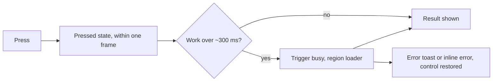

# Interaction Guidelines

```meta
related: [".devbook/design/design-principles.md#no-save-buttons--auto-save-everywhere", ".devbook/design/accessibility.md", ".devbook/arc42/08-crosscutting-concepts.md#storage-and-sync"]
```

> Binding interaction rules for the Backlog product. They cover:
>
> - auto-save, since there are no save buttons;
> - drag-and-drop reordering of items and chapters, with mandatory keyboard
>   equivalents;
> - responsiveness: press feedback, busy actions and scoped loading;
> - feedback and toasts, motion and reduced motion;
> - the empty, loading and error state patterns;
> - the desktop shell's header, panes and group shapes;
> - the combobox, action density and overflow, and timelines.
>
> Motion tokens and interaction patterns were adapted from the JSdotNet design
> style guide (`04-motion-and-interaction`, `09-interaction-patterns`). Conflict
> handling follows the last-write-wins rule in
> `.devbook/arc42/08-crosscutting-concepts.md#storage-and-sync`. Token names are
> declared in `color-scheme.md` and `typography-and-layout.md`.

## Auto-Save (No Save Buttons)

```meta
related: [".devbook/design/design-principles.md#no-save-buttons--auto-save-everywhere", ".devbook/arc42/08-crosscutting-concepts.md#storage-and-sync"]
```

The rule that the product has no save affordance is
`design-principles.md#no-save-buttons--auto-save-everywhere`'s. This section
specifies how auto-save behaves.

### Save Timing and Debounce

```meta
```

| Rule | Requirement |
|---|---|
| Text debounce | Continuous text edits MUST auto-save on a **debounce of 500 ms–1000 ms** after the last keystroke (recommended default 750 ms). |
| Idle/blur flush | A pending save MUST be flushed immediately on field/editor **blur**, on navigation away, and on app background/close. |
| Discrete actions | Discrete changes (reorder, toggle, checkbox, metadata edit, drop) MUST save **immediately** (no debounce). |
| Max in-flight latency | If a save has not been acknowledged within ~5 s, the indicator MUST move from `Saving` toward `Offline`/retry rather than appear stuck. |
| Local-first ordering | Persistence order is: update UI (optimistic) → write local canonical Markdown → background sync. Editing MUST NOT wait on sync. |

### Optimistic UI

```meta
```

| Rule | Requirement |
|---|---|
| Immediate reflection | The UI MUST reflect the change instantly, before persistence completes. |
| Non-blocking | Auto-save MUST NOT block typing, navigation, or further edits. |
| Rollback on failure | If a local write genuinely fails, the change MUST be visibly rolled back or flagged (never silently dropped) and surfaced via an error toast. |

### Save-State Indicator Vocabulary

```meta
```

A single, always-visible save-state indicator communicates persistence. The
vocabulary is **fixed and identical across all channels**.

| State | Label | Icon | Surface / color | Meaning |
|---|---|---|---|---|
| Idle / saved | `Saved` | `check-circle` | `color-text-secondary` on base surface | All changes persisted locally (and synced if online). |
| Saving | `Saving…` | `loader-2` (spin; static under reduced motion) | `color-text-secondary` | A write/sync is in flight. |
| Offline | `Offline — changes saved locally` | `cloud-off` | `color-info` surface | No connectivity; edits are safe locally and will sync on reconnect. |
| Conflict | `Conflict resolved` / `Review conflict` | `alert-triangle` | `color-warning` surface | A concurrent edit was reconciled (see conflict handling). |
| Error | `Couldn't save` + retry | `x-circle` | `color-error` surface | A local write failed; retry offered. |

Rules:

- The indicator MUST be visible without user action and MUST NOT be a button
  that triggers saving.
- `Saved` is the resting state; it MUST NOT nag (no persistent green banner) —
  it settles to a quiet `color-text-secondary` state.
- State transitions use motion per `#motion-and-reduced-motion`.
- Screen-reader announcements for save state are specified in
  `accessibility.md#screen-reader--announcements`.

What the shared `SaveIndicator` builds of this vocabulary is in
[Materialization](#materialization).

### Undo and History

```meta
```

| Rule | Requirement |
|---|---|
| Undo always available | Because there is no save gate, **undo/redo** (Ctrl/Cmd+Z, Ctrl/Cmd+Shift+Z) MUST be available for content edits and for reorder actions. |
| Reorder is undoable | A drag-and-drop or keyboard reorder MUST be a single undoable step that restores the previous order. |
| History granularity | Undo history SHOULD be per-document and coalesce rapid keystrokes into sensible steps. |
| AI edits reversible | AI-applied changes MUST be undoable like any other edit (see `design-principles.md#ai-first-surfaces`). |
| Version history (optional) | Longer-term version/history browsing is a product feature `[TODO: clarify]`; at minimum session-level undo MUST exist. |

### Conflict Handling

```meta
```

Aligns with the architectural rule: **new items always create; edits are
last-write-wins** (`.devbook/arc42/08-crosscutting-concepts.md#storage-and-sync`).

| Rule | Requirement |
|---|---|
| New items | Concurrent creation MUST NOT conflict — both items are created (always-create). |
| Edits | Concurrent edits to the same item resolve by **last-write-wins**; the most recent write is canonical. |
| Non-destructive surfacing | When last-write-wins discards a local change, the UI MUST surface the `Conflict` state rather than silently losing edits, and SHOULD offer access to the superseded version where available. |
| No blocking merge UI | Conflict handling MUST NOT block editing with a mandatory merge dialog; resolution is automatic, notification is passive. |
| Reorder conflicts | Concurrent reorders resolve by last-write-wins on the ordering metadata; the losing client re-renders to the winning order and MAY show the `Conflict` state. |

## Drag-and-Drop Reordering

```meta
related: [".devbook/design/accessibility.md#keyboard-navigation", ".devbook/design/design-principles.md#keyboard-first"]
```

The product supports reordering of **two distinct things**, both with the same
affordance language and both with mandatory keyboard equivalents:

1. **Items:** files or entries in a list, such as tasks, inbox items and
   knowledge notes.
2. **Chapters:** headings and their sections *within a document*. Reordering a
   `##` section moves it with all its nested content.

### Drag Affordances

```meta
```

| Rule | Requirement |
|---|---|
| Visible handle | Each reorderable row/section MUST expose a drag handle using the `grip-vertical` icon at `icon-md`. On dense rows the handle MAY appear on hover/focus but MUST be reachable by keyboard. |
| Cursor | Pointer over a handle uses a grab/grabbing cursor. |
| Lift feedback | On drag start, the dragged item lifts with `shadow-lg` and a subtle `color-background-alt` tint; the rest dims slightly. A board card lifts as a copy of itself that follows the pointer, slightly tilted, while the card stays faded in its column; the slot in the column under the pointer opens to the card's height, and on release the copy settles into the card's new place — or back into its old one — on the *Drop settle* motion. Under reduced motion the copy still follows the pointer, untilted, and nothing unfolds or glides. |
| Handle target | The handle MUST meet the ≥ 44 × 44 px target (see `accessibility.md#target-sizes-and-text`). |

### Drop Indicators

```meta
```

| Rule | Requirement |
|---|---|
| Placeholder | During drag, a placeholder/insertion line MUST show the exact drop position, drawn in `color-primary` at `border-width-2`. |
| Valid vs invalid | Valid drop targets highlight; invalid targets MUST show a not-allowed cursor and MUST NOT show an insertion line. |
| Nesting cue | For chapters, horizontal indentation of the insertion line MUST indicate the resulting heading depth (see nesting rules). |

### Reliable Drop Targets (Items)

```meta
```

> The drag handle and the drop target are not the same hit area. A handle
> sized for a dense row (`#drag-affordances`) is reliably graspable but too
> small to reliably *catch* a drop — the drop target must be sized for
> releasing, not for picking up.

| Rule | Requirement |
|---|---|
| Handle starts the drag only | The visible handle is the pointer-down / `dragstart` origin; it is not required to also be the drop target. |
| Drop target covers the row | While a drag is in progress, each candidate row/card MUST expose a drop target spanning its own full width, split into a "before" and "after" half by height — releasing anywhere over the row commits to the nearer half, not just to the handle's footprint. |
| One scroller per column | A board scrolls sideways only. Given a bounded height it fills it, and each column scrolls its own cards inside itself; a long column MUST show exactly one vertical scrollbar, never one of its own beside the board's or the pane's. |
| Drop target covers the column | Where a whole column is the drop target — a board's status column — it MUST span the full height of the board — the box the board is given when that has a height, else the tallest column — not only the height of its own cards. A card carried sideways from low in a long column arrives beside a short column's foot, and that space MUST still belong to the short column; otherwise the drop silently writes nothing. |
| Cancel both dragenter and dragover | A drop target MUST prevent default on both `dragenter` and `dragover`. A `drop` only fires where the immediately preceding `dragover` was cancelled, and a target that only appears once dragging has started needs its `dragenter` cancelled too, or the first `dragover` over it can be missed. |
| Handle target size still applies | The ≥ 44 × 44 px minimum in `#drag-affordances` (see `accessibility.md#target-sizes-and-text`) governs the handle as an independent pointer/keyboard-focus target, regardless of how large the drop target is. |

### Keyboard-Accessible Reordering

```meta
```

Drag-and-drop alone is **not accessible**. A keyboard path is **mandatory** for
both items and chapters.

| Rule | Requirement |
|---|---|
| Grab/move model | Focus the handle, press **Space/Enter** to "pick up", **Arrow Up/Down** to move, **Space/Enter** to drop, **Escape** to cancel and restore. |
| Explicit move commands | Additionally provide **Move up / Move down** (and **Move to top / bottom**) commands via the item's context menu and the command palette, mapped to keyboard shortcuts. |
| Chapter indent | For chapters, **Arrow Left/Right** (or Tab/Shift+Tab while picked up) MUST change nesting depth within the allowed range. |
| Announcements | Every keyboard move MUST announce the new position via a live region (see `accessibility.md#screen-reader--announcements`), e.g. "Moved to position 3 of 8." |
| Parity | Anything achievable by dragging MUST be achievable by keyboard, including cross-container moves. |

### Autoscroll

```meta
```

| Rule | Requirement |
|---|---|
| Edge autoscroll | Dragging near the top/bottom edge of a scrollable container MUST autoscroll toward that edge at a bounded speed. On a board whose columns scroll their own cards, the container is the column under the pointer, not the one the card came from. |
| Reduced motion | Autoscroll MUST remain functional but MUST NOT add parallax/decorative motion under `prefers-reduced-motion`. |
| Keyboard scroll | Keyboard moves MUST keep the moving item scrolled into view. |

### Cross-Container Moves

```meta
```

| Rule | Requirement |
|---|---|
| Item cross-move | Where the domain allows it, items MAY be dragged between containers (e.g. inbox → backlog list). Invalid cross-moves MUST be rejected with a not-allowed cue, not a silent no-op. |
| Chapter scope | Chapter reordering is scoped to **within a single document** by default; moving a section to another document is a distinct action and MUST be explicit (command), not an accidental drag. |
| Keyboard cross-move | Cross-container moves MUST also be possible via the keyboard "move to…" command. |

### Nesting / Indent Rules (Chapters)

```meta
```

| Rule | Requirement |
|---|---|
| Depth reflects headings | A chapter's nesting depth maps to Markdown heading level (`#`=1 … `######`=6). Reordering/indenting MUST update the heading level of the moved section and MUST keep child sections' relative depth. |
| Legal depth only | Indent MUST NOT produce an illegal jump (e.g. an `##` cannot become `####` in one step without intermediate parent); clamp to a legal level and reflect it in the drop indicator. |
| Content preserved | Moving/indenting a heading MUST move its entire body and descendants together and MUST NOT reflow or corrupt the underlying Markdown (see `content-editing.md`). |
| Round-trip safe | The resulting document MUST round-trip losslessly to canonical Markdown. |

### Reorder × Auto-Save

```meta
```

| Rule | Requirement |
|---|---|
| Immediate persist | A completed reorder (drag drop or keyboard) is a discrete change and MUST auto-save immediately (no debounce), driving the save-state indicator to `Saving` → `Saved`. |
| Optimistic | The new order MUST render immediately; persistence happens in the background. |
| Undoable | A reorder MUST be a single undo step (see `#undo-and-history`). |
| Failure | If persistence fails, the order MUST visibly revert and surface the `Error` save state. |

## Responsiveness

```meta
related: [".devbook/design/interaction-guidelines.md#loading-states", ".devbook/design/interaction-guidelines.md#error-states", ".devbook/design/interaction-guidelines.md#motion-and-reduced-motion", ".devbook/design/accessibility.md#screen-reader--announcements", ".devbook/design/interaction-guidelines.md#auto-save-no-save-buttons"]
```

A press is answered at once, whatever the work behind it costs. The control the
reader pressed shows that it heard them, and a slow act shows that it is still
working. A part of the screen that reloads shows its own loader, and the rest of
the screen stays usable.



### Press Feedback

```meta
```

| Rule | Requirement |
|---|---|
| One frame | Every pressable control MUST acknowledge a press within one frame (≤ 100 ms) through its own visual state, independent of the work the press starts. |
| Pressed state everywhere | Every button variant, chip, toggle and pressable card MUST have an `:active` pressed state. A press that changes nothing visible still shows it. |
| Acknowledge before work | A click handler MUST render its acknowledgement before any slow work. In Blazor, set the state and yield (`await Task.Yield()`), or make the IO asynchronous or move it to `Task.Run`, before any file, git, `gh`, network or process work. |
| No synchronous IO on the UI thread | A click handler MUST NOT do synchronous IO on the UI thread. |
| No double fire | A press repeated while the act is busy MUST be ignored. The act runs once. |

### Busy Actions

```meta
```

| Rule | Requirement |
|---|---|
| When | An act whose work can take longer than ~300 ms MUST put its trigger into the busy state. |
| Busy state | The trigger uses `AppButton`'s `Busy`: a spinner replaces the icon, `aria-busy="true"` is set, and clicks are blocked. The control stays focusable, and its label stays so its width does not jump. |
| Set and clear | Busy MUST be set synchronously on the press and cleared in a `finally`, so no outcome leaves the control stuck. |
| Failure | A failed act MUST restore the control and raise an error toast, per the *Action* row of `#error-states`. |
| Success | A success that nothing else on screen shows MUST get an inline confirmation, per `#feedback-and-toasts`. |
| Stays in place | A busy act MUST NOT move while it runs, per *A running act is exempt* in `#action-density-and-overflow`. |

### Scoped Loading

```meta
```

| Rule | Requirement |
|---|---|
| Scope | A loader MUST cover exactly the region whose data is reloading, nothing larger. A dashboard card, section or widget gets its own loader, a pane gets its own, and a whole page gets one only when the whole page reloads. |
| Independent regions | Regions MUST load independently. One slow region never holds back the others, and the rest of the page stays interactive. |
| First load | An empty region loading for the first time shows a content-shaped `Skeleton`. |
| Refresh | A populated region that refreshes MUST keep its content and show a small `Spinner` in its header. It MAY dim the content and MUST NOT blank it. |
| Frame first | A navigation or takeover MUST open its frame at once (header, title, close control) and load its body inside it. It never waits on data before switching the screen. |
| Every region resolves | Each region ends in content, an empty state (`#empty-states`), or an inline section error with **Retry** (`#error-states`). |

### Timing

```meta
```

| Moment | Threshold | Why |
|---|---|---|
| Acknowledgement | ≤ 100 ms | Feels instant, per `#press-feedback`. |
| Region loader appears | After ~300 ms of waiting | A loader for a fast load is a flash. |
| Region loader stays | ≥ ~500 ms once shown | A loader that vanishes at once is a flicker. |
| Give up | > ~10 s | The region moves to its error with **Retry**, per `#loading-states`. |
| Reduced motion | Always | Spinners stop spinning, per `#motion-and-reduced-motion`. |

The 300 ms delay applies to a region loader that replaces or covers content. A
button's busy state MAY be set immediately, because it is the acknowledgement
itself.

### Accessibility

```meta
```

| Rule | Requirement |
|---|---|
| Busy region | A region MUST carry `aria-busy="true"` while it loads. |
| Announce on request | When a load the reader asked for finishes, such as a **Refresh**, the region SHOULD make one polite announcement. A background refresh announces nothing. How a live region speaks is `accessibility.md#screen-reader--announcements`'s. |
| Focus stays | Focus MUST stay on the trigger through the busy state. |
| Tab order | A control blocked while busy MUST stay in the tab order. It is never removed with the native `disabled` attribute. |

## Feedback and Toasts

```meta
related: [".devbook/design/typography-and-layout.md#z-index-scale"]
```

| Rule | Requirement |
|---|---|
| Non-blocking | Toasts/snackbars are brief, non-blocking, and self-dismissing; they MUST NOT steal keyboard focus. |
| Placement | Prefer bottom-right on desktop/IDE, bottom-center on mobile. Stack vertically with `spacing-sm`; show ≤ 3 at once and queue the rest. |
| Roles | Use `role="status"` for success/info toasts and `role="alert"` for warning/error (see `accessibility.md`). |
| Dismiss | The dismiss control MUST have an accessible label ("Dismiss notification"). |
| No redundant save toasts | Routine auto-saves MUST NOT spam toasts — the persistent save-state indicator carries that; toasts are for failures and notable events only. |
| Inline confirmation | Prefer subtle inline confirmation (e.g. a brief saved-confirmation flash on a saved inline edit, per `#motion-and-reduced-motion`) over a toast for small edits. |
| Above an open dialog | A toast raised while a `Modal` is open MUST be seen above it. A modal sits in the browser's top layer (`typography-and-layout.md#z-index-scale`), so the tray is lifted into that layer above each modal as it opens and let down when the last one closes. It is visible, not interactive: the modal makes everything outside itself inert, so the dismiss control does not answer until the modal closes, and the toast's own timer still dismisses it. |

## Motion and Reduced Motion

```meta
related: [".devbook/design/typography-and-layout.md#shadows-and-elevation", ".devbook/design/accessibility.md#reduced-motion"]
```

Motion serves purpose only — to communicate a state change, direct attention, or
give feedback. Use the fixed duration/easing tokens.

| Duration token | Value | Easing token | Value |
|---|---|---|---|
| `transition-instant` | 0ms | `ease-linear` | linear |
| `transition-fast` | 150ms | `ease-in` | cubic-bezier(0.4,0,1,1) |
| `transition-base` | 250ms | `ease-out` | cubic-bezier(0,0,0.2,1) |
| `transition-slow` | 350ms | `ease-in-out` | cubic-bezier(0.4,0,0.2,1) |
| `transition-page` | 500ms | `ease-bounce` | cubic-bezier(0.34,1.56,0.64,1) |

Standard combinations:

| Interaction | Duration | Easing |
|---|---|---|
| Button/handle hover, focus ring | `transition-fast` | `ease-in-out` |
| Drag lift, card hover elevation | `transition-base` | `ease-in-out` |
| Drop settle | `transition-base` | `ease-out` |
| Dropdown / slash-command open | `transition-base` | `ease-out` |
| Modal / drawer enter | `transition-slow` | `ease-out` |
| Toast / save-state enter | `transition-slow` | `ease-out` |
| Saved-confirmation flash | `transition-base` | `ease-out` (see below) |

**Recorded deviation:** the org style guide pairs the saved-confirmation flash
with `ease-bounce`. The product uses a smooth `ease-out` instead, by explicit
decision — a bounce on every auto-save is a lot of movement for something that
happens continuously and unprompted. The desktop declares this as
`--ease-saved-flash` in `app.css`.

Rules:

- Default to `ease-in-out`; use `ease-out` for entering elements, `ease-in` for
  exiting. `ease-bounce` is reserved for positive confirmations, never errors.
- Animate `transform`/`opacity`, not layout properties (`width`/`height`/`top`/`left`).
- Under `prefers-reduced-motion: reduce`: replace all translate/scale/rotate and
  slide effects with instant changes or opacity-only fades; spinners stop
  spinning (show a static/indeterminate state); autoscroll keeps working but no
  parallax. See `accessibility.md#reduced-motion`.

## Focus and Selection

```meta
related: [".devbook/design/accessibility.md#focus-visibility", ".devbook/design/design-principles.md#low-chrome-content-first"]
```

| Rule | Requirement |
|---|---|
| Visible focus | Keyboard focus MUST use a `color-border-focus` outline at `border-width-2` with a 2 px offset, using `outline` (survives high-contrast) — never `outline: none` without a compliant replacement. |
| Logical order | Focus order MUST follow reading order; modals/drawers trap focus and restore it to the trigger on close. |
| Selection distinct from focus | Selected list items use `color-border-focus` border + optional `color-primary` accent strip; selection MUST be visually distinct from hover and from focus. |
| Multi-select | Bulk selection shows a bulk-action bar with a live count ("3 items selected") and a clear-selection control; "Select all" uses the indeterminate state for partial selection. |
| Entering a multi-select | A list that supports bulk selection MUST NOT put a selection control on a row until the reader has asked for one — by pressing the toggle that enters the mode, such as a Select chip — and hover or focus alone is not asking. The controls leave again with the mode. A reader who came to scan a list is not offered a selection they did not ask for, and selection never shares a paint with hover or focus (*Selection distinct from focus*). This is the argument of `design-principles.md#low-chrome-content-first` one level down: the bulk-action bar is not on screen until something is picked, and the row's checkbox is not on screen until selecting is; here it overrides that chapter's *Progressive disclosure* allowance for hover and focus. |
| Modifier-click scope | A scope strip of pressable chips is single-select on a plain press (this one, or none when it was already alone) and additive with Ctrl (Cmd on macOS) held — the file-manager convention. When one consumer of the scope can take only one value (the Devbook pane reads one devbook), it follows the **anchor**: the first chip taken, which stays put while others join. The desktop header's Brain chip is a member like any other, so an anchor of Brain shows the Brain in the Devbook pane; with nothing pressed the pane shows the Brain too, because it is always there. The anchor carries `aria-current="true"` and a layout-neutral mark, only while a second chip is pressed; the chip's tooltip names the modifier, since nothing else on screen does. A plural scope exists only while a surface that can show several values is on screen — in the desktop shell the Tasks, Board, Calendar and Goals views and the Dashboard, Sessions and Pull requests takeovers: when the screen turns to one that reads a single value (the Roadmap view, Tools), the scope collapses to the anchor and the modifier stops applying; an anchor of Brain reads there as nothing pressed. |
| Reorder focus retention | After a keyboard reorder, focus MUST stay on the moved item's handle. |
| Leaving a multi-select | Escape MUST leave the mode from the surfaces that are only ever about the selection — the toggle that entered it, the bulk-action bar, and any row's own line while the mode is on, whether or not that row is picked — and MUST NOT leave it from a control that owns Escape for something of its own. Where a bar holds both a group trigger and the controls that group opens, the trigger answers the key and the controls keep theirs. |

## Empty, Loading, and Error States

```meta
```

### Empty States

```meta
```

| Rule | Requirement |
|---|---|
| Structure | Provide an `icon-xl`/`icon-2xl` illustration, a one-line explanation, and a primary CTA when the user can act. |
| Variants | First-use (CTA to create), filtered/no-results (Clear filters), permissions (no action), error (Try again), complete (e.g. empty inbox — celebratory, no action). |
| Copy | Calm, human copy; no dead ends. |
| Title | The title is a short fragment with no closing period ("No open work", not "Nothing here yet."), whether it is a literal, an interpolation, or a branch of a condition; a full sentence goes in the Description. |

### Loading States

```meta
```

Which region shows a loader, and when it appears, is `#scoped-loading`'s and
`#timing`'s. This table covers what the loader looks like.

| Rule | Requirement |
|---|---|
| Skeletons | Use content-shaped skeletons for lists/cards/tables; subtle 2 s pulse, disabled under reduced motion; fall back to error after ~10 s. |
| Spinner | Use for action-triggered ops and page-level loads with no layout preview; never as a content placeholder where a skeleton fits. |
| Stale refresh | When refreshing an already-populated view, keep content visible and show a subtle `icon-sm` spinner in the header — do not blank the view. See *Refresh* in `#scoped-loading`. |
| Local-first | Because data is local-first, most views SHOULD render instantly from local storage; loading states are the exception, not the norm. |

### Error States

```meta
```

| Level | Scope | Pattern |
|---|---|---|
| Page-level | Whole view unusable | Full-page error state with **Retry** + navigation escape (back/home). |
| Section | One widget fails | Inline error card within that section. |
| Action | A button/action fails | Error toast + restore control state so the user can retry. |
| Field | Validation | Inline error below the field, linked via `aria-describedby`, color + text + icon. |

### Offline

```meta
```

| Rule | Requirement |
|---|---|
| Persistent banner | Show a calm, persistent offline banner (`color-info` surface) at the top of the viewport; auto-dismiss on reconnect. |
| Editing continues | Reading and editing MUST continue offline; only genuinely network-only actions (e.g. GitHub sync) are disabled with explanation. |
| Save state | The save-state indicator shows `Offline — changes saved locally` (see `#save-state-indicator-vocabulary`). |

## Task Rows

```meta
related: [".devbook/design/typography-and-layout.md#metadata-lines", ".devbook/design/content-editing.md#task-structure", ".devbook/design/interaction-guidelines.md#auto-save-no-save-buttons"]
```

A task row is the product's densest composition. One line holds a completion
control, a title that can be renamed in place, a metadata line, badges and
actions, and a list may hold hundreds of such rows.

| Rule | Requirement |
|---|---|
| Completion | The completion control is round — the one convention this shape has — and MUST remain a real checkbox to assistive technology. |
| No inert controls | A row with nothing listening MUST render its completion state as an image with an accessible label rather than as a control. A control that takes focus and then does nothing, or records something untrue, is worse than no control. |
| Renaming | A rename happens where the title is, so the row MUST NOT change height while it is being renamed. Enter commits, Escape abandons, clicking away commits; there is no Save button, per `#auto-save-no-save-buttons`. |
| Rename reporting | A rename is reported when it settles, not per keystroke. An empty title and an unchanged one are not renames. |
| Escape belongs to the innermost draft | A field that abandons a draft on Escape MUST stop the key there — a row's rename, a list's add-row composer, and the side panel's heading rename all do — so a surface whose own Escape dismisses something never takes that decision out of the same press. Closing the field is not containment: an event's path is fixed before the first handler runs, so a field that removes itself is still on the path the key climbs. A row's line holds no draft, so Escape on it belongs to the surface around the list; that split is what lets a list offer a way out of a selection mode without an abandoned rename discarding the picked set. What such a boundary contains is the framework's dispatch to the handlers above it, not the browser's own propagation — a document-level listener registered in script still hears the key, in either phase — so a gesture's way out is never what a draft's boundary takes away. |
| Repeated renaming | Where retitling many rows is the task, the keystroke that finishes one rename MUST start the next (Tab down, Shift+Tab up), and the field MUST arrive with the title selected so the first keystroke replaces it. |
| Finished rows | A finished row leaves the open list and joins a Completed section of its own, folded by default, behind a count. It MUST NOT be deleted — the record of what was done is the point — and it MUST stay readable rather than being hidden. |
| Reorder | A finished row MUST NOT be draggable: its place in the order stopped meaning anything when it left the list. |
| Kind mark | Where a list's rows have kinds — a backlog's prompts, tasks, ideas and tests — each row wears its kind as a glyph, and the glyph is the **first thing on the metadata line, on every row**, ahead of the list it belongs to and ahead of a blocked row's wait. A mark is only a mark if it is always in the same place; a reader scanning a column for the prompts finds it at the line's left edge or reads every row. The glyph stands alone — the word is the tooltip and a visually-hidden span, per `typography-and-layout.md#metadata-lines` — and both glyph and word come from the host, since the kinds are its vocabulary. The mark also stands in for the glyphs of the facts about the row's *content* — its step count, its note — which follow it directly, as words alone (`✨ 2 of 5 Note`): one statement about one thing, not three glyphs in a row, and nothing else on the line comes between them. Facts about time and a blocked row's wait keep their own glyphs, because those glyphs are what tell a deadline from an alarm. |
| Blocked rows | A row that cannot start yet MUST refuse twice: its completion control renders as state, and its metadata line names what it is waiting for, first among the facts — only the kind mark's statement above stands before it. |
| One next | Where an order is derived, exactly one row is marked as the one to start; rows that are merely startable take a second, quieter marker. The vocabulary MUST NOT change with the count. |
| Recorded beats derived | A row somebody marked done is done, even where a step it waits on is outstanding. A recorded fact outranks a derived conclusion. |
| Following a dependency | A name on the waiting-for line that resolves to a row MUST be followable: it takes the focus to that row and opens it. Where a scope hides that row, the scopes hiding it are widened — only those — rather than the entry being opened beside a list that does not show it. A name that resolves to nothing stays text, per the row below. |
| Unresolvable dependencies | An id that names nothing in view keeps the row blocked and MUST be shown verbatim. Dropping it would report the row ready when the step it waits on is merely missing. |
| Cycles | A cycle is flagged on every row in it, nothing is offered, and no edge is silently broken. Choosing which dependency is the wrong one is the author's decision. |
| Bodies | A row may carry a body, folded by default; a list of ten open bodies is not a list. The fold reuses the product's shared disclosure rather than a second implementation of one. |

Review surface: storybook → *Task list*, and *Task list* → **Prompt tasks**.

### Board Cards

```meta
related: [".devbook/design/typography-and-layout.md#metadata-lines", ".devbook/design/color-scheme.md#the-identity-edge", ".devbook/design/accessibility.md#iconography-accessibility"]
```

A board card states the same facts a task row does, stacked rather than laid
along one line, because a board column is narrow and tall where a list is wide
and short. The rows above hold for the facts; these rules hold for the stack.

| Rule | Requirement |
|---|---|
| Line order | Top to bottom, and nothing absent drawn as a gap: the kind, with the priority mark and the **My Day** marker beside it, and the copy button on that line's far end when the host offers it; the title; `Waits on …` when the chain says the task cannot start, naming what it waits on rather than counting it; the tags; then one quiet line — the repository, the sub-items done of total, the one date that matters (when it is due on an open task, when it was finished on a done one), the work badges — the task's source and the host's — and the effort on the far end. |
| Effort is always stated | The effort is the one fact a card draws when it is absent: `Not estimated`, because a column that sums its points makes an unestimated card worth stating. |
| Quiet priority | Only **High** and **Critical** draw a mark — a small up-chevron, named as its priority to a tooltip and to a screen reader, never only a shape. **Medium** and **Low** draw nothing: priority is barely used, and a mark on every card is a mark nobody reads. |
| One control | The whole card is one focusable control that opens the entry, on a click or on Enter or Space, and it is a control only while the host is listening — per *No inert controls* above. The controls inside it — the copy button, a pressable tag, the badges — are their own tab stops and never open it. |
| Copy on the card | A card a board lays out carries the row's copy button at the far end of its top line, copying exactly what the task's row copies, and refused the same way on a task marked blocked. Copying is not opening: the button's slot stops the press, the click and the key as the badge slot does, and a drag never starts from it. |
| Badges are not the card | The work badges are facts to follow, usually links, and following one is not opening the card. Their slot MUST stop the press, the click and the key before the card hears them, as the row's badge slot does; a tag the host is listening to is a control of its own and stops them the same way. |
| The identity edge is the host's | The repository edge is drawn only when the host passes it, on the seam a list row takes it through, so a card and the row for the same entry cannot disagree about it (see `color-scheme.md#the-identity-edge`). |

Review surface: storybook → *Task list* → **Task card**.

## Shell Header

```meta
related: [".devbook/arc42/adr/0022-the-shell-shows-one-main-view-picked-by-a-view-switch.md", ".devbook/arc42/adr/0027-the-brain-is-a-scope-beside-the-repositories.md", ".devbook/design/color-scheme.md#the-brains-accent", ".devbook/domain/brain/features.md#brain-scope", ".devbook/domain/progress/features.md#the-goals-view", ".devbook/design/interaction-guidelines.md#workspace-panes", ".devbook/design/interaction-guidelines.md#group-shape-says-cardinality", ".devbook/design/interaction-guidelines.md#focus-and-selection", ".devbook/design/design-principles.md#low-chrome-content-first", ".devbook/design/typography-and-layout.md#iconography", ".devbook/design/accessibility.md#iconography-accessibility", ".devbook/design/accessibility.md#target-sizes-and-text", ".devbook/arc42/adr/0029-an-archived-repository-stays-in-the-registry.md", ".devbook/arc42/adr/0041-a-surface-can-open-in-its-own-window.md#4-any-surface-pops-out-as-often-as-asked"]
```

The desktop shell's header is four regions in reading order, each answering one
question. Below it the workspace shows exactly one **main view**, unless a
**takeover**, the Inbox or the Devbook has the screen (local ADR 0022).

| Region | Answers | Holds |
|---|---|---|
| Identity | Over which repositories? | The repository scope, a fused group of chips (see `#focus-and-selection`, *Modifier-click scope*), led by the **Brain** chip, then the **Colors** switch beside it, then the **Show archived** toggle. The scope renders always, with the Brain chip alone when no repository is configured; the Colors switch renders only while a repository is configured (local ADR 0027), and the Show archived toggle only while a repository is archived (local ADR 0029). |
| Navigation | What am I looking at? | Left to right: the **Inbox** toggle, the view switch, the **Devbook** toggle, the work in progress group, then the remaining takeovers. |
| Status | How is the workspace doing? | The GitHub check, only while a task view is on screen. Ambient, the quietest region; its auto margin carries it and the utilities to the right edge. |
| Utilities | What cuts across all of it? | **Ask AI**, the one accented control in the header, while an area with something to ask about is on screen; then the settings link. |

The navigation region holds three kinds of control, and each MUST look and act
as its kind:

| Control | Members | Behaves as |
|---|---|---|
| View switch | `Tasks`, `Board`, `Calendar`, `Roadmap` (while its flag is on) | Exactly one option is pressed while the workspace shows. Pressing the pressed option changes nothing. A view is never closed and Escape never leaves it. |
| Inbox toggle | `Inbox`, before the view switch | An on-or-off of its own that gives the Inbox the whole screen in place of the main view; pressed again, it returns to that view. Escape does not leave the Inbox: it is the Inbox's own key, leaving triage for the list. |
| Devbook toggle | `Devbook`, after the view switch; `Brain` while the Devbook shows the Brain | An on-or-off of its own that gives the Devbook the whole screen in place of the main view; pressed again, it returns to that view, and Escape does too. See `#workspace-panes`. It is named for what the Devbook shows, open or closed: **Brain**, in the Brain's accent (`color-scheme.md#the-brains-accent`), while the Devbook reads or would open on the Brain — nothing pressed, the Brain as anchor, or the Brain side of its `Brain \| <repo>` switch — and **Devbook** otherwise. The word changes, the control does not. |
| Work in progress group | `Goals` (a view), `Sessions`, `Pull requests` (takeovers) | One fused group of the work in flight: the Progress context's [Goals view](../domain/progress/features.md#the-goals-view) and the Sessions context's two lists. Goals acts as a view option does; Sessions and Pull requests act as takeovers. Always renders, because Goals is always offered. |
| Remaining takeovers | `Dashboard`, `Notifications`, `Tools` | A loose group, each under its own flag. Renders while one of them is offered. **Notifications** opens the notification centre and wears the count of questions waiting for an answer, in the question's gold, and no count while none wait. |

| Rule | Requirement |
|---|---|
| The workspace cluster sits close | The Inbox toggle, the view switch and the Devbook toggle MUST sit at the tighter `spacing-xs` gap and the groups after them at the wider navigation gap, so the Inbox and the Devbook read as belonging to the views. |
| A takeover hides, it does not close | Opening a takeover MUST hide the workspace and keep the main view underneath; closing it shows the view as it was. The Devbook is a takeover. |
| Every way back works | A takeover MUST close on Escape, on its own close button and on a second press of its option. Pressing a view option during a takeover MUST close it and show the workspace with that view on screen. The Inbox is left by a second press of its option, a view option or another takeover, never by Escape. |
| Nothing reads pressed under a takeover | During a takeover, the Devbook included, and while the Inbox has the screen, no view option reads pressed, since nothing of the workspace is on screen. |
| A surface pops out | Each header item a module registers as a surface (local ADR 0041 §1) MUST carry a ⧉ **Open in new window** button on its option's bottom-right corner, over the option so showing it never moves the header. It MUST show on hover and while anything in the item has keyboard focus, and always where nothing can hover; it stays in the tab order, after its option. Its name is **Open <name> in a new window**, the option's own word, and the glyph is hidden from assistive technology. Every press opens one more window and changes nothing in this one (local ADR 0041 §4). A host that cannot open windows draws no button. |
| A popped-out window has a slim header | A popped-out window MUST draw a slim header of three things: the surface's title as its heading, the window's own repository scope chips, led by the Brain chip, and a **Show in main window** control that switches the main window to this surface and closes this one. A plain press on a chip scopes that one, and a press on the only one in scope clears it; the chips narrow this window alone, never the main window's scope. The header MUST carry no view switch, no takeover options and no **Ask AI**, which stays in the main window only, and no close button of its own: the OS one closes it. The window's title follows the surface on screen. The footer band and toasts MUST show in the window as they do in the main one (local ADR 0041 §4, §5). |
| Takeovers are exclusive | Opening a takeover MUST replace any other takeover; a group of pressed states, not `aria-expanded`, says so. Ask AI keeps `aria-expanded`, because it is a disclosure. |
| A switched-off view falls back | A view whose flag goes off MUST show Tasks in its place, and MUST come back when the flag does. |
| The filter bar is the task views' | The Tasks filter bar MUST show on the Tasks, Board and Calendar views — the same filtered rows read three ways — and on no other screen. The Board adds its **Columns** choice first on the bar, a select with no visible word beside it — the grouping it shows says what the columns are — named `Columns` to assistive technology and in its tooltip. The Roadmap view carries its own Planning heading row instead, and Goals carries its own iteration choice. |
| A control acts on what is on screen | A header control whose target is off screen MUST NOT render: the GitHub check only beside a task view, Ask AI only with an area to ask about. The view switch, the Inbox and Devbook toggles, the takeover groups and the identity region stay on every screen, since they are the way to everything else. |
| The shell reopens where it was left | The main view, any open takeover, the Inbox or the Devbook, and the repository scope MUST be restored on a fresh shell instance, including after Settings and back. The scope comes back in its order, so the anchor is still first, Brain in its place when it was pressed, and a repository no longer configured is dropped from it. |
| The Brain chip leads the scope | The repository scope MUST start with the **Brain** chip, then a divider, then the repository chips. The chip MUST offer no remove control, MUST wear `color-band-2` as its identity edge (`color-scheme.md#the-brains-accent`) whether or not the Colors switch is on, and MUST lead with a decorative brain glyph before its word. It presses as a repository chip does, Ctrl included, and pressed alone it scopes every view to the tasks filed against no repository. Until a Brain folder is set it reads **Set up your Brain**, still scopes, and its tooltip says where the folder is set. No *No repo* chip appears anywhere else: Brain is the one place that says "no repository". |
| Show archived is an icon toggle | The **Show archived** toggle MUST be an icon-only loose option standing alone after Colors, outside the scope group: the Lucide `archive` glyph at `icon-sm`, hidden from assistive technology, with the name **Show archived repositories** on the control itself. It reads pressed while archived repositories are offered, and its tooltip says what the next press does — **Show archived repositories** or **Hide archived repositories** (local ADR 0029 §3). Its target is about 34 × 36 px, the height and width of the header options beside it, under `accessibility.md#target-sizes-and-text`'s 44 px: accepted so the identity row stays one height, as its neighbours already are. |
| Views and work lead with a glyph | Each view-switch option and each member of the work in progress group MUST lead with a decorative glyph before its word: a list for Tasks, three columns for Board, a calendar for Calendar, staggered bars for Roadmap, a target (Lucide `target`) for Goals, a terminal prompt for Sessions and a pull-request branch for Pull requests. Each glyph is a Lucide outline per `typography-and-layout.md#iconography`, hidden from assistive technology per `accessibility.md#iconography-accessibility`, so every option's name stays its word. The Inbox toggle, the Devbook toggle and the remaining takeovers carry none. |

Review surface: storybook → *App shell* → **Desktop header navigation**.

## Workspace Panes

```meta
related: [".devbook/design/interaction-guidelines.md#shell-header", ".devbook/arc42/adr/0022-the-shell-shows-one-main-view-picked-by-a-view-switch.md#amendment", ".devbook/design/accessibility.md#target-sizes-and-text", ".devbook/design/design-principles.md#low-chrome-content-first"]
```

The desktop shell has no side panes. The task list is the Tasks view, which is
never closed. The Inbox and the Devbook each take the whole screen in place of
the main view and keep it underneath, as a takeover does (see `#shell-header`).
Triage reads one item at a time, and a chapter or the Brain reads full width, so
neither shares the window with the view (local ADR 0022, amendments of
2026-10-12 and 2026-10-15).

| Rule | Requirement |
|---|---|
| A toggle of its own | A press on the Devbook toggle MUST give the Devbook the screen, and a press while it has the screen MUST return to the view underneath. No modifier changes what a press does. |
| Never disabled | The Inbox and Devbook toggles MUST NOT be disabled. The shell showing neither is its ordinary state. |
| The tooltip says what the press will do | "Open the Devbook", or while it has the screen "Back to Tasks", naming the view underneath. *Brain* takes the place of *Devbook* while the Devbook shows the Brain. The Inbox toggle reads the same way. |
| A link opens the surface | A link that opens a chapter or a Brain note in the Devbook, the task row's Brain badge included, MUST give the Devbook the screen. |
| One width | The Devbook MUST fill the workspace's width. No edge sets its width, and the viewport counts no panes. |

## Phone Tab Bar

```meta
related: [".devbook/design/interaction-guidelines.md#shell-header", ".devbook/design/typography-and-layout.md#iconography", ".devbook/design/accessibility.md#iconography-accessibility", ".devbook/design/accessibility.md#target-sizes-and-text", ".devbook/domain/progress/features.md#the-goals-view"]
tests: [unit:dotnet:Backlog.UI.Components.UnitTests.ShellTests.A_tab_given_a_glyph_draws_it_above_its_word_hidden_so_the_word_stays_its_name, unit:dotnet:Backlog.UI.Components.UnitTests.ShellTests.A_tab_without_a_glyph_is_its_word_alone, unit:dotnet:Backlog.Mobile.UI.UnitTests.StandupScreenTests.Every_tab_leads_with_its_glyph_and_stand_up_wears_the_target, unit:dotnet:Backlog.Mobile.UI.UnitTests.NotificationScreenTests.The_tab_shows_once_the_phone_holds_a_notification]
```

The phone's shell has no header navigation. Its destinations are a row of tabs
along the bottom, where a thumb already is: **Today**, **Inbox**,
**Notifications** once the phone holds a notification, **Stand-up** once a
desktop has sent the stand-up, and **Notes**. Each is a route of its own,
so the bar is a nav of links, not a tablist. The tabs are the phone's views, so
they lead with a glyph as the desktop's views do (`#shell-header`).

| Rule | Requirement |
|---|---|
| Every tab or none | Each tab MUST lead with a decorative glyph, or none may. One tab with a picture beside tabs without reads as the one that is different. The phone's tabs carry: a sun for Today (the My Day glyph), an inbox tray for Inbox, a target (Lucide `target`) for Stand-up, as the desktop's Goals option has, a bell (Lucide `bell`) for Notifications, as the desktop's Notifications option has, and a sticky note (Lucide `sticky-note`) for Notes. |
| Glyph above the word | The glyph sits above the tab's word, at `icon-md` (20px), in the word's ink, so the lit tab's glyph lights with it. The word stays: a glyph alone is not a name. |
| The word is the name | The glyph MUST be hidden from assistive technology per `accessibility.md#iconography-accessibility`, so each tab is announced by its word alone. |
| The target holds | Every tab stays at least 48px tall with its glyph, past the 44px minimum in `accessibility.md#target-sizes-and-text`. |
| Lit by more than colour | The current tab carries a bar on its top edge and a heavier word, never its glyph's colour alone. |

Review surface: storybook → *App shell* → **Tab bar with glyphs**.

## Group Shape Says Cardinality

```meta
related: [".devbook/design/interaction-guidelines.md#shell-header", ".devbook/design/interaction-guidelines.md#workspace-panes", ".devbook/design/interaction-guidelines.md#focus-and-selection"]
```

A group of pressable options in application chrome is drawn in one of two
shapes. The shape says how its options belong together, which is the one thing
about a group a reader can see before pressing anything. How many are on at once
is the pressed state's to say, not the shape's.

| Rule | Requirement |
|---|---|
| Fused means one set | A group whose options are siblings read as one control MUST draw its members flush inside one border with hairlines between them: the desktop header's repository scope (several on with Ctrl, its leading Brain chip set off by a divider inside the same border), the view switch (exactly one on), and the work in progress group (the Goals view and two lists). |
| Loose means related only by kind | A group whose options merely share a kind MUST draw them as standalone bordered controls with a gap between them, and MUST NOT fuse them: the desktop header's Dashboard and Tools, two takeovers from two contexts. |
| Not one of a set at all | A control that is simply on or off and belongs to no set — the desktop header's Inbox and Devbook toggles, and its Show archived toggle — MUST stand alone in the loose option shape, outside every group. Inside a fused group it would read as one more of its options and behave as none of them. |
| Still one group | A loose group is still one `role="group"` with one label and one tab sequence; only the drawing changes. |
| Selected on the edge it has | A fused option carries its selected state on the group's shared bottom edge (an underline beside the tint); a loose option, having no group edge, carries it on its own border. Neither is colour alone. |

## Combobox

```meta
status: draft
related: [".devbook/design/accessibility.md#keyboard-navigation", ".devbook/design/interaction-guidelines.md#focus-and-selection", ".devbook/domain/tasks/features.md#planned-hours"]
```

A combobox is a text field with a list of suggestions under it. The reader may
type anything, or take a suggestion instead of typing, and typing never narrows
the list. It follows the ARIA 1.2 editable combobox with list autocomplete. The
planned-hours figure is its first use.

| Rule | Requirement |
|---|---|
| The focus stays in the field | The keyboard focus MUST stay in the text field while the list is open. The field carries `role="combobox"`, `aria-expanded`, `aria-controls` naming the list and `aria-autocomplete="list"`, and `aria-activedescendant` names the active suggestion. The list is a `role="listbox"` of `role="option"` items. |
| Opening the list | Down, Up and Alt+Down MUST open the list, and so does a click in the field. Down opens on the suggestion matching the field, else the first; Up opens on the matching one, else the last. Alt+Down opens with none active. |
| Moving through it | While the list is open, Down and Up MUST move the active suggestion and wrap at either end. |
| Taking a suggestion | Enter on the active suggestion, or a click on one, MUST take it and close the list. Enter with none active MUST commit the typed text. |
| Escape | Escape MUST close an open list and keep the text. With the list already closed, Escape clears the field, and a host listening around the field hears it too. |
| A key the list used is not the host's | A host that listens for Escape or Enter around the field, such as an editor that cancels on Escape, MUST NOT hear the Escape that closed the list or the Enter that took a suggestion. |
| Tab | Tab MUST close the list without taking anything and move the focus on as usual. |
| One commit per value | A value MUST be committed once, whichever way it arrives: a pick, Enter, or leaving the field. The browser's change event after an Enter is not a second commit. |
| A refused value goes back | When the host refuses a committed value, the field MUST go back to the last value that stood, and the host says why beside it. |
| Never clipped | The open list MUST be at least as wide as its field, and MUST NOT be cut off by a container that clips its content. |

Review surface: storybook → *Inputs* → **Combobox** (empty, a suggestion taken, a
figure typed, a figure refused).

## Action Density and Overflow

```meta
related: [".devbook/design/typography-and-layout.md#density", ".devbook/design/accessibility.md#target-sizes-and-text", ".devbook/design/design-principles.md#low-chrome-content-first"]
```

This section uses four words in a fixed sense:

- An **act** is one thing the product does on an external tool, drawn as a
  button or a menu item.
- The **act set** is every act a subject offers. A task, a devbook chapter, a
  roadmap bar and a menu show the same act set.
- The **visible budget** is how many acts a surface shows before the rest go into
  an overflow menu.
- A **primary** act is pinned visible at every density; a **standard** act fills
  the budget in the order it was given.

The act set does not change between surfaces. What changes is how many acts fit
the room available. Density selects a button shape, a size and a visible budget
**together**, as one choice rather than three, so the three cannot be set
inconsistently.

| Density | Shape | Visible budget |
|---|---|---|
| Toolbar | Label and glyph, default size | 4 |
| Inline | Label and glyph, small | 3 |
| Compact | Glyph only | 2 |
| Menu | Trigger only | 0 |

Rules:

- The budgets are deliberately smaller than the act set. A busy surface's resting
  state is a short row and a menu, which is what
  `design-principles.md#low-chrome-content-first` asks for.
- **A primary act is pinned and still counts.** It displaces a standard act rather
  than adding a slot, so the budget is the budget.
- **A copy is pinned and does not count.** A copy is served by the clipboard
  component, and a menu item has no clipboard interop. A copy in overflow would
  claim to copy and silently not.
- An act the host explicitly marked as overflow is removed unconditionally and is
  never pulled back out.
- **One item never gets a menu.** Where the rule would put exactly one act into
  overflow, it stays visible and no trigger is rendered. A menu holding a single
  item costs a click, hides a label, and buys nothing.
- **A running act is exempt.** Collapse is recomputed as state changes, and an act
  the reader has just pressed MUST NOT be moved out from under them.
- **Unavailability never affects placement.** An unavailable act occupies the slot
  it would have occupied, disabled, carrying its reason. A reader who never sees an
  act concludes the product cannot do it. They file that as a missing feature,
  not as an account they have not connected.
- In a menu a row has no room for a second line. There an unavailable act's
  reason MUST be folded into its label, and the item MUST be skipped by the arrow
  keys rather than focused to refuse.
- Icon-only means **visually** icon-only. Every control keeps its accessible name,
  and is padded to the ≥ 44 × 44 px target
  (`accessibility.md#target-sizes-and-text`) even where the glyph is 16 px. A
  compact cluster is the same touch target with less ink in it.

Review surface: storybook → *Integrations* → **Density and overflow**.

## Timelines and Roadmaps

```meta
related: [".devbook/design/color-scheme.md#chart-roles", ".devbook/design/interaction-guidelines.md#keyboard-accessible-reordering", ".devbook/design/accessibility.md#keyboard-navigation"]
```

A roadmap is a plan drawn against a time axis: quarters across the top, swimlanes
down the left, and bars, milestones and dependency arrows placed by their dates.
It is the one surface in the product where position carries meaning in two
dimensions at once.

| Rule | Requirement |
|---|---|
| What a bar means | A bar's horizontal extent is its dates and nothing else. Its vertical position is its row, which carries no ordering claim of its own. |
| Snapping | Every gesture snaps to the week. A plan is not accurate to the day, and an axis ruled in quarters cannot show that it is. |
| Preview is the result | The bar under the pointer mid-gesture MUST already be at the position the drop will commit, rather than a ghost drawn beside it. A preview that can disagree with its result will. |
| Keyboard parity | Every gesture MUST have a key: pick up, move by a week, move by a row, pull either end, drop, cancel. A chart that can only be dragged is a chart some people can read and nobody can edit. See `#keyboard-accessible-reordering`. |
| Announcements | Each keyboard step is announced through a live region, and focus returns to the bar after a drop. |
| Milestones | A milestone has no duration, so it MUST NOT be drawn as a one-day bar: it takes a glyph, on a row of its own, and has no edge to pull. At a year's zoom a one-day bar is a sliver nobody can hit. |
| Marker kinds | Kinds of marker are told apart by **shape** as well as by colour, and each carries its full description — what it is, which lane and row, and its date — as text. |
| Dependencies | An arrow is resolved from where its two ends are drawn *now*, including a bar mid-drag, so it is never a stale line. An arrow with one end missing draws nothing. |
| Contradictions are drawn | Where dependent work starts before the thing it waits on has finished, the arrow MUST double back rather than being straightened. The detour is the reader's cue that the plan contradicts itself. |
| Refusals | An invalid drop is refused rather than ignored, so a reader learns the rule rather than concluding the gesture missed. |
| Locked bars | A committed bar loses its grips and refuses to be picked up at all. |
| Colour | Lanes and bars take the chart roles in `#chart-roles`; a caller passing hues of its own owns them, and the library ships none. |
| Empty plans | No lanes, or lanes with no rows, renders an empty state rather than an axis over nothing. An axis above nothing promises a plan that has not been made. |

Review surface: storybook → *Roadmap*.

## Materialization

```meta
related: [".devbook/design/README.md#living-reference-the-ui-storybook", ".devbook/design/accessibility.md"]
```

| Rule area | Where it lives | Review surface |
|---|---|---|
| Auto-save, debounce, indicator | `SaveIndicator` in the shared library; `TasksDesktopState` in the desktop app | Storybook → *Feedback* → **SaveIndicator**, and *Entry edit*, which runs the real sequence: debounced text save while typing, immediate save on a task toggle, nothing shown while idle |
| Toasts and feedback | `Toast`, `ToastHost`, `Alert`, `EmptyState`, `Spinner` | Storybook → *Feedback* |
| Inline confirmation | `CopyButton` in the shared library: a `role="status"` line beside the button and a glyph that cross-fades into a check for the same few seconds, at `transition-base`/`ease-out` — the same pairing, and the same recorded deviation from `ease-bounce`, as the saved-confirmation flash | Storybook → *Buttons* → **CopyButton** |
| Focus and selection | Every interactive component declares its own `:focus-visible` outline at `border-width-2` with a 2 px offset | Storybook → every page |
| Empty / loading / error states | `EmptyState`, `Spinner`, `Alert` | Storybook → *Feedback* |
| Press feedback, busy actions, scoped loading | In `src/Core/Backlog.UI.Components`: `AppButton` (`Busy` keeps the button focusable through `aria-disabled`), `TaskAction` (`Busy`, `Blocked`), `ConfirmDialog` (busy until its act lands), `Modal.CloseDisabled`, `FileView.Refreshing`, `Spinner` and `Skeleton`; the generic `:active` and `[aria-busy]` rules in `components.css`. Hosts copy the dashboard's pattern: each part loads on its own, and a refresh keeps its figures under the frame's busy mark | Storybook → *Buttons*, *Overlays*, *Feedback* → **A region refreshing in place**, *File view* |
| Drag-and-drop reordering (items) | The **shared library**, in two halves: `taskListDrag` in `Backlog.UI.Components/wwwroot/components.js` carries the pointer gesture and the edge autoscroll, and `TaskListView.razor` the grip, the drop preview, the keyboard move and the announcement. `RoadmapTimeline` runs the same gesture against a time axis. The edge autoscroll is one frame loop for every pointer drag: the Board's card drag and the month calendar's drag (a tray item, a chip, a shelf plan) hand themselves to it, the calendar through `window.backlogDragAutoscroll`, rather than each carrying its own edge zones and speed cap. The module screens are hosts, not owners: `TasksPane.razor` passes `Reorderable`/`OnReorder` and applies the move it is handed | Storybook → *Task list* → **Reordering, by pointer and by key**; *Prompt tasks*, for the link gesture the same pointer machinery drives; *Roadmap* → **Moving a bar, and moving it without a mouse**; *Task calendar*, for a drag to a day scrolled out of view |

Known gaps:

- **The indicator builds three of the five states, under different words.** The
  `SaveState` enum is `Idle`, `Saving`, `Saved` and `Failed`. `Idle` renders
  nothing, which is how a surface with no edit in flight stays quiet. The labels
  are `Saving...`, `Saved` and `Could not save`, where
  `#save-state-indicator-vocabulary` names `Saving…`, `Saved` and `Couldn't save`.
  The vocabulary's `Error` state is the enum's `Failed`.
- **No `Offline` or `Conflict` save state.** Both states are specified in
  `#save-state-indicator-vocabulary`, and both need building before sync ships.
- **The indicator has no icon.** It renders a coloured dot rather than the
  `check-circle`, `loader-2` and `x-circle` glyphs the vocabulary names, because it
  has not yet adopted the icon set (`typography-and-layout.md#materialization`).
  The dot is `aria-hidden`, so the text carries the state and the colour does not
  carry it alone.
- **Chapter reorder is unbuilt.** Nothing in the product reorders *chapters
  within a document*. No grip, keyboard move or announcement exists for it in the
  library or in any host. `#keyboard-accessible-reordering` and the chapter half of
  `#nesting--indent-rules-chapters` are therefore requirements waiting on an
  implementation, not a built gesture falling short of them. There is no review
  surface to ask for until there is something to review.
- **The roadmap drag does not autoscroll.** `#autoscroll` is written for any
  scrollable container, and the task list satisfies it. It has an edge zone at
  each end of the container, where the scroll speed rises with depth into the zone
  up to a cap. The timeline's own gesture, `backlogRoadmapTimeline`, carries no
  scroll logic at all, so a bar cannot be dragged past the edge of what the
  timeline is showing. The rule is unmet there, not misstated here.
- **A dashboard part's first load does not yield.** `DashboardPartBase` yields
  before a fetch a press started (a refresh, a filter change), but not on a
  part's first load. A provider that does synchronous work before its first await
  would therefore hold the takeover's frame, against *Frame first* in
  `#scoped-loading`. No provider is known to do so.
- **Some acts still close their dialog before the work.** The device and sync
  forget/reset confirmations in Settings run synchronously and close at once, so
  they show no busy state. They are quick, but they are not built to the
  *Busy Actions* rules.
- **A move's change check relies on write times.** Moving the storage folder
  copies in the background and refuses the move if the backlog changed during
  the copy. On FAT32 or exFAT, write times are coarse enough that a same-length
  write inside that window could go unseen.
