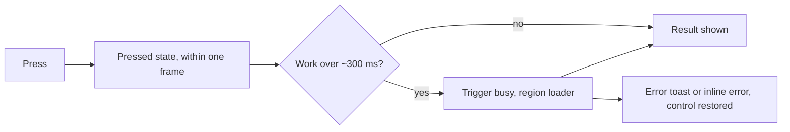

# Interaction Guidelines

```meta
related: [".devbook/design/design-principles.md#no-save-buttons--auto-save-everywhere", ".devbook/design/accessibility.md", ".devbook/arc42/08-crosscutting-concepts.md#storage-and-sync"]
```

> Binding interaction rules for the Backlog product. They cover:
>
> - auto-save, since there are no save buttons;
> - drag-and-drop reordering of items and chapters, with mandatory keyboard
>   equivalents;
> - responsiveness: press feedback, busy actions and scoped loading;
> - feedback and toasts, motion and reduced motion;
> - the empty, loading and error state patterns;
> - the desktop shell's header, panes and group shapes;
> - the combobox, the popover button, action density and overflow, and
>   timelines.
>
> Motion tokens and interaction patterns were adapted from the JSdotNet design
> style guide (`04-motion-and-interaction`, `09-interaction-patterns`). Conflict
> handling follows the last-write-wins rule in
> `.devbook/arc42/08-crosscutting-concepts.md#storage-and-sync`. Token names are
> declared in `color-scheme.md` and `typography-and-layout.md`.

## Auto-Save (No Save Buttons)

```meta
related: [".devbook/design/design-principles.md#no-save-buttons--auto-save-everywhere", ".devbook/arc42/08-crosscutting-concepts.md#storage-and-sync"]
```

The rule that the product has no save affordance is
`design-principles.md#no-save-buttons--auto-save-everywhere`'s. This section
specifies how auto-save behaves.

### Save Timing and Debounce

```meta
```

| Rule | Requirement |
|---|---|
| Text debounce | Continuous text edits MUST auto-save **500 ms–1000 ms** after the last keystroke (recommended default 750 ms). |
| Idle/blur flush | A pending save MUST be flushed immediately on field/editor **blur**, on navigation away, and on app background/close. |
| Discrete actions | Discrete changes (reorder, toggle, checkbox, metadata edit, drop) MUST save **immediately** (no debounce). |
| Max in-flight latency | If a save has no acknowledgement within ~5 s, the indicator MUST move from `Saving` toward `Offline`/retry. |
| Local-first ordering | Update UI (optimistic) → write local canonical Markdown → background sync; editing MUST NOT wait on sync. |

The indicator must never look stuck while a save is in flight.

### Optimistic UI

```meta
```

| Rule | Requirement |
|---|---|
| Immediate reflection | The UI MUST reflect the change instantly, before persistence completes. |
| Non-blocking | Auto-save MUST NOT block typing, navigation, or further edits. |
| Rollback on failure | A failed local write MUST be visibly rolled back or flagged, never silently dropped, with an error toast. |

### Save-State Indicator Vocabulary

```meta
```

A single, always-visible save-state indicator communicates persistence. The
vocabulary is **fixed and identical across all channels**.

| State | Label | Icon | Surface / color | Meaning |
|---|---|---|---|---|
| Idle / saved | `Saved` | `check-circle` | `color-text-secondary` on base surface | All changes persisted locally (and synced if online). |
| Saving | `Saving…` | `loader-2` (spin; static under reduced motion) | `color-text-secondary` | A write/sync is in flight. |
| Offline | `Offline — changes saved locally` | `cloud-off` | `color-info` surface | No connectivity; edits are safe locally and will sync on reconnect. |
| Conflict | `Conflict resolved` / `Review conflict` | `alert-triangle` | `color-warning` surface | A concurrent edit was reconciled (see conflict handling). |
| Error | `Couldn't save` + retry | `x-circle` | `color-error` surface | A local write failed; retry offered. |

Rules:

- The indicator MUST be visible without user action and MUST NOT be a button
  that triggers saving.
- `Saved` is the resting state; it MUST NOT nag (no persistent green banner) —
  it settles to a quiet `color-text-secondary` state.
- State transitions use motion per `#motion-and-reduced-motion`.
- Screen-reader announcements for save state are specified in
  `accessibility.md#screen-reader--announcements`.

What the shared `SaveIndicator` builds of this vocabulary is in
[Materialization](#materialization).

### Undo and History

```meta
```

| Rule | Requirement |
|---|---|
| Undo always available | With no save gate, **undo/redo** (Ctrl/Cmd+Z, Ctrl/Cmd+Shift+Z) MUST cover content edits and reorder actions. |
| Reorder is undoable | A drag-and-drop or keyboard reorder MUST be a single undoable step that restores the previous order. |
| History granularity | Undo history SHOULD be per-document and coalesce rapid keystrokes into sensible steps. |
| AI edits reversible | AI-applied changes MUST be undoable like any other edit (see `design-principles.md#ai-first-surfaces`). |
| Version history (optional) | Longer-term version/history browsing is a product feature `[TODO: clarify]`; at minimum session-level undo MUST exist. |

### Conflict Handling

```meta
```

Aligns with the architectural rule: **new items always create; edits are
last-write-wins** (`.devbook/arc42/08-crosscutting-concepts.md#storage-and-sync`).

| Rule | Requirement |
|---|---|
| New items | Concurrent creation MUST NOT conflict — both items are created (always-create). |
| Edits | Concurrent edits to the same item resolve by **last-write-wins**; the most recent write is canonical. |
| Non-destructive surfacing | When last-write-wins discards a local change, the UI MUST surface the `Conflict` state, never silently losing edits. |
| No blocking merge UI | Conflict handling MUST NOT block editing with a mandatory merge dialog; resolution is automatic, notification is passive. |
| Reorder conflicts | Concurrent reorders resolve by last-write-wins on the ordering metadata; the losing client re-renders the winning order. |

- **Non-destructive surfacing:** the UI SHOULD offer access to the superseded
  version where available.
- **Reorder conflicts:** the losing client MAY show the `Conflict` state.

## Drag-and-Drop Reordering

```meta
related: [".devbook/design/accessibility.md#keyboard-navigation", ".devbook/design/design-principles.md#keyboard-first"]
```

The product supports reordering of **two distinct things**, both with the same
affordance language and both with mandatory keyboard equivalents:

1. **Items:** files or entries in a list, such as tasks, inbox items and
   knowledge notes.
2. **Chapters:** headings and their sections *within a document*. Reordering a
   `##` section moves it with all its nested content.

### Drag Affordances

```meta
```

| Rule | Requirement |
|---|---|
| Visible handle | Each reorderable row/section MUST lead with a grip: the `⠿` glyph in `color-text-disabled`. |
| Press origin | A press anywhere picks up a task row; an item of any other list needs its grip. |
| Cursor | Pointer over a handle uses a grab/grabbing cursor. |
| Set-back feedback | On drag start, the dragged item stays in its place, set back; nothing lifts with a shadow. |
| Handle target | A whole-row press origin is itself the target; a lone grip has a minimum size. |

- **Visible handle:** the glyph turns `color-text-secondary` on hover. The grip
  is the pointer's affordance only (`aria-hidden`, no tab stop). The keyboard
  reaches the same move through the row's own commands
  (`#keyboard-accessible-reordering`).
- **Press origin:** a task row's press may land on its grip too. In other lists,
  such as a goal card or a No goal row, the rest of the item is a control of its
  own: a goal's head opens and folds it.
- **Set-back feedback:**
  - The dragged item is faded, its border or outline dashed in
    `color-border-focus`.
  - In a task list the other rows draw in and dim while it is in flight.
  - The set-back item says where it came from, and the drop indicator
    (`#drop-indicators`) says where it goes.
  - A board card lifts as a copy of itself that follows the pointer, slightly
    tilted, while the card stays faded in its column.
  - The slot in the column under the pointer opens to the card's height. On
    release the copy settles into the card's new place, or back into its old
    one, on the *Drop settle* motion.
  - Under reduced motion the copy still follows the pointer, untilted, and
    nothing unfolds or glides.
- **Handle target:** a grip that is the only press origin MUST be at least
  1.5rem (24 px) wide and 2.75rem (44 px) tall, the bounded exception in
  `accessibility.md#target-sizes-and-text`.

### Drop Indicators

```meta
```

| Rule | Requirement |
|---|---|
| Placeholder | During drag, a placeholder/insertion line MUST show the exact drop position, drawn in `color-primary` at `border-width-2`. |
| Valid vs invalid | Valid drop targets highlight; invalid targets MUST show a not-allowed cursor and MUST NOT show an insertion line. |
| Nesting cue | For chapters, horizontal indentation of the insertion line MUST indicate the resulting heading depth (see nesting rules). |

### Reliable Drop Targets (Items)

```meta
```

> The drag handle and the drop target are not the same hit area. A handle
> sized for a dense row (`#drag-affordances`) is reliably graspable but too
> small to reliably *catch* a drop — the drop target must be sized for
> releasing, not for picking up.

| Rule | Requirement |
|---|---|
| Handle starts the drag only | The handle is the `dragstart` origin; it need not be the drop target. |
| Drop target covers the row | During a drag, each candidate row/card MUST expose a full-width drop target, split into "before" and "after" halves. |
| One scroller per column | A board scrolls sideways only; a long column MUST show exactly one vertical scrollbar. |
| Drop target covers the column | A status column that is a drop target MUST span the board's full height. |
| Cancel both dragenter and dragover | A drop target MUST prevent default on both `dragenter` and `dragover`. |
| Handle target size still applies | The handle target in `#drag-affordances` governs the handle whatever the drop target's size. |

- **Drop target covers the row:** the halves split by height. Releasing anywhere
  over the row commits to the nearer half, not just to the handle's footprint.
- **One scroller per column:** given a bounded height, the board fills it, and
  each column scrolls its own cards inside itself. A column never shows a
  scrollbar of its own beside the board's or the pane's.
- **Drop target covers the column:** the full height is the box the board is
  given when that has a height, else the tallest column, and not only the height
  of the column's own cards. A card carried sideways from low in a long column
  arrives beside a short column's foot. That space MUST still belong to the
  short column; otherwise the drop silently writes nothing.
- **Cancel both dragenter and dragover:** a `drop` only fires where the
  immediately preceding `dragover` was cancelled. A target that only appears
  once dragging has started needs its `dragenter` cancelled too, or the first
  `dragover` over it can be missed.
- **Handle target size still applies:** the handle counts as an independent
  pointer target.

### Keyboard-Accessible Reordering

```meta
```

Drag-and-drop alone is **not accessible**. A keyboard path is **mandatory** for
both items and chapters.

| Rule | Requirement |
|---|---|
| Grab/move model | Focus the handle; **Space/Enter** picks up, **Arrow Up/Down** moves, **Space/Enter** drops, **Escape** cancels and restores. |
| Explicit move commands | Also provide **Move up / Move down** (and **Move to top / bottom**) commands, mapped to keyboard shortcuts. |
| Chapter indent | For chapters, **Arrow Left/Right** (or Tab/Shift+Tab while picked up) MUST change nesting depth within the allowed range. |
| Announcements | Every keyboard move MUST announce the new position via a live region. |
| Parity | Anything achievable by dragging MUST be achievable by keyboard, including cross-container moves. |

- **Explicit move commands:** they appear in the item's context menu and the
  command palette.
- **Announcements:** an example is "Moved to position 3 of 8." See
  `accessibility.md#screen-reader--announcements`.

### Autoscroll

```meta
```

| Rule | Requirement |
|---|---|
| Edge autoscroll | Dragging near a scrollable container's top/bottom edge MUST autoscroll toward that edge at a bounded speed. |
| Reduced motion | Autoscroll MUST remain functional but MUST NOT add parallax/decorative motion under `prefers-reduced-motion`. |
| Keyboard scroll | Keyboard moves MUST keep the moving item scrolled into view. |

**Edge autoscroll:** on a board whose columns scroll their own cards, the
container is the column under the pointer, not the one the card came from.

### Cross-Container Moves

```meta
```

| Rule | Requirement |
|---|---|
| Item cross-move | Where the domain allows it, items MAY be dragged between containers (e.g. inbox → backlog list). |
| Chapter scope | Chapter reordering stays **within a single document** by default; moving elsewhere MUST be an explicit command. |
| Keyboard cross-move | Cross-container moves MUST also be possible via the keyboard "move to…" command. |

- **Item cross-move:** invalid cross-moves MUST be rejected with a not-allowed
  cue, not a silent no-op.
- **Chapter scope:** moving a section to another document is a distinct action,
  not an accidental drag.

### Nesting / Indent Rules (Chapters)

```meta
```

| Rule | Requirement |
|---|---|
| Depth reflects headings | A chapter's nesting depth maps to Markdown heading level (`#`=1 … `######`=6). |
| Legal depth only | Indent MUST NOT produce an illegal jump; clamp to a legal level, shown in the drop indicator. |
| Content preserved | Moving/indenting a heading MUST move its body and descendants together, without corrupting the Markdown. |
| Round-trip safe | The resulting document MUST round-trip losslessly to canonical Markdown. |

- **Depth reflects headings:** reordering or indenting MUST update the heading
  level of the moved section and MUST keep child sections' relative depth.
- **Legal depth only:** an `##` cannot become `####` in one step without an
  intermediate parent.
- **Content preserved:** the move MUST NOT reflow or corrupt the underlying
  Markdown (see `content-editing.md`).

### Reorder × Auto-Save

```meta
```

| Rule | Requirement |
|---|---|
| Immediate persist | A completed reorder is a discrete change and MUST auto-save immediately, with no debounce. |
| Optimistic | The new order MUST render immediately; persistence happens in the background. |
| Undoable | A reorder MUST be a single undo step (see `#undo-and-history`). |
| Failure | If persistence fails, the order MUST visibly revert and surface the `Error` save state. |

**Immediate persist:** the reorder may come from a drag drop or the keyboard. It
drives the save-state indicator to `Saving` → `Saved`.

## Responsiveness

```meta
related: [".devbook/design/interaction-guidelines.md#loading-states", ".devbook/design/interaction-guidelines.md#error-states", ".devbook/design/interaction-guidelines.md#motion-and-reduced-motion", ".devbook/design/accessibility.md#screen-reader--announcements", ".devbook/design/interaction-guidelines.md#auto-save-no-save-buttons"]
```

A press is answered at once, whatever the work behind it costs. The control the
reader pressed shows that it heard them, and a slow act shows that it is still
working. A part of the screen that reloads shows its own loader, and the rest of
the screen stays usable.



### Press Feedback

```meta
```

| Rule | Requirement |
|---|---|
| One frame | Every pressable control MUST acknowledge a press within one frame (≤ 100 ms) through its own visual state. |
| Pressed state everywhere | Every button variant, chip, toggle and pressable card MUST have an `:active` pressed state. |
| Acknowledge before work | A click handler MUST render its acknowledgement before any slow work. |
| No synchronous IO on the UI thread | A click handler MUST NOT do synchronous IO on the UI thread. |
| No double fire | A press repeated while the act is busy MUST be ignored. The act runs once. |

- **One frame:** the acknowledgement is independent of the work the press
  starts.
- **Pressed state everywhere:** a press that changes nothing visible still shows
  it.
- **Acknowledge before work:** in Blazor, set the state and yield
  (`await Task.Yield()`), or make the IO asynchronous or move it to `Task.Run`.
  Do this before any file, git, `gh`, network or process work.

### Busy Actions

```meta
```

| Rule | Requirement |
|---|---|
| When | An act whose work can take longer than ~300 ms MUST put its trigger into the busy state. |
| Busy state | The trigger uses `AppButton`'s `Busy`: a spinner replaces the icon, and clicks are blocked. |
| Set and clear | Busy MUST be set synchronously on the press and cleared in a `finally`. |
| Failure | A failed act MUST restore the control and raise an error toast, per the *Action* row of `#error-states`. |
| Success | A success that nothing else on screen shows MUST get an inline confirmation, per `#feedback-and-toasts`. |
| Stays in place | A busy act MUST NOT move while it runs, per *A running act is exempt* in `#action-density-and-overflow`. |

- **Busy state:** `aria-busy="true"` is set. The control stays focusable, and
  its label stays so its width does not jump.
- **Set and clear:** no outcome then leaves the control stuck.

### Scoped Loading

```meta
```

| Rule | Requirement |
|---|---|
| Scope | A loader MUST cover exactly the region whose data is reloading, nothing larger. |
| Independent regions | Regions MUST load independently; one slow region never holds back the others. |
| First load | An empty region loading for the first time shows a content-shaped `Skeleton`. |
| Refresh | A populated region that refreshes MUST keep its content, show a header `Spinner`, and never blank. |
| Frame first | A navigation or takeover MUST open its frame at once and load its body inside it. |
| Every region resolves | Each region ends in content, an empty state (`#empty-states`), or an inline section error with **Retry** (`#error-states`). |

- **Scope:** a dashboard card, section or widget gets its own loader, a pane
  gets its own, and a whole page gets one only when the whole page reloads.
- **Independent regions:** the rest of the page stays interactive.
- **Refresh:** the `Spinner` is small and the region MAY dim the content.
- **Frame first:** the frame is the header, title and close control. It never
  waits on data before switching the screen.

### Timing

```meta
```

| Moment | Threshold | Why |
|---|---|---|
| Acknowledgement | ≤ 100 ms | Feels instant, per `#press-feedback`. |
| Region loader appears | After ~300 ms of waiting | A loader for a fast load is a flash. |
| Region loader stays | ≥ ~500 ms once shown | A loader that vanishes at once is a flicker. |
| Give up | > ~10 s | The region moves to its error with **Retry**, per `#loading-states`. |
| Reduced motion | Always | Spinners stop spinning, per `#motion-and-reduced-motion`. |

The 300 ms delay applies to a region loader that replaces or covers content. A
button's busy state MAY be set immediately, because it is the acknowledgement
itself.

### Accessibility

```meta
```

| Rule | Requirement |
|---|---|
| Busy region | A region MUST carry `aria-busy="true"` while it loads. |
| Announce on request | When a load the reader asked for finishes, the region SHOULD make one polite announcement. |
| Focus stays | Focus MUST stay on the trigger through the busy state. |
| Tab order | A control blocked while busy MUST stay in the tab order, never natively `disabled`. |

- **Announce on request:** an example is a **Refresh**. A background refresh
  announces nothing. How a live region speaks is
  `accessibility.md#screen-reader--announcements`'s.
- **Tab order:** the control is never removed with the native `disabled`
  attribute.

## Feedback and Toasts

```meta
related: [".devbook/design/typography-and-layout.md#z-index-scale"]
```

| Rule | Requirement |
|---|---|
| Non-blocking | Toasts/snackbars are brief, non-blocking, and self-dismissing; they MUST NOT steal keyboard focus. |
| Placement | Prefer bottom-right on desktop/IDE, bottom-center on mobile; stack with `spacing-sm`; show ≤ 3 and queue the rest. |
| Roles | Use `role="status"` for success/info toasts and `role="alert"` for warning/error (see `accessibility.md`). |
| Dismiss | The dismiss control MUST have an accessible label ("Dismiss notification"). |
| No redundant save toasts | Routine auto-saves MUST NOT spam toasts; toasts are for failures and notable events only. |
| Inline confirmation | Prefer subtle inline confirmation over a toast for small edits. |
| Above an open dialog | A toast raised while a `Modal` is open MUST be seen above it. |

- **No redundant save toasts:** the persistent save-state indicator carries
  that.
- **Inline confirmation:** an example is a brief saved-confirmation flash on a
  saved inline edit, per `#motion-and-reduced-motion`.
- **Above an open dialog:** a modal sits in the browser's top layer
  (`typography-and-layout.md#z-index-scale`), so the tray is lifted into that
  layer above each modal as it opens and let down when the last one closes. The
  toast is visible, not interactive. The modal makes everything outside itself
  inert, so the dismiss control does not answer until the modal closes, and the
  toast's own timer still dismisses it.

## Motion and Reduced Motion

```meta
related: [".devbook/design/typography-and-layout.md#shadows-and-elevation", ".devbook/design/accessibility.md#reduced-motion", ".devbook/domain/brain/features.md#lobes-atlas"]
```

Motion serves purpose only — to communicate a state change, direct attention, or
give feedback. Use the fixed duration/easing tokens.

| Duration token | Value | Easing token | Value |
|---|---|---|---|
| `transition-instant` | 0ms | `ease-linear` | linear |
| `transition-fast` | 150ms | `ease-in` | cubic-bezier(0.4,0,1,1) |
| `transition-base` | 250ms | `ease-out` | cubic-bezier(0,0,0.2,1) |
| `transition-slow` | 350ms | `ease-in-out` | cubic-bezier(0.4,0,0.2,1) |
| `transition-page` | 500ms | `ease-bounce` | cubic-bezier(0.34,1.56,0.64,1) |

Standard combinations:

| Interaction | Duration | Easing |
|---|---|---|
| Button/handle hover, focus ring | `transition-fast` | `ease-in-out` |
| Drag lift, card hover elevation | `transition-base` | `ease-in-out` |
| Drop settle | `transition-base` | `ease-out` |
| Dropdown / slash-command open | `transition-base` | `ease-out` |
| Modal / drawer enter | `transition-slow` | `ease-out` |
| Toast / save-state enter | `transition-slow` | `ease-out` |
| Saved-confirmation flash | `transition-base` | `ease-out` (see below) |

**Recorded deviation:** the org style guide pairs the saved-confirmation flash
with `ease-bounce`. The product uses a smooth `ease-out` instead, by explicit
decision — a bounce on every auto-save is a lot of movement for something that
happens continuously and unprompted. The desktop declares this as
`--ease-saved-flash` in `app.css`.

**Recorded deviation:** the [Lobes atlas](../domain/brain/features.md#lobes-atlas)
turns its brains slowly on their own after four seconds without input, about one
turn in a hundred seconds. The turn ramps in over `transition-slow` on
`ease-in-out`. It serves none of the three purposes the opening rule names. The
product keeps it by explicit decision, so the map reads as three-dimensional at
rest: the brains show their depth without anyone dragging them.

- A press or a scroll on the map stops the turn, and so does resting the pointer
  on a mark. The turn restarts after four more seconds without input.
- The turn never runs under `prefers-reduced-motion: reduce`, nor while the
  document is hidden. A page whose picture must be still turns it off. That is a
  page-level switch, not a reader control.
- The reader stops the turn with **Pause**, beside Labels among the atlas's
  controls, to meet WCAG 2.2.2 (Pause, Stop, Hide). It is a toggle button that a
  keyboard and a pointer both reach, and it reads as pressed while the turn is held.
- Pause holds only the turn on its own. A fling still slows to rest, and a drag
  and the zoom still move the map.
- The pause lasts while the atlas is open. Reopening the atlas starts it turning again.
- Pressing Pause again resumes the turn as after any input: it waits four
  seconds, then ramps in over `transition-slow`.
- Under reduced motion Pause stays enabled, and the brains still never turn.

Rules:

- Default to `ease-in-out`; use `ease-out` for entering elements, `ease-in` for
  exiting. `ease-bounce` is reserved for positive confirmations, never errors.
- Animate `transform`/`opacity`, not layout properties (`width`/`height`/`top`/`left`).
- Under `prefers-reduced-motion: reduce`: replace all translate/scale/rotate and
  slide effects with instant changes or opacity-only fades; spinners stop
  spinning (show a static/indeterminate state); autoscroll keeps working but no
  parallax. See `accessibility.md#reduced-motion`.

## Focus and Selection

```meta
related: [".devbook/design/accessibility.md#focus-visibility", ".devbook/design/design-principles.md#low-chrome-content-first"]
```

| Rule | Requirement |
|---|---|
| Visible focus | Keyboard focus MUST use a `color-border-focus` outline at `border-width-2` with a 2 px offset. |
| Logical order | Focus order MUST follow reading order; modals/drawers trap focus and restore it to the trigger on close. |
| Selection distinct from focus | Selected list items use a `color-border-focus` border + optional `color-primary` accent strip, distinct from hover and focus. |
| Multi-select | Bulk selection shows a bulk-action bar with a live count and a clear-selection control. |
| Entering a multi-select | A row MUST NOT show a selection control until the reader presses the toggle entering the mode. |
| Modifier-click scope | A scope strip's chips are single-select on a plain press and additive with Ctrl (Cmd on macOS). |
| Reorder focus retention | After a keyboard reorder, focus MUST stay on the moved item's handle. |
| Leaving a multi-select | Escape MUST leave the mode from selection-only surfaces, never from a control owning Escape itself. |

What the longer rows add:

- **Visible focus:** `outline` survives high-contrast. Never use `outline: none`
  without a compliant replacement.
- **Multi-select:** the count reads like "3 items selected". "Select all" uses
  the indeterminate state for partial selection.
- **Entering a multi-select:**
  - The toggle is a control such as a Select chip, and hover or focus alone is
    not asking. The controls leave again with the mode.
  - A reader who came to scan a list is not offered a selection they did not ask
    for, and selection never shares a paint with hover or focus (*Selection
    distinct from focus*).
  - This is the argument of `design-principles.md#low-chrome-content-first` one
    level down. The bulk-action bar is not on screen until something is picked,
    and the row's checkbox is not on screen until selecting is.
  - Here it overrides that chapter's *Progressive disclosure* allowance for
    hover and focus.
- **Modifier-click scope:**
  - A plain press selects this one chip, or none when it was already alone. Ctrl
    follows the file-manager convention.
  - When one consumer of the scope can take only one value (the Devbook pane
    reads one devbook), it follows the **anchor**: the first chip taken, which
    stays put while others join.
  - The desktop header's Brain chip is a member like any other, so an anchor of
    Brain shows the Brain in the Devbook pane. With nothing pressed the pane
    shows the Brain too, because it is always there.
  - The anchor carries `aria-current="true"` and a layout-neutral mark, only
    while a second chip is pressed. The chip's tooltip names the modifier, since
    nothing else on screen does.
  - A plural scope exists only while a surface that can show several values is
    on screen. In the desktop shell those are the Tasks, Board, Calendar and
    Goals views and the Dashboard, Sessions, Pull requests, Inbox, Devbook,
    Notifications and Atlas takeovers.
  - When the screen turns to one that reads a single value (the Roadmap view,
    Tools), the scope collapses to the anchor and the modifier stops applying.
    An anchor of Brain reads there as nothing pressed.
- **Leaving a multi-select:** the selection-only surfaces are the toggle that
  entered the mode, the bulk-action bar, and any row's own line while the mode
  is on, whether or not that row is picked. Where a bar holds both a group
  trigger and the controls that group opens, the trigger answers the key and the
  controls keep theirs.

## Empty, Loading, and Error States

```meta
```

### Empty States

```meta
```

| Rule | Requirement |
|---|---|
| Structure | Provide an `icon-xl`/`icon-2xl` illustration, a one-line explanation, and a primary CTA when the user can act. |
| Variants | First-use (create), filtered/no-results (Clear filters), permissions (no action), error (Try again), complete (no action). |
| Copy | Calm, human copy; no dead ends. |
| Title | The title is a short fragment with no closing period; a full sentence goes in the Description. |

- **Variants:** the CTA names the action in brackets. An empty inbox is one
  example of complete, and it is celebratory.
- **Title:** write "No open work", not "Nothing here yet.". The rule holds
  whether the title is a literal, an interpolation, or a branch of a condition.

### Loading States

```meta
```

Which region shows a loader, and when it appears, is `#scoped-loading`'s and
`#timing`'s. This table covers what the loader looks like.

| Rule | Requirement |
|---|---|
| Skeletons | Use content-shaped skeletons for lists/cards/tables, with a subtle 2 s pulse; fall back to error after ~10 s. |
| Spinner | Use for action-triggered ops and page-level loads with no layout preview, never where a skeleton fits. |
| Stale refresh | When refreshing a populated view, keep content visible and show a subtle `icon-sm` spinner in the header. |
| Local-first | Most views SHOULD render instantly from local storage; loading states are the exception. |

- **Skeletons:** the pulse is disabled under reduced motion.
- **Stale refresh:** see *Refresh* in `#scoped-loading`.

### Error States

```meta
```

| Level | Scope | Pattern |
|---|---|---|
| Page-level | Whole view unusable | Full-page error state with **Retry** + navigation escape (back/home). |
| Section | One widget fails | Inline error card within that section. |
| Action | A button/action fails | Error toast + restore control state so the user can retry. |
| Field | Validation | Inline error below the field, linked via `aria-describedby`, color + text + icon. |

### Offline

```meta
```

| Rule | Requirement |
|---|---|
| Persistent banner | Show a calm, persistent offline banner (`color-info` surface) at the top of the viewport; auto-dismiss on reconnect. |
| Editing continues | Reading and editing MUST continue offline; only genuinely network-only actions (e.g. GitHub sync) are disabled with explanation. |
| Save state | The save-state indicator shows `Offline — changes saved locally` (see `#save-state-indicator-vocabulary`). |

## Task Rows

```meta
related: [".devbook/design/typography-and-layout.md#metadata-lines", ".devbook/design/content-editing.md#task-structure", ".devbook/design/content-editing.md#inline-constructs", ".devbook/design/interaction-guidelines.md#auto-save-no-save-buttons"]
```

A task row is the product's densest composition. One line holds a completion
control, a title that can be renamed in place, a metadata line, badges and
actions, and a list may hold hundreds of such rows.

| Rule | Requirement |
|---|---|
| Completion | The completion control is round and MUST remain a real checkbox to assistive technology. |
| No inert controls | A row with nothing listening MUST render its completion state as a labelled image, not a control. |
| Renaming | A rename happens where the title is; the row MUST NOT change height meanwhile. |
| Links in a title | A bare `http` or `https` address in a title reads as a link where it stands. |
| A title's links | The keyboard's and a screen reader's way to that address MUST be a real link beside the title. |
| Rename reporting | A rename is reported when it settles; empty and unchanged titles are not renames. |
| Escape belongs to the innermost draft | A field that abandons a draft on Escape MUST stop the key there. |
| Repeated renaming | Where retitling many rows is the task, finishing one rename MUST start the next. |
| Finished rows | A finished row joins a folded Completed section and MUST NOT be deleted or hidden. |
| Reorder | A finished row MUST NOT be draggable. |
| Kind mark | Where rows have kinds, each row's glyph comes **first on the metadata line, on every row**. |
| Blocked rows | A row that cannot start yet MUST render its completion as state and name its wait. |
| One next | Where an order is derived, exactly one row is marked as the one to start. |
| Recorded beats derived | A row somebody marked done is done, even with a step outstanding. |
| Following a dependency | A waiting-for name that resolves to a row MUST be followable: focus moves there and opens it. |
| Unresolvable dependencies | An id naming nothing in view keeps the row blocked and MUST be shown verbatim. |
| Cycles | A cycle is flagged on every row in it, and no edge is silently broken. |
| Bodies | A row may carry a body, folded by default, using the product's shared disclosure. |

What each row adds:

- **Completion:** roundness is the one convention this shape has.
- **No inert controls:** a control that takes focus and then does nothing, or
  records something untrue, is worse than no control.
- **Renaming:** Enter commits, Escape abandons, and clicking away commits. There
  is no Save button, per `#auto-save-no-save-buttons`.
- **Links in a title:**
  - The address is found and ended as `content-editing.md#inline-constructs`
    says.
  - The title stays verbatim, so the rename draft, the copy and every label
    built from it keep the raw string.
  - The title is the control that opens the row, and the side panel's heading is
    the one that starts its rename. The address inside either is therefore no
    anchor and takes no tab stop.
  - A pointer click on it opens the address in a new browser tab, or in the
    system browser from the desktop head. That click MUST NOT open the row,
    start a rename or start a drag.
- **A title's links:**
  - On a row the link sits in the badge slot after the source badge. On the side
    panel it sits on the heading line after the source.
  - Each distinct address gets one link, in title order.
  - The link is labelled with the host and an arrow, and its accessible name is
    "Open" followed by the whole address.
  - A title with no address draws no link and no empty slot.
- **Escape belongs to the innermost draft:**
  - A row's rename, a list's add-row composer and the side panel's heading
    rename all stop the key. A surface whose own Escape dismisses something
    therefore never takes that decision out of the same press.
  - Closing the field is not containment. An event's path is fixed before the
    first handler runs, so a field that removes itself is still on the path the
    key climbs.
  - A row's line holds no draft, so Escape on it belongs to the surface around
    the list. That split lets a list offer a way out of a selection mode without
    an abandoned rename discarding the picked set.
  - Such a boundary contains the framework's dispatch to the handlers above it,
    not the browser's own propagation. A document-level listener registered in
    script still hears the key, in either phase, so a gesture's way out is never
    what a draft's boundary takes away.
- **Repeated renaming:** the finishing keystroke is Tab down or Shift+Tab up.
  The field MUST arrive with the title selected so the first keystroke replaces
  it.
- **Finished rows:** the row leaves the open list, and the section sits behind a
  count. The record of what was done is the point, and the row MUST stay
  readable.
- **Reorder:** its place in the order stopped meaning anything when it left the
  list.
- **Kind mark:**
  - A backlog's prompts, tasks, ideas and tests are one example of kinds. The
    glyph comes ahead of the list the row belongs to and ahead of a blocked
    row's wait.
  - A mark is only a mark if it is always in the same place. A reader scanning a
    column for the prompts finds it at the line's left edge or reads every row.
  - The glyph stands alone. The word is the tooltip and a visually-hidden span,
    per `typography-and-layout.md#metadata-lines`. Both glyph and word come from
    the host, since the kinds are its vocabulary.
  - The mark also stands in for the glyphs of the facts about the row's
    *content*, its step count and its note. These follow it directly, as words
    alone (`✨ 2 of 5 Note`): one statement about one thing, not three glyphs in
    a row, and nothing else on the line comes between them.
  - Facts about time and a blocked row's wait keep their own glyphs, because
    those glyphs are what tell a deadline from an alarm.
- **Blocked rows:** the row refuses twice. The wait comes first among the facts,
  and only the kind mark's statement above stands before it.
- **One next:** rows that are merely startable take a second, quieter marker.
  The vocabulary MUST NOT change with the count.
- **Following a dependency:** where a scope hides that row, the scopes hiding it
  are widened, and only those, rather than the entry being opened beside a list
  that does not show it. A name that resolves to nothing stays text, per the row
  below.
- **Unresolvable dependencies:** dropping the id would report the row ready when
  the step it waits on is merely missing.
- **Cycles:** nothing is offered. Choosing which dependency is the wrong one is
  the author's decision.
- **Bodies:** a list of ten open bodies is not a list. The fold is not a second
  implementation of the disclosure.

Review surface: storybook → *Task list*, and *Task list* → **Prompt tasks**.

### Board Cards

```meta
related: [".devbook/design/typography-and-layout.md#metadata-lines", ".devbook/design/color-scheme.md#the-identity-edge", ".devbook/design/accessibility.md#iconography-accessibility"]
```

A board card states the same facts a task row does, stacked rather than laid
along one line, because a board column is narrow and tall where a list is wide
and short. The rows above hold for the facts; these rules hold for the stack.

| Rule | Requirement |
|---|---|
| Line order | Top to bottom, with nothing absent drawn as a gap, in the order listed below. |
| Effort is always stated | Effort is the one fact a card draws when absent: `Not estimated`. |
| Quiet priority | Only **High** and **Critical** draw a mark, a small up-chevron; **Medium** and **Low** draw nothing. |
| One control | The whole card is one focusable control opening the entry, only while the host is listening. |
| Copy on the card | A card a board lays out carries the row's copy button at its top line's far end. |
| Badges are not the card | The work badges' slot MUST stop the press, the click and the key before the card hears them. |
| The identity edge is the host's | The repository edge is drawn only when the host passes it, on a list row's seam. |

What each row adds:

- **Line order:**
  1. the kind, with the priority mark and the **My Day** marker beside it, and
     the copy button on that line's far end when offered;
  2. the title;
  3. `Waits on …` when the chain says the task cannot start, naming what it
     waits on rather than counting it;
  4. the tags;
  5. one quiet line, made of:
     - the repository;
     - the sub-items done of total;
     - the one date that matters (when it is due on an open task, when it was
       finished on a done one);
     - the work badges: the task's source, then the links to its title's
       addresses per *A title's links* above, then the host's;
     - the effort, on the far end.
- **Effort is always stated:** a column that sums its points makes an
  unestimated card worth stating.
- **Quiet priority:** the mark is named as its priority to a tooltip and to a
  screen reader, never only a shape. Priority is barely used, and a mark on
  every card is a mark nobody reads.
- **One control:**
  - The card opens on a click or on Enter or Space, per *No inert controls*
    above.
  - The controls inside it are the copy button, a pressable tag, the badges and
    the title's links. They are their own tab stops and never open it.
  - An address in the title is no tab stop. A pointer click on it opens the
    address and not the card, per *Links in a title* above.
- **Copy on the card:**
  - The button copies exactly what the task's row copies, and is refused the
    same way on a task marked blocked.
  - Copying is not opening: the button's slot stops the press, the click and the
    key as the badge slot does, and a drag never starts from it.
  - With the `copy-entries` flag off
    (`.devbook/domain/tasks/context.md#copy-entries`) neither the row nor the
    card carries the button, and the top line ends on what remains.
- **Badges are not the card:** the badges are facts to follow, usually links,
  and following one is not opening the card. Their slot works as the row's badge
  slot does. A tag the host is listening to is a control of its own and stops
  them the same way.
- **The identity edge is the host's:** a card and the row for the same entry
  therefore cannot disagree about it (see `color-scheme.md#the-identity-edge`).

Review surface: storybook → *Task list* → **Task card**.

## Shell Header

```meta
related: [".devbook/arc42/adr/0022-the-shell-shows-one-main-view-picked-by-a-view-switch.md", ".devbook/arc42/adr/0027-the-brain-is-a-scope-beside-the-repositories.md", ".devbook/design/color-scheme.md#the-brains-accent", ".devbook/domain/brain/features.md#brain-scope", ".devbook/domain/brain/features.md#lobes-atlas", ".devbook/domain/progress/features.md#the-goals-view", ".devbook/design/interaction-guidelines.md#workspace-panes", ".devbook/design/interaction-guidelines.md#group-shape-says-cardinality", ".devbook/design/interaction-guidelines.md#focus-and-selection", ".devbook/design/design-principles.md#low-chrome-content-first", ".devbook/design/typography-and-layout.md#iconography", ".devbook/design/accessibility.md#iconography-accessibility", ".devbook/design/interaction-guidelines.md#popover-button", ".devbook/arc42/adr/0029-an-archived-repository-stays-in-the-registry.md", ".devbook/arc42/adr/0043-a-surface-can-open-in-its-own-window.md#4-any-surface-pops-out-as-often-as-asked", ".devbook/design/accessibility.md#target-sizes-and-text", ".devbook/arc42/adr/0043-a-surface-can-open-in-its-own-window.md"]
```

The desktop shell's header is four regions in reading order, each answering one
question. Below it the workspace shows exactly one **main view**, unless a
**takeover**, the Inbox or the Devbook has the screen (local ADR 0022).

| Region | Answers | Holds |
|---|---|---|
| Identity | Over which repositories? | The repository scope, a fused group of chips led by the **Brain** chip, and nothing else. |
| Navigation | What am I looking at? | Left to right: **Inbox**, the view switch, **Devbook**, the Goals group, the remaining takeovers. |
| Status | How is the workspace doing? | The GitHub check, only while a task view is on screen. |
| Utilities | What cuts across all of it? | **Ask AI**, while an area has something to ask about; then the **Settings** gear. |

- **Identity:** see `#focus-and-selection`, *Modifier-click scope*. The
  repository chips follow the Brain chip. The scope renders always, with the
  Brain chip alone when no repository is configured (local ADR 0027).
- **Navigation:** the controls it holds are described in the table below.
- **Status:** this is ambient, the quietest region. Its auto margin carries it
  and the utilities to the right edge.
- **Utilities:** **Ask AI** is the one accented control in the header. The gear
  comes last in the header and opens a menu of **Colors**, **Show archived** and
  a **Settings** link (*The gear holds the occasional switches*).

The navigation region holds three kinds of control, and each MUST look and act
as its kind:

| Control | Members | Behaves as |
|---|---|---|
| View switch | `Tasks`, `Board`, `Calendar`, `Roadmap` (while its flag is on) | Exactly one option is pressed while the workspace shows; a view is never closed. |
| Inbox toggle | `Inbox`, before the view switch | An on-or-off giving the Inbox the whole screen; pressed again, it returns to the view. |
| Devbook toggle | `Devbook`, after the view switch; `Brain` while the Devbook shows the Brain | An on-or-off giving the Devbook the whole screen; a second press or Escape returns. |
| Goals group | `Goals` (a view), `Sessions`, `Pull requests` (takeovers) | One fused group of the work in flight; it always renders. |
| Remaining takeovers | `Dashboard`, `Notifications`, `Tools`, `Atlas` | A loose group, each under its own flag, rendered while one of them is offered. |

What each control adds:

- **View switch:** pressing the pressed option changes nothing, and Escape never
  leaves a view.
- **Inbox toggle:** Escape does not leave the Inbox: it is the Inbox's own key,
  leaving triage for the list.
- **Devbook toggle:** see `#workspace-panes`. The toggle is named for what the Devbook shows, open or
  closed. It reads **Brain**, in the Brain's accent
  (`color-scheme.md#the-brains-accent`), while the Devbook reads or would open
  on the Brain: nothing pressed, the Brain as anchor, or the Brain side of its
  `Brain | <repo>` switch. It reads **Devbook** otherwise. The word changes, the
  control does not.
- **Goals group:** the group holds the Progress context's [Goals
  view](../domain/progress/features.md#the-goals-view) and the Sessions
  context's two lists. Goals acts as a view option does; Sessions and Pull
  requests act as takeovers. It always renders because Goals is always offered.
- **Remaining takeovers:** **Atlas** is under `atlas-lobes` ([Lobes
  atlas](../domain/brain/features.md#lobes-atlas)). **Notifications** opens the
  notification centre and wears the count of questions waiting for an answer, in
  the question's gold, and no count while none wait.

| Rule | Requirement |
|---|---|
| The workspace cluster sits close | The Inbox toggle, view switch and Devbook toggle MUST sit at the tighter `spacing-xs` gap. |
| A takeover hides, it does not close | Opening a takeover MUST hide the workspace and keep the main view underneath. |
| Every way back works | A takeover MUST close on Escape, its close button and a second press of its option. |
| The atlas returns where it was opened | The **Atlas** takeover's Escape, close button and second press MUST return to the surface it opened over. |
| Nothing reads pressed under a takeover | During a takeover, or while the Inbox has the screen, no view option reads pressed. |
| A surface pops out | Each header item a module registers as a surface MUST carry an **Open in new window** button. |
| A popped-out window has a slim header | A popped-out window MUST draw a slim header, with no view switch or takeover options. |
| A popped-out window is remembered by its bookmark | A popped-out window is not remembered unless its bookmark is pressed. |
| A docked window gives its rows to the list | A popped-out window narrower than 40rem is docked, and its layout tightens as listed below. |
| Takeovers are exclusive | Opening a takeover MUST replace any other takeover; a group of pressed states says so. |
| A switched-off view falls back | A view whose flag goes off MUST show Tasks, and come back with the flag. |
| The filter bar is the task views' | The Tasks filter bar MUST show on the Tasks, Board and Calendar views, nowhere else. |
| A control acts on what is on screen | A header control whose target is off screen MUST NOT render. |
| The shell reopens where it was left | The main view, open takeover or Inbox or Devbook, and scope MUST return on a fresh shell. |
| The Brain chip leads the scope | The repository scope MUST start with the **Brain** chip, then a divider, then the repository chips. |
| The gear holds the occasional switches | The **Settings** gear MUST be a `#popover-button` named **Settings** listing the occasional switches. |
| Views and work lead with a glyph | Each view-switch option and Goals group member MUST lead with a decorative glyph before its word. |

What each row adds:

- **The workspace cluster sits close:** the groups after it sit at the wider
  navigation gap, so the Inbox and the Devbook read as belonging to the views.
- **A takeover hides, it does not close:** closing it shows the view as it was.
  The Devbook is a takeover.
- **Every way back works:** pressing a view option during a takeover MUST close
  it and show the workspace with that view on screen. The Inbox is left by a
  second press of its option, a view option or another takeover, never by
  Escape.
- **The atlas returns where it was opened:**
  - The takeover opens from its header option or from the Devbook's own
    **Atlas** button. The surface it returns to is the main view, another
    takeover or the Devbook, and its tooltip names that surface.
  - A surface switched off since it opened is no way back: the atlas returns to
    the main view, and its tooltip names that view instead.
  - Its way back survives a trip to Settings, because the shell is rebuilt on
    every route change. So does the ghost scope a ghost devbook's **Register
    repository** leaves from.
  - A view option still closes it onto the workspace.
- **Nothing reads pressed under a takeover:** the Devbook counts as a takeover
  here, and nothing of the workspace is on screen.
- **A surface pops out:** the surface registration is local ADR 0043 §1.
  - The ⧉ button hangs centred under its option, its top on the option's bottom
    edge. It covers none of the option (not its word, a folded option's glyph or
    the selected underline) and no fused neighbour.
  - It is placed absolutely, so showing it never moves the header or changes the
    width the fold measures. The option's top-right corner stays the feature
    flag's.
  - It MUST show on hover and while anything in the item has keyboard focus, and
    always where nothing can hover. There the header keeps the strip it hangs in
    clear, below itself and between the rows it wraps to, so it covers nothing.
  - It stays in the tab order, after its option. Its name is **Open <name> in a
    new window**, the option's own word, and the glyph is hidden from assistive
    technology.
  - Every press opens one more window and changes nothing in this one (local ADR
    0043 §4). A host that cannot open windows draws no button.
- **A popped-out window has a slim header:**
  - The order is:
    1. the surface's title as its heading;
    2. the window's own repository scope chips, led by the Brain chip;
    3. a **Keep on top** pin;
    4. the **Remember this window** bookmark (see *A popped-out window is
       remembered by its bookmark*);
    5. a **Show in main window** control that switches the main window to this
       surface and closes this one.
  - The pin is an icon-only toggle named **Keep on top**. Pressed, it keeps the
    window in front of every window that is not kept on top itself, and the next
    window of that surface opens kept on top too. Only the desktop head draws
    it, because a browser tab cannot stay on top.
  - A plain press on a chip scopes that one, and a press on the only one in
    scope clears it. The chips narrow this window alone, never the main window's
    scope.
  - The header MUST also carry no **Ask AI**, which stays in the main window
    only, and no close button of its own: the OS one closes it.
  - The window's title follows the surface on screen.
  - The footer band and toasts MUST show in the window as they do in the main
    one, except in a docked window (local ADR 0043 §4, §5).
- **A popped-out window is remembered by its bookmark:**
  - The bookmark MUST be an icon-only toggle between **Keep on top** and **Show
    in main window**, at the header's trailing end. It uses the Lucide
    `bookmark` glyph at `icon-sm`, hidden from assistive technology, with the
    name **Remember this window** on the control itself.
  - It reads pressed (`aria-pressed`) while this window is remembered. Its
    tooltip says what the next press does: **Remember this window** or **Forget
    this window**.
  - A press changes this window alone, never another popped-out window or the
    main one.
  - A remembered window reopens on the next start, after the main window, on the
    surface and query it showed at quit.
  - Quitting the app keeps it remembered. Closing the window itself, **Show in
    main window**, or pressing the bookmark again forgets it (local ADR 0043
    §5).
  - A window without a key draws no bookmark, the web harness and the loopback
    pages among them.
  - Its target matches **Keep on top**'s, under
    `accessibility.md#target-sizes-and-text`'s 44 px for the same reason: the
    slim header stays one height.
- **A docked window gives its rows to the list:**
  - A docked window sits beside other work, such as a list for today on a side
    monitor.
  - Its header MUST put the title and its buttons on one row and the scope chips
    on a row of their own, which scrolls sideways rather than running off the
    edge.
  - **Show in main window** keeps only its glyph, and its name stays on the
    control.
  - The footer band MUST hide its controls, and its feedback dialog MUST still
    open.
  - Task rows MUST drop the grip, the **waits on** link handle and the work
    links, since the keyboard still reorders and links.
  - The main window keeps its layout at every width.
- **Takeovers are exclusive:** the pressed states take the place of
  `aria-expanded`. Ask AI keeps `aria-expanded`, because it is a disclosure.
- **The filter bar is the task views':**
  - Those views show the same filtered rows read three ways.
  - The Board adds its **Columns** choice first on the bar, a select with no
    visible word beside it, because the grouping it shows says what the columns
    are. It is named `Columns` to assistive technology and in its tooltip.
  - The Roadmap view carries its own Planning heading row instead, and Goals
    carries its own iteration choice.
- **A control acts on what is on screen:** the GitHub check renders only beside
  a task view, and Ask AI only with an area to ask about. The view switch, the
  Inbox and Devbook toggles, the takeover groups and the identity region stay on
  every screen, since they are the way to everything else.
- **The shell reopens where it was left:** this includes after Settings and
  back. The scope comes back in its order, so the anchor is still first, Brain
  is in its place when it was pressed, and a repository no longer configured is
  dropped from it.
- **The Brain chip leads the scope:**
  - The chip MUST offer no remove control and MUST lead with a decorative brain
    glyph before its word.
  - It MUST wear `color-band-2` as its identity edge
    (`color-scheme.md#the-brains-accent`) whether or not the Colors switch is
    on.
  - It presses as a repository chip does, Ctrl included, and pressed alone it
    scopes every view to the tasks filed against no repository.
  - Until a Brain folder is set it reads **Set up your Brain**, still scopes,
    and its tooltip says where the folder is set.
  - No *No repo* chip appears anywhere else: Brain is the one place that says
    "no repository".
- **The gear holds the occasional switches:**
  - The panel lines up with the gear's end edge. It MUST list the **Colors**
    switch, then the **Show archived** switch, then a **Settings** link to the
    Settings page.
  - Both switches are the shared `Toggle`, named by the visible word beside the
    track.
  - **Colors** is listed only while a repository is configured (local ADR 0027);
    the Brain's edge is not one of its hues.
  - **Show archived** is always listed, so it can be found. While no repository
    is archived it is disabled and carries the note **No archived repositories**
    (local ADR 0029 §3).
  - Flipping either switch leaves the menu open.
  - Neither switch stands in the header row: both ask "is this layer on", narrow
    nothing, and are flipped too rarely to earn the width.
- **Views and work lead with a glyph:**
  - The glyphs are:
    - a list for Tasks;
    - three columns for Board;
    - a calendar for Calendar;
    - staggered bars for Roadmap;
    - a target (Lucide `target`) for Goals;
    - a terminal prompt for Sessions;
    - a pull-request branch for Pull requests.
  - Each glyph is a Lucide outline per `typography-and-layout.md#iconography`,
    hidden from assistive technology per
    `accessibility.md#iconography-accessibility`, so every option's name stays
    its word.
  - The Inbox toggle, the Devbook toggle and the remaining takeovers carry none.

Review surface: storybook → *App shell* → **Desktop header navigation**.

## Workspace Panes

```meta
related: [".devbook/design/interaction-guidelines.md#shell-header", ".devbook/arc42/adr/0022-the-shell-shows-one-main-view-picked-by-a-view-switch.md#amendment", ".devbook/design/accessibility.md#target-sizes-and-text", ".devbook/design/design-principles.md#low-chrome-content-first"]
```

The desktop shell has no side panes. The task list is the Tasks view, which is
never closed. The Inbox and the Devbook each take the whole screen in place of
the main view and keep it underneath, as a takeover does (see `#shell-header`).
Triage reads one item at a time, and a chapter or the Brain reads full width, so
neither shares the window with the view (local ADR 0022, amendments of
2026-10-12 and 2026-10-15).

| Rule | Requirement |
|---|---|
| A toggle of its own | A press on the Devbook toggle MUST give the Devbook the screen; another press returns. |
| Never disabled | The Inbox and Devbook toggles MUST NOT be disabled. The shell showing neither is its ordinary state. |
| The tooltip says what the press will do | "Open the Devbook", or while it has the screen "Back to Tasks", naming the view underneath. |
| A link opens the surface | A link opening a chapter or Brain note in the Devbook MUST give the Devbook the screen. |
| One width | The Devbook MUST fill the workspace's width. No edge sets its width, and the viewport counts no panes. |

- **A toggle of its own:** the press while the Devbook has the screen MUST
  return to the view underneath. No modifier changes what a press does.
- **The tooltip says what the press will do:** *Brain* takes the place of
  *Devbook* while the Devbook shows the Brain. The Inbox toggle reads the same
  way.
- **A link opens the surface:** this includes the task row's Brain badge.

## Phone Tab Bar

```meta
related: [".devbook/design/interaction-guidelines.md#shell-header", ".devbook/design/typography-and-layout.md#iconography", ".devbook/design/accessibility.md#iconography-accessibility", ".devbook/design/accessibility.md#target-sizes-and-text", ".devbook/domain/progress/features.md#the-goals-view"]
tests: [unit:dotnet:Backlog.UI.Components.UnitTests.ShellTests.A_tab_given_a_glyph_draws_it_above_its_word_hidden_so_the_word_stays_its_name, unit:dotnet:Backlog.UI.Components.UnitTests.ShellTests.A_tab_without_a_glyph_is_its_word_alone, unit:dotnet:Backlog.Mobile.UI.UnitTests.StandupScreenTests.Every_tab_leads_with_its_glyph_and_stand_up_wears_the_target, unit:dotnet:Backlog.Mobile.UI.UnitTests.NotificationScreenTests.The_tab_shows_once_the_phone_holds_a_notification]
```

The phone's shell has no header navigation. Its destinations are a row of tabs
along the bottom, where a thumb already is: **Today**, **Inbox**,
**Notifications** once the phone holds a notification, **Stand-up** once a
desktop has sent the stand-up, and **Notes**. Each is a route of its own,
so the bar is a nav of links, not a tablist. The tabs are the phone's views, so
they lead with a glyph as the desktop's views do (`#shell-header`).

| Rule | Requirement |
|---|---|
| Every tab or none | Each tab MUST lead with a decorative glyph, or none may. |
| Glyph above the word | The glyph sits above the tab's word, at `icon-md` (20px), in the word's ink. |
| The word is the name | The glyph MUST be hidden from assistive technology, so each tab is announced by its word. |
| The target holds | Every tab stays at least 48px tall with its glyph, past the 44px minimum in `accessibility.md#target-sizes-and-text`. |
| Lit by more than colour | The current tab carries a top-edge bar and a heavier word, never its glyph's colour alone. |

- **Every tab or none:** one tab with a picture beside tabs without reads as the
  one that is different. The phone's tabs carry:
  - a sun for Today (the My Day glyph);
  - an inbox tray for Inbox;
  - a target (Lucide `target`) for Stand-up, as the desktop's Goals option has;
  - a bell (Lucide `bell`) for Notifications, as the desktop's Notifications
    option has;
  - a sticky note (Lucide `sticky-note`) for Notes.
- **Glyph above the word:** the lit tab's glyph lights with its word. The word
  stays, because a glyph alone is not a name.
- **The word is the name:** see `accessibility.md#iconography-accessibility`.

Review surface: storybook → *App shell* → **Tab bar with glyphs**.

## Group Shape Says Cardinality

```meta
related: [".devbook/design/interaction-guidelines.md#shell-header", ".devbook/design/interaction-guidelines.md#workspace-panes", ".devbook/design/interaction-guidelines.md#focus-and-selection"]
```

A group of pressable options in application chrome is drawn in one of two
shapes. The shape says how its options belong together, which is the one thing
about a group a reader can see before pressing anything. How many are on at once
is the pressed state's to say, not the shape's.

| Rule | Requirement |
|---|---|
| Fused means one set | Sibling options read as one control MUST draw flush inside one border, with hairlines between. |
| Loose means related only by kind | Options that merely share a kind MUST be standalone bordered controls with a gap, never fused. |
| Not one of a set at all | A control that is simply on or off MUST stand alone, outside every group. |
| Still one group | A loose group is still one `role="group"` with one label and one tab sequence; only the drawing changes. |
| Selected on the edge it has | A fused option selects on the group's shared bottom edge; a loose option on its own border. |

- **Fused means one set:** the desktop header has three examples:
  - the repository scope (several on with Ctrl, its leading Brain chip set off
    by a divider inside the same border);
  - the view switch (exactly one on);
  - the Goals group (the Goals view and two lists).
- **Loose means related only by kind:** the example is the desktop header's
  Dashboard and Tools, two takeovers from two contexts.
- **Not one of a set at all:** the examples are the desktop header's Inbox and
  Devbook toggles, in the loose option shape. Inside a fused group such a
  control would read as one more of its options and behave as none of them.
- **Selected on the edge it has:** the fused edge is an underline beside the
  tint. Neither is colour alone.

## Combobox

```meta
related: [".devbook/design/accessibility.md#keyboard-navigation", ".devbook/design/interaction-guidelines.md#focus-and-selection", ".devbook/domain/tasks/features.md#planned-hours"]
```

A combobox is a text field with a list of suggestions under it. The reader may
type anything, or take a suggestion instead of typing, and typing never narrows
the list. It follows the ARIA 1.2 editable combobox with list autocomplete. The
planned-hours figure is its first use.

| Rule | Requirement |
|---|---|
| The focus stays in the field | The keyboard focus MUST stay in the text field while the list is open. |
| Opening the list | Down, Up and Alt+Down MUST open the list, and so does a click in the field. |
| Moving through it | While the list is open, Down and Up MUST move the active suggestion and wrap at either end. |
| Taking a suggestion | Enter on the active suggestion, or a click on one, MUST take it and close the list. |
| Escape | Escape MUST close an open list and keep the text; on a closed list it clears. |
| A key the list used is not the host's | A surrounding Escape or Enter host MUST NOT hear the key that closed or took from the list. |
| Tab | Tab MUST close the list without taking anything and move the focus on as usual. |
| One commit per value | A value MUST be committed once: by a pick, Enter, or leaving the field. |
| A refused value goes back | When the host refuses a committed value, the field MUST restore the last standing value. |
| Never clipped | The open list MUST be at least as wide as its field, and never clipped. |

- **The focus stays in the field:** the field carries `role="combobox"`,
  `aria-expanded`, `aria-controls` naming the list and
  `aria-autocomplete="list"`, and `aria-activedescendant` names the active
  suggestion. The list is a `role="listbox"` of `role="option"` items.
- **Opening the list:** Down opens on the suggestion matching the field, else
  the first. Up opens on the matching one, else the last. Alt+Down opens with
  none active.
- **Taking a suggestion:** Enter with none active MUST commit the typed text.
- **Escape:** with the list closed, a host listening around the field hears the
  Escape too.
- **A key the list used is not the host's:** an example host is an editor that
  cancels on Escape.
- **One commit per value:** the browser's change event after an Enter is not a
  second commit.
- **A refused value goes back:** the host says why beside the field.
- **Never clipped:** a container that clips its content MUST NOT cut the list
  off.

Review surface: storybook → *Inputs* → **Combobox** (empty, a suggestion taken, a
figure typed, a figure refused).

## Popover Button

```meta
related: [".devbook/design/accessibility.md#keyboard-navigation", ".devbook/design/interaction-guidelines.md#focus-and-selection", ".devbook/design/interaction-guidelines.md#shell-header", ".devbook/design/design-principles.md#low-chrome-content-first"]
```

A popover button shows a small panel of the host's own controls under a button:
settings a reader flips now and then and would rather not see all day. It is a
disclosure, not a menu. The panel holds switches, buttons and links, not menu
items, so the arrow keys stay those controls' own. The desktop header's
**Settings** gear is its first use (`#shell-header`). `PopoverButton` in the
shared library builds it.

| Rule | Requirement |
|---|---|
| A disclosure, not a menu | The trigger MUST carry `aria-expanded` and `aria-controls`; the panel MUST be a named `role="group"`. |
| Named on the trigger | A glyph-only trigger MUST carry its name in `aria-label`, keep the glyph hidden, and show a tooltip. |
| Tab walks in | The panel MUST follow the trigger in the DOM, so Tab moves into and past its controls. |
| Escape returns to the trigger | Escape anywhere in the open popover MUST close it and put the focus back on the trigger. |
| Outside click only closes | A click outside the open panel MUST close it and do nothing else. |
| It stays open while used | Pressing a control inside the panel, such as flipping a switch, MUST leave it open. |
| Lined up with its trigger | The panel MUST line up with the trigger's start edge, or its end edge at a row's end. |

- **A disclosure, not a menu:** `aria-controls` names the panel, and the panel
  sits under the trigger's name. Neither carries a menu role.
- **Named on the trigger:** the tooltip shows the name unless the host gives
  another.
- **Tab walks in:** the component moves no focus. Opening the panel leaves the
  focus on the trigger.
- **Outside click only closes:** the control under the click does not act, and
  the focus stays where the click left it. A second press of the trigger closes
  it the same way.
- **It stays open while used:** a link that leaves the page closes it by
  leaving.
- **Lined up with its trigger:** a panel at a row's end therefore opens inward
  from that end.

Review surface: storybook → *Overlays* → **PopoverButton** (closed, open, a switch
flipped with the panel still open).

## Action Density and Overflow

```meta
related: [".devbook/design/typography-and-layout.md#density", ".devbook/design/accessibility.md#target-sizes-and-text", ".devbook/design/design-principles.md#low-chrome-content-first"]
```

This section uses four words in a fixed sense:

- An **act** is one thing the product does on an external tool, drawn as a
  button or a menu item.
- The **act set** is every act a subject offers. A task, a devbook chapter, a
  roadmap bar and a menu show the same act set.
- The **visible budget** is how many acts a surface shows before the rest go into
  an overflow menu.
- A **primary** act is pinned visible at every density; a **standard** act fills
  the budget in the order it was given.

The act set does not change between surfaces. What changes is how many acts fit
the room available. Density selects a button shape, a size and a visible budget
**together**, as one choice rather than three, so the three cannot be set
inconsistently.

| Density | Shape | Visible budget |
|---|---|---|
| Toolbar | Label and glyph, default size | 4 |
| Inline | Label and glyph, small | 3 |
| Compact | Glyph only | 2 |
| Menu | Trigger only | 0 |

Rules:

- The budgets are deliberately smaller than the act set. A busy surface's resting
  state is a short row and a menu, which is what
  `design-principles.md#low-chrome-content-first` asks for.
- **A primary act is pinned and still counts.** It displaces a standard act rather
  than adding a slot, so the budget is the budget.
- **A copy is pinned and does not count.** A copy is served by the clipboard
  component, and a menu item has no clipboard interop. A copy in overflow would
  claim to copy and silently not.
- An act the host explicitly marked as overflow is removed unconditionally and is
  never pulled back out.
- **One item never gets a menu.** Where the rule would put exactly one act into
  overflow, it stays visible and no trigger is rendered. A menu holding a single
  item costs a click, hides a label, and buys nothing.
- **A running act is exempt.** Collapse is recomputed as state changes, and an act
  the reader has just pressed MUST NOT be moved out from under them.
- **Unavailability never affects placement.** An unavailable act occupies the slot
  it would have occupied, disabled, carrying its reason. A reader who never sees an
  act concludes the product cannot do it. They file that as a missing feature,
  not as an account they have not connected.
- In a menu a row has no room for a second line. There an unavailable act's
  reason MUST be folded into its label, and the item MUST be skipped by the arrow
  keys rather than focused to refuse.
- Icon-only means **visually** icon-only. Every control keeps its accessible name,
  and is padded to the ≥ 44 × 44 px target
  (`accessibility.md#target-sizes-and-text`) even where the glyph is 16 px. A
  compact cluster is the same touch target with less ink in it.

Review surface: storybook → *Integrations* → **Density and overflow**.

## Timelines and Roadmaps

```meta
related: [".devbook/design/color-scheme.md#chart-roles", ".devbook/design/interaction-guidelines.md#keyboard-accessible-reordering", ".devbook/design/accessibility.md#keyboard-navigation"]
```

A roadmap is a plan drawn against a time axis. It is the one surface in the
product where position carries meaning in two dimensions at once:

- quarters run across the top;
- swimlanes run down the left;
- bars, milestones and dependency arrows sit by their dates.

| Rule | Requirement |
|---|---|
| What a bar means | A bar's horizontal extent is its dates, and its row carries no ordering claim. |
| Snapping | Every gesture snaps to the week. |
| Preview is the result | The bar mid-gesture MUST already sit where the drop will commit, not as a beside-it ghost. |
| Keyboard parity | Every gesture MUST have a key: pick up, move by week or row, pull an end, drop, cancel. |
| Announcements | Each keyboard step is announced through a live region, and focus returns to the bar after a drop. |
| Milestones | A milestone MUST NOT be a one-day bar: it takes a glyph on its own row. |
| Marker kinds | Kinds of marker differ by **shape** as well as colour; each carries a full text description. |
| Dependencies | An arrow is resolved from where its two ends are drawn *now*, including mid-drag. |
| Contradictions are drawn | Where dependent work starts before its prerequisite ends, the arrow MUST double back. |
| Refusals | An invalid drop is refused rather than ignored. |
| Locked bars | A committed bar loses its grips and refuses to be picked up at all. |
| Colour | Lanes and bars take the chart roles in `color-scheme.md#chart-roles`; the library ships no hues. |
| Empty plans | No lanes, or lanes with no rows, renders an empty state rather than an axis. |

- **Snapping:** a plan is not accurate to the day, and an axis ruled in quarters
  cannot show that it is.
- **Preview is the result:** a preview that can disagree with its result will.
- **Keyboard parity:** a chart that can only be dragged is a chart some people
  can read and nobody can edit. See `#keyboard-accessible-reordering`.
- **Milestones:** a milestone has no duration and no edge to pull. At a year's
  zoom a one-day bar is a sliver nobody can hit.
- **Marker kinds:** the description says what the marker is, which lane and row,
  and its date.
- **Dependencies:** an arrow is therefore never a stale line. An arrow with one
  end missing draws nothing.
- **Contradictions are drawn:** the arrow is not straightened. The detour is the
  reader's cue that the plan contradicts itself.
- **Refusals:** a reader learns the rule rather than concluding the gesture
  missed.
- **Colour:** a caller passing hues of its own owns them.
- **Empty plans:** an axis above nothing promises a plan that has not been made.

Review surface: storybook → *Roadmap*.

## Materialization

```meta
related: [".devbook/design/README.md#living-reference-the-ui-storybook", ".devbook/design/accessibility.md"]
```

| Rule area | Where it lives | Review surface |
|---|---|---|
| Auto-save, debounce, indicator | `SaveIndicator` in the shared library; `TasksDesktopState` in the desktop app | Storybook → *Feedback* → **SaveIndicator**; *Entry edit* |
| Toasts and feedback | `Toast`, `ToastHost`, `Alert`, `EmptyState`, `Spinner` | Storybook → *Feedback* |
| Inline confirmation | `CopyButton` in the shared library | Storybook → *Buttons* → **CopyButton** |
| Focus and selection | Every interactive component declares its own `:focus-visible` outline at `border-width-2` with a 2 px offset | Storybook → every page |
| Empty / loading / error states | `EmptyState`, `Spinner`, `Alert` | Storybook → *Feedback* |
| Popover button | `PopoverButton` in `Backlog.UI.Components/Overlays` | Storybook → *Overlays* → **PopoverButton** |
| Press feedback, busy actions, scoped loading | `src/Core/Backlog.UI.Components`: `AppButton`, `TaskAction`, `ConfirmDialog` and more, below | Storybook → *Buttons*, *Overlays*, *Feedback* → **A region refreshing in place**, *File view* |
| Drag-and-drop reordering (items) | The **shared library**, in two halves: `taskListDrag` and `TaskListView.razor` | Storybook → *Task list*, *Prompt tasks*, *Roadmap* and *Task calendar*, listed below |

What the longer rows add:

- **Auto-save, debounce, indicator:** *Entry edit* shows a debounced text save
  while typing, an immediate save on a task toggle, and nothing while idle.
- **Inline confirmation:** the line is a `role="status"` line beside the button. The glyph
  cross-fades into a check for the same few seconds, at `transition-base`/`ease-out`. That is
  the same pairing, and the same recorded deviation from `ease-bounce`, as the
  saved-confirmation flash.
- **Popover button:** a transparent full-screen backdrop catches the outside click. It is drawn only while the panel is open, as
  `ContextMenu` does it, so no document listener outlives the panel. It covers
  the trigger too, which is how a second press closes it.
- **Press feedback, busy actions, scoped loading:**
  - `AppButton`'s `Busy` keeps the button focusable through `aria-disabled`.
  - `TaskAction` has `Busy` and `Blocked`.
  - `ConfirmDialog` is busy until its act lands.
  - The rest are `Modal.CloseDisabled`, `FileView.Refreshing`, `Spinner` and
    `Skeleton`.
  - The generic `:active` and `[aria-busy]` rules sit in `components.css`.
  - Hosts copy the dashboard's pattern: each part loads on its own, and a
    refresh keeps its figures under the frame's busy mark.
- **Drag-and-drop reordering (items):**
  - `taskListDrag` in `Backlog.UI.Components/wwwroot/components.js` carries the
    pointer gesture and the edge autoscroll.
  - `TaskListView.razor` carries the grip, the drop preview, the keyboard move
    and the announcement.
  - `RoadmapTimeline` runs the same gesture against a time axis.
  - The edge autoscroll is one frame loop for every pointer drag. The Board's
    card drag and the month calendar's drag (a tray item, a chip, a shelf plan)
    hand themselves to it, rather than each carrying its own edge zones and
    speed cap. The calendar does so through `window.backlogDragAutoscroll`.
  - The module screens are hosts, not owners: `TasksPane.razor` passes
    `Reorderable`/`OnReorder` and applies the move it is handed.
  - The review surfaces are:
    - *Task list* → **Reordering, by pointer and by key**;
    - *Prompt tasks*, for the link gesture the same pointer machinery drives;
    - *Roadmap* → **Moving a bar, and moving it without a mouse**;
    - *Task calendar*, for a drag to a day scrolled out of view.

Known gaps:

- **The indicator builds three of the five states, under different words.** The
  `SaveState` enum is `Idle`, `Saving`, `Saved` and `Failed`. `Idle` renders
  nothing, which is how a surface with no edit in flight stays quiet. The labels
  are `Saving...`, `Saved` and `Could not save`.
  `#save-state-indicator-vocabulary` names `Saving…`, `Saved` and
  `Couldn't save`
  instead. The vocabulary's `Error` state is the enum's `Failed`.
- **No `Offline` or `Conflict` save state.** Both states are specified in
  `#save-state-indicator-vocabulary`, and both need building before sync ships.
- **The indicator has no icon.** It renders a coloured dot rather than the
  `check-circle`, `loader-2` and `x-circle` glyphs the vocabulary names, because it
  has not yet adopted the icon set (`typography-and-layout.md#materialization`).
  The dot is `aria-hidden`, so the text carries the state and the colour does not
  carry it alone.
- **Chapter reorder is unbuilt.** Nothing in the product reorders *chapters
  within a document*. No grip, keyboard move or announcement exists for it in the
  library or in any host. `#keyboard-accessible-reordering` and the chapter half of
  `#nesting--indent-rules-chapters` are therefore requirements waiting on an
  implementation, not a built gesture falling short of them. There is no review
  surface to ask for until there is something to review.
- **The roadmap drag does not autoscroll.** `#autoscroll` is written for any
  scrollable container, and the task list satisfies it. It has an edge zone at
  each end of the container, where the scroll speed rises with depth into the zone
  up to a cap. The timeline's own gesture, `backlogRoadmapTimeline`, carries no
  scroll logic at all, so a bar cannot be dragged past the edge of what the
  timeline is showing. The rule is unmet there, not misstated here.
- **A dashboard part's first load does not yield.** `DashboardPartBase` yields
  before a fetch a press started (a refresh, a filter change), but not on a
  part's first load. A provider that does synchronous work before its first await
  would therefore hold the takeover's frame, against *Frame first* in
  `#scoped-loading`. No provider is known to do so.
- **Some acts still close their dialog before the work.** The device and sync
  forget/reset confirmations in Settings run synchronously and close at once, so
  they show no busy state. They are quick, but they are not built to the
  *Busy Actions* rules.
- **A move's change check relies on write times.** Moving the storage folder
  copies in the background and refuses the move if the backlog changed during
  the copy. On FAT32 or exFAT, write times are coarse enough that a same-length
  write inside that window could go unseen.
