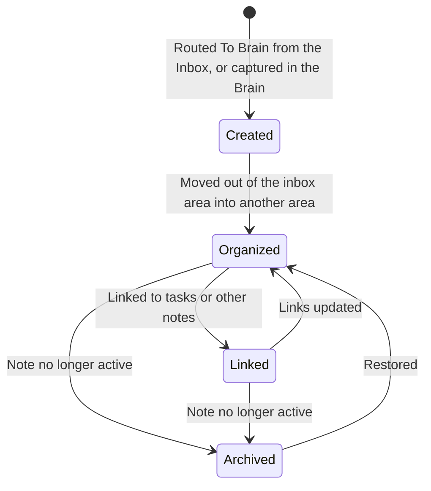

# Domain

```meta
type: domain
```

> One chapter per Aggregate, Domain Service, Domain Event, or Shared Value
> Objects / Shared Enums grouping in this bounded context.

## Knowledge Note

```meta
type: aggregate
related: [.devbook/domain/tasks/domain.md#task, .devbook/arc42/08-crosscutting-concepts.md#shared-data-types, .devbook/arc42/adr/0026-the-brain-is-a-personal-devbook-outside-any-repository.md, .devbook/domain/brain/domain.md#brain, .devbook/domain/brain/domain.invariants.md#knowledge-note]
aliases: [KnowledgeNote, Brain note]
```

**Knowledge note lifecycle**



The lifecycle states (Created, Organized, Linked, Archived) are workflow phases, not a stored enum field. The persisted state is the note's area, its `PARA Category`. A note in the Brain's inbox area (`_inbox` under the PARA default) is Created, and one in its archive area is Archived. A Brain that declares its own areas without an archive area has no Archived state.

An organized unit of project knowledge stored as Markdown, and the boundary for its own organization and links. Its rules are in [its invariants](domain.invariants.md#knowledge-note).

A Knowledge Note lives in the [Brain](#brain) as one Markdown file, a devbook chapter like any other. It keeps the devbook `meta` block and `annotation` fences (local ADR 0016), and adds three fields to the block (local ADR 0026):

| Field | Holds | Value object |
|---|---|---|
| `para` | The note's area, derived from its top folder; written only to override it. | [PARA Category](#para-category) |
| `repos` | The repositories a project note concerns. Project notes only. | [Project Ref](#project-ref) |
| `tasks` | The tasks the note links to. | [Task Link](#task-link) |

The file is the note. What the app derives from it stays out of the folder ([Nothing derived lands in the folder](requirements.md#requirement-nothing-derived-lands-in-the-folder)). The folder's own sync carries the note between machines, not the task feed, which tells it apart from an Inbox [Note](../inbox/domain.md#note) (local ADR 0025). An Inbox Note waits for triage, and triaging it **To Brain** makes a Knowledge Note of it.

As any devbook chapter, a note may also carry the two [planning fields](../devbook/domain.md#shared-value-objects), an Effort and a `roadmap` list. Devbook registers and owns them; the Brain only writes them.

The person and their agent write the note, and the pane saves the person's own edits. Of its own accord, the app changes an existing note in two ways only (local ADR 0052):

- **A link.** [Cross-Linking](#cross-linking) appends a task id to the `tasks` field, or a [Roadmap Tag](../tasks/domain.md#roadmap-tag) to the `roadmap` list, and changes nothing else in the file.
- **An archive move.** When the plan a project note names in its `roadmap` list is done, the person may press to move the note's file into the Brain's archive area. The move changes no byte inside the file, and a Brain without an archive area gets no offer.

The aggregate has no independently identified child entities; `Project Ref`, `Tag` and `Task Link` are value objects owned by the root.

### Project Ref

```meta
type: value-object
aliases: [ProjectRef, repo_id]
```

A scope link to a project/repo: `repo_id` and `project_name`. Equality is by value. A note may be scoped to any number of projects or repositories, none included.

### Task Link

```meta
type: value-object
aliases: [TaskLink, task_id]
```

A link from a note to one Task, by the task's stored id. A note writes it as one value of its `tasks` field, and the id is a GUID. [A task link is the task's id](requirements.md#requirement-a-task-link-is-the-tasks-id) says how it is read. A value that is no GUID links no task, and the note lists it as written.

A Task Link is not an address and not an edge. The Brain's database keeps a note's `tasks` values on the note's own node, as written. The app reads them from there both ways: the tasks a note names, and the notes that name a task. A task's record carries no note.

A Task Link is written into the note, either by the person or their agent, or by [Cross-Linking](#cross-linking) when the app makes a task from the note. The app only appends an id the list does not already hold (local ADR 0052).

### Tag

```meta
type: value-object
```

A `#keyword` for cross-cutting discovery (e.g. `#architecture`, `#performance`). Equality is by canonical `name`.

It is **this context's own** vocabulary: a person invents a `#keyword` to find notes across projects later, and it means what they use it to mean. It is not a [Roadmap Contribution](../devbook/domain.md#roadmap-contribution).

### PARA Category

```meta
type: value-object
aliases: [PARACategory, Brain area, para]
related: [.devbook/arc42/adr/0026-the-brain-is-a-personal-devbook-outside-any-repository.md, .devbook/domain/brain/features.md#brain-folder-setup]
```

The area a note is organized under: one top folder of the [Brain](#brain), shown as one tab. The list is open, with two parts:

- the **declared areas**: those the Brain's `CONVENTIONS.md` declares, each with its name, folder and place in the tab order, or the PARA set when it declares none;
- the **discovered areas**: every other top folder that holds at least one note anywhere below it, named after its folder, with no `Holds`.

A folder `CONVENTIONS.md` lists under `## Ignore` is never an area, nor is a dot-folder. A note's area is the top folder it sits in, unless its `para` field overrides it. Equality is by folder name. Local ADR 0026 records why the folders on disk decide the areas and `CONVENTIONS.md` only adds to them.

`CONVENTIONS.md` declares the areas under a heading named `Areas`, at any level. It writes them as a table with a `Folder` column (optionally `Area` or `Name`, `Holds` and `Order`) or as a list. A list item names the folder in backticks.

Which declarations count is [An area is one plain folder, declared once](domain.invariants.md#invariant-an-area-is-one-plain-folder-declared-once), and their order is [Declared areas keep the order written](domain.invariants.md#invariant-declared-areas-keep-the-order-written). A declared area keeps its tab while its folder is empty or missing, so a capture always has a target.

The discovered areas follow the declared ones, by folder name ([Discovered areas follow the declared ones](domain.invariants.md#invariant-discovered-areas-follow-the-declared-ones)). A top folder with no note in it is not an area until it gets one.

`CONVENTIONS.md` lists the folders that are never areas under a heading named `Ignore`. It writes them as list items naming the folder in backticks or bare, or a table with a `Folder` column. An ignored folder stays out even when `Areas` declares it ([An ignored folder is never an area](domain.invariants.md#invariant-an-ignored-folder-is-never-an-area)). Markdown files at the Brain's root, such as `README.md` and `CONVENTIONS.md`, belong to no area.

When `CONVENTIONS.md` declares no areas, the PARA set applies ([The areas are the declared ones, then the discovered ones](requirements.md#requirement-the-areas-are-the-declared-ones-then-the-discovered-ones)), in this order:

- `_inbox`: notes not yet filed; where a capture lands.
- `projects`: active work with a goal and a deadline.
- `areas`: ongoing responsibilities without a deadline.
- `resources`: reference material and collected knowledge.
- `people`: notes about the people the work involves.
- `journal`: dated entries.
- `archive`: inactive notes preserved for future search.

The name stays *PARA Category* because PARA is the default vocabulary a person starts from. A Brain with its own areas still files one area per note.

### Note Source

```meta
type: enum
```

Origin of the note: `inbox` (routed **To Brain** from triage), `manual` (written in the Brain, through the pane's **Capture** or an assistant's capture over MCP), or `import`.

## Cross-Linking

```meta
type: domain-service
related: [.devbook/domain/tasks/domain.md#task, .devbook/domain/tasks/domain.md#roadmap-tag, .devbook/arc42/adr/0052-the-app-may-write-links-into-a-brain-note-and-move-a-finished-project-note-to-the-archive.md, .devbook/domain/brain/domain.invariants.md#cross-linking]
```

Cross-Linking writes a link from a Knowledge Note to a Task or a plan into the note. When the app makes a task from a note, the service appends the task's id to the note's `tasks` field. For a plan, it appends the plan's [Roadmap Tag](../tasks/domain.md#roadmap-tag) to the `roadmap` list (local ADR 0052). It is a service because the link crosses two contexts: the note is the Brain's, and the task or plan it names is not.

The service only appends, and only to those two lists in the note's top `meta` block. It never removes, reorders or rewrites a value. A missing field is added as the last line of the block. Its rules are in [its invariants](domain.invariants.md#cross-linking).

It is a second writer beside capture's `IBrainNoteWriter`, which only creates notes. Removing or reordering a link stays the person's edit to the note.

Invocation semantics: invoked when the app makes a task or a plan from a note. A note whose top `meta` block is missing or does not parse is refused, and the caller is told why.

## Ubiquitous Language

```meta
type: ubiquitous-language
```

### Brain

```meta
type: term
aliases: [Brain, Second Brain, SecondBrain, brain scope, Brain scope]
related: [.devbook/arc42/adr/0026-the-brain-is-a-personal-devbook-outside-any-repository.md, .devbook/arc42/adr/0027-the-brain-is-a-scope-beside-the-repositories.md, .devbook/arc42/12-glossary.md#terms, .devbook/domain/brain/features.md#brain-scope]
```

The person's own notes: one devbook-shaped folder per user, outside every repository, whose [Knowledge Notes](#knowledge-note) are organized under its [areas](#para-category). Those are the ones its `CONVENTIONS.md` declares, then every other top folder that holds a note. The app builds its database into its own storage, never into the folder. It names its own bounded context (local ADR 0040). *Second Brain* is an alias: until 2026-09-15 it named the whole Devbook context, and now means only the person's own notes.

**Brain** is also the scope of everything filed against no repository: the first chip of the header's repository scope. Pressed, it narrows every view that reads the scope to the tasks with no repository, and opens the Brain in the Devbook pane. Both senses are one person's own things, work with no repository and notes outside every repository, which is why they share a name. Where the scope is stored, Brain is the empty string, a value no repository alias can take.

### Repo link

```meta
type: term
aliases: [repo link, RepoLink, From your Brain]
related: [.devbook/arc42/adr/0027-the-brain-is-a-scope-beside-the-repositories.md, .devbook/domain/brain/features.md#repo-links-and-backlinks]
```

A link from a Brain note into a repository devbook, written `repo:<alias>/<devbook path>[#slug]` in the note's `related` or body. It runs one way: a repository devbook never links into a Brain. Its reverse is the **From your Brain** list, the Brain notes a repository chapter shows as linking to it. Who sees that list, and what reading it writes, is [Backlinks reach only the owner and write nothing](requirements.md#requirement-backlinks-reach-only-the-owner-and-write-nothing).
