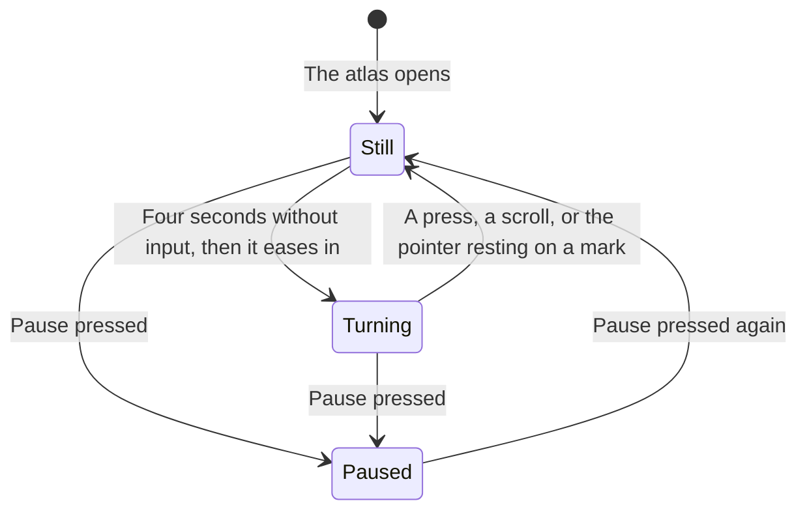
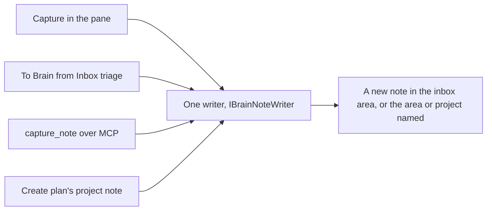

# Features

```meta
type: features
```

> What the Brain lets a person do, in business language.

## Knowledge capture

```meta
type: feature
related: [.devbook/domain/inbox/features.md#routing, .devbook/domain/brain/features.md#capture-into-the-brain]
```

Store notes, references, ideas and learnings as Markdown from inbox triage, manual creation or import, attached to projects, topics or tags. Every note is a file in the person's [Brain](domain.md#brain); [Capture into the Brain](#capture-into-the-brain) says where notes come from.

## PARA organization

```meta
type: feature
depends-on: [.devbook/domain/brain/features.md#knowledge-capture]
related: [.devbook/domain/brain/domain.md#para-category, .devbook/domain/brain/features.md#brain-folder-setup, .devbook/domain/brain/requirements.md#para-default-gains-someday, .devbook/arc42/adr/0054-clarify-outcomes-follow-gtd-and-each-item-has-one-home.md]
```

Organize notes into areas, one top folder and one tab each. The areas the Brain's `CONVENTIONS.md` declares come first. A Brain that declares none uses the PARA set:

- an inbox for what is not filed yet;
- Projects (active, deadline);
- Someday (possibilities not committed to; local ADR 0054);
- Areas (ongoing);
- Resources (reference);
- People;
- a Journal;
- Archive (inactive).

Every other top folder that holds a note follows as an area named after its folder, so a note filed into a new folder shows at once. A folder `CONVENTIONS.md` lists under `## Ignore` never becomes a tab.

A dated area lists newest first: the `journal` folder, or any area whose `Holds` line in `CONVENTIONS.md` says *dated*. Its entries are named by date, so name descending is date descending at every level; other areas list by name.

The Brain holds what is not actionable, and the backlog every commitment (local ADR 0054). A note points at the tasks it is about and holds none of them itself.

Moving a note to another area is moving its file to another folder. A note may name its area in its `para` field instead, which wins over the folder.

## Cross-project linking

```meta
type: feature
related: [.devbook/domain/brain/features.md#repo-links-and-backlinks]
```

Reference several projects and repos from one note, and discover notes across projects by tag. A project note names the repositories it concerns in its `repos` field. A note that points at one chapter of a repository's devbook uses a [repo link](#repo-links-and-backlinks).

## Topic and tag grouping

```meta
type: feature
related: [.devbook/domain/brain/domain.md#tag, .devbook/domain/devbook/domain.md#roadmap-contribution]
```

Group notes by topic, not just project, with cross-cutting tags, and search all knowledge content via the tag index.

These discovery tags are the context's own `#keyword`s, not a chapter's [Roadmap Contribution](../devbook/domain.md#roadmap-contribution). A chapter may also declare an [Effort](../devbook/domain.md#effort), which Devbook registers and Roadmap Planning only reads.

## Bi-directional linking

```meta
type: feature
related: [.devbook/domain/brain/requirements.md#bi-directional-linking, .devbook/domain/brain/domain.md#task-link, .devbook/arc42/adr/0026-the-brain-is-a-personal-devbook-outside-any-repository.md, .devbook/arc42/adr/0027-the-brain-is-a-scope-beside-the-repositories.md, .devbook/arc42/adr/0052-the-app-may-write-links-into-a-brain-note-and-move-a-finished-project-note-to-the-archive.md, .devbook/domain/brain/domain.invariants.md#cross-linking, .devbook/domain/tasks/features.md#search-filter-and-organize]
```

Link a Brain note to the tasks it is about, and see the link from both ends. A note names its tasks in its `tasks` field, one [Task Link](domain.md#task-link) per task, by the task's stored id. The Brain's database carries the field, and the app reads it both ways:

- **From the note.** Under its links into devbooks, the note shows a **Tasks** section. Each task this backlog holds is a gold chip reading its title, which opens the task in the task list. An id this backlog does not hold is a dashed chip reading *not in this backlog*. It is never an error, because one Brain is read beside more than one backlog.
- **From the task.** A task row, in the Brain scope and a repository scope, carries a teal **◆ n note** badge counting the Brain notes that name it. With one note, pressing it opens the Devbook on the Brain side at that note; with several, it lists them to pick from. Where the Devbook is off or has no Brain to read, the press shows a *not available* toast and opens nothing.

The link is written into the note only: a task's record carries no note. When the app makes a task from a note, through the pane's **Create task**, it appends the task's id to the note's `tasks` field. For a plan, made by **Plan this project**, it appends the plan's [Roadmap Tag](../tasks/domain.md#roadmap-tag) to the `roadmap` field ([Brain mode of the Devbook pane](#brain-mode-of-the-devbook-pane)). It changes nothing else in the file and adds no value the list already holds. A list written one `- id` per line stays that way, and the Brain's database reads it back as it reads `[a, b]`. It refuses a note whose top `meta` block it cannot parse (local ADR 0052). The badge is drawn only for the Brain's owner, from their own Brain (local ADR 0027 §6), so another reader of the same backlog sees none. Embedding a note's content in a task's details is not built.

## Brain scope

```meta
type: feature
related: [.devbook/domain/brain/requirements.md#brain-scope, .devbook/arc42/adr/0027-the-brain-is-a-scope-beside-the-repositories.md, .devbook/domain/tasks/features.md#search-filter-and-organize, .devbook/design/interaction-guidelines.md#shell-header, .devbook/domain/notifications/context.md#owner-screens]
```

Pick the Brain the way a repository is picked. The header's repository scope leads with a **Brain** chip, set off from the repository chips by a divider and worn in the Brain's teal. It cannot be removed and needs no repository, so the scope works for a person who has configured none.

Brain is the scope of everything filed against no repository. Pressed alone, it narrows Tasks, Board, Calendar, In progress, the Dashboard and Sessions to the tasks with no repository. It narrows the notification centre to the notifications about no repository. It also shows the Brain when the Devbook is opened. Pull requests and the Roadmap read Brain alone as nothing pressed: every pull request belongs to a repository, and the Roadmap reads one anchor. Ctrl adds it to the repositories already pressed, and nothing pressed still means everything.

The scope is remembered with Brain in its place, so a fresh shell reopens on it. The Tasks filter bar has no *No repo* chip: Brain is the one name for those rows. With the Brain and repositories pressed together, each row's repository badge says where the task is filed: **Brain** for no repository, else the alias.

Until a Brain folder is set up, the chip reads **Set up your Brain**, still scopes the tasks, and its tooltip points to Settings › Storage. The Devbook on the Brain side then shows a **Set up your Brain** button instead of areas. It opens Settings › Storage at the Brain folder card inside the app.

## Brain folder setup

```meta
type: feature
setting: .devbook/domain/brain/context.md#brain-folder
related: [.devbook/domain/brain/requirements.md#brain-folder-setup, .devbook/arc42/adr/0026-the-brain-is-a-personal-devbook-outside-any-repository.md, .devbook/domain/brain/domain.md#para-category]
```

Choose where the Brain lives, once, in Settings › Storage. The person picks a folder outside every repository. There is no default, and OneDrive is the expected place. [Brain folder](context.md#brain-folder) says what the field accepts. The Brain card says three things:

- whether the folder is synced, as information rather than a warning;
- that its search database is built in the app's storage and never synced;
- whether the folder's `README.md` and `CONVENTIONS.md` are present.

**Create conventions** writes both files and every area folder they declare, and never overwrites an existing file. The files come from a template the app ships, the PARA set by default. A folder whose own `CONVENTIONS.md` declares areas keeps those, so a person who wrote theirs first gets their areas, not the template's. The folder then carries its own convention, so a second machine reading the synced folder sees the same areas.

The shipped `CONVENTIONS.md` declares its areas as a table under an `## Areas` heading. Each area has one row, in tab order, with its name, folder and what it holds. With no rows, the PARA set applies. Its `## Ignore` section lists `_templates`, where note templates usually live, so templates never become a tab.

**Browse** opens the Windows folder picker in the installed app. A host without one, the browser harness among them, takes a typed path.

## Brain mode of the Devbook pane

```meta
type: feature
feature-flag: .devbook/domain/devbook/context.md#devbook-pane
related: [.devbook/domain/brain/requirements.md#brain-mode-of-the-devbook-pane, .devbook/domain/devbook/features.md#area-selection-and-scope, .devbook/arc42/adr/0027-the-brain-is-a-scope-beside-the-repositories.md, .devbook/design/interaction-guidelines.md#shell-header]
```

Read and write the Brain in the same pane that reads a repository's devbook. [Area selection and scope](../devbook/features.md#area-selection-and-scope) says which scope shows the Brain. On the Brain, the pane carries a teal **Brain** badge after its title. The folder's path sits where a repository's branch picker would be, and there is one tab per area: the declared areas, then the discovered ones.

**Show hidden** in the menu brings back what the Brain hides. Every folder `CONVENTIONS.md` lists under `## Ignore` and every dot-folder gets a tab after the rest, marked hidden, and an area's menu lists its dot-entries too. It is off by default, and the app remembers it per device in its own settings, never in the folder. It changes only what the pane shows: search, the atlas and the Brain database still leave hidden folders out.

The tree, the rendered chapter and the editor are the ones a repository devbook uses, and a Brain note is always editable. The reader leaves a remark on a note's block as on a chapter's, and edits, resolves or deletes it there. A Brain remark is stored under the Brain's scope, by the note's path from the Brain's root, so the agent lists and resolves it on `#brain`.

A note picks work up from above its body. **Create task** makes a draft task titled by the line the reader selected in the note, its list marker or checkbox dropped, or by the note's title when nothing is selected. The task is filed in the Brain scope, or once in each repository the note's `repos` field names. Each task carries `#brain:<path>` in its Devbook references, and its id is appended to the note's `tasks` ([Bi-directional linking](#bi-directional-linking)).

On a note under the projects area, **Plan this project** asks the plan drafter [Create plan](../inbox/features.md#create-plan-from-an-item) uses. Its input is the note with the Brain notes its `related` field names. The drafter's entries are imported under a `plan` entry titled from the note, which carries a fresh [Roadmap Tag](../tasks/domain.md#roadmap-tag) and the note as its Knowledge Ref. The tag is then appended to the note's `roadmap`. A plan naming a repository the note's `repos` does not is refused whole, as Create plan refuses one. Either action makes nothing while `repos` names a repository this workspace does not have, so a typo never registers one. Each drafted step is filed under the plan's tag at Draft, whatever the drafter wrote.

The line beside the buttons says what the press made. Once the press links the note, the open note is read again, so its Tasks section lists the new task at once. A note whose top `meta` block does not parse keeps the task or plan, and the line says the link was not written and why. Create task is disabled while no Brain folder is set; Plan this project also while no drafter is configured. Each says why in its tooltip.

What only a repository has is absent: branch updates, sync verdicts, scenario marks and opening the folder in an editor. Search is the same [Unified search](../devbook/features.md#unified-search) wherever it is opened. The **Atlas** button opens the Brain's own map ([Atlas edges](#atlas-edges)). Ask AI takes no Brain note as the open chapter.

The `Brain | <repo>` switch flips the pane between the Brain and a repository without touching the task filter. It is not remembered: any change to the scope puts the pane back on the anchor.

The header's toggle for the pane names what it shows: **Brain**, in teal, while the pane shows the Brain, and **Devbook** otherwise. The label is already right while the pane is closed, so a press opens the one it names, and it flips with the switch.

On the Brain, while the switch shows, the pane names itself *Devbook* at the start of its tab strip. The switch sits right after the title so it stays in place as the badge and path come and go.

The pane's own width decides its layout, not the window's. When the pane is narrower than a menu beside a readable column, the menu sits above the note. The menu is capped so the note still starts on screen, and a note's title wraps above its path rather than ending in an ellipsis.

With no folder set up yet, the pane on the Brain asks for one. A folder that is set but missing, or is not a path, says so in words and shows no tabs. A declared area whose folder does not exist yet still has its tab, which says the Brain has no such folder yet.

When the folder holds a OneDrive conflict copy, the pane says so and changes neither file: two edits to one note are the person's to merge. A conflict copy is `<name>-<MACHINE>.md` in the same folder as `<name>.md`, where MACHINE is the computer name OneDrive writes:

- 1 to 15 capitals, digits and hyphens;
- at least one capital.

So `plan-2.md`, `plan-draft.md` and `my-plan.md` stay ordinary notes. The warning names every pair.

## Repo links and backlinks

```meta
type: feature
depends-on: [.devbook/domain/brain/features.md#brain-mode-of-the-devbook-pane]
related: [.devbook/domain/brain/requirements.md#repo-links-and-backlinks, .devbook/domain/brain/domain.md#repo-link, .devbook/arc42/adr/0027-the-brain-is-a-scope-beside-the-repositories.md]
```

Point a Brain note at the repository chapter it is about. A [repo link](domain.md#repo-link), `repo:<alias>/<devbook path>[#slug]` in the note's `related` or body, renders as a chip naming the repository's alias and the chapter:

| Link state | Chip | It adds |
| --- | --- | --- |
| The alias is configured here, and its devbook shows the section the path lies in | Gold; opens that repository's devbook at the chapter | Nothing |
| The alias is not configured on this machine | Dashed | *not on this machine* |
| The alias is configured, but the path lies in no section its devbook shows | Dashed | *not a chapter in its devbook* |

A repository counts as configured here as a clone or as a branch snapshot. The chip's tooltip is the raw link in every state. An unresolved link is never an error, because the same Brain is read on machines with different repositories. Following a gold chip leaves the header scope alone: the pane reads the repository as it does for a task's reference. The switch or the scope brings the Brain back.

The reverse is shown, never written. Under a repository chapter, a teal **From your Brain** box lists the Brain notes that link to it, marked *Only you see this*. It reads the owner's own Brain database and writes nothing into the repository, so personal notes never reach shared history. A repository devbook cannot link into a Brain.

A link to any heading of the chapter's file counts. A note is listed once. It sits under the first chapter if all its links sit inside chapters, and on its own if any link is in `related` or outside every chapter. A chapter no note links to draws no box.

Each note in the box is a link. Following it puts the note on the Brain side of the pane, as a Brain search result does. It leaves the header's scope and the task filter alone.

## Atlas edges

```meta
type: feature
depends-on: [.devbook/domain/brain/features.md#repo-links-and-backlinks]
related: [.devbook/domain/brain/requirements.md#atlas-edges, .devbook/design/component-libraries.md]
```

See where the Brain reaches into the repositories. On the Brain, the pane's **Atlas** button maps the whole Brain: its notes, grouped by area, and the links between them, read from the Brain's own database. Each repo link, in a note's `related` or prose, is an edge to a node for the repository chapter it names. The edge is labelled with the repository's alias, and the chapters of one repository gather in one group named for that alias. One chapter is one node, whichever devbook layout or alias case a note wrote it in.

A link this machine can follow is a solid edge to a filled node. One it cannot is a dashed edge to a hollow node, like its chip. The atlas reads no repository: a repository node shows the link's own words.

An edge's label sits at the middle of its curve unless that overlaps a node, a node's label or another edge's label. It then steps along the curve or just above or below it. An edge with no free seat goes unlabelled, because the node labels are what the reader navigates by.

Selecting a repository node shows the link's chip. A gold chip opens that repository's devbook at the chapter, as a chip in a note does; a dashed one says why it cannot be followed. Selecting a note offers to open it in the pane. Both close the map. With no Brain index built yet, the atlas says so rather than drawing an empty map.

## Lobes atlas

```meta
type: feature
depends-on: [.devbook/domain/brain/features.md#atlas-edges]
feature-flag: .devbook/domain/brain/context.md#lobes-atlas
related: [.devbook/domain/brain/requirements.md#lobes-atlas, .devbook/domain/brain/features.md#para-organization, .devbook/domain/devbook/features.md#repository-devbook-areas, .devbook/design/component-libraries.md#diagram-and-graph-strategy, .devbook/design/color-scheme.md#the-brains-accent, .devbook/design/interaction-guidelines.md#motion-and-reduced-motion]
```

See the Brain and the devbook of every repository registered on this machine in one atlas. It opens full-window from the shell header's **Atlas**, in place of whatever was on screen. It draws each of them as a brain: drag to rotate it, scroll to zoom. Each note or chapter on a brain is a **mark**, the same thing [Atlas edges](#atlas-edges) calls a node.

Its close button, Escape and a second press of **Atlas** return to where the person was:

- the main view;
- the takeover that was up;
- the Devbook, when its button opened the atlas.

If that takeover or the Devbook has since been switched off, they return to the main view instead, and the tooltip names the main view.

**Scopes.** The atlas draws what the shell header's repository scope selects: one member is that scope alone; several, or none pressed (every repository), is **All** with just those. Ghost devbooks are in no repository scope, so a **Ghosts** toggle at the top right, offered while one exists, draws every ghost in All too. A change of what is drawn brings the camera home. The new layout's brains turn from where the last view left them to the default view in about half a second, easing in and out. Under reduced motion the new layout starts at the default view.

| Scope | The atlas shows |
| --- | --- |
| **All** | The Brain in the middle, each devbook in view as a smaller brain around it |
| **Brain** | The Brain alone, by region |
| One per devbook | That devbook alone, by region, with a Brain hub beside it |

When nothing in scope has a devbook, such as a repository with none pressed alone,
the atlas says so in words and offers another pick or **Ghosts**. It never draws
an empty map or everything.

**Layout.** The map fills the atlas, and everything else floats over it:

- the title at the top left;
- the left panel, with the scope card under it;
- the picture's controls and chips at the top right;
- the list of marks down the right;
- the foot along the bottom.

A drag or a scroll that starts on any of them leaves the camera alone.

In a window 60rem wide or narrower nothing floats. The parts stack in one column, in the order the keyboard meets them:

- the title;
- the controls;
- the chips, which keep one row and scroll sideways;
- one disclosure that folds the panel and scope card away;
- the map, with its list under it;
- the foot.

**The idle turn**



**The camera.** The brains move like a globe in the hand. A drag carries the near face of a brain with the pointer, across as well as up and down. A brisk drag carries on after release and comes to rest within about a second.

A press on brains still turning only stops them and selects nothing. A press on a mark that does not move selects the mark and leaves the camera where it is. A scroll zooms toward the point under the pointer, easing to each step, between half and 2.4 times.

The idle turn is slow, about once in a hundred seconds. Showing or hiding a region, or turning Labels on or off, keeps the camera where it was and moving as it was. Under reduced motion nothing moves on its own: a drag turns the brains only while it lasts, and a scroll and a new layout land at once.

**Pause** stops the turn on its own. It reads as pressed while the turn is held, and lasts while the atlas is open. A fling, a drag and the zoom still move the brains while paused.

A repository alias the Brain links to that is not registered on this machine is a **ghost devbook**. It is drawn dashed in All while **Ghosts** is on, and its row in the panel steps into it alone, with its own card. Wherever it is drawn, it shows only its outline and the chapters the notes name, in the link's own words, because the atlas reads no repository ([Atlas edges](features.md#atlas-edges)).

**Brain regions.** A note's region comes from its PARA area; its `para` field wins over its folder ([PARA organization](features.md#para-organization)).

| Region | Brain notes |
| --- | --- |
| Frontal | Projects |
| Parietal | Areas, Resources, and any area `CONVENTIONS.md` declares beyond PARA |
| Temporal | People |
| Occipital | The repository chapters the notes link to |
| Cerebellum | Journal and the inbox |
| Brain stem | The area roots and `CONVENTIONS.md` |

Archive is no region: its notes are the faint dust around the outside.

**Devbook regions.** A chapter's region comes from its folder.

| Region | Devbook folder |
| --- | --- |
| Frontal | `arc42/` |
| Parietal | `tech/` |
| Temporal | `domain/` |
| Occipital | `design/` |
| Cerebellum | `ai/` |
| Brain stem | Each folder's convention root and the reading-order roots |

Parietal starts hidden in each devbook's scope. The atlas holds a devbook's `tech/` chapters but draws them only once the reader turns the region on. The reader does so with its chip, its row in the left panel or **All**. The panel still lists Parietal with its count while it is hidden.

Technology starts hidden in All too: no devbook's `tech/` chapters are drawn or listed there. All has no region chips, so it carries one more toggle, **Tech**, after **Labels** and **Pause** at the top right. It starts off; turning it on draws every devbook's `tech/` chapters in their Parietal regions, and turning it off hides them again. It acts on All alone and leaves each devbook scope's own Parietal chip as the reader set it.

**Hubs and ghost chapters.** The Brain stem holds one hub for `CONVENTIONS.md` and one for each area. Occipital draws the repository chapters the notes link to as one hub per repository alias, with a bundle to each chapter. A chapter of a note takes the note's region, and a PARA area kept under another folder name keeps its region.

A chapter a registered devbook's index does not hold is drawn dashed inside that devbook, in the link's own words. Its chip reads *not a chapter in its devbook*. Every chapter the notes name in a devbook not indexed yet is drawn the same way. Its chip reads *its devbook is not indexed yet — see its scope card*, because the index is missing, not the chapter.

**Counts.** Each scope counts its marks per region, its notes or chapters without the hubs, and the Brain notes that link into it. The Brain's count is the notes that link into any devbook. In All, the tag over each brain gives its name and count; a ghost devbook, which has no count here, reads *not registered* instead.

**Colour and bundles.** Brain marks wear the Brain's accent, `color-band-2`; devbook marks are gold. In All, bundles run from the Brain's repository hubs to the chapters the notes link. In a devbook's scope, a Brain hub floats beside the devbook with those same bundles. A bundle is solid when the link resolves and dashed when it does not, as in [Atlas edges](features.md#atlas-edges).

**The left panel.** In All it lists the scopes in view, each with its count. A registered one's row asks the header's scope for it alone, and a ghost's row steps into that ghost. With no header to ask, the rows are a plain legend. In a single scope it lists that scope's six regions, each with what it holds and its count; a row shows or hides the region. The panel's heading names what it lists: **Scopes**, **Anatomical regions** for the Brain, **Devbook folders** for a devbook.

**The top right.** **Labels** and **Pause** sit beside the close button, then **Tech** in All and **Ghosts** while a ghost exists. In a single scope **All** and **None** follow, with one chip per region under them, named by a short code such as `FRO` or `ARC`. All has no chips.

A chip shows or hides what it names, as the panel's row does. **All** and **None** act on the current scope only, so regions hidden in another scope stay hidden.

In a scope, **None** hides the Archive dust with the regions, so nothing is left on the map or in the list, and **All** shows it again. The dust has no chip or row of its own, so showing one region after **None** leaves it hidden until **All**. The picture's **All** is named *All regions* for a screen reader or speech input.

**The scope card.** Below the list, a scope card names the scope with its counts and says when its index was last built, such as "Indexed 4 minutes ago" or "Not indexed yet". It offers one action:

| Scope | The card's action |
| --- | --- |
| All | **Step into the Brain**, which asks the header's scope for the Brain alone |
| The Brain | **Open in the pane** |
| A devbook | **Open devbook** |
| A ghost devbook | **Register repository**, which opens the Repositories settings, and **Back to all scopes** |

With no header to ask, All's card offers none. A ghost devbook has no index of its own here, so its card gives no time. Coming back from the Repositories settings reopens the atlas on that ghost, with the same way back. Once the alias is registered, the header's scope selects that repository and the atlas follows it.

**The foot.** The map's bottom edge holds the hint "Drag — rotate · Scroll — zoom", which ends with the zoom level. An orientation marker beside it draws the superior, anterior and left axes turning with the camera.

**Every control.** Each control of the atlas is a real button at least 44 px square with a visible focus ring, and every toggle reports whether it is pressed.

**Selecting a mark.** A mark selected on the map or in the list opens its details, as [Atlas edges](features.md#atlas-edges) does. A Brain note offers to open it in the pane. A chapter a note links to shows the link's chip: gold opens that repository's devbook at the chapter, dashed says why it cannot be followed. A devbook's own chapter opens in its devbook. Following any of them, or the card's **Open in the pane** or **Open devbook**, gives the Devbook the screen and closes the atlas.

**Browsing the list.** The list beside the map is one tab stop. The arrow keys, Home and End move from row to row and spotlight that mark on the map without opening its details. Enter or Space opens them, and Escape closes them with the focus back on the mark's row.

**No index yet.** The atlas shows an empty state instead of a map, with the Brain named in a badge beside the title. It says the Brain is not indexed yet and offers **Build the index now** and **Back to notes**.

Building runs the refresher that builds the index in the background. The map takes the empty state's place once the index exists. A build that fails, or finds nothing to index, says why and keeps the offer. A host that cannot build the index offers only **Back to notes**, which leaves the atlas as the close button does.

**Where it opens.** While the flag is on, the Devbook pane's **Atlas** button opens this atlas on the header's repository scope, whose anchor the pane reads. While it is off, the button opens today's atlas. The Technology section keeps its own views either way; no atlas draws the stack.

## Capture into the Brain

```meta
type: feature
depends-on: [.devbook/domain/brain/features.md#brain-mode-of-the-devbook-pane]
related: [.devbook/domain/brain/requirements.md#capture-into-the-brain, .devbook/domain/inbox/features.md#route-to-brain, .devbook/domain/inbox/features.md#create-plan-from-an-item, .devbook/domain/inbox/domain.md#itemtriaged]
tests: [unit:dotnet:Backlog.Desktop.UI.UnitTests.DevbookPaneBrainCaptureTests, unit:dotnet:Backlog.Infrastructure.FileSystem.UnitTests.BrainNoteWriterTests, unit:dotnet:Backlog.Infrastructure.Devbook.UnitTests.BrainNoteTextTests, unit:dotnet:Backlog.Infrastructure.FileSystem.UnitTests.InboxBrainTargetTests.A_project_note_lands_in_the_projects_area_naming_the_plan_s_tag, unit:dotnet:Backlog.Infrastructure.Devbook.UnitTests.BrainNoteDestinationsTests, unit:dotnet:Backlog.Infrastructure.Mcp.UnitTests.BrainScopeToolsTests.A_capture_lands_in_the_inbox_area_and_reads_back_as_written]
```



Get a thought into the Brain without leaving what is on screen. In Brain mode the pane header carries **Capture**: a title and a Markdown body, written as a new note with its `meta` block in the Brain's inbox area. That area is `_inbox` under the PARA default, or the area `CONVENTIONS.md` marks as the inbox. Inbox triage writes the same kind of note through its **To Brain** route, from a capture or an Inbox note, keeping the title and body.

The writer takes a target area: an area's folder, or a folder below one such as a project's (`someday`, `projects/launch`). With none it writes into the inbox area. A target that is not one of the Brain's areas, or climbs out of the Brain or into a dot-folder, is refused in words and nothing is written. The writer also lists where a note can go, which is the list To Brain's destination picker shows ([Route to Brain](../inbox/features.md#route-to-brain)). Create plan's **Also start a project note** writes through it too, into the projects area, with the plan's Roadmap Tag already in the note's `roadmap` list ([Create plan from an item](../inbox/features.md#create-plan-from-an-item)).

Whatever the person typed stays text. A heading, fence or meta block typed into a capture gets a zero-width space just before its marker. The space is invisible when read, and no reader takes the line for structure.

The note's file is named after its title (`Ideas for the sync` is `ideas-for-the-sync.md`), in whichever folder it lands. A name already taken gets `-2`, `-3` and on, so capture never overwrites a note already in the Brain. Capture only creates notes; appending a link to an existing note is [Cross-Linking](domain.md#cross-linking)'s job, beside it ([Bi-directional linking](#bi-directional-linking), local ADR 0052). Its `meta` block says `type: note` and its [source](domain.md#note-source), `manual` from Capture and `inbox` from To Brain. Once written, the pane opens it. An assistant calls the capture tool over MCP ([MCP Brain scope](#mcp-brain-scope)).

## MCP Brain scope

```meta
type: feature
depends-on: [.devbook/domain/brain/features.md#capture-into-the-brain]
related: [.devbook/domain/brain/requirements.md#mcp-brain-scope, .devbook/arc42/adr/0012-backlog-is-an-mcp-server-inside-the-desktop-app.md, .devbook/domain/devbook/features.md#review-notes-in-a-chapter]
tests: [unit:dotnet:Backlog.Infrastructure.Mcp.UnitTests.BrainScopeToolsTests, unit:dotnet:Backlog.Infrastructure.Mcp.UnitTests.BrainReviewToolTests, unit:dotnet:Backlog.Infrastructure.Mcp.UnitTests.McpToolCreationTests.A_host_without_the_brain_ports_still_builds_the_devbook_tools]
```

Let an assistant read and write the Brain through the same tools it uses on a repository devbook. The knowledge tools the app serves over MCP take the Brain as `#brain` in place of a repository's `owner/name`. They list the contexts, read a chapter, and list and resolve the reader's [remarks](../devbook/domain.md#remark).

The spelling is not the empty string the shell stores for the Brain (local ADR 0027 §5). An empty repository argument is already refused as missing, and a session that forgot it must never be handed the person's own notes. On these tools that refusal names both things the argument can be: an `owner/name`, or `#brain`. It is not `brain`, which a repository could be called. A GitHub owner or name cannot hold a `#`, and a configured repository line that starts with one is a comment. So `#brain` matches no repository, and is matched before any repository is looked up.

A Brain note is named by its path from the Brain's root (`projects/plan.md`), never under a dot-folder and never through a link out of the folder. The remarks on it are the ones the reader left on the Brain, and a remark is resolved only under the scope it belongs to.

The same spelling addresses a note from outside the Brain: `#brain:<path from the Brain's root>`. A plan's Knowledge Ref and a task's Devbook references may hold it ([Knowledge Ref](../roadmap/domain.md#knowledge-ref), local ADR 0053). An assistant that lists a task's references gets the address, and reads the note by passing `#brain` and the path to the read tool. It resolves only for the Brain's owner; for anyone else, and where no Brain is set, it reads as unresolved.

The capture tool, `capture_note`, writes a new note into the Brain's inbox area through the writer the pane's Capture uses. It applies the same guard on the text and writes source `manual`. A second capture with the same title is a second note. The tool answers the note's path from the Brain's root, which the read tool takes as it is. Where no Brain is set, or the host has none, the tools say so in words rather than failing.

An action an assistant hears goes to the Inbox instead, through `capture_to_inbox`, so it reaches clarify ([Work the queue over MCP](../inbox/features.md#work-the-queue-over-mcp), local ADR 0054).

`list_brain_reviews` answers the notes whose `review` date has come, oldest first, each with its path from the Brain's root ([A note's review date comes due](requirements.md#requirement-a-notes-review-date-comes-due), local ADR 0054 §6). It compares against today unless the call names a day. A note whose value is no `YYYY-MM-DD` date is listed under warnings and left out, never an error. Like `capture_note` it is the Brain's alone and takes no scope, and like it, it says so in words when no Brain is set or the host has none. Under `toArchive` it also lists every finished plan's project note still in the projects area, with the plan that gathers it ([Archiving a finished plan's project note](../roadmap/features.md#archiving-a-finished-plans-project-note), local ADR 0052 §5).

