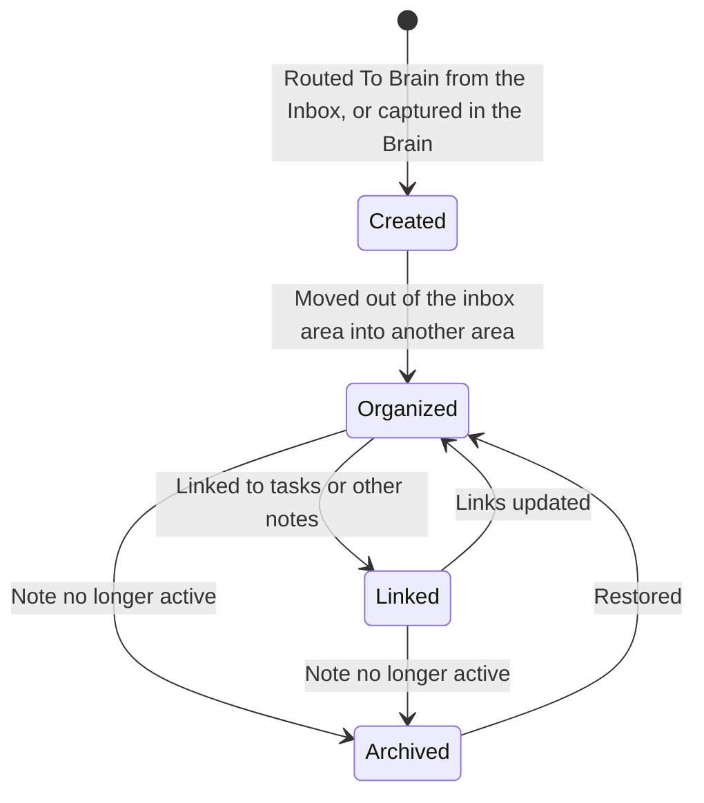

# Flow

```meta
type: flow
status: draft
```

> How a Knowledge Note moves through its workflow phases over time.

## Knowledge note lifecycle



- The lifecycle states (Created/Organized/Linked/Archived) are workflow phases,
  not a stored enum field. The persisted state is the note's area: a note in the
  Brain's inbox area (`_inbox` under the PARA default) is Created, and a note in
  its archive area is Archived. A Brain that declares its own areas without an
  archive area has no Archived state.
