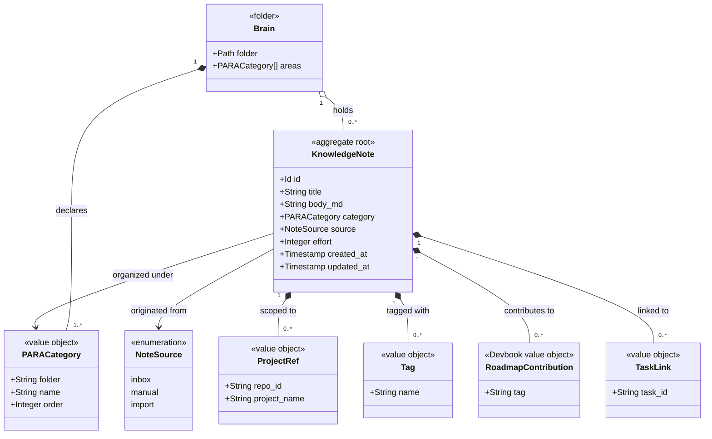

# Model

```meta
type: model
status: draft
```

> Structural view of the Brain's domain model: the aggregate, its value objects,
> and their relationships. `domain.md` holds the responsibilities in prose.

## Model diagram



## Relationship notes

- `KnowledgeNote` is the aggregate root. `ProjectRef`, `Tag`, and `TaskLink` are
  owned value objects, and there are no separately identified child entities.
  `RoadmapContribution` and `effort` are the
  [planning fields](../devbook/domain.md#shared-value-objects) every devbook chapter
  may carry: a note carries them, and Devbook defines them.
- `Brain` is the folder the person picked, not an aggregate: it holds the notes
  as Markdown files. Its areas are the ones `CONVENTIONS.md` declares, the PARA
  set when it declares none, then every other top folder holding a note, minus
  the folders its `## Ignore` lists. A note's `PARACategory` is one of those
  areas, read from the note's top folder unless its `para` field overrides it.
- `ProjectRef` is written as the note's `repos` field and `TaskLink` as its
  `tasks` field (local ADR 0026). A `repo:` link to a repository chapter is not a
  `ProjectRef`: it addresses one chapter, and the Brain's database keeps it as an
  edge that resolves only on a machine where that repository is configured.
- `TaskLink` references a Task by id only, never by object reference,
  so the two contexts stay decoupled. It is a value on the note's node, not an
  edge. Both directions are read from the note's `tasks` field, and a task's
  record carries no note ([Bi-directional linking](features.md#bi-directional-linking)).
- `effort` is the [Effort](../devbook/domain.md#effort) scalar on the root. It carries no relationship to another type. Roadmap
  Planning reads and totals it; Devbook owns it.
- Neither `Tag` nor `RoadmapContribution` is an edge in the knowledge graph; for
  the contribution, see
  [its invariant](../devbook/domain.invariants.md#invariant-a-roadmap-contribution-draws-no-graph-edge).
  Why they are two different things is the
  [Roadmap Contribution](../devbook/domain.md#roadmap-contribution) chapter's.

