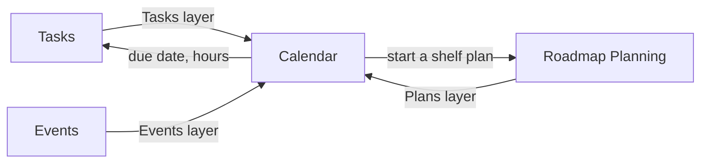

# Calendar

```meta
index: root
type: context
deployment: module
related: [.devbook/arc42/adr/0055-calendar-is-a-surface-of-its-own-that-reads-layers.md, .devbook/arc42/adr/0056-the-calendar-owns-its-grid-and-tasks-is-one-layer.md, .devbook/arc42/adr/0022-the-shell-shows-one-main-view-picked-by-a-view-switch.md, .devbook/arc42/adr/0042-repository-management-owns-pull-request-state.md, .devbook/arc42/adr/0043-a-surface-can-open-in-its-own-window.md, .devbook/domain/context-map.md]
```

The Calendar lays what other contexts own out on a month or a week. It owns no data:
each source draws on it as a [Calendar Layer](domain.md#calendar-layer).

Inside the boundary:

- the Calendar surface, its grid, its range and its days;
- the layer ports each source answers;
- the [layer choices](domain.md#layer-choice) and the range, remembered on this device.

Outside it:

| Concern | Owner |
|---|---|
| Tasks, their due dates and their planned hours | [Tasks](../tasks/features.md#tasks-on-the-calendar) |
| The Tasks filter bar, the open task and the selection, none of which reaches the Calendar | [Tasks](../tasks/features.md#search-filter-and-organize) |
| Plans, their windows, the shelf and the working week | [Roadmap Planning](../roadmap/features.md#laying-out-a-plan-whose-tasks-arrived-first) |
| Knowledge events and their key dates | [Events](../events/features.md#events-on-the-calendar) |
| The repository scope and the repository colours | The window's view state, which the desktop shell answers |
| The header, the windows a surface opens in, and showing another surface | The desktop shell (local ADR 0043) |



A layer writes only back through its source, which decides whether the change is
taken. The Events layer writes nothing.

These chapters are the model decided in local
[ADR 0055](../../arc42/adr/0055-calendar-is-a-surface-of-its-own-that-reads-layers.md),
as local [ADR 0056](../../arc42/adr/0056-the-calendar-owns-its-grid-and-tasks-is-one-layer.md)
changes it. 0055 is proposed and 0056 accepted, and the module `Backlog.Modules.Calendar`
is built as both decide. `Backlog.Modules.Calendar.Abstractions` holds the layer ports,
and `Backlog.Modules.Calendar.UI` the surface and its grid.

- **Grid:** the Calendar's own, `CalendarGrid` in `Backlog.Modules.Calendar.UI`. Built.
- **Tasks layer:** the Calendar's own port, `ICalendarTasks`, which an adapter answers
  over Tasks' published contract. Built.
- **Plans layer and the hours worked each day:** the Calendar's own ports, which adapters
  answer over Roadmap Planning. Built.
- **Events layer:** the Calendar's own port, which an adapter answers over Events. Built.
- **Range, Show tasks, Show plans and Show events:** the Calendar's own view choices.
  Built.
- **Opening a task:** the Calendar asks the window to show the Tasks view with the task
  open, naming it by the published surface id and key. Built.
- **Header tab:** the Calendar's own, outside the view switch. Built.

## Calendar range

```meta
type: setting
key: calendarRange
scope: user
default: Month
related: [.devbook/domain/calendar/features.md#calendar-view, .devbook/domain/calendar/domain.md#range]
```

Whether the Calendar shows a **Month** or a **Week**. The person picks it beside the
month's name, and it is remembered on this device in `shell-navigation.json`. The date
shown is never remembered.

## Show tasks

```meta
type: setting
key: calendarTasksShown
scope: user
default: on
related: [.devbook/domain/calendar/features.md#calendar-view, .devbook/domain/calendar/domain.md#layer-choice, .devbook/domain/tasks/features.md#tasks-on-the-calendar, .devbook/arc42/adr/0056-the-calendar-owns-its-grid-and-tasks-is-one-layer.md]
```

Whether the Tasks layer is drawn, the tasks and their planned hours together. On, each
task with a due date in the range is drawn. Off, no task and no hours are drawn.
Remembered on this device in `shell-navigation.json`, a key local ADR 0056 §4 adds. A
file without it reads as on.

## Show plans

```meta
type: setting
key: calendarPlansShown
scope: user
default: off
related: [.devbook/domain/calendar/features.md#calendar-view, .devbook/domain/calendar/domain.md#layer-choice]
```

Whether the Plans layer is drawn. Remembered on this device in `shell-navigation.json`
under the name ADR 0022 §6 gave it.

## Show events

```meta
type: setting
key: calendarEventsShown
scope: user
default: off
related: [.devbook/domain/calendar/features.md#calendar-view, .devbook/domain/calendar/domain.md#layer-choice, .devbook/domain/events/context.md#events-area]
```

Whether the Events layer is drawn. It is offered only while the
[Events area](../events/context.md#events-area) is on, and is remembered on this device
apart from Show plans.

## Dependencies

### Outbound dependencies

| Depends on (context/module) | DDD pattern | Integration mechanism | Contract | Why |
|---|---|---|---|---|
| [Tasks](../tasks/features.md#tasks-on-the-calendar) | Customer/Supplier | `ICalendarTasks` in `Backlog.Modules.Calendar.Abstractions`, answered by `TasksCalendarTasks` under `Infrastructure.FileSystem/Calendar/`, or `NoCalendarTasks` (Off) in a host without Tasks | `ITaskItems`, `ITaskStore` and `ITaskChangeSignal` in `Backlog.Modules.Tasks.Abstractions`; local ADR 0056 §2 | The tasks with a due date in the range, their hours, and the due-date and hours writes back |
| [Roadmap Planning](../roadmap/domain.md#roadmap-item) | Customer/Supplier | `ICalendarPlans` and `ICalendarCapacity` in `Backlog.Modules.Calendar.Abstractions`, answered by `RoadmapCalendarPlans` and `RoadmapCalendarCapacity` under `Infrastructure.FileSystem/Calendar/` over Roadmap's abstractions | Roadmap's plans, shelf and working week | The plan bars, the shelf drop, and a day's capacity |
| [Events](../events/domain.md#knowledge-event) | Customer/Supplier | `ICalendarEvents` in `Backlog.Modules.Calendar.Abstractions`, answered by `EventsCalendarEvents` under `Infrastructure.FileSystem/Calendar/`, or `NoCalendarEvents` (Off) in a host without Events | `IKnowledgeEventReader` in `Backlog.Modules.Events.Abstractions` | The event bars and key dates |
| The desktop shell | Composition root | `ICalendarWindowScope`, which the host answers from the window's view state as `ShellCalendarWindowScope`, and `ISurfaceNavigator` (local ADR 0043 §3) | The repository scope and colours; the `tasks` surface id and its `entry` key | Narrowing the Tasks layer, colouring chips and bars, and opening a task in the Tasks view |

### Inbound dependents (known)

| Consumer (context/module) | DDD pattern | Integration mechanism | Contract | What it relies on |
|---|---|---|---|---|
| The desktop shell | Composition root | A view-group `ShellSurface`, id `calendar` (local ADR 0043) | The surface registration | The Calendar's own header tab after the view switch `Tasks \| Board \| Roadmap` (local ADR 0056 §7), and `lastView: calendar` reopening on it |
