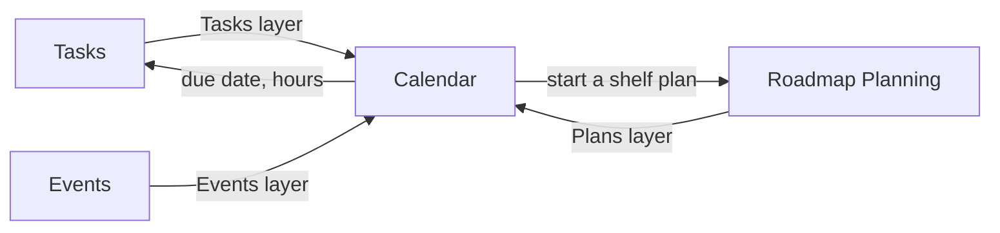

# Calendar

```meta
index: root
type: context
deployment: module
related: [.devbook/arc42/adr/0055-calendar-is-a-surface-of-its-own-that-reads-layers.md, .devbook/arc42/adr/0022-the-shell-shows-one-main-view-picked-by-a-view-switch.md, .devbook/arc42/adr/0042-repository-management-owns-pull-request-state.md, .devbook/arc42/adr/0043-a-surface-can-open-in-its-own-window.md, .devbook/domain/context-map.md]
```

The Calendar lays what other contexts own out on a month or a week. It owns no data:
each source draws on it as a [Calendar Layer](domain.md#calendar-layer).

Inside the boundary:

- the Calendar surface, its range and its days;
- the layer ports each source answers;
- the [layer choices](domain.md#layer-choice) and the range, remembered on this device.

Outside it:

| Concern | Owner |
|---|---|
| Tasks, their due dates and their planned hours | [Tasks](../tasks/features.md#tasks-on-the-calendar) |
| The Tasks filter bar and the open task | [Tasks](../tasks/features.md#search-filter-and-organize) |
| Plans, their windows, the shelf and the working week | [Roadmap Planning](../roadmap/features.md#laying-out-a-plan-whose-tasks-arrived-first) |
| Knowledge events and their key dates | [Events](../events/features.md#events-on-the-calendar) |
| The header and the windows a surface opens in | The desktop shell (local ADR 0043) |



A layer writes only back through its source, which decides whether the change is
taken. The Events layer writes nothing.

These chapters are the model decided in local
[ADR 0055](../../arc42/adr/0055-calendar-is-a-surface-of-its-own-that-reads-layers.md),
which is proposed. The code still draws the Calendar as a layout of the Tasks pane,
through ports Tasks owns, and its stored choices sit in `ShellNavigationStore`. A later
`flow-code` change builds the module `Backlog.Modules.Calendar`, with
`Backlog.Modules.Calendar.Abstractions` for the layer ports and
`Backlog.Modules.Calendar.UI` for the surface.

## Calendar range

```meta
type: setting
key: calendarRange
scope: user
default: Month
related: [.devbook/domain/calendar/features.md#calendar-view, .devbook/domain/calendar/domain.md#range]
```

Whether the Calendar shows a **Month** or a **Week**. The person picks it beside the
month's name, and it is remembered on this device in `shell-navigation.json`. The date
shown is never remembered.

## Show plans

```meta
type: setting
key: calendarPlansShown
scope: user
default: off
related: [.devbook/domain/calendar/features.md#calendar-view, .devbook/domain/calendar/domain.md#layer-choice]
```

Whether the Plans layer is drawn. Remembered on this device in `shell-navigation.json`
under the name ADR 0022 §6 gave it.

## Show events

```meta
type: setting
key: calendarEventsShown
scope: user
default: off
related: [.devbook/domain/calendar/features.md#calendar-view, .devbook/domain/calendar/domain.md#layer-choice, .devbook/domain/events/context.md#events-area]
```

Whether the Events layer is drawn. It is offered only while the
[Events area](../events/context.md#events-area) is on, and is remembered on this device
apart from Show plans.

## Dependencies

### Outbound dependencies

| Depends on (context/module) | DDD pattern | Integration mechanism | Contract | Why |
|---|---|---|---|---|
| [Tasks](../tasks/features.md#tasks-on-the-calendar) | Customer/Supplier | Tasks layer port, answered by an adapter (not built) | Tasks' published task contract | The tasks by due date, their hours, and the writes back |
| [Roadmap Planning](../roadmap/domain.md#roadmap-item) | Customer/Supplier | Plans layer port and the hours worked each day, answered by adapters (not built; today `ICalendarPlans` and `ICalendarCapacity` in Tasks) | Roadmap's plans, shelf and working week | The plan bars, the shelf drop, and a day's capacity |
| [Events](../events/domain.md#knowledge-event) | Customer/Supplier | Events layer port, answered by an adapter (not built; today `ICalendarEvents` in Tasks) | `IKnowledgeEventReader` in `Backlog.Modules.Events.Abstractions` | The event bars and key dates |

### Inbound dependents (known)

| Consumer (context/module) | DDD pattern | Integration mechanism | Contract | What it relies on |
|---|---|---|---|---|
| The desktop shell | Composition root | A view-group `ShellSurface`, id `calendar` (local ADR 0043) | The surface registration | The Calendar's slot in `Tasks \| Board \| Calendar \| Roadmap` |
