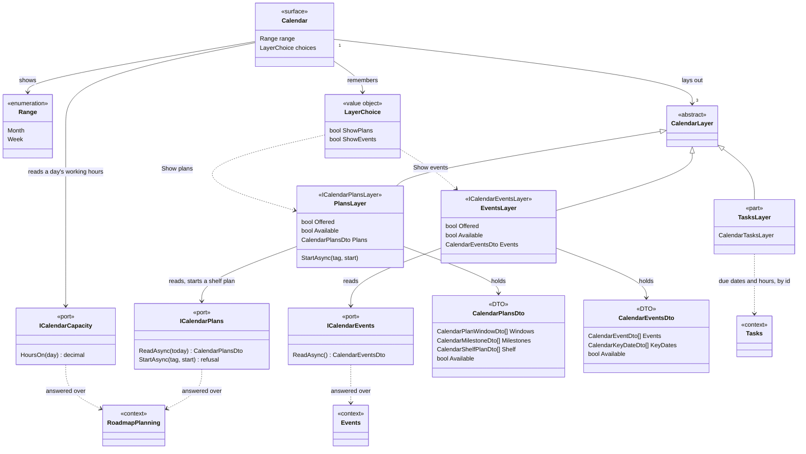

# Model

```meta
type: model
related: [.devbook/domain/calendar/domain.md#calendar-layer, .devbook/domain/calendar/domain.md#layer-choice, .devbook/domain/calendar/domain.md#range]
```

> Structural view of what the Calendar holds and reads. It owns no aggregate, so the
> diagram draws its [layers](domain.md#calendar-layer), its [range](domain.md#range) and
> [layer choices](domain.md#layer-choice), and the ports each source answers.
> [`domain.md`](domain.md) says what each word means.

## Model diagram



## Relationship notes

- The Calendar stores only its range and its layer choices, on this device
  (`ICalendarViewPreferences`, kept in `shell-navigation.json`). Every other box is
  read fresh from its source; a layer's DTO is a copy, never kept.
- A write goes back through the context that owns what changes. A due date and planned
  hours go through Tasks, and a shelf plan's start goes through `ICalendarPlans` to
  Roadmap Planning, which decides whether to take it and where the window ends. The
  Events layer writes nothing.
- The ports live in `Backlog.Modules.Calendar.Abstractions` and belong to the Calendar.
  Adapters under `Infrastructure.FileSystem/Calendar/` answer them: `RoadmapCalendarPlans`
  and `RoadmapCalendarCapacity` over Roadmap Planning, and `EventsCalendarEvents` over
  Events' read contract, or `NoCalendarEvents` in a host without Events. The source
  contexts' own types appear here by reference only.
- The Tasks layer has no layer choice: it is always drawn. It is a part Tasks offers and
  the Calendar hosts, and the Calendar hands it the range, the Plans and Events layers and
  the day's working hours to draw.
- A layer with no port behind it, or whose area is off, answers Off (`Available` false)
  and its choice is not offered. A read that fails leaves the layer empty but available,
  and the tasks stay drawn.
