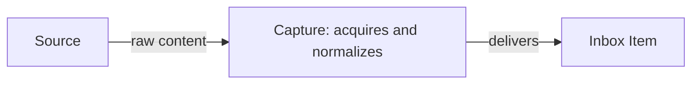

# Capture

```meta
index: root
type: context
deployment: module
related: [.devbook/arc42/05-building-block-view.md#desktop-app]
```

Capture owns **how items enter the system**. Once an item reaches the
[Inbox](../inbox/domain.md#inbox-item) as an Inbox Item, Capture's responsibility ends. The
sources are:

- mobile devices;
- automated monitors;
- email subscriptions;
- web clippers;
- IDE-class hosts: IDE extensions, and agentic session tools such as the GitHub
  Copilot App;
- manual import.

Outside it: triage, routing, and everything that happens to an item after it
arrives, which the [Inbox](../inbox/domain.md#inbox-item) answers. In-app feedback
is the one capture that does not reach the Inbox: it is filed as an issue on the
product's own repository.



## Feedback reporting

```meta
type: feature-flag
key: feedback-reporting
default: on
related: [".devbook/domain/capture/features.md#in-app-feedback-capture"]
```

Turning it on puts a report action in the app chrome. The action files a Desktop
app issue on GitHub with a title, details, and a screenshot.

The flag is released: on by default, without the `DEV` or `BETA` mark that the
settings screen puts on an unfinished feature
([Feature Enablement](../../arc42/08-crosscutting-concepts.md#feature-enablement)).
The settings screen lists it from the feature catalog in `AppFeatures.cs`, and a
person's choice is kept in `features.json`. It is retired once nobody needs to
switch the report action off.

## Capture sources

```meta
type: setting
key: capture-sources.json
scope: user
default: every source off, with no targets
related: [.devbook/domain/capture/features.md#run-capture-now, .devbook/domain/capture/features.md#youtube-monitor, .devbook/domain/capture/features.md#website-monitor, .devbook/domain/capture/features.md#news-email-ingestion, .devbook/domain/capture/domain.md#capture-source, .devbook/domain/inbox/context.md#inbox-pane]
tests: [unit:dotnet:Backlog.Infrastructure.FileSystem.UnitTests.CaptureSourcesSettingsStoreTests, unit:dotnet:Backlog.Desktop.UI.UnitTests.CaptureSourcesPanelTests, unit:dotnet:Backlog.Modules.Capture.UnitTests.RunCaptureCommandHandlerTests]
```

This setting says which sources Capture watches and what each one is pointed at.
It holds the [capture sources](domain.md#capture-source) that can be
monitored: YouTube, website, and email, one entry each, in that order.
An entry has:

- the source's kind, written as its slug (`youtube`, `website`, `email`);
- whether it is on;
- its list of targets.

A target is a channel or
feed URL or handle, a page URL, or a sender address. Targets are identifiers
only, never a credential, because the file is plain text meant for hand-editing.
Nothing is watched until the reader switches a source on.

The reader edits it in the Sources panel on the [Inbox pane](../inbox/context.md#inbox-pane),
where the switch and the targets commit the moment they change. The panel shows
the file's path. [Run capture now](features.md#run-capture-now) reads it when a
run starts and polls only the sources that are on.

The setting is the reader's own, kept in `capture-sources.json`
under `%LOCALAPPDATA%\Backlog` and never synced between devices. It has its
own file rather than a section of `settings.json`, which only points at the
workspace. Two other files sit beside it:

- the **capture run log**, `capture-runs.json`, keeps what the last runs found,
  per source, for the reader;
- the **target ledger**, `capture-targets.json`, remembers per target the entries
  a run has already passed over, so a run delivers each entry once.

The file is read tolerantly, so a hand-edit never stops the app from opening.
Targets are trimmed, blank ones are dropped, and duplicates are folded.
An unreadable or unmonitorable kind is dropped, and a
source missing from the file comes back switched off. A corrupt file
falls back to nothing watched. A save that cannot be written keeps the
change for the session and says so.
