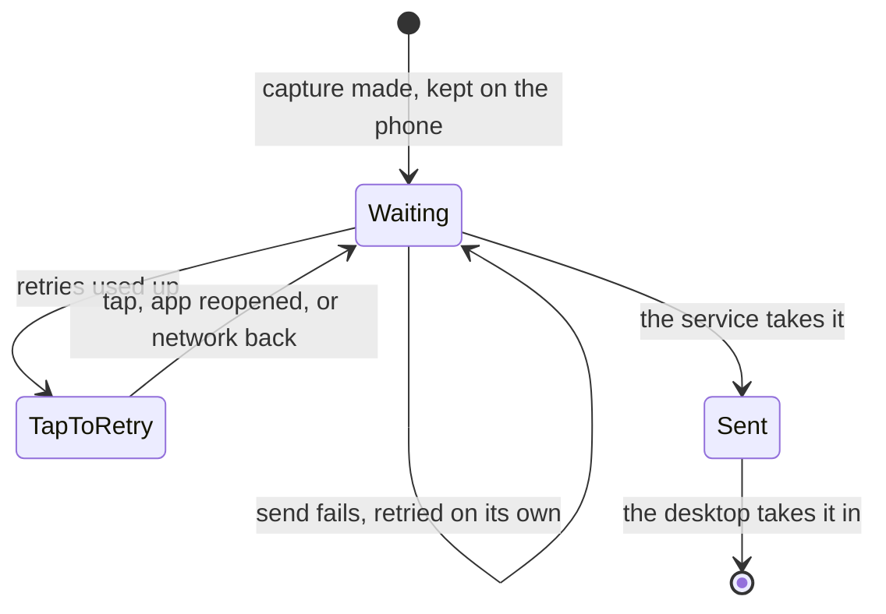

# Capture

```meta
type: features
status: draft
```

> Features and sub-features this bounded context supports, described in
> business/ubiquitous language rather than implementation terms.

## Mobile capture

```meta
type: feature
status: draft
related: [".devbook/arc42/05-building-block-view.md#mobile-app"]
```

Frictionless capture from a phone while away from the desktop, offline first.

A capture needs only a title and where it came from. Everything else is
optional: a Markdown body, tags, the one person it is about or from, and files.
The files are pictures, PDFs, text and Office documents that travel beside the
capture. The phone names every capture with an id of its own before the first
send, so sending it again is never a second capture. The sub-features below each
use part of that:

- one-tap entry uses the body, tags and person;
- offline-first sync uses the id;
- [notes](#talk-note) use the files.

### One-tap entry

```meta
type: sub-feature
status: draft
related: [.devbook/domain/capture/requirements.md#one-tap-entry]
```

Rapid title + body capture with optional tags and source context.

On the phone, one tap on the capture button opens the capture sheet at
`/capture`: a sheet up from the bottom edge, over the screen it was opened from.
It asks where the thought goes, and the hint over the text field, the field's
prompt and the one save button follow the choice:

| Destination | Save button | Line after a save | Dictation and photos | What a save creates |
| --- | --- | --- | --- | --- |
| **Inbox** (the default) | `Add to inbox` | `Added to inbox — capture another` | both | An ordinary capture, the same one the Inbox tab's own field sends. |
| **Note** | `Save note` | `Note saved — capture another` | both | A note the phone keeps and edits (see [Notes on the phone](../inbox/features.md#notes-on-the-phone)). |
| **Today** | `Add to today` | `Added to today — capture another` | text only | A task picked for today, as My Day's add does (see [My Day](../tasks/features.md#my-day)). |

A save leaves the sheet open and cleared, with the line from the table, so
several thoughts in a row need no reopening. Opened from Focus, a save goes back
to Focus instead: the thought is set down and the task taken up again. Cancel, a
tap on the dimmed screen behind, or Escape go back to the screen the sheet came
from.

The sync service takes the body, the tags and a person alongside the title and
the source, each optional and each bounded. A person is sent as the person and
never as a tag; on the desktop it becomes the item's source person, and the tags
are stored bare and once each. A phone that sends only a title and a source gets
the same answer as one that sends everything.

### Speech-to-text capture

```meta
type: sub-feature
status: draft
```

On-device transcription of voice notes into usable markdown, with retry on
transcription failure, preserving source metadata.

On the phone, dictation is the capture sheet's. What was heard is shown on a
line and appended to what is already in the field, so nothing is sent that the
person has not read first.

### Offline-first sync

```meta
type: sub-feature
status: draft
```



Every capture is kept on the phone before it is sent, so a capture is never lost
to a missing signal. It appears in the Inbox list at once, marked `Waiting`, and
captures leave in the order they were made. A failed send is retried on its own a
few times, with growing waits, before it reads `Waiting — tap to retry`. The
status line says how many captures are waiting. A capture reads `Sent` the moment
the service takes it. It stays in the list while the next pull brings it back,
even when that pull was asked before it landed, or fails.

Each capture carries an id the phone mints before its first send. Resending it
after a lost answer therefore delivers it once: the service answers with the
capture it already holds instead of storing a second one.

The Inbox tab says how many captures wait to be sorted, as `3 items to sort`,
over a field that adds one more. Each row in its list shows:

- when the capture was made;
- a glyph and a word for what kind of thing it is;
- the first line of its body;
- where it stands: `Waiting`, `Waiting — tap to retry`, or `Sent`.

A tap opens the whole capture with its source, tags and person. The list holds
only the captures this phone made, and each leaves it once the desktop takes it
in. The phone never triages, so a row offers no action that would decide or
dismiss it: see [Triage stays on the desktop](../inbox/features.md#triage-stays-on-the-desktop).
The list refreshes on a pull down, on the refresh button and on returning to the
app. When the service cannot answer, the last list the phone saw stays on screen
with a line saying why it is not newer.

### Talk note

```meta
type: sub-feature
related: [".devbook/arc42/06-runtime-view.md#talk-note-upload", ".devbook/arc42/06-runtime-view.md#mobile-note-sync", ".devbook/domain/inbox/features.md#notes-on-the-phone", ".devbook/domain/inbox/domain.md#note", ".devbook/arc42/adr/0014-attachments-travel-through-a-blob-store-beside-the-replica.md"]
```

A note taken during a conference talk: what was said, the slide photo, the
handout. It is a [note](../inbox/domain.md#note), written in the phone's Notes tab
([Notes on the phone](../inbox/features.md#notes-on-the-phone)). It is never
called a session note, because Sessions is a bounded context of its own.

The Notes editor takes dictation into the body. It also takes photos from the
camera, and pictures and files chosen from the phone, several to a note. A note
is an item of kind `note` that stays on the phone, and either side may edit it. A
note carries no speaker and no tags, and it has no send button: it saves on its
own. A talk note an earlier build left waiting in the outbox is still sent as an
ordinary capture.

Each attached file shows its name, type and size. Cloud sync refuses a file over
the per-file limit, or one that is not a picture, PDF, text or Office file. Such a
file stays off the note, with the reason written under it, until it is taken off
the list of files not attached.

Pictures are made smaller before they leave: at most 1600 pixels on the longest
side, as JPEG, with the location, camera and time details removed and only the
way-up kept. Files go as they are. Each file is uploaded before the note that
names it. A file that already went is never sent again, and a failed one is
retried on its own. A note saved without a title is named after the first line of
its body. With no body it is named "Photo · <date>" when a picture is attached, or
else after the first file's name.

### Share-sheet and shortcuts

```meta
type: sub-feature
status: draft
```

Another app hands its content to Capture through the phone's share sheet or a
shortcut, without opening the capture sheet first.

## Automation capture

```meta
type: feature
status: draft
```

Unattended monitors that watch external sources and create captures on a
configurable schedule, with retry/backoff and failure logging.

### Run capture now

```meta
type: sub-feature
status: draft
related: [.devbook/domain/capture/domain.md#source-adapter, .devbook/domain/inbox/features.md#incoming-queue]
feature-flag: .devbook/domain/inbox/context.md#inbox-pane
```

The reader runs the monitors on demand from the Inbox, without waiting for a
schedule. A folded Sources panel on the same Inbox pane, beside the button that
runs them, sets which sources are watched and what each one looks at. The sources
are YouTube, website and email; the targets are channels, URLs and senders. The
choice is kept on the machine, and a source is off until switched on.

A run answers per source. It says how many new captures it delivered, or that no
`Source Adapter` exists for that source yet. A source that cannot be watched says
so instead of silently finding nothing. With no source switched on, the run points
at the panel that would change that.

Each source's row also carries when it was last looked at and how many new
captures that run delivered. Under it is a log of the runs before, each with the
same per-source line the run reported. The machine keeps that log as a bounded
window rather than an archive (the capture run log in
[Capture sources](context.md#capture-sources)).

### YouTube monitor

```meta
type: sub-feature
```

Polls a subscribed channel's video feed for new videos. The channel is given as a
feed URL, a channel id, or a handle, user or `c` page that resolves to one. New
videos go straight into the Inbox. There is no folder filing and no
`#capture/youtube` auto-tag yet.

### Website monitor

```meta
type: sub-feature
```

Watches a configured URL for a feed it can discover, and delivers new entries into
the Inbox. It finds the feed through `<link rel=alternate>`, a feed link on the
same host, or a well-known path. A site with no feed has no fallback yet: the
monitor does not compare the page between runs. There is no folder filing and no
`#capture/web/{domain}` auto-tag yet.

### News email ingestion

```meta
type: sub-feature
status: draft
```

Polls an email inbox over IMAP (the Internet Message Access Protocol) for
newsletters and summaries, and tags each capture `#capture/email/{sender}`.

### Scheduled scans

```meta
type: sub-feature
status: draft
```

The monitors run on a schedule the reader sets, so nobody has to press Run
capture now.

### Composable monitors

```meta
type: sub-feature
status: proposed
related: [.devbook/domain/capture/domain.md#source-adapter, .devbook/domain/monitoring/features.md#automation-status]
```

Let the user compose a monitor themselves, from a trigger, a condition, and the
capture it produces, instead of choosing only from the monitors the product ships
with. A composed monitor carries the same schedule, retry/backoff, and
failure-logging guarantees as a built-in one. It still delivers a normalized
capture, so nothing downstream can tell the two apart.

Recorded as a possibility, not a commitment. What prompted it is xyOps
(<https://github.com/pixlcore/xyops>), a self-hosted automation platform. It wires
events, triggers, actions, and monitors into pipelines through a visual editor,
and files the result carrying its own context. This chapter does not settle the
technology choice: build the capability in-product, or run such a platform behind
the `Source Adapter` anti-corruption layer. Either way the local-first rule holds:
a composed monitor's source credentials stay on the machine and never route
through the optional Cloud Service.

Boundary: this covers monitors watching sources *outside* the product. Signals
about the product's own health continue to reach the Inbox as Monitoring's
[`FollowUpCaptured`](../monitoring/domain.md#followupcaptured), not as a capture.

## Web clipper capture

```meta
type: feature
status: draft
```

A browser extension or bookmarklet that clips web content: the URL, the title, the
selected text, and the page metadata. It converts the clip to markdown and keeps
the source link.

## IDE capture

```meta
type: feature
status: draft
```

An adapter that lets an IDE-class host capture selected code or text, or a note
taken in a session. It attaches context metadata: the file path, line number, and
branch, or the session and worktree. It covers editor extensions (VS Code, Visual
Studio) and agentic session tools (GitHub Copilot App).

### Copilot App session capture

```meta
type: sub-feature
status: draft
related: [.devbook/domain/capture/domain.md#source-adapter]
```

Let a GitHub Copilot App session capture a backlog idea, follow-up, or knowledge
note directly from within its agent conversation. The capture carries the session
id, the local worktree path, and the current branch as context metadata. It runs
against the session's local worktree only, so no source credential leaves the
machine. The desktop's source monitors work under the same local-first rule.

## Manual import

```meta
type: feature
status: draft
```

Drag-and-drop files or paste content directly, convert to markdown (MarkItDown
or equivalent), and extract tags, links, and source metadata automatically.

### Import manifest

```meta
type: sub-feature
status: draft
related: [.devbook/arc42/adr/0017-inbox-import-is-a-capture-source-with-a-markdown-manifest.md, .devbook/domain/capture/domain.md#capture-source, .devbook/domain/inbox/domain.md#inbox-list]
```

Bring the items from another tool into the Inbox by importing a manifest.
Microsoft To Do is the first tool. A skill outside the product,
`import-inbox` in the `backlog-tools` plugin, reads the tool's export and writes
the manifest. It leaves out completed items. It maps the tool's lists to Inbox
Lists, and the labels the person chooses to tags.

The manifest is Markdown with front matter. A `---` block names the `schema` and
the `tool`. Then comes one `#`-titled item per capture. Each item has a `meta`
fence carrying `external_id` and `captured_at`, and optionally `url`, `kind`,
`tags`, `person`, and `list`, followed by its notes as the body.

The Inbox's Sources panel has an **Import file…** row below the monitors. A
manifest picked or dropped there is imported at once, through the same run the
Capture button uses. The row shows the import's line, its last run, and a Log
of earlier imports, the way each monitor's row does.

Every item arrives as an `unprocessed` Inbox Item with source `import`. Its
`url` and `captured_at` are kept as written. A stated `kind` is kept; without
one, the kind is read off the item the way any capture's is. An item is filed
in the Inbox List its `list` names when that list exists. It lands unfiled when
the item names no list, or names one that does not exist. An import never
creates a list.

Importing the same manifest again, or a later overlapping one, adds only the
items not already there. An item is known by its id, which comes from the tool
and the item's own `external_id`, and nothing records past imports. An item
written without an `external_id` is known by a fallback id instead: the hash of
its title and `captured_at`, the same one the generating skill writes. So a
hand-written item also imports once, until its title changes.

The run answers with one line, in the form the feed monitors use:
`Import (microsoft-todo): 12 new items · 30 already known.`

A manifest is often edited by hand, so an item that cannot be read is skipped,
and the rest still come in. The line names each skipped item and says what to change, as in
`Item 4 "Buy oat milk" has no captured_at — add one like captured_at:
2026-09-20T08:14:00Z`. A missing list is named too:
`no list is called "Errands", so what was meant for it landed unfiled`. Only
front matter that cannot be read refuses the whole file, because without its
`tool` no item has an identity.

## Normalized delivery

```meta
type: feature
status: draft
related: [.devbook/domain/inbox/features.md#incoming-queue]
```

Every capture source produces a standard Inbox Item (title, `body_md`, source,
tags, `captured_at`) and delivers it to the Inbox's
[incoming queue](../inbox/features.md#incoming-queue), preserving the original
source link and capture timestamp.

## In-app feedback capture

```meta
type: feature
status: draft
feature-flag: .devbook/domain/capture/context.md#feedback-reporting
related: [.devbook/domain/repository-management/features.md#github-access-resolution]
```

Report a problem with the app from inside the app, at the moment it happens.
The report carries a title, optional detail, and which area of the screen the
problem concerns. The product attaches a picture of the current screen, so the
reporter does not have to describe what they were looking at. The report is filed
as an issue against the product's own repository. A failure to capture the screen
is stated in the report rather than silently dropping it.
