# Backlog

```meta
type: context-map
status: draft
```

> Strategic DDD view of the Backlog product domain: bounded-context roles,
> subdomain classification, and the relationships that carry work, knowledge,
> standards, and signals across the system.

> See also: `.devbook/arc42/03-context-and-scope.md` for the system-level context this
> map's bounded contexts sit inside, and `.devbook/arc42/05-building-block-view.md` for
> how these contexts are realized across the desktop, mobile, IDE, and cloud
> containers.

## Subdomain landscape

| Bounded context | Subdomain type | Why |
|---|---|---|
| Capture | Core | It is the front door for turning raw external input into normalized intent for the product. |
| Inbox | Core | It owns triage and the decision point where captured input becomes work, knowledge, deferral, or archive. |
| Tasks | Core | It owns the durable work model, prioritization, and multi-repository execution planning. |
| Roadmap Planning | Core | It owns the forward plan — what is intended, when, in what order — and is the only context that holds a dependency between two pieces of planned work. Sequencing intent across repositories is a judgement the product exists to support, not a report over work someone else owns. |
| Devbook | Core | It owns durable knowledge linked to work and makes knowledge reusable across projects. |
| Productivity | Supporting | It turns AI-assisted work activity into personal productivity insight without owning the work items or execution tools. |
| Environment | Supporting | It provides quick access to named local, cloud, and project environments without becoming the authority for repository or health data. |
| Monitoring & Dashboard | Supporting | It observes the core flow and turns signals into visibility and follow-up actions rather than owning the work itself. |
| Technology Stack | Supporting | It supplies portfolio-wide standards, baselines, and deprecation policy to the core work contexts. |
| Repository Management | Supporting | It provides repository inventory, health, and dependency visibility used by the core work contexts. |
| Dev PC Management | Supporting | It provides machine inventory, compliance, and operator support capabilities for the work system. |
| Progress | Supporting | It lays sprints over a set of repositories and reports what each set out to do and how it ended, naming tasks by id and plans by tag without owning either. |
| Sessions | Supporting | It records what the AI coding agents have been doing on each environment, without owning the work, the machines, or the repositories those sessions touch. |

## Context map

```mermaid
flowchart LR
    Capture[Capture]
    Inbox[Inbox]
    Tasks[Tasks]
    Roadmap[Roadmap Planning]
    Brain[Devbook]
    Productivity[Productivity]
    Environment[Environment]
    Monitor["Monitoring & Dashboard"]
    Tech[Technology Stack]
    Repo[Repository Management]
    DevPC[Dev PC Management]
    Sessions[Sessions]
    Progress[Progress]

    Capture -->|OHS + Published Language<br/>ItemCaptured| Inbox
    %% Inbox -> Tasks is built as an in-process port (IInboxBacklogTarget in
    %% the Inbox's Abstractions) answered by an infrastructure adapter over
    %% Tasks' published ITaskItems — not an async event. See
    %% .devbook/domain/inbox/dependencies.md.
    Inbox -->|OHS + Published Language<br/>ItemTriaged| Tasks
    Inbox -->|OHS + Published Language<br/>ItemTriaged| Brain
    Tasks <-->|Partnership<br/>Cross-link by id| Brain
    Tasks <-->|Partnership<br/>Optional cross-link by id| Roadmap
    Roadmap -->|Customer/Supplier<br/>Roadmap tag vocabulary| Tasks
    Brain -->|Customer/Supplier<br/>Chapters by tag/ref + registered effort| Roadmap

    Roadmap -->|OHS + Published Language<br/>RoadmapItemScheduled| Monitor

    Tasks -->|OHS + Published Language<br/>StatusChanged / TaskProjected / TaskCompleted| Monitor
    Inbox -->|Customer/Supplier<br/>Queue-health feed| Monitor
    Repo -->|Customer/Supplier<br/>Health and scan feed| Monitor
    DevPC -->|OHS + Published Language<br/>MachineStatusChanged / ComplianceUpdated| Monitor
    Productivity -->|OHS + Published Language<br/>ProductivityRecorded| Monitor
    Monitor -->|Customer/Supplier<br/>Health and availability signals| Environment
    Monitor -->|OHS + Published Language<br/>FollowUpCaptured| Inbox

    Tech -->|Customer/Supplier<br/>Technology baselines| Repo
    Tech -->|Customer/Supplier<br/>Team tools baseline| DevPC
    Repo -->|Customer/Supplier<br/>Adoption and technology scans| Tech
    DevPC -->|Customer/Supplier<br/>Tool-version reports| Tech

    Tasks -->|OHS + Published Language<br/>AIWorkLogged| Productivity
    Monitor -->|OHS + Published Language<br/>CopilotSession signal| Productivity
    Productivity -->|Customer/Supplier<br/>Productivity summaries| Tasks

    Repo -->|Customer/Supplier<br/>Repository/environment registry lookup| Environment
    Environment -->|Customer/Supplier<br/>Launchable environment links| Tasks
    Environment -->|Customer/Supplier<br/>Environment shortcuts| DevPC

    %% Sessions. The Sessions -> Productivity and Sessions -> Tasks edges are
    %% built, each through an infrastructure adapter rather than a published
    %% event. The other two below are named and not built: see the strategic
    %% rules below and .devbook/domain/sessions/dependencies.md.
    DevPC -.->|"Customer/Supplier (not built)<br/>Machine identity for an environment"| Sessions
    Sessions -->|Customer/Supplier<br/>Agent session facts| Productivity
    Sessions -->|Customer/Supplier<br/>Linked session state| Tasks
    Sessions -.->|"Customer/Supplier (not built)<br/>Stalled-session observation"| Monitor

    Repo -->|Customer/Supplier<br/>Repo registry lookup| Tasks
    Repo -->|Customer/Supplier<br/>Repo registry lookup by alias| Roadmap

    %% Progress. All four edges are in-process reads; Progress publishes no
    %% event. See .devbook/domain/progress/context.md and local ADR 0028.
    Tasks -->|Customer/Supplier<br/>Task by id: status, tags, plan tag, linked pull requests| Progress
    Roadmap -->|Customer/Supplier<br/>Plan tag vocabulary| Progress
    Repo -->|Customer/Supplier<br/>Repo registry lookup by alias| Progress
    Progress -->|Customer/Supplier<br/>Open sprint and goal for the briefs| Monitor
```



## Published languages and contracts

| Contract owner | Published language / contract | Used by |
|---|---|---|
| Capture | `.devbook/domain/capture/domain.md#itemcaptured` | Inbox |
| Inbox | `.devbook/domain/inbox/domain.md#itemtriaged` | Tasks, Devbook |
| Tasks | `.devbook/domain/tasks/domain.md#statuschanged`, `.devbook/domain/tasks/domain.md#taskprojected`, `.devbook/domain/tasks/domain.md#taskcompleted` | Monitoring & Dashboard |
| Tasks | `.devbook/domain/tasks/domain.md#aiworklogged` | Productivity |
| Roadmap Planning | `.devbook/domain/roadmap/domain.md#roadmapitemscheduled` | Monitoring & Dashboard |
| Roadmap Planning | `.devbook/domain/roadmap/domain.md#roadmap-item` | Tasks |
| Roadmap Planning | `.devbook/domain/roadmap/domain.md#roadmap-tag` | Tasks, Devbook |
| Monitoring & Dashboard | `.devbook/domain/monitoring/domain.md#followupcaptured` | Inbox |
| Dev PC Management | `.devbook/domain/dev-pc-management/domain.md#machinestatuschanged`, `.devbook/domain/dev-pc-management/domain.md#complianceupdated` | Monitoring & Dashboard |
| Productivity | `.devbook/domain/productivity/domain.md#productivityrecorded` | Monitoring & Dashboard |
| Environment | `.devbook/domain/environment/domain.md#environment-shortcut-resolution` | Tasks, Dev PC Management |
| Technology Stack | `Technology Baseline` / `BaselineProvided` contract in `.devbook/domain/technology-stack/domain.md#deprecation-management` | Dev PC Management, Repository Management |

## Strategic rules

- Only the owning context defines a published language. Consumers conform to that
  contract and do not reach into the supplier's internal aggregate shape.
- `Tasks` and `Roadmap Planning` split the word *priority* on
  purpose, and the split is load-bearing. Tasks owns a task's **status and
  execution priority**. Roadmap owns **planning priority and sequence**. Neither
  writes the other's value, and neither derives its own from the other. A roadmap
  item may name the task that executes it. A plan must also hold work that has no
  task yet, which is why the plan is stored rather than projected.
- `Inbox` publishes `ItemTriaged` and `Tasks` conforms to it, carried in-process
  rather than by an asynchronous event. The payload is a DTO in the Inbox's
  Abstractions, handed over the `IInboxBacklogTarget` port. An infrastructure
  adapter answers that port over Tasks' published `ITaskItems`. Neither module
  references the other, and the adapter is the only place an inbox item becomes
  entry text.
- A capture reaches the Inbox in one of two ways:
  - **From another device**, as a `capture`-kind document on the sync replica
    (`.devbook/arc42/adr/0009-captures-are-a-document-kind-on-the-replica.md`).
  - **From a source monitor on the desktop** (a YouTube channel, a website),
    in-process and without the replica. It delivers through the same
    `IInboxIntake` port the sync path hands `capture`-kind documents to.

  Both are keyed by the same deterministic per-entry id, so idempotency belongs
  to the port, not to the transport.
- `Tasks` and `Devbook` are a deliberate `Partnership`: both
  sides keep only foreign ids and the link semantics are coordinated through the
  Cross-Linking service rather than a shared aggregate.
- `Roadmap Planning` **totals** what it does not **own**. Story-point `effort` is
  registered on Tasks and on knowledge chapters. A
  [roadmap tag](roadmap/domain.md#roadmap-tag) is the vocabulary Tasks offers in
  its picker and a knowledge chapter names in its `roadmap` list. Roadmap gathers
  tasks and chapters by tag and by direct reference, and adds up their registered
  effort. It registers no effort and defines no tag.
- `Technology Stack` is the standards supplier for both `Repository Management`
  and `Dev PC Management`; those contexts may cache or copy baselines locally,
  but they do not become the authority for baseline meaning.
- `Monitoring & Dashboard` is an observer/read context. Its only write-back into
  the core flow is the published `FollowUpCaptured` contract into `Inbox`.
- `Productivity` measures personal and AI-assisted work from published activity
  signals. It never changes backlog status, agent sessions (`Sessions`), or repository state.
- `Environment` owns the user's launchable environment shortcuts and access
  preferences. It resolves repository and health facts through suppliers instead
  of duplicating Repository Management or Monitoring data.
- `Sessions` is the single owner of the agent-session record. No other context
  models agent sessions. `Monitoring`'s own `copilot_session` signal kind gives way
  to this context once the two are wired together.
- `Sessions` publishes no bounded-context domain event. It appears in no row of the
  published-language table above, and its Dev PC Management and Monitoring edges
  stay dashed. Two infrastructure adapters read it directly, as Customer/Supplier
  reads rather than published contracts:
  - for `Productivity`, the
    [Session Log](sessions/domain.md#session-log);
  - for `Tasks`, the [session state](sessions/domain.md#session-state) a task's
    work badge shows.

  That is why those two edges draw solid without a table row. When Monitoring
  consumes Sessions too, or Sessions publishes an event of its own, the event goes
  into `.devbook/domain/sessions/domain.md` and into that table in the same change.
- A `Sessions` [Environment](sessions/domain.md#environment) is not an
  [`Environment`-context Environment](environment/domain.md#environment), and not a
  `Dev PC Management` [Machine](dev-pc-management/domain.md#machine). The two words
  collide across three contexts and the concepts do not. Each context defines its
  own under `## Ubiquitous Language` in its `domain.md`, and no aggregate holds
  another context's identity for it. The Sessions Environment's `EnvironmentId` is
  the product-wide device identity issued by the shared kernel
  (`.devbook/domain/tasks/domain.md#device`), which no bounded context owns. That
  identity is still not Dev PC Management's Machine, so the rule stands unchanged.
- `Progress` names a task by its id and a plan by its
  [plan tag](roadmap/domain.md#roadmap-tag), and reads both from their owners
  on every reading. `Tasks` holds no knowledge of sprints: no task field, tag,
  status or entry-text token names one, and no close outcome changes a task
  (`.devbook/arc42/adr/0028-progress-is-its-own-boundary-and-tasks-knows-no-sprints.md`).
  Progress publishes no event, so it has no row in the published-language table;
  its four edges are Customer/Supplier reads.
