# Backlog

```meta
type: context-map
related: [.devbook/arc42/adr/0042-repository-management-owns-pull-request-state.md, .devbook/arc42/adr/0055-calendar-is-a-surface-of-its-own-that-reads-layers.md, .devbook/arc42/adr/0056-the-calendar-owns-its-grid-and-tasks-is-one-layer.md, .devbook/arc42/adr/0071-agent-changes-are-restorable-through-a-change-journal-beside-the-store.md, .devbook/arc42/adr/0073-the-bounded-contexts-are-redrawn.md]
```

> Strategic view of the Backlog domain: context roles, subdomain classification, and the relationships that carry work, knowledge, standards, and signals. System context: `.devbook/arc42/03-context-and-scope.md`. Containers: `.devbook/arc42/05-building-block-view.md#container-view`.

## Subdomain landscape

| Bounded context | Subdomain type | Why |
|---|---|---|
| Capture | Core | It is the front door that turns raw external input into normalized intent. |
| Inbox | Core | It owns triage, where captured input becomes work, knowledge, deferral, or archive. |
| Work | Core | It owns the tasks and the forward plan: the durable work model, execution and planning priority, sequence, capacity and My Day, across repositories. |
| Devbook | Core | It reads, builds, renders and searches a repository's devbook, and supplies that machinery to the Brain. |
| Brain | Core | It owns one person's own notes, linked to their work by id and into a repository's devbook. |
| Insights | Supporting | It turns the work the person and their agents do into personal insight on the dashboard, reading the other contexts and owning no work. |
| Repositories | Supporting | It provides repository inventory, health and dependency visibility, launches each repository's named environments, and owns the state of pull requests. |
| Dev PC Management | Supporting | It provides machine inventory, compliance, and operator support capabilities for the work system. |
| Goals | Supporting | It keeps a person's goals and impediments, and reads both over an iteration as a stand-up. |
| Sessions | Supporting | It records what the AI coding agents do on each environment, and owns nothing those sessions touch. |
| Events | Supporting | It keeps the knowledge events a person attends to learn something, from spotting one to its harvest. |
| Notifications | Generic | It lets any context tell the person something or ask a question, and hands the answer back. |
| Sync | Generic | It keeps one person's data the same across their devices by carrying other contexts' documents. |
| Change journal | Generic | It records who changed what across tasks, plans, goals, inbox triage, events and devbook state, and restores a change (local ADR 0071). |

- **Work:** Tasks and Roadmap Planning merged into it, with Task and Plan as separate aggregates (local ADR 0073 §1). The plan says what is intended, when, and in what order. Sequencing intent across repositories is a judgement the product exists to support, not a report over work someone else owns.
- **Devbook:** It reads the devbook a repository carries beside its code in place.
- **Brain:** The person and their agent organize the notes. The link into a repository's devbook runs one way (local ADR 0040).
- **Insights:** Monitoring & Dashboard merged into Productivity under this name (local ADR 0073 §2). Team monitoring and scanning across repositories were dropped.
- **Repositories:** The core work contexts use its inventory, health and dependency visibility. It owns the status, readiness verdict, stacks and merge commands of the registered repositories' pull requests (local ADR 0042). Environment folded into it: a repository holds its named environments, each with a launch link (local ADR 0073 §3).
- **Goals:** The goals are the ones a person's work is attached to, and the impediments are what hold that work back. It names tasks by id, plans by tag and pull requests by repository and number, without owning any of them.
- **Sessions:** It owns none of the work, the machines, or the repositories those sessions touch.
- **Notifications:** The answer comes back from whichever paired device the person used. The context carries no work of its own (local ADR 0039).
- **Events:** Learning events support the person's work and are not what sets the product apart. Knowledge events only: other appointments stay out (local ADR 0050). The aggregates, the To Event route, the Events pane with prep tasks, the Calendar's events layer over the read contract, the harvest task, sync and the phone are built.
- **Sync:** It is built in-house (local ADR 0005), and its pairing and precedence rules are cut to Backlog's local-first model. It is still not what makes the product different.
- **Change journal:** Two tables beside the store, filled by triggers, shared across contexts the way Sync is. Its MCP tool group belongs to the channel.

Three parts of the product are drawn on the map and are not contexts (local ADR 0073 §6):

- **Desktop shell** — a composition. It composes the cards and owns no state.
- **Calendar** — a composition beside the shell. It owns its grid, reads the Tasks and Plans layers from Work and the Events layer from Events, and owns no data (local ADRs 0055, 0056).
- **MCP server** — a channel beside the shell. Agents enter through it; each tool group passes a call to one context's Abstractions (local ADR 0012). The agent grants and scopes are its own (local ADRs 0058, 0059, 0069).

## Context map

Arrows point from supplier to consumer. Dashed lines are one-way references or not built (local ADR 0073 §11).

```mermaid
flowchart LR
    Capture[Capture]
    Inbox[Inbox]
    Work[Work]
    Devbook[Devbook]
    Brain[Brain]
    Insights[Insights]
    Repo[Repositories]
    DevPC[Dev PC Management]
    Sessions[Sessions]
    Goals[Goals]
    Sync[Sync]
    Notify[Notifications]
    Events[Events]

    Capture -->|OHS + Published Language<br/>ItemCaptured| Inbox
    %% Inbox -> Work is built as an in-process port (IInboxBacklogTarget in
    %% the Inbox's Abstractions) answered by an infrastructure adapter over
    %% Work's published ITaskItems — not an async event. See
    %% .devbook/domain/inbox/dependencies.md.
    Inbox -->|OHS + Published Language<br/>ItemTriaged| Work
    Inbox -->|OHS + Published Language<br/>ItemTriaged: To Brain| Brain
    Work <-->|Partnership<br/>Task links by id| Brain
    Devbook -->|"Customer/Supplier<br/>Reader, database builder, viewer, search, remarks<br/>Every registered devbook, read-only"| Brain
    Brain -.->|"One-way reference<br/>repo: link to a repository chapter"| Devbook
    Repo -->|Customer/Supplier<br/>Repo registry lookup by alias| Brain
    %% Tasks and Roadmap Planning merged into Work (local ADR 0073 §1): the task
    %% link by id and the roadmap tag vocabulary run inside it.
    Devbook -->|Customer/Supplier<br/>Chapters by tag/ref + registered effort| Work


    %% Technology Stack is dissolved (local ADR 0073 §5): a repository's
    %% technologies, ratings and approved versions are its devbook tech/ folder.
    Devbook -.->|"Customer/Supplier (not built)<br/>Every registered devbook's tech/, read-only, for portfolio adoption"| Repo

    %% Insights reads across the contexts for the dashboard (local ADR 0073 §2).
    %% Each read below is an infrastructure adapter answering a port in
    %% Backlog.Modules.Insights.Abstractions; Insights publishes no event and
    %% writes into no other context.
    Work -->|OHS + Published Language<br/>AIWorkLogged| Insights
    Insights -->|Customer/Supplier<br/>Productivity summaries| Work
    Work -->|Customer/Supplier<br/>Plan progress, pace and working week| Insights
    Devbook -->|Customer/Supplier<br/>Sync verdicts of the drifted units| Insights
    Repo -->|Customer/Supplier<br/>Registered repositories, archived skipped| Insights
    %% The published events below have no reference in src/, so their edges are dashed.
    Work -.->|"OHS + Published Language (not built)<br/>StatusChanged / TaskProjected / TaskCompleted / RoadmapItemScheduled"| Insights
    DevPC -.->|"OHS + Published Language (not built)<br/>Machine, MachineStatusChanged / ComplianceUpdated"| Insights

    %% Environment folded into Repositories (local ADR 0073 §3): a repository's
    %% named environments are its own, so its four unbuilt edges left the map.

    %% Sessions. The Sessions -> Insights and Sessions -> Work edges are
    %% built, each through an infrastructure adapter rather than a published
    %% event. The other two below are named and not built: see the strategic
    %% rules below and .devbook/domain/sessions/dependencies.md. Work -> Sessions
    %% is the follow-up a gate answer files, in process through ITaskFollowUps; built.
    DevPC -.->|"Customer/Supplier (not built)<br/>Machine identity for an environment"| Sessions
    Sessions -->|Customer/Supplier<br/>Agent session facts| Insights
    Sessions -->|Customer/Supplier<br/>Linked session state, dated work, actual hours| Work
    Work -->|Customer/Supplier<br/>File a follow-up after an entry| Sessions
    Sessions -.->|"Customer/Supplier (not built)<br/>Attached session: state, branch"| Goals
    Sessions -.->|"Customer/Supplier (not built)<br/>Stalled-session alert"| Insights

    Repo -->|Customer/Supplier<br/>Repo registry lookup by id and by alias| Work

    %% Goals. Its edges are in-process reads; Goals publishes no event.
    %% See .devbook/domain/goals/context.md and local ADR 0035.
    Work -->|Customer/Supplier<br/>Task by id: status, due date, effort, blocked mark, linked pull requests<br/>Plan tag vocabulary, plan order, pace| Goals
    Repo -->|Customer/Supplier<br/>Repo registry lookup by alias| Goals

    %% Pull request state, local ADR 0042. Repositories
    %% publishes one contract; Work and Goals read it through adapters that
    %% answer their own ports. The shell is the composition root, not a context:
    %% it composes the cards and asks Work which task a session or a pull
    %% request belongs to, so Repositories holds no edge to Work.
    %% The Calendar is a composition beside it, and the MCP server a channel
    %% beside it, through which agents reach each context's Abstractions
    %% (local ADR 0073 §6). Neither is a context.
    Shell(["Desktop shell<br/>(composition root, not a context)"])
    Calendar(["Calendar<br/>(composition, not a context)"])
    Mcp(["MCP server<br/>(channel, not a context)"])
    Repo -->|"Customer/Supplier<br/>Pull request status and verdict, ILinkedPullRequestStates"| Work
    Repo -->|"Customer/Supplier<br/>Pull request status, IGoalPullRequestReader"| Goals
    Repo -->|"Customer/Supplier<br/>Verdict on the session card, through the shell"| Sessions
    Work -->|"OHS + Published Language<br/>Task by session, task by pull request, ITaskLookup"| Shell

    %% Sync. It carries the documents of the contexts below and reads none of
    %% their payloads. Each downstream context reaches it through an adapter in
    %% Backlog.Infrastructure.Sync. See .devbook/domain/sync/context.md.
    Sync -->|OHS + Published Language<br/>Task replica feed, with the plan and the pace| Work
    Sync -->|OHS + Published Language<br/>Session record replica| Sessions
    Sync -->|OHS + Published Language<br/>Annotation replica| Devbook
    Sync -->|Customer/Supplier<br/>capture-kind documents for IInboxIntake| Inbox

    %% Notifications. Local ADR 0039. It conforms to Sync's replica protocol and
    %% offers INotifications to the contexts that publish. Every edge below is
    %% built: see .devbook/domain/notifications/context.md.
    Sync -->|Conformist<br/>Notification and reply replica| Notify
    Notify -->|OHS + Published Language<br/>INotifications, answer handler| Sessions
    Notify -->|OHS + Published Language<br/>INotifications, answer handler| Sync
    Notify -->|OHS + Published Language<br/>INotifications| Devbook
    Notify -->|OHS + Published Language<br/>Close by subject| Work

    %% Events. Local ADR 0050. Every edge is built. The Brain and Inbox edges are
    %% dashed because each is a one-way id reference: Brain notes answered by
    %% EventsBrainNotes over IEventBrainNotes, Talk notes held by their Inbox
    %% note id. Neither is a contract the Brain or the Inbox offers.
    %% Inbox -> Events is the To Event route; Capture -> Events the event facts
    %% a capture carries, through the Inbox. Work -> Events files, reads and
    %% completes the prep and harvest tasks by id (IEventTaskTarget, answered by
    %% EventsTaskTarget over ITaskItems). Sync -> Events carries the knowledge
    %% event replica, and the phone's attachment requests on the task feed,
    %% through IKnowledgeEventReplication and IEventAttachmentRequests. The read
    %% contract supplies the Calendar's Events layer (below).
    %% See .devbook/domain/events/context.md.
    Inbox -->|"OHS + Published Language<br/>ItemTriaged: To Event"| Events
    Capture -->|"OHS + Published Language<br/>Event facts on the capture, through the Inbox. Watched pages stay Capture's targets"| Events
    Work -->|"Customer/Supplier<br/>File and complete tasks under the Brain scope, task by id. Work never shows the event"| Events
    Events -.->|"One-way reference<br/>Note links by id. Brain knows no event"| Brain
    Events -.->|"One-way reference<br/>Talk notes by Inbox note id. Inbox knows no event"| Inbox
    Sync -->|"Conformist<br/>Knowledge event replica, and attachment requests on the task feed"| Events

    %% Calendar. Local ADRs 0055 and 0056. A composition: it owns its grid,
    %% reads layers and owns no data. Adapters under Infrastructure.FileSystem/Calendar/ answer
    %% the Calendar's own ports over Work's published task contract, its plan
    %% abstractions and Events' read contract. All three layers are built.
    %% A write goes back through its source. See the dependency table in
    %% .devbook/domain/calendar/context.md.
    Work -->|"Customer/Supplier<br/>Tasks layer, due dates and hours, ICalendarTasks<br/>Plans layer, shelf and working week, ICalendarPlans"| Calendar
    Events -->|"Customer/Supplier<br/>Events layer over the read contract, ICalendarEvents"| Calendar
```



## Published languages and contracts

| Contract owner | Published language / contract | Used by |
|---|---|---|
| Capture | `.devbook/domain/capture/domain.md#itemcaptured` | Inbox |
| Inbox | `.devbook/domain/inbox/domain.md#itemtriaged` | Work, Brain |
| Work | `.devbook/domain/work/domain.md#statuschanged`, `.devbook/domain/work/domain.md#taskprojected`, `.devbook/domain/work/domain.md#taskcompleted`, `.devbook/domain/work/domain.md#roadmapitemscheduled` | Insights (not built) |
| Work | `.devbook/domain/work/domain.md#aiworklogged` | Insights |
| Work | `.devbook/domain/work/domain.plan.md#roadmap-tag` | Devbook, Goals |
| Devbook | The devbook convention (local ADR 0016) and the [planning fields](devbook/domain.md#shared-value-objects) a chapter carries | Brain, Work |
| Devbook | The devbook database of each registered repository, read through Devbook's reader (local ADR 0015) | Brain, read-only, for the [Lobes atlas](brain/features.md#lobes-atlas); Repositories, read-only, for [portfolio technology adoption](repositories/features.md#portfolio-technology-adoption) (not built) |
| Dev PC Management | `.devbook/domain/dev-pc-management/domain.md#machinestatuschanged`, `.devbook/domain/dev-pc-management/domain.md#complianceupdated` | Insights (not built) |
| Repositories | The pull request contract (`.devbook/domain/repositories/domain.md#pull-request-status`, `.devbook/domain/repositories/domain.md#readiness-verdict`, `.devbook/domain/repositories/domain.md#merge-command`), through `IPullRequests` in `Backlog.Modules.Repositories.Abstractions` (local ADR 0042) | Work and Goals through adapters, Sessions through the shell |
| Work | `ITaskLookup` in `Backlog.Modules.Work.Abstractions` (local ADR 0042 §9), from a session id or a pull request to its task | The desktop shell, for Repositories' and Sessions' screens |
| Notifications | `INotifications`, `INotificationAnswerHandler` and `NotificationDraft` in `Backlog.Modules.Notifications.Abstractions`, under `.devbook/domain/notifications/domain.md#notification` | Sessions, Sync, Devbook, Work |
| Work | `ITaskItems`, `ITaskStore` and `ITaskChangeSignal` in `Backlog.Modules.Work.Abstractions` (local ADR 0056 §2) | The Calendar, through an adapter, for its Tasks layer |
| Events | The events read contract: `IKnowledgeEventReader` in `Backlog.Modules.Events.Abstractions`, which answers the decided events and their key dates, under `.devbook/domain/events/domain.md#knowledge-event` (local ADR 0050) | The Calendar, through an adapter, for its Events layer |
| Events | `IKnowledgeEventReplication` and `IEventAttachmentRequests` in `Backlog.Modules.Events.Abstractions`, under `.devbook/domain/events/domain.md#knowledge-event` and `.devbook/domain/events/domain.md#attachment-request` (local ADR 0050) | Sync, through `Backlog.Infrastructure.Sync` |
| Sync | The replica protocol: the routes and DTOs in `Backlog.Modules.Sync.Abstractions` (`SyncRoutes`, `DataTransferObjects`), under `.devbook/domain/sync/domain.md#change-precedence` | Work, Sessions, Devbook, Inbox, Events |

## Strategic rules

- Only the owning context defines a published language. Consumers conform to it and never reach into the supplier's aggregate shape.
- `Work` splits the word *priority* on purpose, as an invariant between its two
  aggregates (local ADR 0073 §1). A task owns its **status and execution
  priority**. A plan owns **planning priority and sequence**. Neither writes or
  derives the other's value. A roadmap item may name the task that executes it. A
  plan also holds work with no task yet, so the plan is stored rather than projected.
- `Inbox` publishes `ItemTriaged` and `Work` conforms to it, in-process
  rather than by an asynchronous event. The payload is a DTO in the Inbox's
  Abstractions, handed over the `IInboxBacklogTarget` port. An infrastructure
  adapter answers that port over Work's `ITaskItems`. Neither module
  references the other, and the adapter is the only place an inbox item becomes
  entry text.
- A capture reaches the Inbox in one of two ways:
  - **From another device**, as a `capture`-kind document on the sync replica
    (`.devbook/arc42/adr/0009-captures-are-a-document-kind-on-the-replica.md`).
  - **From a source monitor on the desktop** (a YouTube channel, a website),
    in-process and without the replica. It delivers through the same
    `IInboxIntake` port the sync path hands `capture`-kind documents to.

  Both use the same deterministic per-entry id, so idempotency belongs to the port.
- `Work` and `Brain` are a deliberate `Partnership`: both
  keep only foreign ids, and the [Cross-Linking](brain/domain.md#cross-linking) service coordinates the links.
- `Brain` is downstream of `Devbook` as a Customer/Supplier, not a Shared Kernel
  (local ADR 0040). It conforms to the devbook convention and reads, indexes and
  renders its notes through Devbook's machinery. A need of its own enters through
  a hook Devbook offers, and Devbook knows no PARA, area or capture. Its repo links
  run one way, into a repository chapter, and its backlinks are read from the
  owner's Brain, never written into the repository. Its [Lobes atlas](brain/features.md#lobes-atlas) reads the
  devbook of every registered repository through Devbook's reader: a read, never a write.
- A plan in `Work` **totals** what it does not **own**. Story-point `effort` is
  registered on tasks and on devbook chapters. A
  [roadmap tag](work/domain.plan.md#roadmap-tag) is the vocabulary a task's picker
  offers and a devbook chapter names in its `roadmap` list. A plan gathers
  tasks and chapters by tag and by direct reference and adds up their effort. It registers no effort.
- No context owns a technology baseline (local ADR 0073 §5). A repository's
  technologies, their ratings and approved versions are its devbook `tech/` folder;
  `Repositories` reads them across the portfolio through Devbook's reader,
  and the tools a machine must have are `Dev PC Management`'s tool catalog.
- `Insights` is an observer context. It measures personal and AI-assisted work from
  what the other contexts publish and hold, and writes into none of them: it never
  changes backlog status, plans, agent sessions (`Sessions`), or repository state.
- `Repositories` holds each registered repository's named
  [environments](repositories/domain.md#environment), each with a launch link, and a
  [no-repository group](repositories/domain.md#no-repository-group) for a destination
  that belongs to none. It stores no credential, only where one is kept.
- `Sessions` is the single owner of the agent-session record. No other context
  models agent sessions.
- `Sessions` publishes no domain event and owns no row of the
  published-language table (it only uses Sync's replica protocol). Its
  Dev PC Management and stalled-alert edges stay dashed. Two infrastructure adapters read it directly, as Customer/Supplier
  reads rather than published contracts:
  - for `Insights`, the
    [Session Log](sessions/domain.md#session-log);
  - for `Work`, the [session state](sessions/domain.md#session-state) a task's
    work badge shows.

  That is why those two edges draw solid without a table row. When the stalled alert
  is built, or Sessions publishes an event, the event goes
  into `.devbook/domain/sessions/domain.md` and that table in the same change.
  The pull requests its sessions open are Repositories'.
- `Repositories` is the single owner of pull request state
  (`.devbook/arc42/adr/0042-repository-management-owns-pull-request-state.md`).
  It owns each pull request's
  [status](repositories/domain.md#pull-request-status), its
  [readiness verdict](repositories/domain.md#readiness-verdict), its stack,
  the [merge commands](repositories/domain.md#merge-command) and the one
  cache. It is the one place an archived repository's pull requests are skipped.
  Every reader goes through its contract:
  - `Work` and `Goals` through an adapter that answers their own port, so
    neither references Repositories;
  - the pull requests pane, the session card and a task's side panel through the
    desktop shell, which composes them.

  No module screen reads pull request state from the GitHub adapter or sends a
  merge command there. The reverse question, which task a session or a pull request
  belongs to, is `Work`'s lookup. The shell asks it, so no two contexts
  form a cycle. The pull request activity history that the dashboard
  and `Insights` read is a different question and stays outside this rule.
- A `Sessions` [Environment](sessions/domain.md#environment) is not an
  [`Repositories` Environment](repositories/domain.md#environment), and not a
  `Dev PC Management` [Machine](dev-pc-management/domain.md#machine). The two words
  collide across three contexts and the concepts do not. Each context defines its
  own under `## Ubiquitous Language` in its `domain.md`, and no aggregate holds
  another context's identity for it. The Sessions Environment's `EnvironmentId` is
  the product-wide device identity issued by the shared kernel
  (`.devbook/domain/work/domain.md#device`). No bounded context owns it, and it is still not a Machine.
- `Goals` reads each thing it names from its owner on every reading. It names
  them by these identities:
  - a task by its id;
  - a plan by its [plan tag](work/domain.plan.md#roadmap-tag);
  - a pull request by its repository and number;
  - a session by its agent and session id.

  An impediment holds back tasks, pull requests and plans by the same
  identities. `Work` knows no goals or impediments. No task
  field, tag, status or entry-text token names one, and attaching a task to a goal
  changes nothing on it. A task's blocked mark is the task's alone and raises no
  impediment. Work does not call Goals and stores no impediment id
  (`.devbook/arc42/adr/0035-goals-and-impediments-replace-sprints.md`, which keeps
  the boundary of
  `.devbook/arc42/adr/0028-progress-is-its-own-boundary-and-tasks-knows-no-sprints.md`).

  Goals publishes no event, so it has no row in the published-language table;
  its edges are Customer/Supplier reads. The Sessions edge is local ADR 0037's.
- `Sync` carries other contexts' documents without interpreting them.
  It stores each one whole under its [Owner](sync/domain.md#owner), orders
  pushed copies by stamp and tombstone
  ([Change Precedence](sync/domain.md#change-precedence)), and hands them back.
  It reads no payload field. The merge into a device's store stays with the
  document's owner: Work, Sessions, Devbook, or the Inbox for a `capture`-kind
  document.

  A context that wants its documents on every device conforms to the
  replica protocol through an adapter in `Backlog.Infrastructure.Sync`. It never
  reaches into another context's documents on the replica.
- `Notifications` is downstream of `Sync` and upstream of every context that
  publishes (local ADR 0039). It conforms to the replica protocol for its
  `notifications` container, as Work, Sessions and Devbook do for theirs. The
  contexts that publish depend on `Backlog.Modules.Notifications.Abstractions`, the
  way they depend on `Tasks.Abstractions`, and never on its module. Notifications
  reads no publisher's data: the context that owns a subject reports the end
  through `CloseForSubjectAsync`, and answers a probe at startup. The pairing
  question makes `Sync` both its supplier and a publisher. The two edges run
  through different parts: the desktop sync client carries the documents, and the
  pairing flow publishes the question.
- `Sessions` and `Work` supply each other through different parts, so the two
  edges make no cycle of modules. Sessions supplies the session
  state a task's work badge shows. Work supplies
  [filing a follow-up after an entry](work/features.md#filing-a-follow-up-after-an-entry),
  which the Sessions answer handler calls when the person approves a run with a
  follow-up.

  Sessions records the answer on the run; Work decides
  what the follow-up is born with. Both use infrastructure adapters, and
  neither module references the other. The follow-up is a task, never a session
  request (local ADR 0038 §1).
- `Events` keeps knowledge events only, attended to learn something
  (`.devbook/arc42/adr/0050-events-is-its-own-bounded-context.md`). It names
  what it links by these identities:
  - a task by its id;
  - a Brain note by its path from the Brain's root;
  - a Talk note by its Inbox note id.

  The links run one way. `Work` and `Brain` know no event, and no task or note
  field, tag or link names one. Its documents ride `Sync` as Notifications' do,
  on a replica container of their own that Sync never reads. The Calendar's Events
  layer reads Events' read contract through a port the Calendar owns. Events publishes no
  domain event.
- The Calendar is a composition, not a context (local ADR 0073 §6). It owns its grid, reads layers and owns no data
  (`.devbook/arc42/adr/0055-calendar-is-a-surface-of-its-own-that-reads-layers.md` and
  `.devbook/arc42/adr/0056-the-calendar-owns-its-grid-and-tasks-is-one-layer.md`).
  `Work` answers two layer ports of the [Calendar](calendar/context.md), the Tasks
  and the Plans layer, and `Events` one, each through an adapter. All three ports
  are built.

  Its writes go back through the source. The Calendar references no source and no
  source references it, so the edges make no cycle. The map draws one line from
  each source to the Calendar; the ports and adapters behind each are its
  [dependency table](calendar/context.md#dependencies).
