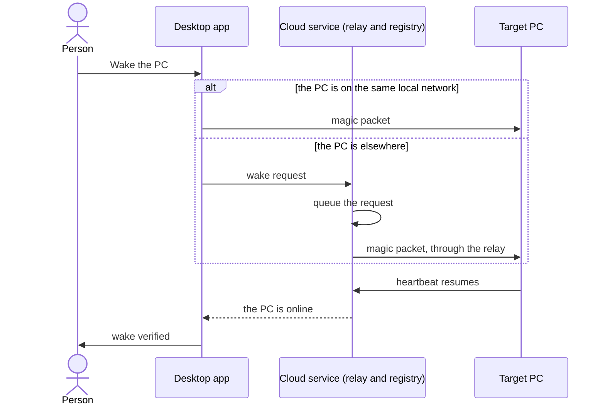

# Dev PC Management

```meta
type: features
status: draft
```

> Features and sub-features this bounded context supports, described in
> business/ubiquitous language rather than implementation terms.

## PC registration

```meta
type: feature
status: draft
```

The desktop app registers its machine with the cloud on startup. It reports the
machine's name, OS, local and public IP, MAC address, and status. A heartbeat
tracks whether the machine is online, sleeping or offline, and the registration
is removed after a period of inactivity.

## Wake-on-LAN

```meta
type: feature
status: draft
depends-on: [.devbook/domain/dev-pc-management/features.md#pc-registration]
```

Send a magic packet to wake a registered PC that is sleeping or powered off.



A wake counts as done only when the PC's heartbeat resumes. A request that needs
the relay waits in the cloud's queue until it can be sent.

## Remote desktop session

```meta
type: feature
status: draft
depends-on: [.devbook/domain/dev-pc-management/features.md#pc-registration]
```

Start a remote desktop session to any online PC, over RDP with VNC as the
fallback. The cloud brokers the connection details, and a relay can tunnel the
session to a machine behind NAT or a firewall.

## Machine status dashboard

```meta
type: feature
status: draft
related: [.devbook/domain/monitoring/features.md#multi-layer-dashboards]
```

List all registered PCs with their current state, last-seen time, uptime, and the
desktop app version each runs. Each row offers quick actions: wake, connect, and
optionally shut down.

## Configuration and tool version tracking

```meta
type: feature
status: draft
related: [.devbook/domain/technology-stack/features.md#technology-baseline-definition]
```

Report installed tool versions on startup and on demand, store version snapshots,
compare them against the team baseline, and alert when a tool is outdated or
incompatible.

### Copilot tool catalog

```meta
type: sub-feature
status: draft
related: [.devbook/domain/technology-stack/features.md#technology-baseline-definition]
```

Track the tooling a development machine is expected to run, as a catalog the
repository declares, layered with each machine's own choices. The catalog holds
four kinds of entry:

| Kind | What it is |
|---|---|
| Plugin | A Copilot or Claude plugin, which the host CLI installs |
| Marketplace | A Claude plugin marketplace, which every Claude plugin installed from it needs first |
| MCP server | A server, installed as a .NET tool or by a command, plus its registration |
| Application | Software or a check the setup guide asks for: a winget package, a VS Code extension, a command, or a manual check |

The catalog states which tools belong to the working setup. This machine's own
choices record what the PC has enabled and which version is actually installed.
Each tool reports its installed version against the available one, so "behind",
"up to date", and "not installed" are distinguishable rather than lumped
together. A manual check has nothing to detect, so it carries this machine's
acknowledgement instead.

### Catalog authoring

```meta
type: sub-feature
status: draft
feature-flag: .devbook/domain/dev-pc-management/context.md#system-tools
depends-on: [.devbook/domain/dev-pc-management/features.md#copilot-tool-catalog]
```

Author the catalog itself from the machine, rather than treating it as something
only a person editing a file can maintain. A person can:

- create the catalog where none exists, after being shown the resolved path it
  will be written to;
- add or remove an entry;
- import a JSON file or pasted text to replace the whole catalog in one step. The
  prior catalog is kept as a backup, and invalid input is rejected without
  touching what is already declared.

Removing an entry also clears any override this machine recorded against it.
What the catalog declares and what a machine has enabled therefore cannot drift
into a stale combination.

## Remote tool updates

```meta
type: feature
status: draft
depends-on: [.devbook/domain/dev-pc-management/features.md#configuration-and-tool-version-tracking]
```

Trigger single, targeted, or bulk tool updates from the dashboard. Updates queue
for offline PCs, report progress with rollback on failure, and can require
explicit confirmation ([Tool update lifecycle](flow.md#tool-update-lifecycle)).

### Local tool enablement and updates

```meta
type: sub-feature
status: draft
feature-flag: .devbook/domain/dev-pc-management/context.md#system-tools
depends-on: [.devbook/domain/dev-pc-management/features.md#copilot-tool-catalog]
```

Act on the machine the person is sitting at:

- re-check the catalog for newer versions;
- update one tool, or every updatable tool at once;
- switch an individual tool on or off for this machine, without changing what the
  catalog declares for everyone else.

Each action reports back whether it succeeded. Tool management can be switched
off wholesale on machines where it does not apply, by the
[System tools](context.md#system-tools) flag.

## Security

```meta
type: feature
status: draft
```

Require authentication for registration and connections, and explicit
authorization for wake, connect, and update. Communication is encrypted, and the
cloud stores no target-machine credentials.
