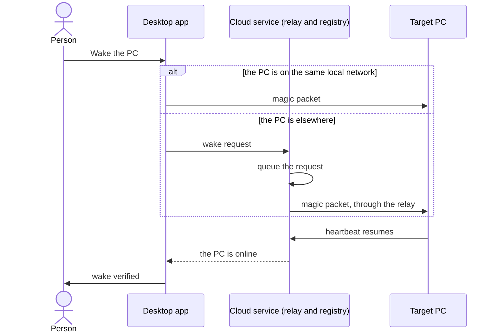

# Dev PC Management

```meta
type: features
status: draft
```

> Features and sub-features this bounded context supports, described in
> business/ubiquitous language rather than implementation terms.

## PC registration

```meta
type: feature
status: draft
```

The desktop app registers its machine with the cloud on startup. It reports the
machine's name, OS, local and public IP, MAC address, and status. A heartbeat
tracks whether the machine is online, sleeping or offline, and the registration
is removed after a period of inactivity.

## Wake-on-LAN

```meta
type: feature
status: draft
depends-on: [.devbook/domain/dev-pc-management/features.md#pc-registration]
```

Send a magic packet to wake a registered PC that is sleeping or powered off.



A wake counts as done only when the PC's heartbeat resumes. A request that needs
the relay waits in the cloud's queue until it can be sent.

## Remote desktop session

```meta
type: feature
status: draft
depends-on: [.devbook/domain/dev-pc-management/features.md#pc-registration]
```

Start a remote desktop session to any online PC, over RDP with VNC as the
fallback. The cloud brokers the connection details, and a relay can tunnel the
session to a machine behind NAT or a firewall.

## Machine status dashboard

```meta
type: feature
status: draft
related: [.devbook/domain/monitoring/features.md#multi-layer-dashboards]
```

List all registered PCs with their current state, last-seen time, uptime, and the
desktop app version each runs. Each row offers quick actions: wake, connect, and
optionally shut down.

## Configuration and tool version tracking

```meta
type: feature
status: draft
related: [.devbook/domain/technology-stack/features.md#technology-baseline-definition]
```

Report installed tool versions on startup and on demand, store version snapshots,
compare them against the team baseline, and alert when a tool is outdated or
incompatible.

### Copilot tool catalog

```meta
type: sub-feature
status: draft
related: [.devbook/domain/technology-stack/features.md#technology-baseline-definition]
```

Track the tooling a development machine is expected to run, as a catalog the
repository declares, layered with each machine's own choices. The catalog holds
four kinds of entry:

| Kind | What it is |
|---|---|
| Plugin | A Copilot or Claude plugin, which the host CLI installs |
| Marketplace | A Claude plugin marketplace, which every Claude plugin installed from it needs first |
| MCP server | A server, installed as a .NET tool or by a command, plus its registration |
| Application | Software or a check the setup guide asks for: a winget package, a VS Code extension, a command, or a manual check |

The catalog states which tools belong to the working setup. This machine's own
choices record what the PC has enabled and which version is actually installed.
Each tool reports its installed version against the available one, so "behind",
"up to date", and "not installed" are distinguishable rather than lumped
together. A manual check has nothing to detect, so it carries this machine's
acknowledgement instead.

### Catalog authoring

```meta
type: sub-feature
status: draft
feature-flag: .devbook/domain/dev-pc-management/context.md#system-tools
depends-on: [.devbook/domain/dev-pc-management/features.md#copilot-tool-catalog]
```

Author the catalog itself from the machine, rather than treating it as something
only a person editing a file can maintain. A person can:

- create the catalog where none exists, after being shown the resolved path it
  will be written to;
- add or remove an entry;
- import a JSON file or pasted text to replace the whole catalog in one step. The
  prior catalog is kept as a backup, and invalid input is rejected without
  touching what is already declared.

Removing an entry also clears any override this machine recorded against it.
What the catalog declares and what a machine has enabled therefore cannot drift
into a stale combination.

### System tools pane

```meta
type: sub-feature
status: draft
feature-flag: .devbook/domain/dev-pc-management/context.md#system-tools
depends-on: [.devbook/domain/dev-pc-management/features.md#copilot-tool-catalog]
related: [.devbook/domain/dev-pc-management/requirements.md#system-tools-pane]
```

Read the catalog against this machine one kind at a time. The pane leads with a
sentence saying what is outstanding on the tab on show — how many of its entries
are behind, missing or not yet confirmed, or that everything matches the catalog —
and when the catalog was last checked. Its tabs are an Overview, then Plugins,
Marketplaces, MCP servers, Applications and a Checklist, which holds the
applications nothing can check and somebody confirms by hand; each kind tab
carries a count of the entries needing action. A host filter narrows every tab
and every count to the entries for Claude (Claude Code or Claude Desktop) or for
Copilot, and entries for no host at all — applications and checklist items —
show only under all hosts. Within a tab, a toolbar narrows to the entries that
need action or by name, and each catalog group is a card that starts folded when
nothing in it is outstanding. The tab and the host filter are remembered on this
machine, never synced, so the pane reopens where it was left. A machine that has
never been on a tab opens on the Overview.

At phone width the pane never scrolls sideways: the tab strip stays on one row and
scrolls on its own, a group's label wraps rather than running past its card, a
row's actions wrap onto a second line when they no longer fit beside each other,
and a long note — a registry path, a URL — breaks inside its card. The keyboard
reaches every control in reading order; the arrow keys move along the host filter
and the tab strip. Escape in one of the pane's dialogs — adding a tool, importing a
catalog, reading the last run's transcript — closes that dialog and leaves the pane
open; the next Escape closes the pane.

### Overview tab

```meta
type: sub-feature
status: draft
feature-flag: .devbook/domain/dev-pc-management/context.md#system-tools
depends-on: [.devbook/domain/dev-pc-management/features.md#system-tools-pane, .devbook/domain/dev-pc-management/features.md#last-run-record]
related: [.devbook/domain/dev-pc-management/requirements.md#overview-tab]
```

Read every kind at once. Four headline figures lead: how many entries match the
catalog out of how many this machine wants, with the share that is matching,
behind, missing and not confirmed; how many are behind, by host; how many are
missing, and how many of those can be installed from here rather than by hand; and
how many cached plugin versions nothing loads any more. Under them, Needs you lists
every entry that needs action, updates first, then missing entries, then
unconfirmed checklist items, then the stale cache, each as one action — update it,
install it, go to its download page and install it by hand, tick it done here, or
clear the cache — and says that everything matches the catalog when nothing is
left. Beside it, one bar per kind says how many of that kind's entries match, and
opens that kind's tab, and the last run this machine finished says how it ended,
what it was, when, how many of its steps succeeded and how long it took, with the
end of its transcript and the whole of it a click away. An entry switched off on
this machine, or one whose version could not be looked up, is left out of every
figure. The host filter narrows every figure here as it does on the kind tabs.

A machine with no catalog yet opens on "No tool catalog on this machine yet",
where the catalog would be written, and two choices side by side: create this
machine's catalog — the recommended one — or import a team catalog somebody
already keeps; a quieter third way creates an empty catalog and goes straight to
adding tools one at a time.

"Create from this machine" writes a catalog that already holds what the hosts here
have installed, read from their own manifests: every Copilot plugin with a source
to install it from, every Claude plugin installed for the user — one entry for a
plugin both hosts have — every Claude marketplace, and every MCP server registered
with Claude or Claude Desktop, each switched on or off as its host has it.
Applications are left out, because nothing can name one before its entry exists,
and so are plugins installed only for one project, Copilot's own MCP servers, and
every header and environment value, which is where tokens live. What was left out
is said after the write. Neither way ever writes over a catalog that is already
there. The web harness reads no host's manifests, so there it writes the empty
catalog and says so.

A catalog that exists with nothing in it offers the same
arrangement, to add a tool or import a team catalog. Both choices are offered only
where the host can write the catalog; a read-only host says so instead. While the
first check of the machine is still running, the pane shows the shape of what is
coming — the tab strip, the toolbar and group cards with placeholder rows — rather
than a sentence.

## Remote tool updates

```meta
type: feature
status: draft
depends-on: [.devbook/domain/dev-pc-management/features.md#configuration-and-tool-version-tracking]
```

Trigger single, targeted, or bulk tool updates from the dashboard. Updates queue
for offline PCs, report progress with rollback on failure, and can require
explicit confirmation ([Tool update lifecycle](flow.md#tool-update-lifecycle)).

### Local tool enablement and updates

```meta
type: sub-feature
status: draft
feature-flag: .devbook/domain/dev-pc-management/context.md#system-tools
depends-on: [.devbook/domain/dev-pc-management/features.md#copilot-tool-catalog]
```

Act on the machine the person is sitting at:

- re-check the catalog for newer versions;
- update one tool, or every updatable tool at once;
- switch an individual tool on or off for this machine, without changing what the
  catalog declares for everyone else.

Each action reports back whether it succeeded. Tool management can be switched
off wholesale on machines where it does not apply, by the
[System tools](context.md#system-tools) flag.

While an update of every tool runs, the pane says so: its header reads "Updating"
with how many tools the run takes, how many are done and how many are running, a
progress bar under it fills as steps finish, and checking and updating are both
unavailable until the run ends. A "This run" list names every tool the run takes
in order — done, running, queued or failed — with the version it is going from
and to and, once finished, how long it took, beside the run's transcript as it is
written, which can be copied and read with long lines wrapped or not. The tools
themselves stay on screen under it. A tool whose step fails goes back to needing
action, with the reason under its row, and the run's transcript stays open beside
it.

### Last run record

```meta
type: sub-feature
status: draft
feature-flag: .devbook/domain/dev-pc-management/context.md#system-tools
depends-on: [.devbook/domain/dev-pc-management/features.md#local-tool-enablement-and-updates]
related: [.devbook/domain/dev-pc-management/domain.md#last-tool-run]
```

Keep the last Update all, Update, Install or Clear stale cache this machine
finished, so what it did is still there after the app restarts: which kind of run
it was, when it started and finished, whether it succeeded, failed or partly
failed, each tool it touched with the version it came from, the version it was
going to, how that tool's step ended and how long it took, and the whole
transcript. Only the most recent run is kept, per machine and beside that
machine's own tool choices; a new run replaces it once it finishes, and a machine
that has never finished one has none. An Update all the host refuses before any
tool is touched — a host that only reads the catalog — still finishes, and is kept
as a failed run with no tool steps and the refusal as its transcript.

## Security

```meta
type: feature
status: draft
```

Require authentication for registration and connections, and explicit
authorization for wake, connect, and update. Communication is encrypted, and the
cloud stores no target-machine credentials.
