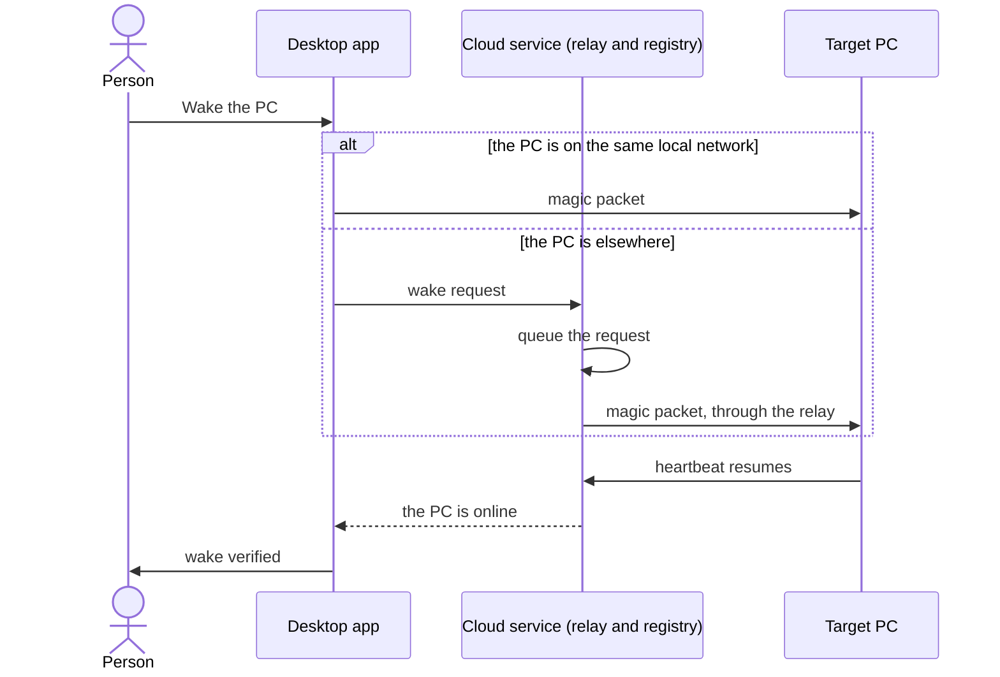
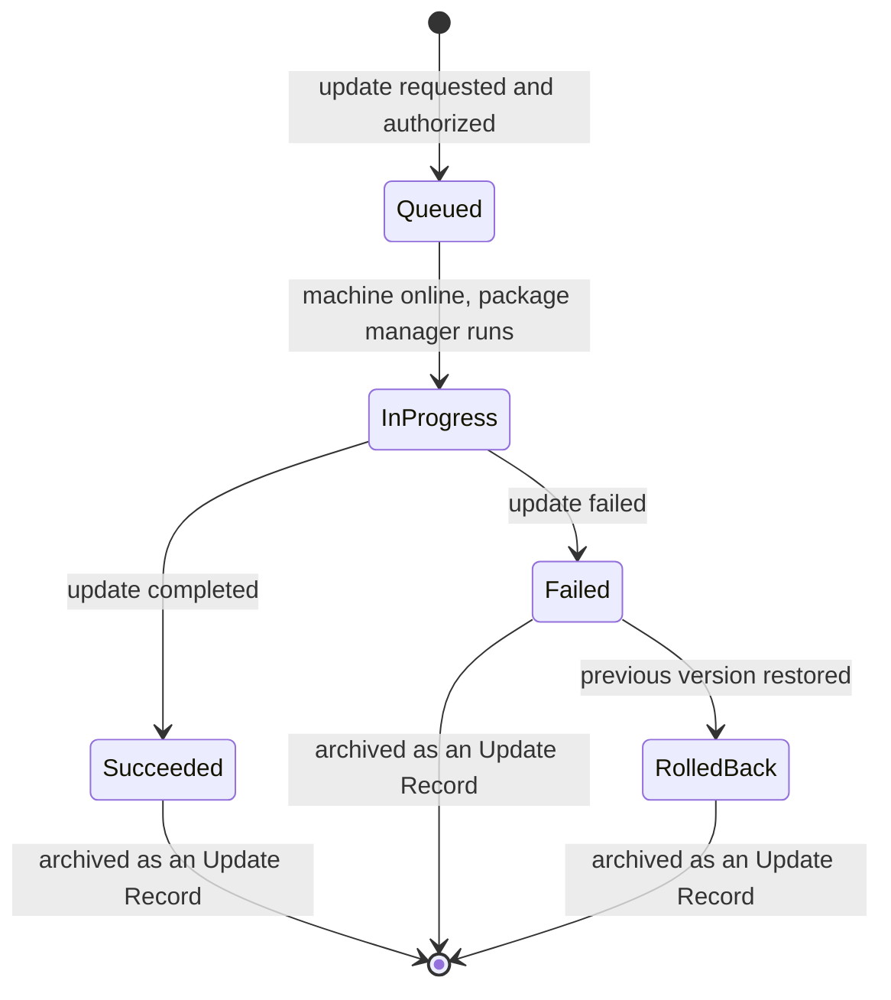

# Dev PC Management

```meta
type: features
```

> Features and sub-features this bounded context supports, described in
> business/ubiquitous language rather than implementation terms.

## PC registration

```meta
type: feature
```

The desktop app registers its machine with the cloud on startup. It reports the
machine's:

- name and OS;
- local and public IP;
- MAC address and status.

A heartbeat tracks whether the machine is online, sleeping or offline, and the
registration is removed after a period of inactivity.

## Wake-on-LAN

```meta
type: feature
depends-on: [.devbook/domain/dev-pc-management/features.md#pc-registration]
```

Send a magic packet to wake a registered PC that is sleeping or powered off.



A wake counts as done only when the PC's heartbeat resumes. A request that needs
the relay waits in the cloud's queue until it can be sent.

## Remote desktop session

```meta
type: feature
depends-on: [.devbook/domain/dev-pc-management/features.md#pc-registration]
```

Start a remote desktop session to any online PC, over RDP with VNC as the
fallback. The cloud brokers the connection details, and a relay can tunnel the
session to a machine behind NAT or a firewall.

## Machine status dashboard

```meta
type: feature
related: [.devbook/domain/monitoring/features.md#multi-layer-dashboards]
```

List all registered PCs, each with:

- its current state and last-seen time;
- its uptime;
- the desktop app version it runs.

Each row offers quick actions: wake, connect, and optionally shut down.

## Configuration and tool version tracking

```meta
type: feature
related: [.devbook/domain/technology-stack/features.md#technology-baseline-definition]
```

Report installed tool versions on startup and on demand, store version snapshots,
compare them against the team baseline, and alert when a tool is outdated or
incompatible.

### Copilot tool catalog

```meta
type: sub-feature
related: [.devbook/domain/technology-stack/features.md#technology-baseline-definition]
```

Track the tooling a development machine is expected to run, as a catalog the
repository declares, layered with each machine's own choices. The catalog holds
four kinds of entry:

| Kind | What it is |
|---|---|
| Plugin | A Copilot or Claude plugin, which the host CLI installs |
| Marketplace | A Claude plugin marketplace, which every Claude plugin installed from it needs first |
| MCP server | A server, installed as a .NET tool or by a command, plus its registration |
| Application | Software or a check the setup guide asks for |

An application entry is one of:

- a winget package;
- a VS Code extension;
- a command;
- a manual check.

The catalog states which tools belong to the working setup. This machine's own
choices record what the PC has enabled and which version is installed.
Each tool reports its installed version against the available one, so "behind",
"up to date" and "not installed" stay distinct. A manual check has nothing to
detect, so it carries this machine's acknowledgement instead.

### Catalog authoring

```meta
type: sub-feature
feature-flag: .devbook/domain/dev-pc-management/context.md#system-tools
depends-on: [.devbook/domain/dev-pc-management/features.md#copilot-tool-catalog]
```

Author the catalog from the machine, not only by editing a file. A person can:

- create the catalog where none exists, after being shown the resolved path it
  will be written to;
- add or remove an entry, giving an application or an MCP server the download
  page somebody installing it by hand gets it from;
- import a JSON file or pasted text to replace the whole catalog in one step. The
  prior catalog is kept as a backup, and invalid input is rejected without
  touching what is already declared.

Removing an entry also clears any override this machine recorded against it, so
the catalog and a machine's choices cannot drift into a stale combination.

### System tools pane

```meta
type: sub-feature
feature-flag: .devbook/domain/dev-pc-management/context.md#system-tools
depends-on: [.devbook/domain/dev-pc-management/features.md#copilot-tool-catalog]
related: [.devbook/domain/dev-pc-management/requirements.md#system-tools-pane]
```

Read the catalog against this machine one kind at a time.

The pane leads with a sentence saying what is outstanding on the tab on show: how
many entries are behind, missing or not yet confirmed, or that everything
matches the catalog. When several are outstanding, the sentence
counts each, in the order Needs you lists them. It reads "Three updates
waiting, two tools missing and one item to confirm" on the Overview and "Two
plugins behind and one missing" on a kind tab.

Under it a quieter line says how long ago the catalog was checked (just now, so
many minutes or hours ago, or the date), how many entries the tab holds, and how
many already match. It changes when the pane next redraws, never on a timer.

The tabs, in order, are:

- Overview;
- Plugins;
- Marketplaces;
- MCP servers;
- Applications;
- Checklist, which holds the applications nothing can check and somebody confirms
  by hand.

Each kind tab carries a count of the entries needing action. A host filter narrows
every tab and count to the entries for Claude (Claude Code or Claude Desktop)
or for Copilot. Entries for no host, which are applications and checklist
items, show only under all hosts.

Within a kind tab, a toolbar narrows to the entries that need action or by name.
Each catalog group is a card that starts folded when nothing in it is outstanding.
A group's fold names its title, how many entries of the tab's kind it holds and how
many need action, dropping the last when none do. Under All, an open group
that has both lists the entries needing action first and holds the matching ones
behind "n more up to date — show". Once shown, they stay shown when the catalog is
checked again.

The tab and the host filter are remembered on this machine, never synced. A
machine that has never been on a tab opens on the Overview.

At phone width the pane never scrolls sideways:

- the tab strip stays on one row and scrolls on its own;
- a group's label wraps rather than running past its card;
- a row's actions wrap onto a second line when they no longer fit;
- a long note, such as a registry path or a URL, breaks inside its card.

The keyboard reaches every control in reading order, and the arrow keys move along
the host filter and the tab strip. Escape in one of the pane's dialogs (adding a
tool, importing a catalog, reading the last run's transcript) closes that dialog
and leaves the pane open. The next Escape closes the pane.

### Overview tab

```meta
type: sub-feature
feature-flag: .devbook/domain/dev-pc-management/context.md#system-tools
depends-on: [.devbook/domain/dev-pc-management/features.md#system-tools-pane, .devbook/domain/dev-pc-management/features.md#last-run-record]
related: [.devbook/domain/dev-pc-management/requirements.md#overview-tab]
```

Read every kind at once. Four headline figures lead:

- how many entries match the catalog out of how many this machine wants, with the
  share that is matching, behind, missing and not confirmed;
- how many are behind, by host, with the lines adding up to the figure;
- how many are missing, and how many of those can be installed from here rather
  than by hand;
- how many cached plugin versions nothing loads any more.

The by-host lines count each entry once, in one of these places:

- under the one host it is for or the one that reports it behind;
- under Both when it is for both and both or neither say;
- as the machine's own software.

Under the figures, Needs you lists every entry that needs action: updates first,
then missing entries, then unconfirmed checklist items, then the stale cache. Each
offers one action: update it, install it, go to its download page and install it
by hand, tick it done here, or clear the cache. When nothing is left, Needs you
says everything matches the catalog. Over a list, it says the list is only the
exceptions.

Beside Needs you, one bar per kind says how many of that kind's entries match, and
opens that kind's tab. The last run this machine finished also sits there, with the
end of its transcript and the whole of it a click away. It says how it ended and what it was.
It also gives when it ran, how many steps succeeded, and how long it took.

The tab strip's "Last run transcript" opens the whole transcript whenever
there is a last run, even after a restart. A tab opened from the Overview takes
the keyboard focus to that tab in the strip.

An entry switched off on this machine, or one whose version could not be looked up,
is left out of every figure. The host filter narrows every figure as on the kind tabs.

At its foot the Overview names the catalog this machine reads and the file holding
its own choices. Where the host can write the catalog, it also offers Add tool and
Import there. The kind tabs keep both in their toolbars.

The download page an entry installed by hand links to is the one its catalog
entry names, when that is an http or https address. Otherwise it is derived from
the entry's mechanism: the winstall.app page for a winget id, or the Marketplace
page for a VS Code extension. An entry with neither links to its kind's tab, where
the note under the row says what to do.

A machine with no catalog yet opens on "No tool catalog on this machine yet". That
screen says where the catalog would be written and offers two choices side by side:
create this machine's catalog (recommended), or import a team catalog. A quieter
third way creates an empty catalog to add tools one at a time.

"Create from this machine" writes a catalog that already holds what the hosts here
have installed, read from their own manifests. Each entry is switched on or off as
its host has it. The catalog holds:

- every Copilot plugin with a source to install it from;
- every Claude plugin installed for the user, with one entry for a plugin both
  hosts have;
- every Claude marketplace;
- every MCP server registered with Claude or Claude Desktop.

It leaves out:

- applications, because nothing can name one before its entry exists;
- plugins installed only for one project;
- Copilot's own MCP servers;
- every header and environment value, which is where tokens live.

What was left out is said after the write. Neither choice ever writes over an
existing catalog. The web harness reads no host's manifests, so there it writes
the empty catalog and says so.

A catalog with nothing in it offers the same choices, to add a tool or import a
team catalog, only where the host can write the catalog; a read-only host says
so instead. While the first check is running, the pane shows placeholder rows in
the tab strip, toolbar and group cards rather than a sentence.

## Remote tool updates

```meta
type: feature
depends-on: [.devbook/domain/dev-pc-management/features.md#configuration-and-tool-version-tracking]
```

Trigger single, targeted, or bulk tool updates from the dashboard. Updates queue
for offline PCs ([Tool update lifecycle](features.md#remote-tool-updates)).

**Tool update lifecycle**



A queued update is a [Pending Update](domain.md#pending-update) and waits while
its machine is offline. [Remote Update](domain.md#remote-update) runs it through
the machine's native package manager. Once it completes or fails, it leaves
`pending_updates` for `updates_history` as an
[Update Record](domain.md#update-record). Updates report progress with rollback on failure, and an update can require explicit confirmation.

### Local tool enablement and updates

```meta
type: sub-feature
feature-flag: .devbook/domain/dev-pc-management/context.md#system-tools
depends-on: [.devbook/domain/dev-pc-management/features.md#copilot-tool-catalog]
```

Act on the machine the person is sitting at:

- re-check the catalog for newer versions;
- update one tool, or every updatable tool at once;
- switch a tool on or off for this machine, with a switch on its row that shows whether this machine wants it,
  without changing what the catalog declares for everyone else.

Each action reports whether it succeeded. The
[System tools](context.md#system-tools) flag switches tool management off on
machines where it does not apply.

While an update of every tool runs, the pane header reads "Updating"
with how many tools the run takes, how many are done and how many are running. A
progress bar under it fills as steps finish. Checking and updating are unavailable
until the run ends.

A "This run" list names every tool the run takes, in order, each reading
done, running, queued or failed, with the versions it goes from and to and,
once finished, how long it took. The list sits beside the run's transcript as it is
written, which can be copied and read with long lines wrapped or not. The tools
stay on screen under it.

A tool whose step fails goes back to needing action, with the reason under its row
and on its Needs you card, until the next run starts. The run's transcript stays
open beside it.

### Last run record

```meta
type: sub-feature
feature-flag: .devbook/domain/dev-pc-management/context.md#system-tools
depends-on: [.devbook/domain/dev-pc-management/features.md#local-tool-enablement-and-updates]
related: [.devbook/domain/dev-pc-management/domain.md#last-tool-run]
```

Keep the last Update all, Update, Install or Clear stale cache this machine
finished, so it survives an app restart. The record holds:

- which kind of run it was;
- when it started and finished;
- whether it succeeded, failed or partly failed;
- each tool it touched, with the version it came from and was going
  to, how its step ended and how long it took;
- the whole transcript.

Only the most recent run is kept, per machine and beside its own tool
choices. A new run replaces it once it finishes, and a machine that has never finished one has none. An Update all the host refuses
before any tool is touched (a host that only reads the catalog) is kept as a
failed run with no tool steps and the refusal as its transcript.

## Security

```meta
type: feature
```

Require authentication for registration and connections. Wake, connect and update
also need explicit authorization. Communication is encrypted, and the
cloud stores no target-machine credentials.
