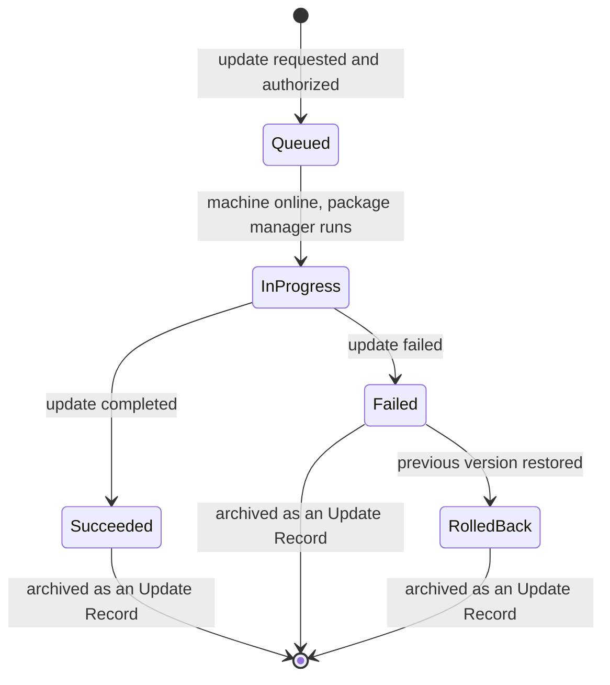

# Dev PC Management

```meta
type: flow
status: draft
```

> Lifecycle and process flows for this bounded context. Flows describe how a
> machine moves through its states over time. They complement `model.md`
> (structure) and `domain.md` (responsibilities/invariants).

## Machine status lifecycle

```mermaid
stateDiagram-v2
    [*] --> Online : Registers and sends heartbeat
    Online --> Sleeping : OS sleeps (heartbeat pauses)
    Sleeping --> Online : WoL received; heartbeat resumes
    Online --> Offline : Heartbeat timeout
    Sleeping --> Offline : Heartbeat timeout
    Offline --> Online : Desktop app restarts and heartbeats
```



## Tool update lifecycle



A queued update is a [Pending Update](domain.md#pending-update) and waits while
its machine is offline. [Remote Update](domain.md#remote-update) runs it through
the machine's native package manager. Once it completes or fails, it leaves
`pending_updates` for `updates_history` as an
[Update Record](domain.md#update-record), whose status is success, failed, or
rollback.
