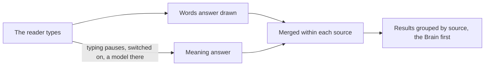
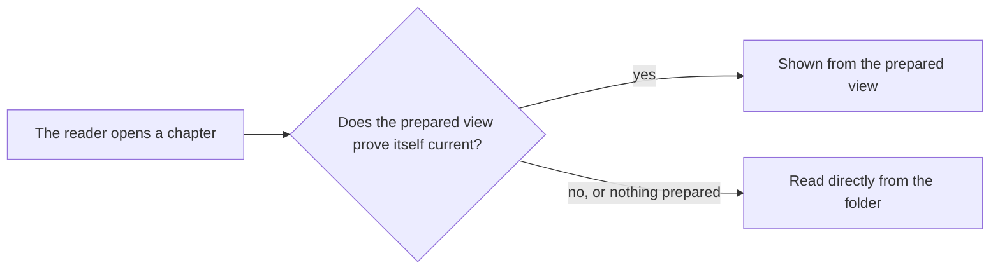
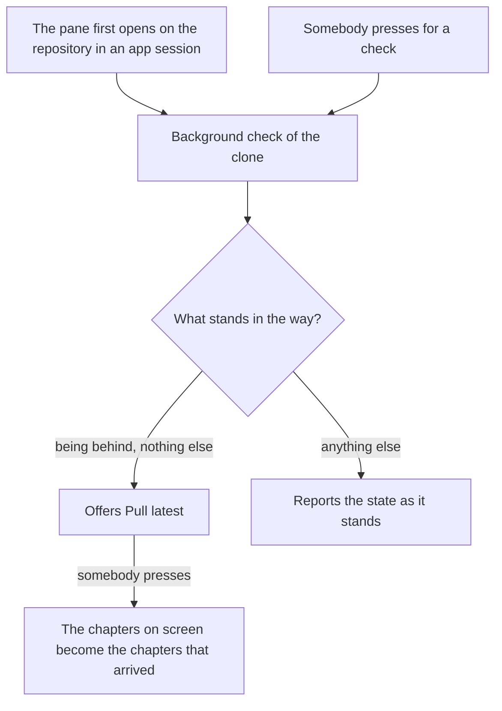
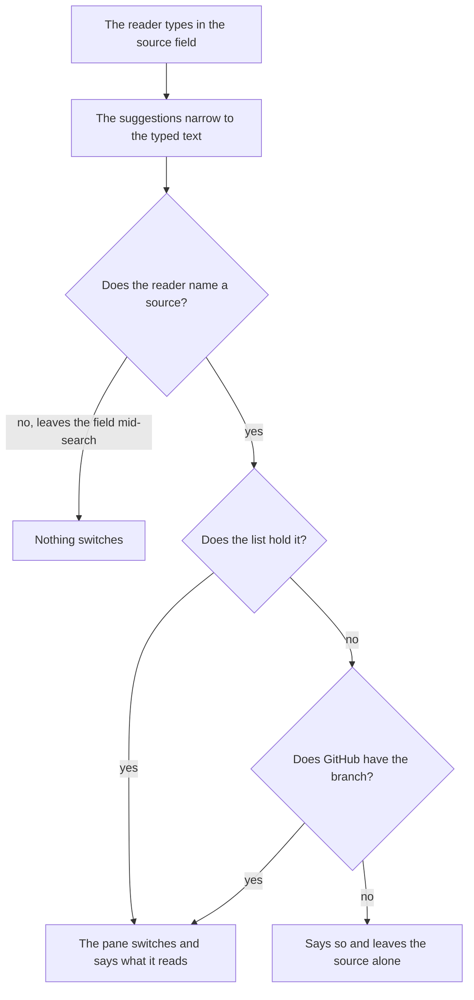
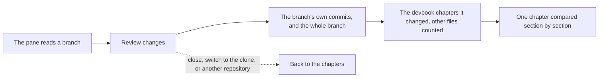
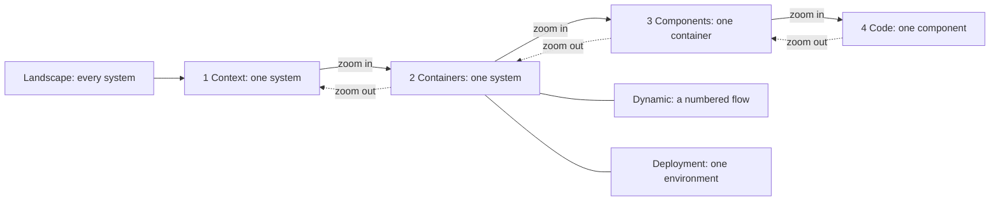

# Devbook

```meta
type: features
```

> Features and sub-features this bounded context supports, described in
> business/ubiquitous language rather than implementation terms.

## Unified search

```meta
type: feature
depends-on: [.devbook/domain/devbook/features.md#devbook-retrieval]
related: [.devbook/domain/devbook/requirements.md#unified-search, .devbook/arc42/08-crosscutting-concepts.md#devbook-database]
```



Ask one question of the Brain and every configured repository's devbook at once.
The search offers scope chips (**Everywhere**, **Brain**, and one per
repository). It searches by words and by meaning, as
[Devbook retrieval](#devbook-retrieval) does for one devbook, over each source's
own database. A source with no database yet is named as not searchable rather
than silently left out.

Search by meaning is additive, as for one devbook. The words answer is drawn
while the meaning answer is on its way. Within a source the two are merged by where
each put a chapter, never by their scores, which are on different scales. A
chapter both found is one result. A result from the devbook on screen opens there.
One from another devbook moves the pane to that devbook and opens it, leaving the
header's scope and the task filter alone.

## Repository devbook areas

```meta
type: feature
feature-flag: .devbook/domain/devbook/context.md#devbook-pane
related: [.devbook/domain/repository-management/features.md#repository-devbook-folder-settings, .devbook/domain/tasks/features.md#search-filter-and-organize]
```

Read the devbook a repository already carries alongside its code, next to the
backlog. A devbook is grouped into named areas:

- working instructions;
- domain;
- architecture;
- technology;
- design.

Each is backed by the repository's own folder for that subject. Tasks are not an
area: they are their own workspace section, read and written rather than browsed,
so a repository's backlog folder is not one.

Areas are browsed in the Devbook, which takes the whole screen in place of the task
list and keeps it underneath. One press moves between the devbook and work (local
ADR 0022, amendment of 2026-10-15).

### Area selection and scope

```meta
type: sub-feature
feature-flag: .devbook/domain/devbook/context.md#devbook-pane
related: [.devbook/domain/brain/features.md#brain-mode-of-the-devbook-pane, .devbook/arc42/adr/0027-the-brain-is-a-scope-beside-the-repositories.md, .devbook/domain/repository-management/requirements.md#archiving-a-repository]
```

Switch between areas, and between repositories when more than one is registered,
so what the pane shows always belongs to a known repository or to the Brain.

| Scope | The pane shows | The `Brain \| <repo>` switch |
| --- | --- | --- |
| Nothing pressed | The [Brain](../brain/features.md#brain-mode-of-the-devbook-pane) | Absent |
| Brain alone | The Brain | Absent |
| Repositories, no Brain | The anchor's repository | Absent |
| Brain and at least one repository | The anchor's side | Shown |

With Brain as the anchor and several repositories, the switch's other side is the
first of them. The pane reads one devbook at a time, even when the backlog beside
it is scoped to several. It follows the scope's anchor, the first chip taken into
that scope, so widening the list never moves the chapter being read. Nothing
pressed shows the Brain, which is always there. The switch flips what the pane
shows and leaves the task filter alone (local ADR 0027).

The folder the backlog is kept in is never read as a devbook of its own. Every
area is opt-in, can be switched off, and can be pointed at a non-standard folder.
When none is on, the pane says there is nothing to browse instead of offering an
empty tab strip.

### Rendered devbook documents

```meta
type: sub-feature
feature-flag: [.devbook/domain/devbook/context.md#devbook-editing, .devbook/domain/devbook/context.md#devbook-status]
related: [.devbook/domain/devbook/requirements.md#rendered-devbook-documents, .devbook/domain/tasks/features.md#acceptance-from-scenario-parts, .devbook/domain/devbook/domain.md#subject-state, .devbook/arc42/adr/0044-devbook-subject-state-lives-in-backlogs-own-store.md]
```

Present each area's documents as readable content, not raw files: headings and
sections, the metadata each chapter declares, cross-references between documents,
and diagrams rendered as diagrams.

A cross-reference may name a chapter in the repository's backlog folder, though
that folder is not a browsable area. It is read with that folder's own status
vocabulary, not as an unknown one.

Two parts are switches of their own, both off by default.
[Devbook status](context.md#devbook-status) draws the status and decision state
beside each file and chapter, and the state the app keeps for a decision or debt
record. [Devbook editing](context.md#devbook-editing) offers Edit on a repository
chapter; a Brain note keeps Edit either way. What follows about status or decisions
holds while status is on. Off, the file still states them, the app still keeps a
record's state, and the app draws none of it.

Documents appear in the order the convention gives them:

1. each directory's introducing document first;
2. numbered chapters by their number;
3. a folder's usual chapters in their usual places;
4. the rest by name.

A repository never writes its reading order down, and a file that tries to is
ignored. Inside a bounded context, the rules a domain page's types enforce are a
page of their own that reads directly after it. The menu lists it as the page's
invariants: "Invariants", or "Order invariants" beside a page split out for one
aggregate. A context that still keeps its rules in the older single invariants file
has them read and listed where they always were.

The metadata is read against the devbook convention the repository's own checks
enforce, folder by folder, so a chapter the app shows as fine is not one those
checks reject:

- **A status at rest says nothing.** Architecture, domain and design chapters that
  are current carry no status and are shown as current. The app writes no status
  into them, and a status one states anyway is shown as a badge. A chapter that
  spells out "current" is pointed out. Technology and AI-adoption chapters are
  ratings, so the file always states theirs. The app reads a rating from `rating`,
  and from `status` until the repository migrates, and writes the reader's pick
  into whichever of the two the chapter carries.
- **A decision is state, not content.** A domain chapter can state that it stands
  approved (someone agreed it), and above that accepted (someone saw the built
  work against it and accepted it). A review on the way there is state too:
  requested, changes requested or cleared, and who owes the next move. The app
  shows them as the chapter states them and never writes them
  ([requirements](requirements.md#rendered-devbook-documents)). No other area has
  them, and a chapter outside the domain that carries one is pointed out.
- **A record's workflow state is the app's.** The app keeps the state of a
  decision record and a debt record itself, never in the file
  ([Subject State](domain.md#subject-state), local ADR 0044). The states a
  repository's default branch still writes in its Markdown are imported into that
  store once. The record shows that state beside its name, with who set it and
  when. Three cases differ:
  - A debt record's state is picked there, on a branch snapshot too, because
    picking it writes no file.
  - A decision record's state is shown and never picked. It is kept per pull
    request, which the panel does not know, so the panel shows the state set most
    recently for that path, in any pull request.
  - A change proposal's state, approval and acceptance are set by an assistant
    over the app's MCP server. No panel shows a proposal's state yet.
- **Kinds.** Each area that classifies its chapters is read with its own set of
  kinds. A domain context's set covers:

  - its boundary document;
  - its requirements and invariants and the single rules inside them;
  - its switches and settings;
  - its actors;
  - a page of its own that the convention does not name.

  A requirements
  or invariants page is shown under the title it carries, which names what it
  holds. How a bounded context ships, as a service of its own or as a module in a
  shared host, is shown with it. The app says so when the context map and the
  boundary document disagree.
- **Everything else a chapter declares** is shown as written: the tests that back
  it, its number and place in the reading order, and the day it records. State
  another tool keeps under its own name is
  [carried as written](requirements.md#requirement-another-tools-state-is-carried-as-written).
- **Planning fields are not drawn.** The chapter view shows no `issue`, `effort`,
  `roadmap` or `change` field, though the app still reads them for tasks and the
  knowledge graph.

A bounded context's click demo, the one HTML file a context holds, is shown with
the page it belongs to. It pairs with a page in two ways. By name, `demo.html`
belongs to the context's boundary document and `<page>.demo.html` to the page
beside it. By field, a chapter's `demo` metadata names a demo and the places in it
that show the chapter. The context view shows the context's own demo, and every other
page shows the demos paired with it.

Each demo runs in a frame of its own, isolated from the app, and can go full
screen. It keeps its own look, so the pane never forces its dark theme onto it.
Every place a chapter names in the demo is a chip above the frame. The first place
opens when the demo says it is ready, and picking another chip moves the demo
there. Notes on a demo are placed in spec-manager, so the pane neither pins notes
nor follows where the reader clicks inside the demo.

A scenarios file is listed in the bounded context it lives in, at any depth: the
context's `scenarios.md`, or a split `scenarios.<name>.md`. Each `##` chapter with
`type: scenario` is one end-to-end journey, and its `###` parts are the outcomes
the actor reaches. The scenario register the repository's devbook commits says
which files hold journeys. A repository with no register is read for the scenarios
files whose journeys say so themselves.

In the menu each scenarios file carries the scenario mark and one dot for the last
runs of all its journeys: passed, failed, stale, or never run. The dot takes the
first of never run, stale and failed that any journey is, and reads passed only
when every journey passed. It differs by shape as well as colour, and a screen
reader hears its state. A legend under the menu draws the four dots beside their
words, so the shapes need not be learned. It shows only while the repository has a journey, and never for a Brain.

Each journey's run is committed beside its scenarios file, at
`<scenarios file without .md>/<journey>/run.json`. The app reads all three run
versions:

- version 3 names the journey;
- version 2 names the journey page it ran before journeys moved into scenarios files;
- version 1 is the older format spec-manager's test tooling writes.

It reads the register at schema 2 only and treats any other as none. Staleness is
worked out, never stored: the app signs each journey as it reads now, the way
devbook computes a journey signature. A run that proved a different signature is
stale, and so is a version 1 run, which proves no signature.

Opening a scenarios file shows each journey's run above the file. The run shows the
setup the journey runs under:

- where it starts;
- who is signed in;
- the profile;
- the data sets;
- the flag and setting overrides.

Under the setup is a summary line, then each part with its outcome and
screenshots. A failed part also shows the screenshot taken where it failed.

A reference can name one of a journey's parts, such as a part pressed in a task's
acceptance checklist. The journey then opens at that part, marks it and scrolls it
into view. The mark stays until the reader picks another chapter and belongs to
the repository the reference named.

An image written `scenario:<scenarios file>#<label>` in any chapter shows that
screenshot from the last run of the journey that holds the label. The file is named
by its path inside the domain folder, such as `work/scenarios.md`, and a label is
unique in its file. Inside the scenarios file itself, `shot:<label>` is enough. A
source line under the image names the journey, the part, the run's state and the
time of the capture, and two such images in one paragraph sit side by side.

The image reports what went wrong:

- A label the file does not have lists the labels it does have.
- A scenarios file that does not exist says so.
- A label the run never captured says that too.
- A capture older than the last run says so on its source line.

### Remarks on a chapter

```meta
type: sub-feature
related: [.devbook/arc42/adr/0011-devbook-annotations-are-a-third-replica-container.md, .devbook/arc42/08-crosscutting-concepts.md#storage-and-sync, .devbook/domain/devbook/requirements.md#remarks-on-a-chapter]
```

Let a reader leave a [remark](domain.md#remark) against one block of a chapter
while reading it. A remark has a kind (comment, question, suggestion or flag) and
sits beside the prose. It belongs to the person: the app keeps it, it moves with
the person's backlog, and it reaches their other devices through sync.

Because a remark stays out of the repository, a reader can remark on a chapter read
from a branch nobody can edit
([the Remark invariants](domain.invariants.md#remark)). A remark can be resolved,
which keeps it visible and quiet, or deleted.

A remark is kept per branch. One left on a named branch shows only while that
branch is read. One left on the default branch shows on a clone and on the default
branch's snapshot alike.

A remark is not a [Review Note](domain.md#review-note), the `annotation` fence a
repository writes into a chapter, shown under
[Review notes in a chapter](#review-notes-in-a-chapter). A repository's open
review notes on its default branch arrive as remarks once, but the app never turns
a remark into a review note.

A remark is anchored to the block it was left on and remembers what the block said,
so the chapter can change under it without losing it. See
[the requirements](requirements.md#remarks-on-a-chapter) for where the read view
then shows it.

### Review notes in a chapter

```meta
type: sub-feature
related: [.devbook/arc42/adr/0011-devbook-annotations-are-a-third-replica-container.md, .devbook/arc42/adr/0012-backlog-is-an-mcp-server-inside-the-desktop-app.md, .devbook/domain/devbook/features.md#remarks-on-a-chapter, .devbook/domain/devbook/requirements.md#review-notes-in-a-chapter]
```

Show the [review notes](domain.md#review-note) a repository keeps in its own
chapters as notes attached to their passage, open or resolved, not as the raw text
they are stored in. Each shows its kind and its replies. Whoever reviews the
chapter reads the same notes, and they leave with the change that resolves them.

A review note is never read as what the chapter says, because an open question
about whether a rule still holds is not the rule. See
[the requirements](requirements.md#review-notes-in-a-chapter) for what that keeps
out of an assistant's read, search and excerpts.

The convention's own tooling writes these notes; the app only shows them, apart
from the reader's [remarks](#remarks-on-a-chapter). The default branch's open notes
are imported once into remarks (local ADR 0011).

### Sync verdicts beside a chapter

```meta
type: sub-feature
related: [.devbook/domain/devbook/domain.md#sync-verdict, .devbook/domain/sessions/features.md#what-started-a-run-and-what-it-found, .devbook/domain/productivity/features.md#drift-at-a-glance, .devbook/domain/devbook/requirements.md#sync-verdicts-beside-a-chapter]
```

Show beside each chapter heading its [Sync Verdict](domain.md#sync-verdict): the
last verdict a sweep reached on it (aligned, code ahead, spec ahead, in conflict,
or unresolved). The root chapter of a [Sync Unit](domain.md#sync-unit) also shows
the unit's own verdict and what the sweep did about it. Each badge leads to the
pull request or drift issue the sweep opened, where the verdict is argued.

Only the latest verdict per chapter is shown, in the sweep's own words. A
chapter last checked a month ago keeps that word until a sweep checks it again.
See [the requirements](requirements.md#sync-verdicts-beside-a-chapter) for which
verdict that is and how an unknown word looks. A chapter no sweep has checked
carries nothing.

Each verdict also keeps the unit's sync direction as the sweep resolved it, and
where it was inherited from. The dashboard's
[Drift at a glance](../productivity/features.md#drift-at-a-glance) part reads the
same verdicts a unit at a time and groups them by that direction.

### A devbook that stays current

```meta
type: sub-feature
related: [.devbook/arc42/08-crosscutting-concepts.md#devbook-database]
```



Show what a repository's folders actually say, including when a chapter was
edited outside the app, by another tool, a pull request, or hand. The folders are
the source of truth and the app never owns them.

A repository where nothing has been prepared is a normal state, not an error: its
devbook is still browsable, only slower, and preparing it is never a precondition
for reading it.

Preparation happens unasked and unawaited. It never slows opening the app or holds
back a pane ready to show something. A chapter edited moments ago is shown from the
folder itself, so what is on screen is never older than what is on disk.

The prepared view is kept with the app, never in the repository, so nothing is
added to a repository's folders or needs ignoring. It is prepared per copy of the
repository, so two clones or worktrees are each prepared from their own files. A
repository read from a branch without a clone is prepared too.

### The devbook on the repository's latest version

```meta
type: sub-feature
related: [.devbook/domain/repository-management/features.md#repository-devbook-folder-settings, .devbook/domain/repository-management/requirements.md#archiving-a-repository]
```



Say whether the devbook in view is the latest version the repository has, and
bring it up to date when it is not. A local clone falls behind in silence: every
chapter still opens, and nothing says somebody has revised it since.

The first question is asked on its own, beside loading
[its branches](#choosing-where-the-devbook-is-read-from). It reaches for the
repository itself, so opening a folder never waits on
it. A clone found behind is offered "Pull latest" straight away, with no "Check
now" first.

The question concerns only the local clone, so the control shows only while the
pane reads the clone. A branch snapshot keeps itself current on its own cadence
(local ADR 0008).

The answer says how far behind the clone is. Three other states are not reconciled for the reader:

- a clone carrying edits nobody has committed;
- a clone holding revisions the repository does not have;
- a clone whose history has parted from the repository's.

Whoever owns the clone decides what to do about those. A devbook kept outside a
repository has no latest version and is not asked about, nor is that of an
[archived repository](../repository-management/domain.md#archived-repository),
which [is read-only](../repository-management/requirements.md#requirement-an-archived-repositorys-devbook-is-read-only).

Updating happens only when somebody presses for it, because a pull touches a
working tree somebody may be editing in.

### Choosing where the devbook is read from

```meta
type: sub-feature
feature-flag: .devbook/domain/devbook/context.md#devbook-pane
related: [.devbook/domain/devbook/requirements.md#choosing-where-the-devbook-is-read-from, .devbook/arc42/adr/0008-knowledge-reads-from-a-branch-snapshot-when-there-is-no-clone.md, .devbook/domain/repository-management/features.md#repository-devbook-folder-settings, .devbook/design/typography-and-layout.md#iconography]
```

Read a repository's devbook from its local clone or any of its branches, chosen
beside the area strip and not in settings. A chapter under review lives on a branch
long before the default one, and its reader rarely has that branch checked out. A
repository nobody has cloned has only its branches (local ADR 0008).

The choice is one field the reader types into. It suggests the default branch, the
local clone where there is one, and the branches that change the devbook, narrowed
to the typed text. A branch that touches no devbook area has nothing the default branch lacks, so it
is not suggested but can be typed by name.

Each branch shows the glyph of every area it changes and how many commits it is
ahead of and behind the default branch. The local clone shows how far it is ahead
of and behind the branch it tracks, and nothing when it tracks none.



Knowing what a branch changes means one comparison call per branch with the default
branch. The branches are loaded once per repository per app session, in the
background, when the pane first opens on it. A load is the list, a comparison per branch, and
a look at the clone. Reopening the picker, switching tabs or source, or a second
window reuses that load.

The pane never waits on it: the field works from the
start, and "Loading branches…" marks a load still running. "Refresh branches" asks
again. The list stops at a ceiling instead of paging without end.

A load, or part of it, can fail. A branch GitHub would not compare is not placed. A
refused listing is said beside the field, and the default branch, the clone and the
configured branch stay offered. A refused refresh keeps the last good load. GitHub is
asked about a typed branch because the list may be older than the branch.

Switching says, under the strip, whether the pane now reads the clone or a
read-only branch snapshot. The settings screen offers the same choice with the same
entries.

### Reviewing what a branch changed

```meta
type: sub-feature
feature-flag: .devbook/domain/devbook/context.md#devbook-pane
depends-on: [.devbook/domain/devbook/features.md#choosing-where-the-devbook-is-read-from]
related: [.devbook/domain/devbook/requirements.md#reviewing-what-a-branch-changed, .devbook/arc42/adr/0008-knowledge-reads-from-a-branch-snapshot-when-there-is-no-clone.md]
```

See what a branch did to the devbook before it is merged, commit by commit, in the
pane that already shows the branch. A pull request's diff shows Markdown as lines;
a devbook reviewer wants the chapters that moved and what moved in each.



**Review changes** is never offered for the local clone, whose history is the
reader's own working copy, not a proposal. The branch's own commits are those the
default branch lacks, and the whole branch is compared against the default branch.
A chapter is compared before and after.

Where GitHub answered with only part of the history or file list, the review says
so. The review is read from GitHub and held only for the session: nothing is cloned,
written to disk or prepared, so it leaves no trace in the repository or the app's
storage.

## C4 zoom navigation

```meta
type: feature
feature-flag: .devbook/domain/devbook/context.md#c4-zoom
depends-on: [.devbook/domain/devbook/features.md#rendered-devbook-documents]
related: [.devbook/domain/devbook/requirements.md#c4-zoom-navigation, .devbook/arc42/adr/0046-c4-zoom-navigation-is-a-second-tab-read-from-devbook-meta.md, .devbook/arc42/08-crosscutting-concepts.md#devbook-database]
```



Walk the architecture one C4 level at a time, and see beside every element the
chapters, decisions and debt about it. The **C4** tab lists views one by one; this
tab is one model a reader zooms through.

**Where it sits.** The **C4 zoom** tab is offered beside the **C4** tab while the
`c4-zoom` and `c4-diagrams` switches are both on, and the **C4** tab stays as it
is. The tab opens on the System context view. The first time it opens it shows a
hint, which the reader can dismiss, naming the ways to move.

**The zoom bar.** A bar heads the tab with four steps: 1 Context › 2 Containers ›
3 Components › 4 Code. Each step shows the element its level is about: the system
for Context and Containers, a container for Components, a component for Code. The
current step is ringed. A step behind the reader always works. A deeper step stays
greyed, reading "pick a container" or "pick a component", until an element that
fills it is selected. Landscape, Dynamic and Deployment sit beside the bar under
**Also**, because they are not levels of the chain.

**Ways to move.**

- **Zoom in:** double-click an element, use its **Zoom in** chip, or press Enter
  on the focused element. Only an element with a deeper view shows the chip.
- **Zoom out:** pick an earlier step in the zoom bar, or press Backspace. The
  element the reader zoomed out of stays selected.
- **Jump:** any zoom bar step whose element is known, or a view in the tree beside
  the diagram.
- **Sideways:** Landscape sits above level 1; Dynamic and Deployment sit beside
  level 2; records open from an element's inspector.

Enter and Backspace act only while the diagram has focus. Typing elsewhere in the
app is never taken as a move.

**The inspector.** Selecting an element opens it beside the diagram, with:

- its kind, description and technology
- the arc42 chapters that document a view showing it
- the decisions (ADRs) and the debt (TDRs) that name it
- a zoom-in button when a deeper view exists

A decision still proposed carries a "proposed" chip; a debt shows its severity and
its rung on the debt ladder. Each chapter and record opens in the **Chapters** tab.
A section with nothing to list says so. A deployment node opens the same inspector,
with the container instances it runs.

**Overlays.** A switch in the tab's head reads None, Decisions or Debt, and the
choice holds as the reader zooms. Decisions puts an "n ADR" chip on each card the
decisions name. Debt puts an "n TDR" chip on each card that open debt names (debt
not yet resolved), and draws that card on the error surface. A card counts the
records the inspector lists for it, those that touch it included. Under the
diagram a line counts the records that name no element on the view but one
nested below a card on it. A reader finds those by zooming in. While Debt is chosen,
a cross-cutting tray under the diagram shows open debt that names no element, which
has no place on a card.

**Code is generated, never authored.** Level 4 is drawn from the source on demand:
a component linked to its code opens its types with their members. A component
with no code link stops at level 3. Nothing at this level is written by hand, so
it cannot drift from the source it shows.

**The supplementary views.** A dynamic view plays its numbered steps one by one,
the current step drawn apart from the others. A deployment view puts its
environments behind one tab list, and draws another environment as a dashed door
into its own view. A selected deployment node shows what it is, and the container
instances it runs, each a way into the containers view.
The landscape draws the groups the DSL declares as bands.

**From the chapters.** While `c4-zoom` is on, an ADR or a TDR opened in the
**Chapters** tab has a panel beside it. A compact container view rings the
containers the record decides (`c4`), marks those it touches (`c4-touches`, a
component landing on its container), dims the rest, and opens in the zoom tab with
the decided element selected. The panel also lists the arc42 sections whose
`related:` cite the record and, for an ADR, the TDRs that name it.

The decision chain draws a proposed ADR dashed, and lists:

- what the record supersedes and what supersedes it, read from the `## History` rows
  below the standing choice that open by naming another ADR
- what it builds on: its `related:` ADRs
- what builds on it: the ADRs whose `related:` name it

A TDR shows its severity and its rung on the debt ladder in place of the chain.

An arc42 chapter embeds the views it documents. Where the chapter's own mermaid
fence and the model disagree, it flags the elements in the model but missing from
the fence, and the reverse. The chapter stays the text that is read; the model is
what is drawn.

The app reads these from the chapters' own devbook metadata, never from a file kept
beside the model (local ADR 0046):

- which element a record names
- a TDR's severity
- which ADR supersedes which
- which code a component maps to

A TDR's rung and an ADR's
proposed mark are the record's state in Backlog's subject store, as the file header
shows it, and the record's own `status` only where nothing is stored (local ADR
0044). A record that states none, as devbook's contract 38 has it, rests: no proposed
mark, the `identified` rung.

## Technology view

```meta
type: feature
feature-flag: .devbook/domain/devbook/context.md#devbook-pane
depends-on: [.devbook/domain/devbook/features.md#repository-devbook-areas]
related: [.devbook/domain/devbook/requirements.md#technology-view, .devbook/tech/technology-graph.md#graph, .devbook/design/component-libraries.md#diagram-and-graph-strategy, .devbook/arc42/adr/0004-knowledge-index-is-a-generated-local-database.md#how-a-reader-degrades]
```

See what a repository's technology stack rests on and what would break if one part
changed, in the Technology area of the Devbook pane. A layer file reads one
technology at a time, but a reader asks about the links: what sits under this, what
uses it, and how far a change travels. The view answers from the stack's own
`depends-on` metadata, so it needs nothing a repository does not already write. The
agreed design is the artifact <https://claude.ai/artifact/D5xzbYTojBsrWQwaN89QBK>.

The area shows five views, switched from one tab bar, in place of its earlier Atlas
and Layers tabs:

| View | What it answers |
| --- | --- |
| **Overview** | Everything in use: a table narrowed by type, sorted by measure, with an inspector beside it. |
| **Dependencies** | What one technology sits on and what sits on it, hop by hop: a change's reach. |
| **Complexity** | Blast radius against depth: how many use each technology and how much sits under it. |
| **Clusters** | The whole stack by layer: open a layer to see its technologies, then follow one's links. |
| **Type lenses** | One technology read through the lens its type chooses. |

One technology is selected at a time, and the selection is shared across views.

**Measures.** Every number the views show is computed from `depends-on`, the edges
each technology chapter declares to what it sits on:

| Measure | What it counts |
| --- | --- |
| **Used by** | The technologies whose `depends-on` names this one. |
| **Breaks if it changes** | Those users, transitively: everything that sits on this one at any distance. |
| **Rests on** | Its `depends-on`, transitively: everything under it. |
| **Depth** | The longest `depends-on` chain from it down to a technology with none. |
| **Complexity** | Rests on plus depth, banded Low below 6, Medium from 6 to 9, and High from 10. |

A technology with nothing under it is a foundation; one nothing uses is a leaf. The
measures come from the layer files' own metadata, so a repository whose devbook
database has not been built shows the same numbers (local ADR 0004).

**Cycles.** The metadata permits a cycle, though a stack should not have one. Every
walk ends at a technology it has visited, so a cycle is recorded on the graph and
not walked forever. A technology never counts itself, even if it names itself in
`depends-on`. Inside a cycle the longest chain has no end, so depth needs one more rule. The
members share one depth, that of the longest chain leaving the cycle, and a hop
between two members is not a hop down the stack.

**Technologies from other folders.** A `depends-on` may name a chapter in another
devbook folder. The walks run through it, and it counts in rests on, used by,
breaks if it changes and depth, as a foundation of its own. It is not one of the
folder's technologies, so it is left out of the per-type, per-family and per-status
counts and off the Complexity scatter and the Clusters map. The Dependencies view
shows it where it is reached, and the inspector links to its chapter.

**Complexity.** The scatter places each technology by used by across and rests on up.
The used-by axis is square-root scaled, so the long tail of technologies with one or
two users stays apart. It runs to the largest used by, and never ends short of 4. The
rests-on axis is linear and runs to one above the largest rests on, never short of 5.
The quadrants split at used by 3.5 and rests on 4.5:

| Quadrant | Where | Its line |
| --- | --- | --- |
| **Deep leaves** | Rests on 5 or more, used by 3 or fewer | Rest on a lot, nothing rests on them. They break when anything under them moves. |
| **Hubs** | Rests on 5 or more, used by 4 or more | Many users and a deep stack. |
| **Foundations** | Rests on 4 or fewer, used by 4 or more | Load-bearing. Upgrade on purpose, never in passing. |
| **Leaves** | Rests on 4 or fewer, used by 3 or fewer | Cheap to change or replace. |

A quadrant with no technology adds "None today." to its line. Technologies at the
same used by and rests on are drawn as one point labelled with every name, three
names and a count of the rest when crowded. Pressing the point selects its first
technology, and pressing again selects the next. The point is filled while any of
its technologies is adopted. Beside the scatter, Most complex lists the six that
rest on the most, and Widest blast radius the five used by the most.

**Dependencies.** The view walks out from the selected technology hop by hop, on the
side the reader chooses: what it sits on, what uses it, or both. The reader limits the
hops to 1, 2 or all, and groups the cards by hop or by layer. A technology reached at
several hops shows once, at its nearest hop, marked with every further hop it is also
reached at ("also 3, 4 hops"). From 2 hops, a card names the technology one hop nearer
that it is reached through ("via ASP.NET Core"). Below the board, the view lists at most
10 paths down to a foundation and says when more lead down. It also shows the longest path
running through the selected technology.

**Clusters.** The view opens on the selected technology's layer, with that
technology in focus, or on All layers with nothing selected. An open layer groups
its technologies in one headed group per type family, in the order listed below.
Each technology followed from the open layer joins a trail of the last 6 visited,
and pressing a step goes back to it.

The Back button steps to the previous technology on the trail, then out to its
layer, then to All layers. The breadcrumb reads All layers, the open layer and the
technology in focus, and its layer step takes the technology out of focus without
clearing the shared selection.

On All layers every dot is a button. The keyboard moves one cluster per Tab, and
pressing a dot opens its layer with that technology in focus.

**Type lenses.** The board shows one card per type in use, the types with the most
technologies first. A card shows its type's lens for the selected technology when
that technology is of its type, and otherwise for the type's most-used technology.
Below the cards, the Lens per type table says what each lens shows and which
metadata it reads.

**Type families and status.** A technology's type decides its colour. The thirteen
types fall into eight families, so the views stay readable:

1. framework;
2. platform;
3. runtime;
4. language and package;
5. library, tool and plugin;
6. skill;
7. agent, service and format;
8. protocol.

Status is never left to colour: a technology not yet `adopted` is drawn hollow, so
a candidate or a trial reads apart from an adopted choice in any family.

**The inspector and its lenses.** The inspector opens on the same three facts for
every technology: its status, what it sits on, and what uses it. Below them comes a
section its type chooses: a package's version, a framework's stack above and below
it, the alternatives a tool was chosen over. A lens shows only what the pane
holds, the chapter's metadata (`version`, `alternatives`, `related`, `depends-on`)
and the graph, and leaves out a fact the chapter does not record.

Status stays editable from the inspector. A change is written back to the
technology's chapter in its layer file under `.devbook/tech`.

**Drawn as buttons, operated from a list.** The Clusters map and the Complexity
scatter are components the app positions with CSS, and every technology on them is
a real button. The first-party canvas atlas no longer draws the stack; it draws the
Brain's atlas and the repository devbook atlas. That atlas offers no Technology scope
and leaves `.tech` chapters out.

Every view a pointer operates has an on-screen list or table companion that
operates the same selection, so a reader without a mouse or with a screen reader
loses nothing but the picture.

## Instruction optimization

```meta
type: feature
feature-flag: .devbook/domain/devbook/context.md#instruction-optimization
depends-on: [.devbook/domain/devbook/features.md#repository-devbook-areas]
related: [.devbook/domain/devbook/domain.md#instruction-review, .devbook/domain/repository-management/features.md#repository-devbook-folder-settings]
```

Review the working instructions as documents whose readers are mostly not people:
the coding agents in the repository read them on every run, each tool its own
files. The area grows by addition, because adding a rule feels safe and removing
one feels risky. Findings say what an instruction set costs, where it disagrees
with itself, and what would make it sharper. The repository owns every word, so a
finding is a proposal and nothing is rewritten unattended.

Two costs are named separately and never traded silently: the
[Context Load](domain.md#context-load), and the person's own cost of knowing which
document to reach for. That second cost is not a number to drive to zero. An instruction set
that got smaller while the agents got worse has failed, and the review reports
that and not a saving.

### Instruction set inventory

```meta
type: sub-feature
related: [.devbook/domain/devbook/domain.md#instruction-set]
```

See every [Instruction Set](domain.md#instruction-set) the repository carries,
document by document, with what each costs to load and whether always or only on
the branch that reaches it. A document of a tool the product does not recognize is
listed as such and not dropped, because a new tool is a normal event.

### Context-load budget

```meta
type: sub-feature
related: [.devbook/domain/devbook/domain.md#context-load]
```

Weigh a repository's always-loaded instruction weight against a budget and rank
what carries it, heaviest first, with the one change that would lighten each. The
ranking follows what a line costs across the turns that pay for it, not its file's
length. A short document loaded every run outranks a long one reached twice a
month.

### Duplicate rule detection

```meta
type: sub-feature
related: [.devbook/domain/devbook/domain.md#instruction-alignment]
```

Surface a rule stated in more than one place, across two documents or twice inside
one, and name the single place that should own it. The same meaning in different
words matters most; identical sentences are the easy case. A candidate is offered
for judgement, not merged, because two rules that read alike may differ.

### Cross-tool alignment validation

```meta
type: sub-feature
related: [.devbook/domain/devbook/domain.md#instruction-alignment]
```

Check whether the instruction sets different tools read for one repository still
agree where they overlap, and surface a rule one tool is told and another is not.
Documents in [Instruction Alignment](domain.md#instruction-alignment) are not
duplicates, so a finding is a disagreement or an omission, never that both exist.
Documents maintained as a pair are named as a pair, so editing one raises the other
as unfinished work.

### Pointer and phrasing review

```meta
type: sub-feature
```

Judge the wording that is supposed to do the work. A line naming a document held
elsewhere is judged on whether it will make an agent reach for that document and
whether its conditions cover the cases the document handles. Must-have guidance
behind wording that only sometimes fires is worse than none, because it fails
unpredictably.

A rule written as a prohibition is offered back stated as the wanted behaviour,
since naming the banned behaviour puts it in front of the reader.

### Prune candidates

```meta
type: sub-feature
```

Surface the lines that no longer earn their load:

- guidance the agent already follows without being told;
- guidance that has gone stale against the behaviour it describes;
- guidance that restates what the repository's own configuration, scripts, or
  folder layout already state, a copy that can only drift out of date.

These are proposals for review. Running the agent without an instruction settles
whether it changes anything.

### Reviewed change proposals

```meta
type: sub-feature
related: [.devbook/domain/devbook/domain.md#instruction-review]
```

Apply an accepted proposal one at a time on an explicit yes, with the previous
wording recoverable exactly. Then measure what the change did, and offer to
withdraw it when the effect is not an improvement. Code blocks, commands, paths and
error strings pass through a rewrite unchanged, because they have to be exact.

### Saving evidence

```meta
type: sub-feature
related: [.devbook/domain/devbook/domain.md#saving-evidence]
```

Show every claimed reduction with its [Saving Evidence](domain.md#saving-evidence).
A figure with none is not shown.

## Devbook retrieval

```meta
type: feature
related: [.devbook/domain/brain/features.md#topic-and-tag-grouping, .devbook/domain/devbook/features.md#repository-devbook-areas, .devbook/domain/tasks/features.md#search-filter-and-organize, .devbook/arc42/08-crosscutting-concepts.md#devbook-database]
```

Find the chapter that answers a question across every area and every note at once.
Search works by the words a chapter uses and by what it means, so a recollection
that does not share the author's vocabulary still lands. Results name the chapter
they came from, because a chapter address is what this context links by.

Devbook-backed AI assistance reads the same surface, so an answer can cite the
chapters behind it. Retrieval by meaning is additive: when unavailable, words alone
still answer, and neither is a precondition for browsing an area.

A repository nothing has prepared cannot offer retrieval, because reading every
chapter on each question is no answer. Where browsing falls back to the folder,
search says plainly that it has nothing to search yet and what would make it
available.

Click demos are indexed beside the chapters, each with the page it pairs with by
name and every chapter `demo` field pointing into it. A demo is not a chapter, so
it has no place in the reading order and is not searched. An assistant that reads
a page is told which demos it has, by path and by the place each field names. It
never receives a demo's HTML, which runs to hundreds of kilobytes. It can open the
file from its own checkout.
