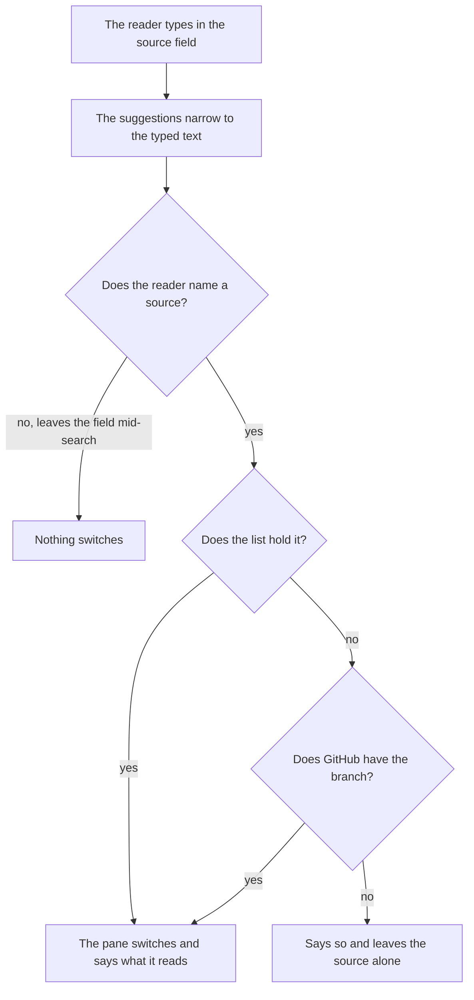
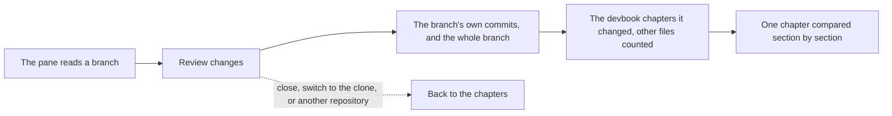
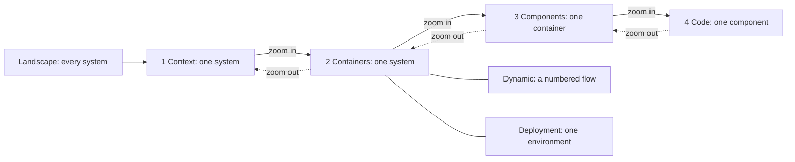

# Devbook

```meta
type: features
status: draft
```

> Features and sub-features this bounded context supports, described in
> business/ubiquitous language rather than implementation terms.

## Knowledge capture

```meta
type: feature
related: [.devbook/domain/inbox/features.md#routing, .devbook/domain/devbook/features.md#capture-into-the-brain]
```

Store notes, references, ideas, and learnings as markdown from inbox triage,
manual creation, or import, attaching them to one or more projects, topics, or
tags. Every note is a file in the person's [Brain](domain.md#brain); where it
comes from is [Capture into the Brain](#capture-into-the-brain).

## PARA organization

```meta
type: feature
depends-on: [.devbook/domain/devbook/features.md#knowledge-capture]
related: [.devbook/domain/devbook/domain.md#para-category, .devbook/domain/devbook/features.md#brain-folder-setup]
```

Organize notes into the areas the Brain's `CONVENTIONS.md` declares, one top
folder each, shown as one tab each. A Brain that declares none uses the PARA set:
an inbox for what is not filed yet, Projects (active, deadline), Areas
(ongoing), Resources (reference), People, a Journal, and Archive (inactive).
A dated area lists newest first: the `journal` folder, or any area whose
`Holds` line in `CONVENTIONS.md` says *dated*. Its entries are named by date, so
the name descending is the date descending, at every level of the folder; every
other area lists by name.
Moving a note to another area is moving its file to another folder; a note may
name its area in its `para` field instead, which wins over the folder.

## Cross-project linking

```meta
type: feature
related: [.devbook/domain/devbook/features.md#repo-links-and-backlinks]
```

Reference multiple projects and repos from a single note, and discover notes
across projects by tag. A project note names the repositories it concerns in its
`repos` field; a note that points at one chapter of a repository's devbook does
so with a [repo link](#repo-links-and-backlinks).

## Topic and tag grouping

```meta
type: feature
related: [.devbook/domain/devbook/domain.md#tag, .devbook/domain/devbook/domain.md#roadmap-contribution]
```

Group notes by topic (not just project), support cross-cutting tags, and search
across all knowledge content via the tag index.

These discovery tags are the context's own `#keyword`s. They are not a chapter's
[Roadmap Contribution](domain.md#roadmap-contribution). A chapter may also declare
an [Effort](domain.md#effort), which Devbook registers and Roadmap Planning only
reads.

## Bi-directional linking

```meta
type: feature
related: [.devbook/domain/devbook/requirements.md#bi-directional-linking, .devbook/domain/devbook/domain.md#task-link, .devbook/arc42/adr/0026-the-brain-is-a-personal-devbook-outside-any-repository.md, .devbook/arc42/adr/0027-the-brain-is-a-scope-beside-the-repositories.md, .devbook/domain/tasks/features.md#search-filter-and-organize]
```

Link a Brain note to the tasks it is about, and see the link from both ends. A
note names its tasks in its `tasks` field, one [Task Link](domain.md#task-link)
per task, by the task's stored id. The Brain's database carries the field, and
the app reads it both ways from there:

- **From the note.** Under its links into devbooks, the note shows a **Tasks**
  section: each task this backlog holds is a gold chip reading its title, and
  pressing it opens the task in the task list. An id this backlog does not hold is
  a dashed chip reading *not in this backlog*, never an error — one Brain is read
  beside more than one backlog.
- **From the task.** A task row, in the Brain scope and in a repository scope,
  carries a teal **◆ n note** badge counting the Brain notes that name it. With one
  note, pressing it gives the Devbook the screen on the Brain side, at that note;
  with several, it lists them to pick from. Where the Devbook is switched off or
  has no Brain to read, the press shows a *not available* toast and opens
  nothing.

The reverse is read, never written: a task's record carries no note, and the badge
is drawn only for the Brain's owner, from their own Brain (local ADR 0027 §6), so
another reader of the same backlog sees none. Embedding a note's content in a task's
details is not built.

## Brain scope

```meta
type: feature
related: [.devbook/domain/devbook/requirements.md#brain-scope, .devbook/arc42/adr/0027-the-brain-is-a-scope-beside-the-repositories.md, .devbook/domain/tasks/features.md#search-filter-and-organize, .devbook/design/interaction-guidelines.md#shell-header]
```

Pick the Brain the way a repository is picked. The header's repository scope
leads with a **Brain** chip, set off from the repository chips by a divider and
worn in the Brain's teal. It cannot be removed, and it needs no repository, so
the scope works for a person who has configured none.

Brain is the scope of everything filed against no repository. Pressed alone, it
narrows Tasks, Board, Calendar, In progress, the Dashboard and Sessions to the
tasks with no repository. It also shows the Brain when the Devbook is opened. Pull
requests and the Roadmap read Brain alone as nothing pressed: every pull request
belongs to a repository, and the Roadmap reads one anchor. Ctrl adds it to the repositories already pressed, and nothing pressed still
means everything.

The scope is remembered with Brain in its place, so a fresh shell reopens on it.
The Tasks filter bar has no *No repo* chip: Brain is the one name for those rows.
With the Brain and repositories pressed together, each row's repository badge
says where the task is filed: **Brain** for no repository, else the alias.
Until a Brain folder is set up, the chip reads **Set up your Brain**, still
scopes the tasks, and its tooltip points to Settings › Storage. The Devbook on the
Brain side then shows a **Set up your Brain** button instead of areas. It opens
Settings › Storage at the Brain folder card, inside the app rather than in the
system browser.

## Brain folder setup

```meta
type: feature
setting: .devbook/domain/devbook/context.md#brain-folder
related: [.devbook/domain/devbook/requirements.md#brain-folder-setup, .devbook/arc42/adr/0026-the-brain-is-a-personal-devbook-outside-any-repository.md, .devbook/domain/devbook/domain.md#para-category]
```

Choose where the Brain lives, once, in Settings › Storage. The person picks a
folder outside every repository. There is no default, and OneDrive is the
expected place. What the field accepts is in
[Brain folder](context.md#brain-folder). The Brain card says three things:

- whether the folder is synced, as information rather than a warning;
- that its search database is built in the app's storage and never synced;
- whether the folder's `README.md` and `CONVENTIONS.md` are present.

**Create conventions** writes both files and every area folder they declare from
a template the app ships, the PARA set by default, and never overwrites a file
that is already there. From then on the folder carries its own convention, so a
second machine that reads the synced folder sees the same areas.

The shipped `CONVENTIONS.md` declares its areas as a table under an `## Areas`
heading. It has one row per area in tab order, with the area's name, its folder
and what it holds. With no rows, the PARA set applies. Create conventions makes the
area folders the folder's own `CONVENTIONS.md` declares, so a person who wrote
theirs first gets their areas, not the template's.

**Browse** opens the Windows folder picker in the installed app. A host without
one, the browser harness among them, takes a typed path.

## Brain mode of the Devbook pane

```meta
type: feature
feature-flag: .devbook/domain/devbook/context.md#devbook-pane
related: [.devbook/domain/devbook/requirements.md#brain-mode-of-the-devbook-pane, .devbook/domain/devbook/features.md#area-selection-and-scope, .devbook/arc42/adr/0027-the-brain-is-a-scope-beside-the-repositories.md, .devbook/design/interaction-guidelines.md#shell-header]
```

Read and write the Brain in the same pane that reads a repository's devbook.
Which scope shows the Brain is in
[Area selection and scope](#area-selection-and-scope). On the Brain, the pane
carries a teal **Brain** badge after its title. The folder's path sits where a
repository's branch picker would be, and there is one tab per area the Brain
declares.

The tree, the rendered chapter and the editor are the ones a repository devbook
uses, and a Brain note is always editable. The reader leaves a remark on a
note's block as on a chapter's, and edits, resolves or deletes it there. A Brain
remark is stored under the Brain's scope, by the note's path from the Brain's
root, so the agent lists and resolves it on `#brain`. What only a repository
has is absent: branch updates, sync verdicts and scenario marks. So is opening
the folder in an editor. Search is offered on the Brain as on a repository, because it is one
[Unified search](#unified-search) wherever it is opened. The **Atlas** button
opens the Brain's own map instead of a repository's
([Atlas edges](#atlas-edges)). Ask AI takes no Brain note as the open chapter.

The `Brain | <repo>` switch flips the pane between the Brain and a repository
without touching the task filter. It is not remembered: any change to the scope
puts the pane back on the anchor.

The header's toggle for the pane names what it shows: **Brain**, in teal, while
the pane shows the Brain, and **Devbook** otherwise. It is right before the pane
opens, so a closed toggle already says which one a press will open, and it flips
with the switch.

On the Brain, and while the switch shows, the pane names itself *Devbook* at the
start of its tab strip. The switch sits right after the title, so it stays in
place as the badge and the path come and go.

The pane's own width decides its layout, not the window's. Narrower than a menu
beside a readable column, as in a narrow window, the menu sits above the
note, capped so the note still starts on screen, and a note's title wraps above
its path rather than ending in an ellipsis.

With no folder set up yet, the pane on the Brain asks for one. A folder that is
set but missing, or is not a path, says so in words and shows no tabs. A
declared area whose folder does not exist yet still has its tab, and the tab
says the Brain has no such folder yet.

When the folder holds a OneDrive conflict copy, the pane says so and changes
neither file: two edits to one note are the person's to merge. A conflict copy
is `<name>-<MACHINE>.md` in the same folder as `<name>.md`. MACHINE is the
computer name OneDrive writes: 1 to 15 capitals, digits and hyphens, with at
least one capital. So `plan-2.md`, `plan-draft.md` and `my-plan.md` stay
ordinary notes. The warning names every pair.

## Repo links and backlinks

```meta
type: feature
depends-on: [.devbook/domain/devbook/features.md#brain-mode-of-the-devbook-pane]
related: [.devbook/domain/devbook/requirements.md#repo-links-and-backlinks, .devbook/domain/devbook/domain.md#repo-link, .devbook/arc42/adr/0027-the-brain-is-a-scope-beside-the-repositories.md]
```

Point a Brain note at the repository chapter it is about. A
[repo link](domain.md#repo-link), `repo:<alias>/<devbook path>[#slug]` in the
note's `related` or its body, renders as a chip naming the repository's alias
and the chapter:

| Link state | Chip | It adds |
| --- | --- | --- |
| The alias names a repository configured here, as a clone or a branch snapshot, and its devbook shows the section the path lies in | Gold; opens that repository's devbook at the chapter | Nothing |
| The alias is not configured on this machine | Dashed | *not on this machine* |
| The alias is configured, but the path lies in no section its devbook shows | Dashed | *not a chapter in its devbook* |

The chip's tooltip is the raw link in every state. An unresolved link is never an
error, because the same Brain is read on machines with different repositories.
Following a gold chip leaves the header scope alone. The pane reads the
repository as it does for a task's reference, and the switch or the scope brings
the Brain back.

The reverse is shown, never written. Under a repository chapter, a teal **From
your Brain** box lists the Brain notes that link to it, marked *Only you see
this*. It reads the owner's own Brain database, and nothing is written into the
repository, so personal notes never reach shared history. A link to any heading
of the chapter's file counts. A note is listed once. If all its links sit inside
chapters, it is listed under the first. If any link is in `related` or outside
every chapter, it is listed on its own. A chapter no note links to draws no box.
Each note in the box is a link: following it puts the note on the Brain side of
the pane, the way a Brain search result does, and leaves the header's scope and
the task filter alone.
A repository devbook has no way to link into a Brain.

## Unified search

```meta
type: feature
depends-on: [.devbook/domain/devbook/features.md#devbook-retrieval]
related: [.devbook/domain/devbook/requirements.md#unified-search, .devbook/arc42/08-crosscutting-concepts.md#devbook-database]
```

Ask one question of the Brain and every configured repository's devbook at once.
The search offers scope chips (**Everywhere**, **Brain**, and one per
repository) and groups its results by where they came from, the Brain's group
first. It searches by words and by meaning, as
[Devbook retrieval](#devbook-retrieval) does for one devbook, over each source's
own database. A source with no database yet is named as not searchable rather
than silently left out.

Search by meaning is additive, as it is for one devbook: it is asked only while
it is switched on and a model is there to answer, once typing pauses, and the words answer is drawn while it is
on its way. Within a source the two answers are merged by where each put a
chapter, never by their scores, which are on different scales; a chapter both
found is one result. Opening a result from the devbook on screen opens it there.
Opening one from another devbook moves the pane to that devbook and opens it,
without touching the header's scope or the task filter.

## Atlas edges

```meta
type: feature
depends-on: [.devbook/domain/devbook/features.md#repo-links-and-backlinks]
related: [.devbook/domain/devbook/requirements.md#atlas-edges, .devbook/design/component-libraries.md]
```

See where the Brain reaches into the repositories. On the Brain, the pane's
**Atlas** button maps the whole Brain: its notes, grouped by area, and the links
between them, read from the Brain's own database. Each repo link, in a note's
`related` or its prose, is an edge to a node for the repository chapter it
names. The edge is labelled with the repository's alias, and the chapters of one
repository gather in one group named for that alias. One chapter is one node,
whichever devbook layout or alias case a note wrote it in. A link this machine
can follow is a solid edge to a filled node. One it cannot is a dashed edge to a
hollow node, like its chip. The atlas reads no repository: what a repository
node shows is the link's own words. An edge's label sits at the middle of its
curve unless that overlaps a node, a node's label, or another edge's label; it
then steps along the curve or just above or below it, and an edge with no free
seat goes unlabelled, because the node labels are what the reader navigates by.

Selecting a repository node shows the link's chip. A gold chip opens that
repository's devbook at the chapter, as a chip in a note does. A dashed one says
why it cannot be followed. Selecting a note offers to open it in the pane. Both
close the map. With no Brain index built yet, the atlas says so rather than
drawing an empty map.

## Capture into the Brain

```meta
type: feature
depends-on: [.devbook/domain/devbook/features.md#brain-mode-of-the-devbook-pane]
related: [.devbook/domain/devbook/requirements.md#capture-into-the-brain, .devbook/domain/inbox/features.md#route-to-brain, .devbook/domain/inbox/domain.md#itemtriaged]
tests: [unit:dotnet:Backlog.Desktop.UI.UnitTests.DevbookPaneBrainCaptureTests, unit:dotnet:Backlog.Infrastructure.FileSystem.UnitTests.BrainNoteWriterTests, unit:dotnet:Backlog.Infrastructure.Devbook.UnitTests.BrainNoteTextTests, unit:dotnet:Backlog.Infrastructure.Mcp.UnitTests.BrainScopeToolsTests.A_capture_lands_in_the_inbox_area_and_reads_back_as_written]
```

Get a thought into the Brain without leaving what is on screen. In Brain mode
the pane header carries **Capture**: a title and a Markdown body, written as a
new note with its `meta` block in the Brain's inbox area. That area is `_inbox`
under the PARA default, or the area `CONVENTIONS.md` marks as the inbox. Inbox
triage writes the same kind of note through its **To Brain** route, from a
capture or from an Inbox note, keeping the title and the body.

Whatever the person typed stays text: a heading, a fence or a meta block typed
into a capture is written so that it cannot become the note's structure. Each
such line gets a zero-width space just before its marker: invisible when the
note is read, and enough that no reader takes the line for structure.

The note's file is named after its title (`Ideas for the sync` is
`ideas-for-the-sync.md`), and a name already taken gets `-2`, `-3` and on:
nothing in the Brain is ever overwritten. Its `meta` block says `type: note`
and its [source](domain.md#note-source), `manual` from Capture and `inbox` from
To Brain. Once written, the pane opens it. One writer, `IBrainNoteWriter`, does
all of this for Capture and for To Brain alike, and so does the capture tool
an assistant calls over MCP ([MCP Brain scope](#mcp-brain-scope)).

## MCP Brain scope

```meta
type: feature
depends-on: [.devbook/domain/devbook/features.md#capture-into-the-brain]
related: [.devbook/domain/devbook/requirements.md#mcp-brain-scope, .devbook/arc42/adr/0012-backlog-is-an-mcp-server-inside-the-desktop-app.md, .devbook/domain/devbook/features.md#review-notes-in-a-chapter]
tests: [unit:dotnet:Backlog.Infrastructure.Mcp.UnitTests.BrainScopeToolsTests, unit:dotnet:Backlog.Infrastructure.Mcp.UnitTests.McpToolCreationTests.A_host_without_the_brain_ports_still_builds_the_devbook_tools]
```

Let an assistant read and write the Brain through the same tools it uses on a
repository devbook. The knowledge tools the app serves over MCP take the Brain as
`#brain` in the place of a repository's `owner/name`. They list the contexts, read
a chapter, and list and resolve the reader's [remarks](domain.md#remark).

The spelling is not the empty string the shell stores for the Brain (local
ADR 0027 §5). An empty repository argument is already refused as missing, and a
session that forgot it must never be handed the person's own notes. On these
tools that refusal names both things the argument can be: an `owner/name`, or
`#brain` for the Brain. It is not
`brain` either, which a repository could be called. A GitHub owner or name cannot
hold a `#`, and a configured repository line that starts with one is a comment.
So `#brain` matches no repository, and it is matched before any repository is
looked up.

A Brain note is named by its path from the Brain's root (`projects/plan.md`),
never under a dot-folder and never through a link out of the folder. The
remarks on it are the ones the reader left on the Brain, and a remark is
resolved only under the scope it belongs to.

The capture tool, `capture_note`, writes a new note into the Brain's inbox
area through the same writer the pane's Capture uses, under the same guard on
the text and with source `manual`. A second capture with the same title is a
second note, never an overwrite. The tool answers the note's path from the
Brain's root, which the read tool takes as it is. Where no Brain is set, or the
host has none, the tools say so in words rather than failing.

## Repository devbook areas

```meta
type: feature
status: draft
feature-flag: .devbook/domain/devbook/context.md#devbook-pane
related: [.devbook/domain/repository-management/features.md#repository-knowledge-folder-settings, .devbook/domain/tasks/features.md#search-filter-and-organize]
```

Read the knowledge a repository already carries alongside its code, next to the
backlog rather than in a separate tool. Knowledge is grouped into named areas:
working instructions, domain, architecture, technology, and design. Each is backed
by the repository's own folder for that subject. Tasks are not an area. They are
their own workspace section, read and written rather than browsed, so a
repository's backlog folder is not a knowledge area.

Areas are browsed in the Devbook, which takes the whole screen in place of the
task list and keeps it underneath, so one press moves between knowledge and work
(local ADR 0022, amendment of 2026-10-15).

### Area selection and scope

```meta
type: sub-feature
status: draft
feature-flag: .devbook/domain/devbook/context.md#devbook-pane
related: [.devbook/domain/devbook/features.md#brain-mode-of-the-devbook-pane, .devbook/arc42/adr/0027-the-brain-is-a-scope-beside-the-repositories.md, .devbook/domain/repository-management/requirements.md#archiving-a-repository]
```

Switch between areas, and between repositories when more than one is registered,
so the knowledge shown always belongs to a known repository or to the Brain.

| Scope | The pane shows | The `Brain \| <repo>` switch |
| --- | --- | --- |
| Nothing pressed | The [Brain](#brain-mode-of-the-devbook-pane) | Absent |
| Brain alone | The Brain | Absent |
| Repositories, no Brain | The anchor's repository | Absent |
| Brain and at least one repository | The anchor's side | Shown; with Brain as the anchor and several repositories, its other side is the first of them |

The pane reads one devbook at a time, even when the backlog beside it is scoped to
several. It follows the scope's anchor, the first chip taken into that scope, so
widening the list never moves the knowledge already being read. Nothing pressed
shows the Brain because the Brain is always there. The switch flips what the pane
shows and leaves the task filter alone (local ADR 0027).

The folder the backlog is kept in is never read as a devbook of its own. Every
area is opt-in. Each can be switched off on its own or pointed at a non-standard
folder. When none is left on, there is nothing to browse, and the pane says so
rather than offering an empty tab strip.

### Rendered devbook documents

```meta
type: sub-feature
status: draft
feature-flag: [.devbook/domain/devbook/context.md#devbook-editing, .devbook/domain/devbook/context.md#devbook-status]
related: [.devbook/domain/devbook/requirements.md#rendered-devbook-documents, .devbook/domain/tasks/features.md#acceptance-from-scenario-parts]
```

Present each area's documents as readable content rather than raw files:
headings and sections, the metadata each chapter declares, cross-references
between knowledge documents, and embedded diagrams rendered as diagrams. A
cross-reference may name a chapter in the repository's backlog folder, even though
that folder is not a browsable area. It is read with that folder's own status
vocabulary rather than as an unknown one.

Two parts of this are switches of their own, both off by default.
[Devbook status](context.md#devbook-status) draws the status and decision state
beside each file and chapter, and
[Devbook editing](context.md#devbook-editing) offers Edit on a repository
chapter; a Brain note keeps Edit either way. What follows about showing a status
or a decision holds while status is on. Off, the file still states them and the
app draws neither.

Documents appear in the order the convention gives them:

1. each directory's introducing document first;
2. numbered chapters by their number;
3. a folder's usual chapters in their usual places;
4. the rest by name.

A repository therefore never has to write its reading order down, and a file that
tries to is ignored. Inside a bounded context, the rules a domain page's types
enforce are a page of their own that reads directly after it. The menu lists that
page as the page's invariants rather than by its file name: "Invariants", or
"Order invariants" beside a page split out for one aggregate. A context that still
keeps its rules in the older single invariants file has them read and listed where
they always were.

The metadata is read against the devbook convention the repository's own checks
enforce, folder by folder, so a chapter the app shows as fine is not one those
checks reject:

- **A status at rest says nothing.** Architecture, domain and design chapters
  that are simply current carry no status at all and are shown as current.
  Choosing "current" for one removes the word rather than writing it, and a
  chapter that spells it out anyway is pointed out. Technology and AI-adoption
  chapters are ratings, so the file always states theirs.
- **A decision is state, not content.** A domain chapter can stand approved
  (someone agreed it), and above that accepted (someone saw the built work
  against it and accepted it). Where a review stands on the way there is state
  too: requested, changes requested or cleared, and who owes the next move. The
  app never offers those two steps as a status to pick, because the approval step
  that makes the decision records them. Where that state is shown, and when a
  decision record goes, are in
  [the requirements of this sub-feature](requirements.md#rendered-devbook-documents).
  No other area has them, and a chapter outside the domain that carries one is
  pointed out.
- **Kinds.** Each area that classifies its chapters is read with its own set of
  kinds. A domain context's set covers its boundary document, its requirements and
  invariants and the single rules inside them, and its switches and settings. It
  also covers its actors, and a page of its own that the convention does not name. A requirements
  or invariants page is shown under the title it carries, which names what it
  holds rather than the context. How a bounded context ships, as a service of its
  own or as a module inside a shared host, is shown with it. When the context map
  and the context's own boundary document disagree about it, the app says so.
- **Everything else a chapter declares** is shown as it was written: the tests
  that back it, its number and place in the reading order, and the day it
  records. State another tool keeps on the chapter under its own name is
  [carried as written](requirements.md#requirement-another-tools-state-is-carried-as-written).

A bounded context's click demo is shown with the page it belongs to. A demo is
the one HTML file a context holds: a clickable picture of what a person sees. It
pairs with a page in two ways. By name, `demo.html` belongs to the context's
boundary document and `<page>.demo.html` to the page beside it. By field, a
chapter's `demo` metadata names a demo and the places in it that show the
chapter. The context view shows the context's own demo, and every other page
shows the demos paired with it.

Each demo runs in a frame of its own, isolated from the app, and can go full
screen. It keeps its own look, so the pane never forces its dark theme onto it.
Every place a chapter names in the demo is offered as a chip above the frame.
The first place opens as soon as the demo says it is ready, and picking another
chip moves the demo there. Notes on a demo are placed in spec-manager, the
specification review tool, so the pane neither pins notes nor follows where the
reader clicks inside the demo.

A scenarios file is listed in the bounded context it lives in, at whatever depth,
like any page beside it. It is the context's `scenarios.md`, or a split
`scenarios.<name>.md`. Each `##` chapter that says `type: scenario` in its own
metadata is one end-to-end journey, and its `###` parts are the outcomes the actor
reaches. Which files hold journeys comes from the scenario register the
repository's devbook commits. A repository that commits no register is read for
the scenarios files whose journeys say so themselves.

In the menu each scenarios file carries the scenario mark and one dot for the last
runs of all its journeys: passed, failed, stale, or never run. The dot takes the
first of never run, stale and failed that any journey is, and reads passed only
when every journey passed. The dot differs by shape as well as by colour, and a
screen reader hears its state. Under the menu a legend draws the four dots, each
beside its word, so a reader who has not learned the shapes can tell them apart.
The legend is there only while the repository has at least one journey, and never
for a Brain, which has none.

Each journey's run is committed beside its scenarios file, at
`<scenarios file without .md>/<journey>/run.json`. The app reads all three run
versions: version 3 names the journey, version 2 names the journey page it ran
before journeys moved into scenarios files, and version 1 is the older format
spec-manager's test tooling writes. It reads the register at schema 2 only, and
treats any other register as none. Whether a run is stale is worked out, never
stored. The app signs each journey as it reads now, the way devbook computes a
journey signature. A run that proved a different signature is stale, and so is a
version 1 run, which proves no signature at all.

Opening a scenarios file shows each journey's run above the file. The run shows
the setup the journey runs under: where it starts, who is signed in, the profile,
the data sets, and the flag and setting overrides. Under the setup is a summary
line, then each part with its outcome and the screenshots it took. A failed part
also shows the screenshot taken where it failed. A journey opened from a reference
that names one of its parts, such as a part pressed in a task's acceptance
checklist, opens at that part, marks it as the one asked for, and scrolls it into
view. The mark stays until the reader picks another chapter, and it belongs to the
repository the reference named.

An image written `scenario:<scenarios file>#<label>` in any chapter, or in a task's
own text
([Acceptance from scenario parts](../tasks/features.md#acceptance-from-scenario-parts)),
shows that screenshot from the last run of the journey that holds the label. The
file is named by its path inside the domain folder, such as `work/scenarios.md`,
and a label is unique in its file. Inside the scenarios file itself, `shot:<label>`
is enough. A source line under the image names the journey, the part, the run's
state and the time of the capture. Two such images in one paragraph sit side by
side. A label the file does not have lists the labels it does have. A scenarios
file that does not exist says so. A label the run never captured says that too. A
capture older than the last run says so on its source line.

### Remarks on a chapter

```meta
type: sub-feature
related: [.devbook/arc42/adr/0011-devbook-annotations-are-a-third-replica-container.md, .devbook/arc42/08-crosscutting-concepts.md#storage-and-sync, .devbook/domain/devbook/requirements.md#remarks-on-a-chapter]
```

Let a reader leave a [remark](domain.md#remark) against one block of a chapter
while reading it, and keep it. A remark can be a question, a flag or a note to
self, and it sits beside the prose rather than inside it. It belongs to the
person, not to the repository. The app keeps it, it moves with the person's
backlog, and it reaches their other devices through sync. Because it stays out
of the repository, a reader can remark on a chapter read from a branch nobody
can edit; [the Remark invariants](domain.invariants.md#remark) say how. A remark
can be resolved, which keeps it visible and quiet, or deleted.

A remark is not a [Review Note](domain.md#review-note), the `annotation` fence a
repository writes into a chapter; those are shown under
[Review notes in a chapter](#review-notes-in-a-chapter). The app does not turn a
remark into a review note.

A remark is anchored to the block it was left on, and remembers what that block
said, so the chapter can change under it without the remark being lost. Where the
read view then shows it is in
[the requirements of this feature](requirements.md#remarks-on-a-chapter).

### Review notes in a chapter

```meta
type: sub-feature
related: [.devbook/arc42/adr/0011-devbook-annotations-are-a-third-replica-container.md, .devbook/arc42/adr/0012-backlog-is-an-mcp-server-inside-the-desktop-app.md, .devbook/domain/devbook/features.md#remarks-on-a-chapter, .devbook/domain/devbook/requirements.md#review-notes-in-a-chapter]
```

Show the [review notes](domain.md#review-note) a repository keeps in its own
chapters as notes attached to their passage, open or resolved, rather than as the
raw text they are stored in. Each shows its kind and its replies. Whoever reviews
the chapter reads the same notes, and they leave with the change that resolves
them.

A review note is never read as what the chapter says, because an open question
about whether a rule still holds is not the rule. What that keeps out of an
assistant's read, search and excerpts is in
[the requirements of this sub-feature](requirements.md#review-notes-in-a-chapter).

The app shows these notes and does not write them; the convention's own tooling
does. They are also not the reader's [remarks](#remarks-on-a-chapter). The two are
shown apart and never merged, the decision local ADR 0011 records.

### Sync verdicts beside a chapter

```meta
type: sub-feature
related: [.devbook/domain/devbook/domain.md#sync-verdict, .devbook/domain/sessions/features.md#what-started-a-run-and-what-it-found, .devbook/domain/productivity/features.md#drift-at-a-glance, .devbook/domain/devbook/requirements.md#sync-verdicts-beside-a-chapter]
```

Show beside each chapter heading its [Sync Verdict](domain.md#sync-verdict): the
last verdict a sweep reached on it (aligned, code ahead, spec ahead, in conflict,
or unresolved). The root chapter of a [Sync Unit](domain.md#sync-unit) also shows
the unit's own verdict and what the sweep did about it. Each badge leads to the
pull request or drift issue the sweep opened, where the verdict is argued.

Only the latest verdict per chapter is shown, in the sweep's own words, so a
chapter last checked a month ago keeps that month-old word until a sweep checks it
again. Which verdict that is, and how a word the app does not know looks, are in
[the requirements of this sub-feature](requirements.md#sync-verdicts-beside-a-chapter).
A chapter no sweep has checked carries nothing.

Each verdict also keeps the unit's sync direction as the sweep resolved it, and where
it was inherited from. The dashboard's
[Drift at a glance](../productivity/features.md#drift-at-a-glance) part reads the
same verdicts a unit at a time and groups them by that direction.

### A devbook that stays current

```meta
type: sub-feature
status: draft
related: [.devbook/arc42/08-crosscutting-concepts.md#devbook-database]
```

Show what a repository's folders actually say, including when a chapter was
edited outside the app: by another tool, by a pull request, or by hand in an
editor. The folders are the source of truth and the app never owns them. A
prepared view over them is a convenience. It has to prove itself current before it
is shown, and it gives way to reading the folder directly when it cannot.

A repository where nothing has been prepared is a normal state, not an error: its
knowledge is still browsable, only slower. Preparing it is never a precondition
for reading it.

Preparation happens without being asked for and without being waited on. It never
slows opening the app, and never holds back a pane that is ready to show something.
A chapter edited moments ago is shown from the folder itself rather than held back
until the prepared view catches up. What is on screen is never older than what is
on disk.

The prepared view is the app's own and is kept with the app, never in the
repository. Nothing is added to a repository's folders, and nothing there needs to
be told to ignore it. It is prepared per copy of the repository, so two clones or
two worktrees of one repository are each prepared from their own files. A
repository read from a branch without a clone is prepared too.

### The devbook on the repository's latest version

```meta
type: sub-feature
status: draft
related: [.devbook/domain/repository-management/features.md#repository-knowledge-folder-settings, .devbook/domain/repository-management/requirements.md#archiving-a-repository]
```

Say whether the knowledge in view is the latest version the repository has, and
bring it up to date when it is not. A repository's folders are read from a local
clone, and a clone falls behind in silence: every chapter still opens, and nothing
in one says that somebody else has revised it since.

The question is asked once on its own: the first time the pane opens on the
repository in an app session, beside loading
[its branches](#choosing-where-the-devbook-is-read-from). Answering means reaching
for the repository itself, so it runs in the background and opening a folder never
waits on it. A clone it finds behind is offered "Pull latest" straight away, with
no "Check now" pressed first and no sentence nobody asked for. After that the
question is asked when somebody presses for it.

The question is only about the local clone, so the version control shows only
while the pane reads the clone. A branch snapshot keeps itself current on its own
cadence (local ADR 0008), and a control there would only hurry along what happens
anyway.

The answer says how far behind the clone is. It offers to bring the clone up to
date only when being behind is all that is in the way. Three other states are
reported as they stand rather than reconciled on the reader's behalf:

- a clone carrying edits nobody has committed;
- a clone holding revisions the repository does not have;
- a clone whose history has parted from the repository's.

What to do about any of those belongs to whoever owns the clone. Knowledge kept
outside a repository has no latest version to be on, and is not asked about.
Nor is the devbook of an
[archived repository](../repository-management/domain.md#archived-repository),
which [is read-only](../repository-management/requirements.md#requirement-an-archived-repositorys-devbook-is-read-only).

Bringing a clone up to date happens only when somebody presses for it, because a
pull touches a working tree somebody may be editing in. It replaces what the
clone's folders say, so the knowledge on screen becomes the knowledge that arrived
with it.

### Choosing where the devbook is read from

```meta
type: sub-feature
status: draft
feature-flag: .devbook/domain/devbook/context.md#devbook-pane
related: [.devbook/domain/devbook/requirements.md#choosing-where-the-devbook-is-read-from, .devbook/arc42/adr/0008-knowledge-reads-from-a-branch-snapshot-when-there-is-no-clone.md, .devbook/domain/repository-management/features.md#repository-knowledge-folder-settings, .devbook/design/typography-and-layout.md#iconography]
```

Read a repository's devbook from its local clone or from any of its branches,
chosen beside the area strip rather than in settings. Knowledge under review lives
on a branch long before it reaches the default one. The reader who wants it is
rarely the one who has that branch checked out, and a repository nobody has cloned
has only its branches to offer (local ADR 0008).

The choice is one field the reader types into. It suggests the default branch, the
local clone where there is one, and the branches that change the devbook, narrowed
to what the typed text contains. A branch that touches no devbook area has nothing
to read that the default branch lacks, so it is not suggested; it can still be
typed by name.

Each branch says why it is worth reading: the glyph of every area it changes, and
how many commits it is ahead of and behind the default branch. The local clone says
how far it is ahead of and behind the branch it tracks, and nothing when it tracks
none.



Knowing what a branch changes means comparing it with the default branch, one call
per branch. The branches are therefore loaded once per repository per app session,
in the background, when the pane first opens on it: the list, a comparison per
branch, and a look at the clone. Reopening the picker, switching tabs or source, or
a second window reuses that load rather than asking again. The pane never waits on
it: the field works from the start, and "Loading branches…" in the list marks a
load still running. "Refresh branches" asks again. The list stops at a ceiling
instead of paging without end.

A load can fail, or part of it can. A branch GitHub would not compare is not placed;
a refused listing is said beside the field, and the default branch, the clone and
the configured branch stay offered. A refused refresh keeps what the last good load
listed. A typed branch the list does not hold is asked of GitHub before it is
turned down, because the list may simply be older than the branch. A search is not
a choice: only a named source switches what the pane reads.

Switching says, under the strip, whether the pane now reads the clone or a branch
snapshot, and a branch snapshot is read-only. The settings screen offers the same
choice with the same entries.

### Reviewing what a branch changed

```meta
type: sub-feature
status: draft
feature-flag: .devbook/domain/devbook/context.md#devbook-pane
depends-on: [.devbook/domain/devbook/features.md#choosing-where-the-devbook-is-read-from]
related: [.devbook/domain/devbook/requirements.md#reviewing-what-a-branch-changed, .devbook/arc42/adr/0008-knowledge-reads-from-a-branch-snapshot-when-there-is-no-clone.md]
```

See what a branch did to the devbook before it is merged, commit by commit, in
the pane that already shows the branch. A pull request's diff shows Markdown as
lines; a reader reviewing knowledge wants the chapters that moved and what moved
in each, beside the devbook they belong to.



**Review changes** is never offered for the local clone: the clone's history is
the reader's own working copy, not a proposal. The branch's own commits are the
ones it holds that the default branch does not, and the whole branch is compared
against the default branch. A chapter is compared before and after.

Where GitHub answered with only part of the history or the file list, the review
says so instead of passing a partial answer off as whole. The review is read from
GitHub and held only for the session. Nothing is cloned, written to disk, or
prepared, so a review leaves no trace in the repository or the app's storage.

## C4 zoom navigation

```meta
type: feature
status: draft
feature-flag: .devbook/domain/devbook/context.md#c4-zoom
depends-on: [.devbook/domain/devbook/features.md#rendered-devbook-documents]
related: [.devbook/domain/devbook/requirements.md#c4-zoom-navigation, .devbook/arc42/adr/0037-c4-zoom-navigation-is-a-second-tab-read-from-devbook-meta.md, .devbook/arc42/08-crosscutting-concepts.md#devbook-database]
```

Walk the architecture the way C4 draws it, one level at a time, from the system
in its context down to the code of one component, and see beside every element the
chapters, decisions and debt that are about it. The **C4** tab lists views one by
one; this tab is one model a reader zooms through, with the records attached where
they apply.



**Where it sits.** The **C4 zoom** tab is offered beside the **C4** tab while the
`c4-zoom` and `c4-diagrams` switches are both on, and the **C4** tab stays as it
is. The tab opens on the System context view. The first time it opens it shows a
hint, which the reader can dismiss, naming the ways to move.

**The zoom bar.** A bar heads the tab with four steps: 1 Context › 2 Containers ›
3 Components › 4 Code. Each step shows the element its level is about: the system
for Context and Containers, a container for Components, a component for Code. The
current step is ringed. A step behind the reader always works. A deeper step stays
greyed, reading "pick a container" or "pick a component", until an element that
fills it is selected. Landscape, Dynamic and Deployment sit beside the bar under
**Also**, because they are not levels of the chain.

**Ways to move.**

- **Zoom in:** double-click an element, use its **Zoom in** chip, or press Enter
  on the focused element. Only an element with a deeper view shows the chip.
- **Zoom out:** pick an earlier step in the zoom bar, or press Backspace. The
  element the reader zoomed out of stays selected.
- **Jump:** any zoom bar step whose element is known, or a view in the tree beside
  the diagram.
- **Sideways:** Landscape sits above level 1; Dynamic and Deployment sit beside
  level 2; records open from an element's inspector.

Enter and Backspace act only while the diagram has focus. Typing elsewhere in the
app is never taken as a move.

**The inspector.** Selecting an element opens it beside the diagram: its kind,
description and technology, the arc42 chapters that document a view showing it,
the decisions (ADRs) and the debt (TDRs) that name it, and a zoom-in button when a
deeper view exists. A decision still proposed carries a "proposed" chip; a debt
shows its severity and its rung on the debt ladder. Each chapter and record opens
in the **Chapters** tab. A section with nothing to list says so. A deployment node
opens the same inspector, with the container instances it runs.

**Overlays.** A switch in the tab's head reads None, Decisions or Debt, and the
choice holds as the reader zooms. Decisions puts an "n ADR" chip on each card the
decisions name. Debt puts an "n TDR" chip on each card that open debt names (debt
not yet resolved), and draws that card on the error surface. A card counts the
records the inspector lists for it, those that touch it included. Under the
diagram a line counts the records that name no element on the view but one
nested below a card on it, the ones a reader finds by zooming in. Open debt that
names no element is shown in a cross-cutting tray under the diagram while Debt is
chosen, so it is never lost for having no place on a card.

**Code is generated, never authored.** Level 4 is drawn from the source on demand:
a component linked to its code opens its types with their members. A component
with no code link stops at level 3. Nothing at this level is written by hand, so
it cannot drift from the source it shows.

**The supplementary views.** A dynamic view plays its numbered steps one by one,
the current step drawn apart from the others. A deployment view puts its
environments behind one tab list, and draws another environment as a dashed door
into its own view. A selected deployment node shows what it is, and the container
instances it runs, each a way into the containers view.
The landscape draws the groups the DSL declares as bands.

**From the chapters.** While `c4-zoom` is on, an ADR or a TDR opened in the
**Chapters** tab has a panel beside it. A compact container view rings the
containers the record decides (`c4`), marks those it touches (`c4-touches`, a
component landing on its container), dims the rest, and opens in the zoom tab with
the decided element selected. The decision chain lists what the record supersedes
and what supersedes it, read from the `## History` rows below the standing choice
that open by naming another ADR; what it builds on, its `related:` ADRs; and what
builds on it, the ADRs whose `related:` name it. A proposed ADR is drawn dashed.
The panel also lists the arc42 sections whose `related:` cite the record and, for
an ADR, the TDRs that name it. A TDR shows its severity and its rung on the debt
ladder in place of the chain. An arc42 chapter embeds the views it
documents. Where the chapter's own mermaid fence and the model disagree, it flags
the elements in the model but missing from the fence, and the reverse. The chapter
stays the text that is read; the model is what is drawn.

Which element a record names, a TDR's severity and lifecycle, which ADR supersedes
which, and which code a component maps to are read from the chapters' own devbook
metadata, never from a file kept beside the model (local ADR 0037).

## Instruction optimization

```meta
type: feature
status: draft
feature-flag: .devbook/domain/devbook/context.md#instruction-optimization
depends-on: [.devbook/domain/devbook/features.md#repository-devbook-areas]
related: [.devbook/domain/devbook/domain.md#instruction-review, .devbook/domain/repository-management/features.md#repository-knowledge-folder-settings]
```

Review the working instructions as what they are: documents whose readers are
mostly not people. The coding agents working in the repository read them on every
run, and each tool reads its own files. The area grows by addition, because adding
a rule feels safe and removing one feels risky. Findings say what an instruction
set costs, where it disagrees with itself, and what would make it sharper. The
repository keeps ownership of every word, so a finding is a proposal and nothing
is rewritten unattended.

Two costs are named separately and never traded silently. One is the
[Context Load](domain.md#context-load). The other is the person's own cost of
knowing which document to reach for, which is not a number to drive to zero. An
instruction set that got smaller while the agents got worse has failed, and the
review reports that rather than a saving.

### Instruction set inventory

```meta
type: sub-feature
status: draft
related: [.devbook/domain/devbook/domain.md#instruction-set]
```

See every [Instruction Set](domain.md#instruction-set) the repository carries, document by document. Each is shown with what it costs to load and whether
that cost is paid always or only on the branch that reaches it. A document
belonging to a tool the product does not recognize is listed as exactly that
rather than dropped, because the next tool arriving is a normal event.

### Context-load budget

```meta
type: sub-feature
status: draft
related: [.devbook/domain/devbook/domain.md#context-load]
```

Weigh a repository's always-loaded instruction weight against a budget and rank
what carries that weight, heaviest first, with the one change that would lighten
each. The ranking follows what a line actually costs across the turns that pay for
it, not how long its file is. A short document loaded every run therefore outranks
a long one reached twice a month.

### Duplicate rule detection

```meta
type: sub-feature
status: draft
related: [.devbook/domain/devbook/domain.md#instruction-alignment]
```

Surface a rule stated in more than one place, across two documents or twice
inside one, and name the single place that should own it. The half that matters
is the same meaning in different words; identical sentences are the easy case. A
candidate is offered for judgement rather than merged, because two rules that read
alike are sometimes two different rules and collapsing them loses one.

### Cross-tool alignment validation

```meta
type: sub-feature
status: draft
related: [.devbook/domain/devbook/domain.md#instruction-alignment]
```

Check whether the instruction sets different tools read for one repository still
agree where they overlap, and surface a rule one tool is told and another is not.
Documents in [Instruction Alignment](domain.md#instruction-alignment) are not duplicates, so the finding is a disagreement or an omission and never the fact that both exist. Documents
maintained as a pair are named as a pair, so editing one raises the other as work
not yet finished.

### Pointer and phrasing review

```meta
type: sub-feature
status: draft
```

Judge the wording that is supposed to do the work. A line naming a document held
elsewhere is judged on two things: whether it will actually make an agent reach
for that document, and whether the conditions it lists cover the cases the
document handles. Must-have guidance behind wording that only sometimes fires is
worse than guidance that is absent, because it fails unpredictably rather than
visibly.

A rule written as a prohibition is judged the same way. It is offered back stated
as the behaviour that is wanted, since naming the banned behaviour is what puts it
in front of the reader.

### Prune candidates

```meta
type: sub-feature
status: draft
```

Surface the lines that no longer earn their load:

- guidance the agent already follows without being told;
- guidance that has gone stale against the behaviour it describes;
- guidance that restates what the repository's own configuration, scripts, or
  folder layout already state, a copy that can only drift out of date.

These are proposals for review. Whether an instruction changes anything is settled
by running the agent without it, not by arguing about it.

### Reviewed change proposals

```meta
type: sub-feature
status: draft
related: [.devbook/domain/devbook/domain.md#instruction-review]
```

Apply an accepted proposal one at a time on an explicit yes, with the previous
wording recoverable exactly as it was. Then measure what the change did, and offer
to withdraw it when the effect is not an improvement. Code blocks, commands, paths,
and error strings pass through a rewrite unchanged: they are the part of an
instruction that has to be exact.

### Saving evidence

```meta
type: sub-feature
status: draft
related: [.devbook/domain/devbook/domain.md#saving-evidence]
```

Show every claimed reduction with its [Saving Evidence](domain.md#saving-evidence); a figure with none is not shown.

## Devbook retrieval

```meta
type: feature
status: draft
related: [.devbook/domain/devbook/features.md#topic-and-tag-grouping, .devbook/domain/devbook/features.md#repository-devbook-areas, .devbook/domain/tasks/features.md#search-filter-and-organize, .devbook/arc42/08-crosscutting-concepts.md#devbook-database]
```

Find the chapter that answers a question across every area and every note at
once. Search works both by the words a chapter uses and by what it means, so a
recollection that does not share the author's vocabulary still lands. Results name the chapter
they came from rather than returning loose text, because a chapter address is
what every other part of this context already links by.

This is the same surface that knowledge-backed AI assistance reads, so an answer
can always cite the chapters behind it. Retrieval by meaning is additive: when it
is unavailable, retrieval by words alone still answers, and neither is a
precondition for browsing an area.

Retrieval is the one capability that a repository nothing has prepared cannot
offer, because answering a question by reading every chapter each time is not a
slower answer but no answer. Where browsing quietly falls back to the folder,
search says plainly that it has nothing to search yet, and what would make it
available.

Click demos are indexed beside the chapters, each with the page it pairs with by
name and every chapter `demo` field that points into it. A demo is not a
chapter, so it has no place in the reading order and is not searched. An
assistant that reads a page is told which demos the page has, by path and by the
place each field names, but never receives a demo's HTML. A demo runs to
hundreds of kilobytes, and the assistant can open the file from its own checkout
when it needs one.
