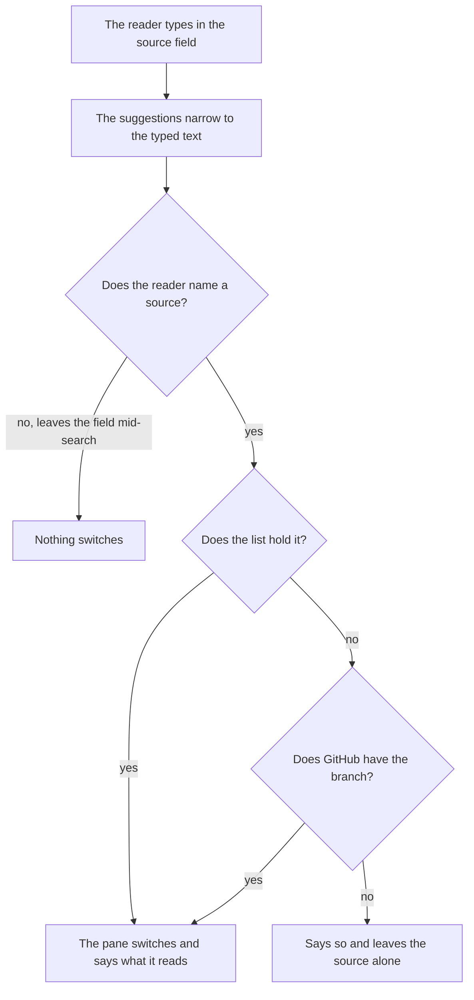
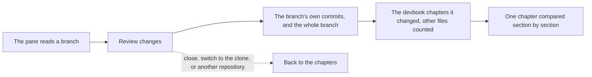

# Devbook

```meta
type: features
status: draft
```

> Features and sub-features this bounded context supports, described in
> business/ubiquitous language rather than implementation terms.

## Unified search

```meta
type: feature
depends-on: [.devbook/domain/devbook/features.md#devbook-retrieval]
related: [.devbook/domain/devbook/requirements.md#unified-search, .devbook/arc42/08-crosscutting-concepts.md#devbook-database]
```

Ask one question of the Brain and every configured repository's devbook at once.
The search offers scope chips (**Everywhere**, **Brain**, and one per
repository) and groups its results by where they came from, the Brain's group
first. It searches by words and by meaning, as
[Devbook retrieval](#devbook-retrieval) does for one devbook, over each source's
own database. A source with no database yet is named as not searchable rather
than silently left out.

Search by meaning is additive, as it is for one devbook: it is asked only while
it is switched on and a model is there to answer, once typing pauses, and the words answer is drawn while it is
on its way. Within a source the two answers are merged by where each put a
chapter, never by their scores, which are on different scales; a chapter both
found is one result. Opening a result from the devbook on screen opens it there.
Opening one from another devbook moves the pane to that devbook and opens it,
without touching the header's scope or the task filter.

## Repository devbook areas

```meta
type: feature
status: draft
feature-flag: .devbook/domain/devbook/context.md#devbook-pane
related: [.devbook/domain/repository-management/features.md#repository-devbook-folder-settings, .devbook/domain/tasks/features.md#search-filter-and-organize]
```

Read the knowledge a repository already carries alongside its code, next to the
backlog rather than in a separate tool. Knowledge is grouped into named areas:
working instructions, domain, architecture, technology, and design. Each is backed
by the repository's own folder for that subject. Tasks are not an area. They are
their own workspace section, read and written rather than browsed, so a
repository's backlog folder is not a knowledge area.

Areas are browsed in the Devbook, which takes the whole screen in place of the
task list and keeps it underneath, so one press moves between knowledge and work
(local ADR 0022, amendment of 2026-10-15).

### Area selection and scope

```meta
type: sub-feature
status: draft
feature-flag: .devbook/domain/devbook/context.md#devbook-pane
related: [.devbook/domain/brain/features.md#brain-mode-of-the-devbook-pane, .devbook/arc42/adr/0027-the-brain-is-a-scope-beside-the-repositories.md, .devbook/domain/repository-management/requirements.md#archiving-a-repository]
```

Switch between areas, and between repositories when more than one is registered,
so the knowledge shown always belongs to a known repository or to the Brain.

| Scope | The pane shows | The `Brain \| <repo>` switch |
| --- | --- | --- |
| Nothing pressed | The [Brain](../brain/features.md#brain-mode-of-the-devbook-pane) | Absent |
| Brain alone | The Brain | Absent |
| Repositories, no Brain | The anchor's repository | Absent |
| Brain and at least one repository | The anchor's side | Shown; with Brain as the anchor and several repositories, its other side is the first of them |

The pane reads one devbook at a time, even when the backlog beside it is scoped to
several. It follows the scope's anchor, the first chip taken into that scope, so
widening the list never moves the knowledge already being read. Nothing pressed
shows the Brain because the Brain is always there. The switch flips what the pane
shows and leaves the task filter alone (local ADR 0027).

The folder the backlog is kept in is never read as a devbook of its own. Every
area is opt-in. Each can be switched off on its own or pointed at a non-standard
folder. When none is left on, there is nothing to browse, and the pane says so
rather than offering an empty tab strip.

### Rendered devbook documents

```meta
type: sub-feature
status: draft
feature-flag: [.devbook/domain/devbook/context.md#devbook-editing, .devbook/domain/devbook/context.md#devbook-status]
related: [.devbook/domain/devbook/requirements.md#rendered-devbook-documents, .devbook/domain/tasks/features.md#acceptance-from-scenario-parts]
```

Present each area's documents as readable content rather than raw files:
headings and sections, the metadata each chapter declares, cross-references
between devbook documents, and embedded diagrams rendered as diagrams. A
cross-reference may name a chapter in the repository's backlog folder, even though
that folder is not a browsable area. It is read with that folder's own status
vocabulary rather than as an unknown one.

Two parts of this are switches of their own, both off by default.
[Devbook status](context.md#devbook-status) draws the status and decision state
beside each file and chapter, and
[Devbook editing](context.md#devbook-editing) offers Edit on a repository
chapter; a Brain note keeps Edit either way. What follows about showing a status
or a decision holds while status is on. Off, the file still states them and the
app draws neither.

Documents appear in the order the convention gives them:

1. each directory's introducing document first;
2. numbered chapters by their number;
3. a folder's usual chapters in their usual places;
4. the rest by name.

A repository therefore never has to write its reading order down, and a file that
tries to is ignored. Inside a bounded context, the rules a domain page's types
enforce are a page of their own that reads directly after it. The menu lists that
page as the page's invariants rather than by its file name: "Invariants", or
"Order invariants" beside a page split out for one aggregate. A context that still
keeps its rules in the older single invariants file has them read and listed where
they always were.

The metadata is read against the devbook convention the repository's own checks
enforce, folder by folder, so a chapter the app shows as fine is not one those
checks reject:

- **A status at rest says nothing.** Architecture, domain and design chapters
  that are simply current carry no status at all and are shown as current.
  Choosing "current" for one removes the word rather than writing it, and a
  chapter that spells it out anyway is pointed out. Technology and AI-adoption
  chapters are ratings, so the file always states theirs.
- **A decision is state, not content.** A domain chapter can stand approved
  (someone agreed it), and above that accepted (someone saw the built work
  against it and accepted it). Where a review stands on the way there is state
  too: requested, changes requested or cleared, and who owes the next move. The
  app never offers those two steps as a status to pick, because the approval step
  that makes the decision records them. Where that state is shown, and when a
  decision record goes, are in
  [the requirements of this sub-feature](requirements.md#rendered-devbook-documents).
  No other area has them, and a chapter outside the domain that carries one is
  pointed out.
- **Kinds.** Each area that classifies its chapters is read with its own set of
  kinds. A domain context's set covers its boundary document, its requirements and
  invariants and the single rules inside them, and its switches and settings. It
  also covers its actors, and a page of its own that the convention does not name. A requirements
  or invariants page is shown under the title it carries, which names what it
  holds rather than the context. How a bounded context ships, as a service of its
  own or as a module inside a shared host, is shown with it. When the context map
  and the context's own boundary document disagree about it, the app says so.
- **Everything else a chapter declares** is shown as it was written: the tests
  that back it, its number and place in the reading order, and the day it
  records. State another tool keeps on the chapter under its own name is
  [carried as written](requirements.md#requirement-another-tools-state-is-carried-as-written).

A bounded context's click demo is shown with the page it belongs to. A demo is
the one HTML file a context holds: a clickable picture of what a person sees. It
pairs with a page in two ways. By name, `demo.html` belongs to the context's
boundary document and `<page>.demo.html` to the page beside it. By field, a
chapter's `demo` metadata names a demo and the places in it that show the
chapter. The context view shows the context's own demo, and every other page
shows the demos paired with it.

Each demo runs in a frame of its own, isolated from the app, and can go full
screen. It keeps its own look, so the pane never forces its dark theme onto it.
Every place a chapter names in the demo is offered as a chip above the frame.
The first place opens as soon as the demo says it is ready, and picking another
chip moves the demo there. Notes on a demo are placed in spec-manager, the
specification review tool, so the pane neither pins notes nor follows where the
reader clicks inside the demo.

A scenarios file is listed in the bounded context it lives in, at whatever depth,
like any page beside it. It is the context's `scenarios.md`, or a split
`scenarios.<name>.md`. Each `##` chapter that says `type: scenario` in its own
metadata is one end-to-end journey, and its `###` parts are the outcomes the actor
reaches. Which files hold journeys comes from the scenario register the
repository's devbook commits. A repository that commits no register is read for
the scenarios files whose journeys say so themselves.

In the menu each scenarios file carries the scenario mark and one dot for the last
runs of all its journeys: passed, failed, stale, or never run. The dot takes the
first of never run, stale and failed that any journey is, and reads passed only
when every journey passed. The dot differs by shape as well as by colour, and a
screen reader hears its state. Under the menu a legend draws the four dots, each
beside its word, so a reader who has not learned the shapes can tell them apart.
The legend is there only while the repository has at least one journey, and never
for a Brain, which has none.

Each journey's run is committed beside its scenarios file, at
`<scenarios file without .md>/<journey>/run.json`. The app reads all three run
versions: version 3 names the journey, version 2 names the journey page it ran
before journeys moved into scenarios files, and version 1 is the older format
spec-manager's test tooling writes. It reads the register at schema 2 only, and
treats any other register as none. Whether a run is stale is worked out, never
stored. The app signs each journey as it reads now, the way devbook computes a
journey signature. A run that proved a different signature is stale, and so is a
version 1 run, which proves no signature at all.

Opening a scenarios file shows each journey's run above the file. The run shows
the setup the journey runs under: where it starts, who is signed in, the profile,
the data sets, and the flag and setting overrides. Under the setup is a summary
line, then each part with its outcome and the screenshots it took. A failed part
also shows the screenshot taken where it failed. A journey opened from a reference
that names one of its parts, such as a part pressed in a task's acceptance
checklist, opens at that part, marks it as the one asked for, and scrolls it into
view. The mark stays until the reader picks another chapter, and it belongs to the
repository the reference named.

An image written `scenario:<scenarios file>#<label>` in any chapter shows that
screenshot from the last run of the journey that holds the label. The
file is named by its path inside the domain folder, such as `work/scenarios.md`,
and a label is unique in its file. Inside the scenarios file itself, `shot:<label>`
is enough. A source line under the image names the journey, the part, the run's
state and the time of the capture. Two such images in one paragraph sit side by
side. A label the file does not have lists the labels it does have. A scenarios
file that does not exist says so. A label the run never captured says that too. A
capture older than the last run says so on its source line.

### Remarks on a chapter

```meta
type: sub-feature
related: [.devbook/arc42/adr/0011-devbook-annotations-are-a-third-replica-container.md, .devbook/arc42/08-crosscutting-concepts.md#storage-and-sync, .devbook/domain/devbook/requirements.md#remarks-on-a-chapter]
```

Let a reader leave a [remark](domain.md#remark) against one block of a chapter
while reading it, and keep it. A remark can be a question, a flag or a note to
self, and it sits beside the prose rather than inside it. It belongs to the
person, not to the repository. The app keeps it, it moves with the person's
backlog, and it reaches their other devices through sync. Because it stays out
of the repository, a reader can remark on a chapter read from a branch nobody
can edit; [the Remark invariants](domain.invariants.md#remark) say how. A remark
can be resolved, which keeps it visible and quiet, or deleted.

A remark is not a [Review Note](domain.md#review-note), the `annotation` fence a
repository writes into a chapter; those are shown under
[Review notes in a chapter](#review-notes-in-a-chapter). The app does not turn a
remark into a review note.

A remark is anchored to the block it was left on, and remembers what that block
said, so the chapter can change under it without the remark being lost. Where the
read view then shows it is in
[the requirements of this feature](requirements.md#remarks-on-a-chapter).

### Review notes in a chapter

```meta
type: sub-feature
related: [.devbook/arc42/adr/0011-devbook-annotations-are-a-third-replica-container.md, .devbook/arc42/adr/0012-backlog-is-an-mcp-server-inside-the-desktop-app.md, .devbook/domain/devbook/features.md#remarks-on-a-chapter, .devbook/domain/devbook/requirements.md#review-notes-in-a-chapter]
```

Show the [review notes](domain.md#review-note) a repository keeps in its own
chapters as notes attached to their passage, open or resolved, rather than as the
raw text they are stored in. Each shows its kind and its replies. Whoever reviews
the chapter reads the same notes, and they leave with the change that resolves
them.

A review note is never read as what the chapter says, because an open question
about whether a rule still holds is not the rule. What that keeps out of an
assistant's read, search and excerpts is in
[the requirements of this sub-feature](requirements.md#review-notes-in-a-chapter).

The app shows these notes and does not write them; the convention's own tooling
does. They are also not the reader's [remarks](#remarks-on-a-chapter). The two are
shown apart and never merged, the decision local ADR 0011 records.

### Sync verdicts beside a chapter

```meta
type: sub-feature
related: [.devbook/domain/devbook/domain.md#sync-verdict, .devbook/domain/sessions/features.md#what-started-a-run-and-what-it-found, .devbook/domain/productivity/features.md#drift-at-a-glance, .devbook/domain/devbook/requirements.md#sync-verdicts-beside-a-chapter]
```

Show beside each chapter heading its [Sync Verdict](domain.md#sync-verdict): the
last verdict a sweep reached on it (aligned, code ahead, spec ahead, in conflict,
or unresolved). The root chapter of a [Sync Unit](domain.md#sync-unit) also shows
the unit's own verdict and what the sweep did about it. Each badge leads to the
pull request or drift issue the sweep opened, where the verdict is argued.

Only the latest verdict per chapter is shown, in the sweep's own words, so a
chapter last checked a month ago keeps that month-old word until a sweep checks it
again. Which verdict that is, and how a word the app does not know looks, are in
[the requirements of this sub-feature](requirements.md#sync-verdicts-beside-a-chapter).
A chapter no sweep has checked carries nothing.

Each verdict also keeps the unit's sync direction as the sweep resolved it, and where
it was inherited from. The dashboard's
[Drift at a glance](../productivity/features.md#drift-at-a-glance) part reads the
same verdicts a unit at a time and groups them by that direction.

### A devbook that stays current

```meta
type: sub-feature
status: draft
related: [.devbook/arc42/08-crosscutting-concepts.md#devbook-database]
```

Show what a repository's folders actually say, including when a chapter was
edited outside the app: by another tool, by a pull request, or by hand in an
editor. The folders are the source of truth and the app never owns them. A
prepared view over them is a convenience. It has to prove itself current before it
is shown, and it gives way to reading the folder directly when it cannot.

A repository where nothing has been prepared is a normal state, not an error: its
knowledge is still browsable, only slower. Preparing it is never a precondition
for reading it.

Preparation happens without being asked for and without being waited on. It never
slows opening the app, and never holds back a pane that is ready to show something.
A chapter edited moments ago is shown from the folder itself rather than held back
until the prepared view catches up. What is on screen is never older than what is
on disk.

The prepared view is the app's own and is kept with the app, never in the
repository. Nothing is added to a repository's folders, and nothing there needs to
be told to ignore it. It is prepared per copy of the repository, so two clones or
two worktrees of one repository are each prepared from their own files. A
repository read from a branch without a clone is prepared too.

### The devbook on the repository's latest version

```meta
type: sub-feature
status: draft
related: [.devbook/domain/repository-management/features.md#repository-devbook-folder-settings, .devbook/domain/repository-management/requirements.md#archiving-a-repository]
```

Say whether the knowledge in view is the latest version the repository has, and
bring it up to date when it is not. A repository's folders are read from a local
clone, and a clone falls behind in silence: every chapter still opens, and nothing
in one says that somebody else has revised it since.

The question is asked once on its own: the first time the pane opens on the
repository in an app session, beside loading
[its branches](#choosing-where-the-devbook-is-read-from). Answering means reaching
for the repository itself, so it runs in the background and opening a folder never
waits on it. A clone it finds behind is offered "Pull latest" straight away, with
no "Check now" pressed first and no sentence nobody asked for. After that the
question is asked when somebody presses for it.

The question is only about the local clone, so the version control shows only
while the pane reads the clone. A branch snapshot keeps itself current on its own
cadence (local ADR 0008), and a control there would only hurry along what happens
anyway.

The answer says how far behind the clone is. It offers to bring the clone up to
date only when being behind is all that is in the way. Three other states are
reported as they stand rather than reconciled on the reader's behalf:

- a clone carrying edits nobody has committed;
- a clone holding revisions the repository does not have;
- a clone whose history has parted from the repository's.

What to do about any of those belongs to whoever owns the clone. Knowledge kept
outside a repository has no latest version to be on, and is not asked about.
Nor is the devbook of an
[archived repository](../repository-management/domain.md#archived-repository),
which [is read-only](../repository-management/requirements.md#requirement-an-archived-repositorys-devbook-is-read-only).

Bringing a clone up to date happens only when somebody presses for it, because a
pull touches a working tree somebody may be editing in. It replaces what the
clone's folders say, so the knowledge on screen becomes the knowledge that arrived
with it.

### Choosing where the devbook is read from

```meta
type: sub-feature
status: draft
feature-flag: .devbook/domain/devbook/context.md#devbook-pane
related: [.devbook/domain/devbook/requirements.md#choosing-where-the-devbook-is-read-from, .devbook/arc42/adr/0008-knowledge-reads-from-a-branch-snapshot-when-there-is-no-clone.md, .devbook/domain/repository-management/features.md#repository-devbook-folder-settings, .devbook/design/typography-and-layout.md#iconography]
```

Read a repository's devbook from its local clone or from any of its branches,
chosen beside the area strip rather than in settings. Knowledge under review lives
on a branch long before it reaches the default one. The reader who wants it is
rarely the one who has that branch checked out, and a repository nobody has cloned
has only its branches to offer (local ADR 0008).

The choice is one field the reader types into. It suggests the default branch, the
local clone where there is one, and the branches that change the devbook, narrowed
to what the typed text contains. A branch that touches no devbook area has nothing
to read that the default branch lacks, so it is not suggested; it can still be
typed by name.

Each branch says why it is worth reading: the glyph of every area it changes, and
how many commits it is ahead of and behind the default branch. The local clone says
how far it is ahead of and behind the branch it tracks, and nothing when it tracks
none.



Knowing what a branch changes means comparing it with the default branch, one call
per branch. The branches are therefore loaded once per repository per app session,
in the background, when the pane first opens on it: the list, a comparison per
branch, and a look at the clone. Reopening the picker, switching tabs or source, or
a second window reuses that load rather than asking again. The pane never waits on
it: the field works from the start, and "Loading branches…" in the list marks a
load still running. "Refresh branches" asks again. The list stops at a ceiling
instead of paging without end.

A load can fail, or part of it can. A branch GitHub would not compare is not placed;
a refused listing is said beside the field, and the default branch, the clone and
the configured branch stay offered. A refused refresh keeps what the last good load
listed. A typed branch the list does not hold is asked of GitHub before it is
turned down, because the list may simply be older than the branch. A search is not
a choice: only a named source switches what the pane reads.

Switching says, under the strip, whether the pane now reads the clone or a branch
snapshot, and a branch snapshot is read-only. The settings screen offers the same
choice with the same entries.

### Reviewing what a branch changed

```meta
type: sub-feature
status: draft
feature-flag: .devbook/domain/devbook/context.md#devbook-pane
depends-on: [.devbook/domain/devbook/features.md#choosing-where-the-devbook-is-read-from]
related: [.devbook/domain/devbook/requirements.md#reviewing-what-a-branch-changed, .devbook/arc42/adr/0008-knowledge-reads-from-a-branch-snapshot-when-there-is-no-clone.md]
```

See what a branch did to the devbook before it is merged, commit by commit, in
the pane that already shows the branch. A pull request's diff shows Markdown as
lines; a reader reviewing knowledge wants the chapters that moved and what moved
in each, beside the devbook they belong to.



**Review changes** is never offered for the local clone: the clone's history is
the reader's own working copy, not a proposal. The branch's own commits are the
ones it holds that the default branch does not, and the whole branch is compared
against the default branch. A chapter is compared before and after.

Where GitHub answered with only part of the history or the file list, the review
says so instead of passing a partial answer off as whole. The review is read from
GitHub and held only for the session. Nothing is cloned, written to disk, or
prepared, so a review leaves no trace in the repository or the app's storage.

## Lobes atlas

```meta
type: feature
status: draft
depends-on: [.devbook/domain/brain/features.md#atlas-edges]
feature-flag: .devbook/domain/devbook/context.md#lobes-atlas
related: [.devbook/domain/devbook/requirements.md#lobes-atlas, .devbook/domain/brain/features.md#para-organization, .devbook/domain/devbook/features.md#repository-devbook-areas, .devbook/design/component-libraries.md#diagram-and-graph-strategy, .devbook/design/color-scheme.md#the-brains-accent, .devbook/design/interaction-guidelines.md#motion-and-reduced-motion]
```

See the Brain and every devbook on this machine in one picture. One atlas maps
the Brain and the devbook of every registered repository. It opens full-window
from the shell header's **Atlas**, in place of whatever was on screen, and
draws each of them as a brain: drag to rotate it, scroll to zoom. Its close
button, Escape and a second press of **Atlas** return to where the person was:
the main view, the takeover that was up, or the Devbook when its button opened
the atlas. If that takeover or the Devbook has since been switched off, they
return to the main view instead, and the tooltip names the main view.

**Scopes.** A switch in the atlas's header picks what the atlas shows: **All**,
**Brain**, then each registered devbook by alias, then each ghost devbook in a
dashed button. Switching scope brings the camera home. The new scope's brains
turn from where the last view left them to the default view in about half a
second, easing in and out. Under reduced motion the new scope starts at the
default view.

| Scope | The atlas shows |
| --- | --- |
| **All** | The Brain in the middle, each devbook as a smaller brain around it |
| **Brain** | The Brain alone, by region |
| One per devbook | That devbook alone, by region, with a Brain hub beside it |

**Layout.** The map fills the atlas, and everything else floats over it: the
title and the scope switch at the top left, the left panel with the scope card
under it, the picture's controls and the chips at the top right, the list of
marks down the right, and the foot along the bottom. A drag or a scroll that
starts on any of them leaves the camera alone. In a window 60rem wide or
narrower nothing floats. The parts stack in one column, in the order the
keyboard meets them: the title, the scope switch, the controls, the chips, one
disclosure that folds the panel and the scope card away, the map with its list
under it, and the foot. The scope switch and the chips each keep one row and
scroll sideways.

**The camera.** The brains move like a globe in the hand. A drag carries the
near face of a brain with the pointer, across as well as up and down. A brisk
drag carries on after release and comes to rest within about a second. A press
on brains still turning only stops them, and selects nothing. A press on a mark
that does not move selects the mark and leaves the camera where it is. A scroll
zooms toward the point under the pointer, easing to each step, between half and
2.4 times.

After four seconds without input the brains turn slowly on their own, about
once in a hundred seconds. The turn lasts until the person presses, scrolls or
rests the pointer on a mark. Showing or hiding a region, or turning Labels on or
off, keeps the camera where it was and moving as it was. Under reduced motion
nothing moves on its own. A drag turns the brains only while it lasts, and a
scroll and a scope switch land at once.

A repository alias the Brain links to that is not registered on this machine
is a **ghost devbook**. It has a scope of its own and is drawn dashed: its
outline, and only the chapters the notes name, in the link's own words. The
atlas reads no repository, as [Atlas edges](../brain/features.md#atlas-edges) already says.

**Brain regions.** A note's region comes from its PARA area. Its `para` field
wins over its folder, as [PARA organization](../brain/features.md#para-organization) says.

| Region | Brain notes |
| --- | --- |
| Frontal | Projects |
| Parietal | Areas, Resources, and any area `CONVENTIONS.md` declares beyond PARA |
| Temporal | People |
| Occipital | The repository chapters the notes link to |
| Cerebellum | Journal and the inbox |
| Brain stem | The area roots and `CONVENTIONS.md` |

Archive is no region: its notes are the faint dust around the outside.

**Devbook regions.** A chapter's region comes from its folder.

| Region | Devbook folder |
| --- | --- |
| Frontal | `arc42/` |
| Parietal | `tech/` |
| Temporal | `domain/` |
| Occipital | `design/` |
| Cerebellum | `ai/` |
| Brain stem | Each folder's convention root and the reading-order roots |

**Hubs and ghost chapters.** The Brain stem holds one hub for `CONVENTIONS.md`
and one for each area. Occipital draws the repository chapters the notes link
to as one hub per repository alias, with a bundle to each chapter. A chapter of
a note takes the note's region, and a PARA area kept under another folder name
keeps its region. A chapter a registered devbook's index does not hold is drawn
dashed inside that devbook, in the link's own words, and its chip reads *not a
chapter in its devbook*. Every chapter the notes name in a devbook not indexed
yet is drawn the same way, but its chip reads *its devbook is not indexed yet —
see its scope card*: the index is missing, not the chapter, as the card says.

**Counts.** Each scope counts its marks per region, its notes or chapters
without the hubs, and the Brain notes that link into it. The Brain's count is
the notes that link into any devbook. In All, the tag over each brain gives its
name and its count; a ghost devbook, which has no count here, reads *not
registered* instead.

**Colour and bundles.** Brain marks wear the Brain's accent, `color-band-2`;
devbook marks are gold. In All, bundles run from the Brain's repository hubs
to the chapters the notes link. In a devbook's scope, a Brain hub floats beside
the devbook with those same bundles. A bundle is solid when the link resolves
and dashed when it does not, as in [Atlas edges](../brain/features.md#atlas-edges).

**The left panel.** In All it lists the scopes, each with its count; a row
opens that scope. In a single scope it lists that scope's six regions, each
with what it holds and its count; a row shows or hides the region. The panel's
heading names what it lists: **Scopes**, **Anatomical regions** for the Brain,
**Devbook folders** for a devbook.

**The top right.** **Labels**, **All** and **None** sit beside the close
button, and under them one chip per region of the current scope, or one per
scope in All, named by a short code such as `FRO` or `ARC`. A chip shows or
hides what it names, as the panel's row does. **All** and **None** act on the
current scope only, so the regions hidden in another scope stay hidden. In a
scope, **None** hides the Archive dust with the regions, so nothing is left on
the map or in the list beside it, and **All** shows it again. The dust has no
chip or row of its own, so showing one region again after **None** leaves it
hidden until **All**. The picture's **All** is named *All scopes* or *All
regions* for a screen reader or speech input, apart from the scope switch's
**All**.

**The scope card.** Below the list, a scope card names the scope with its
counts, says when its index was last built, such as "Indexed 4 minutes ago" or
"Not indexed yet", and offers one action:

| Scope | The card's action |
| --- | --- |
| All | **Step into the Brain**, which switches to the Brain's scope |
| The Brain | **Open in the pane** |
| A devbook | **Open devbook** |
| A ghost devbook | **Register repository**, which opens the Repositories settings |

A ghost devbook has no index of its own here, so its card gives no time.
Coming back from the Repositories settings reopens the atlas on that ghost,
with the same way back as before. Once the alias is registered, it opens on
that devbook's scope instead.

**The foot.** Along the map's bottom edge, the hint "Drag — rotate · Scroll —
zoom" ends with the zoom level, and an orientation marker draws the superior,
anterior and left axes turning with the camera.

**Every control.** Each control of the atlas is a real button at least 44 px
square with a visible focus ring, and every toggle reports whether it is
pressed.

**Selecting a mark.** A mark selected on the map or in the list beside it opens
its details, as [Atlas edges](../brain/features.md#atlas-edges) does. A Brain note offers to open
it in the pane. A chapter a note links to shows the link's chip: a gold chip
opens that repository's devbook at the chapter, and a dashed one says why it
cannot be followed. A devbook's own chapter opens in its devbook. Following
any of them, or the card's **Open in the pane** or **Open devbook**, gives the
Devbook the screen, which closes the atlas.

**Browsing the list.** The list beside the map is one tab stop. The arrow keys,
Home and End move from row to row and spotlight that mark on the map without
opening its details. Enter or Space opens them, and Escape closes them with the
focus back on the mark's row.

**No index yet.** With no Brain index built yet, the atlas shows an empty state
instead of a map. Its header names the Brain in its badge beside the title, as
the header does over any atlas with no map to show. It says the Brain is not
indexed yet, and offers **Build the index now** and **Back to notes**. Building runs the same refresher that builds
the index in the background, and the map takes the empty state's place once the
index exists. A build that fails, or finds nothing to index, says why and keeps
the offer. A host that cannot build the index offers only **Back to notes**.
Back to notes leaves the atlas the way its close button does.

**Where it opens.** While the flag is on, the Devbook pane's **Atlas** button
opens this atlas at the pane's scope: the Brain, or that repository. While it
is off, the button opens today's atlas. The Technology section keeps its own
views either way; no atlas draws the stack.

## Technology view

```meta
type: feature
status: draft
feature-flag: .devbook/domain/devbook/context.md#devbook-pane
depends-on: [.devbook/domain/devbook/features.md#repository-devbook-areas]
related: [.devbook/domain/devbook/requirements.md#technology-view, .devbook/tech/technology-graph.md#graph, .devbook/design/component-libraries.md#diagram-and-graph-strategy, .devbook/arc42/adr/0004-knowledge-index-is-a-generated-local-database.md#how-a-reader-degrades]
```

See what a repository's technology stack rests on and what would break if one
part of it changed, in the Technology area of the Devbook pane. A layer file reads
one technology at a time; the questions a reader brings to a stack are about the
links between them: what sits under this, what uses it, and how far a change
travels. The view answers them from the stack's own `depends-on` metadata, so it
needs nothing a repository does not already write. The agreed design is the
artifact <https://claude.ai/artifact/D5xzbYTojBsrWQwaN89QBK>.

The area shows five views, switched from one tab bar, in place of the Atlas and
Layers tabs it had before:

| View | What it answers |
| --- | --- |
| **Overview** | Everything in use: the technologies as a table that sorts by each measure, narrowed by type, with the selected one in an inspector beside it. |
| **Dependencies** | One technology in context: what it sits on and what sits on it, hop by hop, and how far a breaking change reaches. |
| **Complexity** | Blast radius against depth: each technology placed by how many use it and how much sits under it. |
| **Clusters** | The whole stack by layer: open a layer to see its technologies, then follow one's links. |
| **Type lenses** | One technology read through the lens its type chooses. |

One technology is selected at a time, and the selection is shared: picking one in
any view and switching views keeps it selected.

**Measures.** Every number the views show is computed from `depends-on`, the edges each
technology chapter declares to what it sits on:

| Measure | What it counts |
| --- | --- |
| **Used by** | The technologies whose `depends-on` names this one. |
| **Breaks if it changes** | Those users, transitively: everything that sits on this one at any distance. |
| **Rests on** | Its `depends-on`, transitively: everything under it. |
| **Depth** | The longest `depends-on` chain from it down to a technology with none. |
| **Complexity** | Rests on plus depth, banded Low below 6, Medium from 6 to 9, and High from 10. |

A technology with nothing under it is a foundation; one nothing uses is a leaf.
The measures are read from the layer files' own metadata, so a repository whose
devbook database has not been built shows the same numbers (local ADR 0004).

**Cycles.** The metadata permits a cycle, though a stack should not have one. Every
walk ends at a technology it has already visited, so a cycle is found and recorded on
the graph rather than walked forever. A technology never counts itself: one that names
itself in `depends-on` is not its own user and does not rest on itself. Depth needs one
more rule, because inside a cycle the longest chain has no end. The members of a cycle
share one depth, that of the longest chain that leaves the cycle, and a hop between two
members is not a hop down the stack.

**Technologies from other folders.** A `depends-on` may name a chapter in another
devbook folder. The walks run through it: it counts in rests on, used by, breaks if it
changes and depth, as a foundation of its own. It is not one of the folder's
technologies, though. It is left out of the per-type, per-family and per-status
counts, and it is not drawn on the Complexity scatter or the Clusters map. The
Dependencies view shows it where it is reached, and the inspector links to its chapter.

**Complexity.** The scatter places each technology by used by across and rests on up.
The used-by axis is square-root scaled, so the long tail of technologies with one or
two users stays apart. It runs to the largest used by, and never ends short of 4. The
rests-on axis is linear and runs to one above the largest rests on, never short of 5.
The quadrants split at used by 3.5 and rests on 4.5:

| Quadrant | Where | Its line |
| --- | --- | --- |
| **Deep leaves** | Rests on 5 or more, used by 3 or fewer | Rest on a lot, nothing rests on them. They break when anything under them moves. |
| **Hubs** | Rests on 5 or more, used by 4 or more | Many users and a deep stack. |
| **Foundations** | Rests on 4 or fewer, used by 4 or more | Load-bearing. Upgrade on purpose, never in passing. |
| **Leaves** | Rests on 4 or fewer, used by 3 or fewer | Cheap to change or replace. |

A quadrant with no technology in it adds "None today." to its line. Technologies at the
same used by and rests on would hide each other, so they are drawn as one point labelled
with every name. A crowded point prints three names and a count of the rest. Pressing
the point selects its first technology, and pressing it again selects the next one. The
point is filled while any of its technologies is adopted. Beside the scatter, Most
complex lists the six that rest on the most, and Widest blast radius the five used by
the most.

**Dependencies.** The view walks out from the selected technology hop by hop, on the
side the reader chooses: what it sits on, what uses it, or both. The reader limits the
hops to 1, 2 or all, and groups the cards by hop or by layer. A technology reached at
several hops shows once, at its nearest hop, marked with every further hop it is also
reached at ("also 3, 4 hops"). From 2 hops, a card names the technology one hop nearer
that it is reached through ("via ASP.NET Core"). Below the board, the view lists at most
10 paths down to a foundation, says when more lead down, and shows the longest path
running through the selected technology.

**Clusters.** The view opens on the selected technology's layer, with that technology
in focus. With nothing selected, it opens on All layers. Each technology followed from
the open layer joins a trail of the last 6 visited, and pressing a step goes back to it.
Back steps to the previous technology on the trail, then out to its layer, then to All
layers. The breadcrumb reads All layers, the open layer and the technology in focus, and
its layer step takes the technology out of focus without clearing the shared selection.

**Type lenses.** The board shows one card per type in use, the types with the most
technologies first. A card shows its type's lens for the selected technology when that
technology is of its type, and otherwise for the type's most-used technology. Below the
cards, the Lens per type table says what each lens shows and which metadata it reads.

**Type families and status.** A technology's type decides its colour. The thirteen types fall into eight
families, so the views stay readable:

1. framework;
2. platform;
3. runtime;
4. language and package;
5. library, tool and plugin;
6. skill;
7. agent, service and format;
8. protocol.

Status is never left to colour. A technology not yet `adopted` is drawn hollow,
so a candidate or a trial reads apart from an adopted choice in any family.

**The inspector and its lenses.** The inspector opens on the same three facts for every technology: its status,
what it sits on, and what uses it. Below them comes a section its type chooses:
a package's version, a framework's stack above and below it, the alternatives a
tool was chosen over. A lens shows only what the pane already holds: the
chapter's metadata (`version`, `alternatives`, `related`, `depends-on`) and the
graph. A fact the chapter does not record is left out rather than shown empty
or filled in from somewhere else.

Status stays editable from the inspector. A change is written back to the
technology's chapter in its layer file under `.devbook/tech`, as the Technology
area has always done.

**Drawn as buttons, operated from a list.** The Clusters map and the Complexity scatter are drawn as components the app
positions with CSS, and every technology on them is a real button. The
first-party canvas atlas no longer draws the stack; it draws the Brain's atlas
and the repository devbook atlas, which offers no Technology scope and leaves
`.tech` chapters out.

Every view a pointer operates has a list or table companion, on screen, that
operates the same selection. A reader without a mouse, or with a screen reader,
picks a technology from the companion and loses nothing but the picture.

## Domain view by unit

```meta
type: feature
status: draft
feature-flag: .devbook/domain/devbook/context.md#new-domain-view
roadmap: [devbook-domain-view]
depends-on: [.devbook/domain/devbook/features.md#rendered-devbook-documents]
related: [.devbook/domain/devbook/requirements.md#domain-view-by-unit, .devbook/arc42/adr/0044-the-domain-view-reads-by-unit.md, .devbook/design/color-scheme.md#domain-view-element-tones]
```

Read a repository's domain one unit at a time: the context map, then each bounded
context, then each file inside it. Every row in the Domain area's menu is a unit,
and the page it opens is drawn for the kind of file the unit is. A reader who
wants to know what a context does reads its functional pages. A reader who wants
field types reads Model.

| Menu row | The file | The page |
| --- | --- | --- |
| Context map | `context-map.md` | **Map** draws the contexts and their relations; **List** names them in reading order |
| A context | `context.md` | One page with no tabs: its neighbours, from `dependencies.md`, then its **Overview** — the context's boundary, what it holds, how well it is proved and settled, its switches and its pages |
| Domain | `domain.md` and its splits | A unit picker. An aggregate opens **About** and **Always true**; a domain service opens one page; the **Glossary**, from the Ubiquitous Language chapter, is the bar's last tab |
| Features | `features.md` | The features and their sub-features |
| Requirements | `requirements.md` | Each requirement and its scenarios |
| Model | `model.md` | **Diagram**, **Fields** and **Events** |
| Flow | `flow.md` | The context's lifecycles |

The menu lists files in the devbook reading order, and a split file nests under
its kind's row. A rules file, a click demo and `dependencies.md` get no row of
their own. Each one shows on the page it belongs to: the rules as the **Always
true** tab, the demo as a **Demo** button, the dependencies as the neighbours at
the top of the context's page. A
file whose name starts with `_` stays hidden, and so does the `assets` folder,
whose images the chapters show. How each file maps to a row is
local [ADR 0044](../../arc42/adr/0044-the-domain-view-reads-by-unit.md).

A kind's row is titled by its base file's heading, so Fincent's `actors.md`
reads *Actoren* and its `flow.md` *Flows*, and it counts the rows under it at
its far edge. A heading that only repeats the context's name keeps the kind's
own name, as every row does before the devbook database is built.

**Wording comes from the chapters.** A page shows the headings as written, and a
row's summary is its chapter's first sentence. A relation among the neighbours reads
the "Why" column of the dependency tables. No chapter gains a field for the view,
so a devbook reads the same in the app and in a Markdown viewer.

**A context reads one way however it is reached.** The Context map, a related
link, a link to its `dependencies.md` and its menu row all open the same page. It
opens on the neighbours diagram and the Overview follows below it, so no tab
decides what the reader sees first.

**A context's Overview reads its `context.md` as the board draws it.** The
name and the boundary's lead come first, under its subdomain, deployment and
status. The *Inside the boundary:* paragraph becomes the Inside card. The
*Outside it:* paragraph becomes the Outside card, one question per clause, each
linked to the contexts its sentence says answer it. Tiles count the domain and
feature chapters; two cards say how many requirements and invariants name a
test; one bar shows how settled the chapters are; the switches table links the
features each switch gates. The page's own words are its section headings, the
two card labels, the line under Switches, the note under How settled, and the question beside each page it
offers; every other word is a chapter's.

**Technical detail lives on Model.** Field types, how a domain service is invoked
and what an event carries are shown on Model only. The functional pages, from the
context's Overview to its Glossary, say what the domain does in its own
language.

**Diagram reads the model file's stereotypes.** Each class of a `classDiagram`
carries the building block its `domain.md` chapter names, as one of five
stereotypes: `<<aggregate root>>`, `<<entity>>`, `<<value object>>`,
`<<enumeration>>` and `<<domain service>>`. A type another context owns carries
none. A stereotype is never a list of names: a type's variants are written in
the relationship notes. Composition (`*--`) draws a part inside its root's
boundary, a dashed line (`..>`) a type held by id outside it. A class no
aggregate holds, such as a shared value object or another context's type, is a
card outside every boundary. Only a diagram that does not parse, or names no
aggregate root, is drawn with mermaid.

**Fields reads the model file's own groups.** Fields heads the aggregate root
with its kind, its chapter's status and aliases, its name and its chapter's first
sentence. It then lists the root's fields in the purpose groups the model file's
`## Fields` chapter writes: one `###` per group, its first paragraph the question
the group answers, and one bullet per field naming it in backticks with what it
means. A bullet that ends in `Rules:` and links to invariants shows how many it
points at, and the count opens them under the row. A field no group names stands under *Other fields*. A model file with
no `## Fields` chapter is grouped by what the types say. Beside the groups,
*Owned by the …* lists the root's entities, value objects, enums with their
values, and domain services.

**Events is an index with one contract open.** Events heads the page *What
‹context› tells other contexts*. It lists every event with who raises it, when,
who consumes it and whether it is emitted, and shows the picked event's contract
beneath. *What ‹context› listens to* reads the dependency tables' rows in which
another context supplies a published language.

**The Domain page reads one unit at a time.** An unsplit `domain.md` offers its
aggregates, domain services and Glossary in a chapter bar inside the page, under
a caption naming the file: a segmented bar, the open unit filled, each aggregate
led by a filled square and each domain service by an outlined one; a split
`domain.<name>.md` opens on its one aggregate. An aggregate's **About** is a
summary of its chapter, not its prose. A card at the top holds the kind and
status, the heading, the chapter's first sentence, a tile per group of its rules,
and links to **Always true**, the lifecycle on Flow and the Glossary. Below it
sit a card per entity or value object it owns, with its first sentence and how
many rules are about it, a count that opens them on the card, its enums as rows
of values read as words, and the
events it raises with who hears them. A summary that closes on a list of fields
reads as far as the colon, so no field shows.
**Always true** sits beside it, read from the invariants file beside the page
(`domain.invariants.md`, or `domain.<name>.invariants.md` beside a split). Each
rule reads as its heading, marked ✓ when its chapter names a test, ○ when it
names none, and ? when its `Enforced at:` line is `open`; the tab's title counts
the rules and the bar counts each mark. The rules sit in a card per group. A
group is one the chapter writes itself, a `type: invariants` heading inside the
aggregate's chapter with its rules beneath it, headed by its words with what its
`related` names linked beside them. A rule outside every such group sits under
the entity, value object or enum its `Enforced at:` line names, else under the
aggregate, and that card's heading opens the concept on About. A rule's first
sentence and where it is enforced name fields and code, so they show only once
**Show where each is enforced** is pressed. A
shared value object's or enum's rules show on the base page, as a **Shared Value
Objects** or **Shared Enums** unit in its chapter bar. A domain service's page is its kind and status, its
heading and first sentence, the requirements it is held to under **You can count
on**, each opening on Requirements, what is always true of the units its
`related` names, links to its promises, the aggregate it names
and how it runs on Model, and the events it raises. The rest of its prose says how
it is invoked, which is Model's. A unit's events are the domain-event
chapters whose `related` names it, and a service's requirements are those whose
`related` names it or that its own `related` names.

**A unit's rules show wherever they apply.** Always true is the full list; every
other page that draws a thing the invariants constrain shows the rules about it
in place, in one list. A rule is about a thing when a group of the invariants
names it in `related`, when its `Enforced at:` line names its type, or when the
thing is the unit itself. Features shows them under a feature's promises,
Requirements under a feature's heading, Model behind a field's rule count on
Fields and a part's on Diagram, About behind a member card's count, a domain
service's page for the units it names, the Glossary behind a row's count, and
Flow under a lifecycle and behind a card's count. Each rule reads as Always true
draws it, its claim behind its ✓, ○ or ? mark; pressing it shows its first
sentence and where it is enforced, and a link to its row on its unit's Always
true tab, which opens with the row marked and focused. A list shows three rules
and the rest behind *n more*, or all four when there are four.

**Flow draws each lifecycle as one row.** A `stateDiagram-v2` in a flow file is
drawn as one row of states. The forward transitions run above the row, the ways
back run below it, and the way from the last state back to the first loops round
the outside. The chapter's prose follows the row. Every other Mermaid diagram in
the file renders as it does elsewhere, and so does a state diagram the row cannot
hold, such as one with composite states.

**The Glossary is the context's words, A to Z.** The chapter bar's Glossary
lists every term under `## Ubiquitous Language` and every model chapter of the
context's domain files in one card, under a lead that says so. Each row shows
its kind, a `proposed` or `deprecated` badge, its aliases as code chips and its
first sentence, and a `deprecated` chapter is struck through. A find box matches
a heading or an alias. Beside it, one-choice pills with counts show All, Model,
Terms or Borrowed, the last only when a term is borrowed. A term is **borrowed**
when its `related` names its own heading in another context; its row links
there. With All picked and nothing typed, a list of more than twenty rows shows
its first fifteen and the rest behind *n more*. Beside the list, **Easily
confused** gives one card to each group of terms that name each other in
`related`, and **Across contexts** lists the borrowed words.

**Features stand by what they build on.** The Features page sets a context's
features in columns by how many of its features each builds on through
`depends-on`. The page opens on its title, *What* the context *lets a person
do*, a lead counting its features, and a legend. A card shows the feature's
title, its sub-feature count, its flag or setting, *n req · m tested* when it
has requirements and, past the first column, what it comes after. A proposed
feature is dashed, and the deprecated ones are gathered, struck through, in one
box at the end of the last column. Picking a card shows what it builds on, the
flag it is gated by or the setting it is configured by, the model chapters its
`related` names and its sub-features, and beside them what it promises: its
requirement count, how many a test proves as a bar, a link to Requirements, and
what is always true of what it uses — the rules its requirements lean on.

**Requirements read per feature.** The Requirements page shows each requirement
with its SHALL sentence set apart and whether it is proved, and each scenario as
Given, When and Then rows, a row that joins clauses with ", and" read as one
bullet each. Where a feature's requirements rest on an aggregate's rules — they
name the aggregate, a chapter inside it, or a concept its rules are about —
**What is always true** lists those rules under the feature's heading, counted,
instead of a sentence explaining them.
A split `features.<name>.md` or `requirements.<name>.md` reads the same way for
its one feature. The page opens on a card saying what a requirement is, with
how many are tested; each requirement is a card with a *Test linked* or dashed
*No test linked* mark and its scenarios on its foot, and a feature with more
than three requirements opens the first two and lists the rest as rows that
open in place.

**The Brain and the tasks show where they link.** Under each unit, feature and
glossary term, the [From your Brain](../brain/features.md#repo-links-and-backlinks) box lists the
owner's Brain notes linking to that chapter or to one inside it, and a model
part and a glossary term carry a **◆ n note** badge counting them. A note
linking to the whole file names no unit, and shows only in the box under the
page, which still lists every note linking anywhere in the file. A feature's
detail and each requirement show the tasks whose Devbook references name the
chapter as task chips: gold when this backlog holds the task, which pressing
opens, and dashed, reading *not in this backlog*, when it does not. The box and
the badge are the only teal on the view.

The view is built behind the [New domain view](context.md#new-domain-view)
switch. Until the switch is on, the Domain area reads as it always has.

## Instruction optimization

```meta
type: feature
status: draft
feature-flag: .devbook/domain/devbook/context.md#instruction-optimization
depends-on: [.devbook/domain/devbook/features.md#repository-devbook-areas]
related: [.devbook/domain/devbook/domain.md#instruction-review, .devbook/domain/repository-management/features.md#repository-devbook-folder-settings]
```

Review the working instructions as what they are: documents whose readers are
mostly not people. The coding agents working in the repository read them on every
run, and each tool reads its own files. The area grows by addition, because adding
a rule feels safe and removing one feels risky. Findings say what an instruction
set costs, where it disagrees with itself, and what would make it sharper. The
repository keeps ownership of every word, so a finding is a proposal and nothing
is rewritten unattended.

Two costs are named separately and never traded silently. One is the
[Context Load](domain.md#context-load). The other is the person's own cost of
knowing which document to reach for, which is not a number to drive to zero. An
instruction set that got smaller while the agents got worse has failed, and the
review reports that rather than a saving.

### Instruction set inventory

```meta
type: sub-feature
status: draft
related: [.devbook/domain/devbook/domain.md#instruction-set]
```

See every [Instruction Set](domain.md#instruction-set) the repository carries, document by document. Each is shown with what it costs to load and whether
that cost is paid always or only on the branch that reaches it. A document
belonging to a tool the product does not recognize is listed as exactly that
rather than dropped, because the next tool arriving is a normal event.

### Context-load budget

```meta
type: sub-feature
status: draft
related: [.devbook/domain/devbook/domain.md#context-load]
```

Weigh a repository's always-loaded instruction weight against a budget and rank
what carries that weight, heaviest first, with the one change that would lighten
each. The ranking follows what a line actually costs across the turns that pay for
it, not how long its file is. A short document loaded every run therefore outranks
a long one reached twice a month.

### Duplicate rule detection

```meta
type: sub-feature
status: draft
related: [.devbook/domain/devbook/domain.md#instruction-alignment]
```

Surface a rule stated in more than one place, across two documents or twice
inside one, and name the single place that should own it. The half that matters
is the same meaning in different words; identical sentences are the easy case. A
candidate is offered for judgement rather than merged, because two rules that read
alike are sometimes two different rules and collapsing them loses one.

### Cross-tool alignment validation

```meta
type: sub-feature
status: draft
related: [.devbook/domain/devbook/domain.md#instruction-alignment]
```

Check whether the instruction sets different tools read for one repository still
agree where they overlap, and surface a rule one tool is told and another is not.
Documents in [Instruction Alignment](domain.md#instruction-alignment) are not duplicates, so the finding is a disagreement or an omission and never the fact that both exist. Documents
maintained as a pair are named as a pair, so editing one raises the other as work
not yet finished.

### Pointer and phrasing review

```meta
type: sub-feature
status: draft
```

Judge the wording that is supposed to do the work. A line naming a document held
elsewhere is judged on two things: whether it will actually make an agent reach
for that document, and whether the conditions it lists cover the cases the
document handles. Must-have guidance behind wording that only sometimes fires is
worse than guidance that is absent, because it fails unpredictably rather than
visibly.

A rule written as a prohibition is judged the same way. It is offered back stated
as the behaviour that is wanted, since naming the banned behaviour is what puts it
in front of the reader.

### Prune candidates

```meta
type: sub-feature
status: draft
```

Surface the lines that no longer earn their load:

- guidance the agent already follows without being told;
- guidance that has gone stale against the behaviour it describes;
- guidance that restates what the repository's own configuration, scripts, or
  folder layout already state, a copy that can only drift out of date.

These are proposals for review. Whether an instruction changes anything is settled
by running the agent without it, not by arguing about it.

### Reviewed change proposals

```meta
type: sub-feature
status: draft
related: [.devbook/domain/devbook/domain.md#instruction-review]
```

Apply an accepted proposal one at a time on an explicit yes, with the previous
wording recoverable exactly as it was. Then measure what the change did, and offer
to withdraw it when the effect is not an improvement. Code blocks, commands, paths,
and error strings pass through a rewrite unchanged: they are the part of an
instruction that has to be exact.

### Saving evidence

```meta
type: sub-feature
status: draft
related: [.devbook/domain/devbook/domain.md#saving-evidence]
```

Show every claimed reduction with its [Saving Evidence](domain.md#saving-evidence); a figure with none is not shown.

## Devbook retrieval

```meta
type: feature
status: draft
related: [.devbook/domain/brain/features.md#topic-and-tag-grouping, .devbook/domain/devbook/features.md#repository-devbook-areas, .devbook/domain/tasks/features.md#search-filter-and-organize, .devbook/arc42/08-crosscutting-concepts.md#devbook-database]
```

Find the chapter that answers a question across every area and every note at
once. Search works both by the words a chapter uses and by what it means, so a
recollection that does not share the author's vocabulary still lands. Results name the chapter
they came from rather than returning loose text, because a chapter address is
what every other part of this context already links by.

This is the same surface that knowledge-backed AI assistance reads, so an answer
can always cite the chapters behind it. Retrieval by meaning is additive: when it
is unavailable, retrieval by words alone still answers, and neither is a
precondition for browsing an area.

Retrieval is the one capability that a repository nothing has prepared cannot
offer, because answering a question by reading every chapter each time is not a
slower answer but no answer. Where browsing quietly falls back to the folder,
search says plainly that it has nothing to search yet, and what would make it
available.

Click demos are indexed beside the chapters, each with the page it pairs with by
name and every chapter `demo` field that points into it. A demo is not a
chapter, so it has no place in the reading order and is not searched. An
assistant that reads a page is told which demos the page has, by path and by the
place each field names, but never receives a demo's HTML. A demo runs to
hundreds of kilobytes, and the assistant can open the file from its own checkout
when it needs one.
