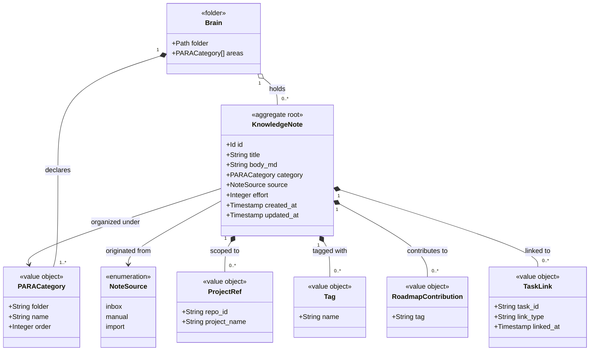
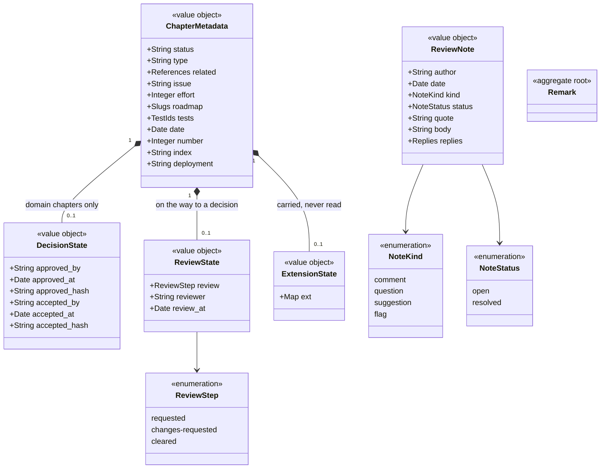

# Devbook

```meta
type: model
status: draft
```

> Structural view of the domain model for this bounded context: aggregates,
> entities, value objects, and their relationships. Keep this in sync with
> `domain.md` (which describes responsibilities/invariants in prose) — this
> file focuses on structure and relationships.

## Model diagram



## Relationship notes

- `KnowledgeNote` is the aggregate root. `ProjectRef`, `Tag`,
  `RoadmapContribution`, and `TaskLink` are owned value objects, and there are no
  separately identified child entities.
- `Brain` is the folder the person picked, not an aggregate: it holds the notes
  as Markdown files and declares its areas in `CONVENTIONS.md`, the PARA set when
  it declares none. A note's `PARACategory` is one of those areas, read from the
  note's top folder unless its `para` field overrides it.
- `ProjectRef` is written as the note's `repos` field and `TaskLink` as its
  `tasks` field (local ADR 0026). A `repo:` link to a repository chapter is not a
  `ProjectRef`: it addresses one chapter, and the Brain's database keeps it as an
  edge that resolves only on a machine where that repository is configured.
- `TaskLink` references a Task by id only, never by object reference,
  so the two contexts stay decoupled; the Cross-Linking service keeps both
  directions consistent.
- `effort` is the [Effort](domain.md#effort) scalar on the root. It carries no relationship to another type. Roadmap
  Planning reads and totals it; Devbook owns it.
- `Tag` and `RoadmapContribution` are both owned value objects, and neither is an
  edge in the knowledge graph; for the contribution, see
  [its invariant](domain.invariants.md#invariant-a-roadmap-contribution-draws-no-graph-edge).
  Why they are two different things is the
  [Roadmap Contribution](domain.md#roadmap-contribution) chapter's.

## Chapter metadata the panels read

A repository devbook chapter is not a `KnowledgeNote`: it is a file this context
reads and never owns (see [Repository devbook areas](features.md#repository-devbook-areas)).
What the panels read off one is modelled here because it is what they show, and
because three of its parts are easy to confuse.



- **`status` is folder-relative, and absent is a value.** In the architecture,
  domain and design areas an absent status *is* `active`, the resting state,
  and the panels write it by removing the line. In the technology and AI areas
  it is a rating and always present. The domain area alone adds two decision
  steps above the ladder, `approved` and `accepted`.
- **`DecisionState` and `ReviewState` are state, not content.** They sit in the
  chapter's `meta` block but describe the road to a decision. The panels draw them
  beside the status and never hand them on as what the chapter says.
  `DecisionState` exists only while its step stands and leaves with it.
  `ReviewState` is replaced by `DecisionState` when approval is written. Neither
  is legal outside the domain area.
- **`type` is folder-relative too.** Domain, technology and AI chapters each
  draw from their own set; architecture and design define none. A domain
  context's additional page takes its own filename as its type.
- **`ExtensionState` belongs to whoever wrote it.** Keys under `ext.` are
  carried through verbatim and never validated or interpreted here.
- **`ReviewNote` and `Remark` are two things on purpose.** A
  [Review Note](domain.md#review-note) is an `annotation` fence in the chapter
  file, read-only here. A [Remark](domain.md#remark) is the person's own note on a
  block, owned and replicated by this context. Local ADR 0011
  (`.devbook/arc42/adr/0011-devbook-annotations-are-a-third-replica-container.md`)
  records why the two are kept apart and why neither is converted into the other.
