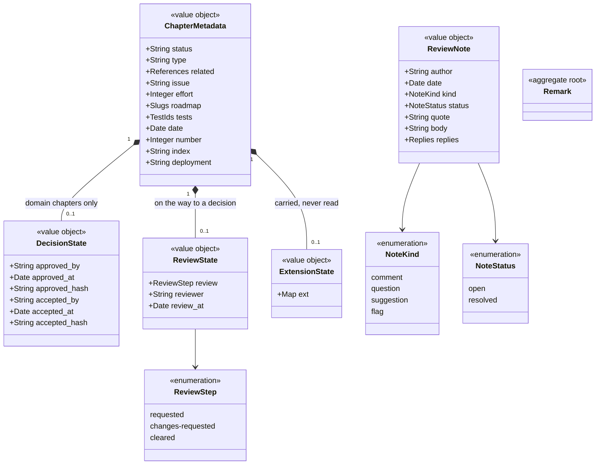

# Devbook

```meta
type: model
status: draft
```

> Structural view of the domain model for this bounded context: aggregates,
> entities, value objects, and their relationships. Keep this in sync with
> `domain.md` (which describes responsibilities/invariants in prose) — this
> file focuses on structure and relationships.

## Chapter metadata the panels read

A devbook chapter is a file this context reads and never owns (see
[Repository devbook areas](features.md#repository-devbook-areas)); a Brain note is
one too, and the [Brain](../brain/model.md#model-diagram) models what it adds.
What the panels read off a chapter is modelled here because it is what they show,
and because three of its parts are easy to confuse. `effort` and `roadmap` are the
[planning fields](domain.md#shared-value-objects) Devbook registers.



- **`status` is folder-relative, and absent is a value.** In the architecture,
  domain and design areas an absent status *is* `active`, the resting state,
  and the panels write it by removing the line. In the technology and AI areas
  it is a rating and always present. The domain area alone adds two decision
  steps above the ladder, `approved` and `accepted`.
- **`DecisionState` and `ReviewState` are state, not content.** They sit in the
  chapter's `meta` block but describe the road to a decision. Where the panels
  show them, and when a `DecisionState` goes, are in
  [the requirements of Rendered devbook documents](requirements.md#rendered-devbook-documents).
  `ReviewState` is replaced by `DecisionState` when approval is written. Neither
  is legal outside the domain area.
- **`type` is folder-relative too.** Domain, technology and AI chapters each
  draw from their own set; architecture and design define none. A domain
  context's additional page takes its own filename as its type.
- **`ExtensionState` belongs to whoever wrote it.** Keys under `ext.` mean what
  their tool means by them, so this context
  [carries them as written](requirements.md#requirement-another-tools-state-is-carried-as-written).
- **`ReviewNote` and `Remark` are two things on purpose.** A
  [Review Note](domain.md#review-note) is an `annotation` fence in the chapter
  file, read-only here. A [Remark](domain.md#remark) is the person's own note on a
  block, owned and replicated by this context. Local ADR 0011
  (`.devbook/arc42/adr/0011-devbook-annotations-are-a-third-replica-container.md`)
  records why the two are kept apart and why neither is converted into the other.
