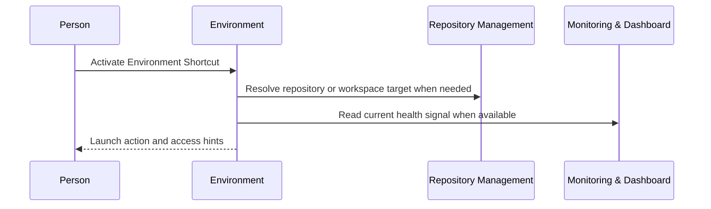

# Environment

```meta
type: domain
```

> One chapter per Aggregate, Domain Service, Domain Event, or Shared Value
> Objects / Shared Enums grouping in this bounded context; each chapter's
> `type` records which of those it is. An Aggregate's owned Entities, Value
> Objects, and Enums are chapters directly beneath it, typed `entity`,
> `value-object`, and `enum`. Value Objects/Enums shared across multiple
> aggregates get their own chapter at the end instead of being duplicated.

## Environment Catalog

```meta
type: aggregate
related: [.devbook/domain/repository-management/domain.md#repository-registry, .devbook/domain/monitoring/domain.md#progress-signal, .devbook/domain/environment/domain.invariants.md#environment-catalog]
aliases: [EnvironmentCatalog]
```

The personal catalog of launchable environments. The rules it holds are in
[its invariants](domain.invariants.md#environment-catalog).

### Environment

```meta
type: entity
aliases: [environment_id]
```

A named destination the person wants quick access to, such as:

- a local Aspire dashboard;
- a staging web app;
- an Azure resource group;
- a repository preview;
- a production admin surface.

### Environment Shortcut

```meta
type: entity
aliases: [EnvironmentShortcut, shortcut_id]
```

An owned quick-access entry for an Environment. It carries:

- a display name;
- a group;
- an order;
- pinned/hidden state;
- optional deep-link details.

### Launch Target

```meta
type: value-object
aliases: [LaunchTarget, target_ref]
```

The value needed to open an environment. Equality is by target type and target
value. It is one of:

- a URL;
- a command;
- a workspace path;
- a dashboard resource id;
- a cloud resource id;
- a repository/environment id.

### Access Hint

```meta
type: value-object
aliases: [AccessHint]
```

A non-secret pointer that helps the person reach the environment. It never
contains the credential itself. It can be:

- the credential source name;
- a tenant label;
- a VPN requirement;
- a required local profile.

### Environment Type

```meta
type: enum
```

Classifies the destination as one of:

- `local`
- `development`
- `test`
- `staging`
- `production`
- `cloud`
- `repository`
- `tooling`

## Environment Shortcut Resolution

```meta
type: domain-service
related: [.devbook/domain/environment/domain.md#environment-catalog, .devbook/domain/repository-management/domain.md#repository-registry, .devbook/domain/monitoring/domain.md#progress-signal]
```

**Shortcut activation**



- The health read is optional: Environment asks only when a view shows health.
- Environment is not built, so this flow is the intended design.

Resolves an Environment Shortcut into the launch action the UI can present:

- open a URL;
- run a command;
- focus a local workspace;
- navigate to a cloud dashboard.

It is a service because it composes catalog data with supplier facts such as
repository path or environment health rather than belonging to one shortcut's
stored state. Invocation semantics: query/composition-oriented when a quick-access
view is shown or a shortcut is activated.

## EnvironmentShortcutUsed

```meta
type: domain-event
related: [.devbook/domain/environment/domain.md#environment-catalog]
```

Published when the person activates an Environment Shortcut.

### Payload

- `environment_id` - environment identifier.
- `shortcut_id` - activated shortcut identifier.
- `environment_type` - target category.
- `target_ref` - non-secret target reference.
- `used_at` - activation time.

### Consumers

- Productivity, which counts environment access as work-flow activity.

### Published language rules

- The event records a launch action only; it does not expose credentials or claim
  that the target environment was healthy.

## Shared Enums

```meta
type: shared-enums
```

> Enums used by more than one aggregate in this bounded context.

Environment currently has a single aggregate, so `Environment Type` is documented
under it. This chapter is reserved for future cross-aggregate enums.
