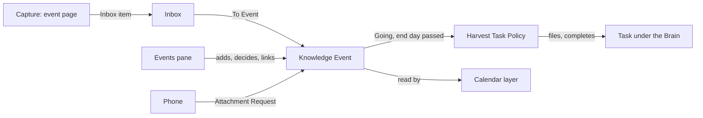

# Events

```meta
index: root
type: context
deployment: module
related: [.devbook/arc42/adr/0050-events-is-its-own-bounded-context.md, .devbook/arc42/adr/0039-notifications-are-an-owned-document-kind-and-push-only-nudges.md, .devbook/arc42/adr/0026-the-brain-is-a-personal-devbook-outside-any-repository.md, .devbook/arc42/adr/0027-the-brain-is-a-scope-beside-the-repositories.md, .devbook/arc42/adr/0022-the-shell-shows-one-main-view-picked-by-a-view-switch.md, .devbook/arc42/adr/guidelines/0005-modular-monolith-structure.md, .devbook/domain/context-map.md]
```

Events keeps the knowledge events a person attends to learn something: what they
are, whether to go, and what was learned there.

Inside the boundary:

- each [Knowledge Event](domain.md#knowledge-event): its dates, place, link, key
  dates, ticket, cost, what the person wants to learn, and its verdict;
- the [lifecycle](domain.md#knowledge-event-state) from Spotted to Harvested, and
  why an event was Skipped;
- the [Event Series](domain.md#event-series) an event is one edition of;
- the links from an event to its Brain notes, Talk notes and tasks, by id;
- filing and completing the [harvest task](domain.md#harvest-task-policy).

Outside it:

| Concern | Owner |
|---|---|
| Meetings, holidays and every other appointment | Not modelled in Backlog |
| The event pages watched for new editions | [Capture](../capture/context.md), as monitored targets |
| Triage, and the **To Event** route | [Inbox](../inbox/context.md) |
| The tasks themselves, and the Brain scope they file under | [Tasks](../tasks/domain.md#task), and [Brain scope](../brain/features.md#brain-scope) |
| The takeaways | [Brain](../brain/context.md), as [Knowledge Notes](../brain/domain.md#knowledge-note) |
| The notes taken at a talk | [Inbox](../inbox/domain.md#note), as [Talk notes](../capture/features.md#talk-note) |
| The Calendar view | Tasks ([Calendar view](../tasks/features.md#calendar-view)) |
| Carrying the documents between devices | [Sync](../sync/context.md) |



Nothing here is built yet. These chapters are the model a later change builds,
decided in local [ADR 0050](../../arc42/adr/0050-events-is-its-own-bounded-context.md).

Tasks and the Brain know no event. The event holds the task ids and note links,
and a task or note never names the event back. Events publishes no domain event.

The module is `Backlog.Modules.Events`. It publishes its contracts to other
contexts through `Backlog.Modules.Events.Abstractions`, with its screens in
`Backlog.Modules.Events.UI` (inherited guideline
[ADR 0005](../../arc42/adr/guidelines/0005-modular-monolith-structure.md)). It
reaches another context only through that context's `.Abstractions`, by an
adapter in Infrastructure.

Events owns its documents the way Notifications does
([ADR 0039 §3](../../arc42/adr/0039-notifications-are-an-owned-document-kind-and-push-only-nudges.md#3-notifications-get-their-own-replica-containers)).
A knowledge event is a document kind of its own, on a replica container of its own,
whose name is still open. Sync stores and carries the documents and reads none of
their fields. Each desktop keeps the person's events in its own store and pushes
its changes.

- **Writers.** Every desktop of the person may change an event. The latest write
  wins, as for tasks ([Change Precedence](../sync/domain.md#change-precedence)).
- **The phone.** It reads the events and writes none. To attach a Talk note it
  sends an [Attachment Request](domain.md#attachment-request), which a desktop
  applies. A reply reaches a notification's owner the same way
  ([ADR 0039 §2](../../arc42/adr/0039-notifications-are-an-owned-document-kind-and-push-only-nudges.md#2-a-viewer-replies-by-writing-a-reply-document-and-the-owner-decides)).

**Why:** the phone does not see the Brain (local
[ADR 0026](../../arc42/adr/0026-the-brain-is-a-personal-devbook-outside-any-repository.md)),
and the person needs the event most at the venue.

## Events area

```meta
type: feature-flag
key: events
default: off
related: [.devbook/domain/events/features.md#events-pane, .devbook/domain/events/features.md#to-event-route, .devbook/domain/events/features.md#prep-tasks, .devbook/domain/events/features.md#harvest-task, .devbook/domain/events/features.md#events-on-the-calendar, .devbook/domain/events/features.md#events-on-the-phone, .devbook/domain/inbox/features.md#route-to-event, .devbook/domain/capture/features.md#event-page-monitor, .devbook/arc42/adr/0050-events-is-its-own-bounded-context.md]
```

Turning it on opens the Events area on five surfaces:

- the [Events pane](features.md#events-pane) on the desktop;
- the Inbox's [To Event route](../inbox/features.md#route-to-event) in triage;
- the [event page capture source](../capture/features.md#event-page-monitor) in Capture;
- the [events layer](features.md#events-on-the-calendar) on the Calendar;
- the [Events screen](features.md#events-on-the-phone) on the phone.

Switched off, none of the five shows and the
[harvest task](features.md#harvest-task) is not filed. Events already stored are
kept.

It ships off and marked `DEV`, the settings screen's mark for a feature still under
construction
([Feature Enablement](../../arc42/08-crosscutting-concepts.md#feature-enablement)).
The key joins the feature catalog in `AppFeatures.cs`, and a person's choice is kept
in `features.json` beside the app's other per-device choices. The phone honours the
same flag. The flag is retired when the Events area leaves `DEV`.

## Desktop clock

```meta
type: technical
related: [.devbook/domain/events/domain.md#harvest-task-policy, .devbook/domain/events/features.md#harvest-task]
```

The local calendar day on a desktop running Backlog. When the day turns, or the app
starts on a new day, it triggers the
[Harvest Task Policy](domain.md#harvest-task-policy). The model records nothing of
it: the policy reads the date and files the task.

## Dependencies

Events is downstream of Inbox, Tasks and Sync, and upstream of Tasks for the
Calendar's events layer. The two Tasks edges run through different parts, so they
form no cycle of modules.

### Outbound dependencies

| Depends on (context/module) | DDD pattern | Integration mechanism | Contract | Why |
|---|---|---|---|---|
| [Inbox](../inbox/context.md) | OHS + Published Language (Events = conformist) | The To Event route hands the triaged item to Events' intake, through an adapter | [ItemTriaged](../inbox/domain.md#itemtriaged), route `events` | An Inbox item becomes a Spotted knowledge event. |
| [Capture](../capture/context.md) | OHS + Published Language, through the Inbox | None direct: the facts ride on the Inbox item | [ItemCaptured](../capture/domain.md#itemcaptured), its `event` field | The dates, place and their source reach the event. |
| [Tasks](../tasks/domain.md#task) | Customer/Supplier (Events = customer) | A port in Events' abstractions, answered by an adapter over Tasks' published task contract | `Backlog.Modules.Tasks.Abstractions` | Files a prep or harvest task under the Brain scope, and completes one by id. |
| [Brain](../brain/context.md) | One-way reference | A Brain note's path from the Brain's root, held on the event | The path `ItemTriaged.note_path` uses | The takeaways stay Brain notes. Brain knows no event. |
| [Inbox](../inbox/domain.md#note), notes | One-way reference | An Inbox note id, held on the event | [Note](../inbox/domain.md#note) | A Talk note is attached to its event. |
| [Sync](../sync/context.md) | Conformist (Events = conformist) | An exchange in `Backlog.Infrastructure.Sync`, and the phone's device outbox | The replica protocol in `Backlog.Modules.Sync.Abstractions`; local ADR 0050 | Events and attachment requests reach every paired device. |

### Inbound dependents (known)

| Consumer (context/module) | DDD pattern | Integration mechanism | Contract | What it relies on |
|---|---|---|---|---|
| [Tasks](../tasks/features.md#calendar-view) | Customer/Supplier (Events = supplier) | A Tasks-owned port, answered by an adapter over Events' read contract, as the Calendar reads plans | The read contract in `Backlog.Modules.Events.Abstractions` | The decided events and their key dates, for the Calendar's events layer. |
| The phone (`Backlog.Mobile.UI`) | Conformist, through Sync | Pulls the event documents and posts attachment requests | The Events replica container; local ADR 0050 | A read-only view of the person's events at the venue. |
