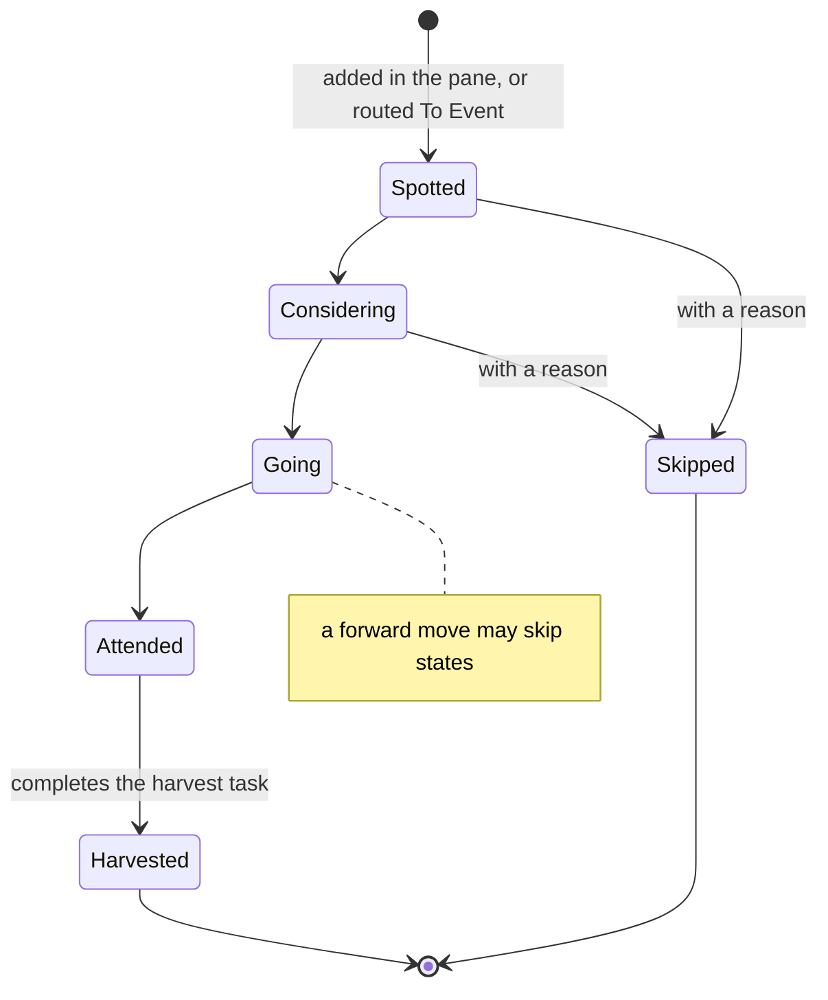
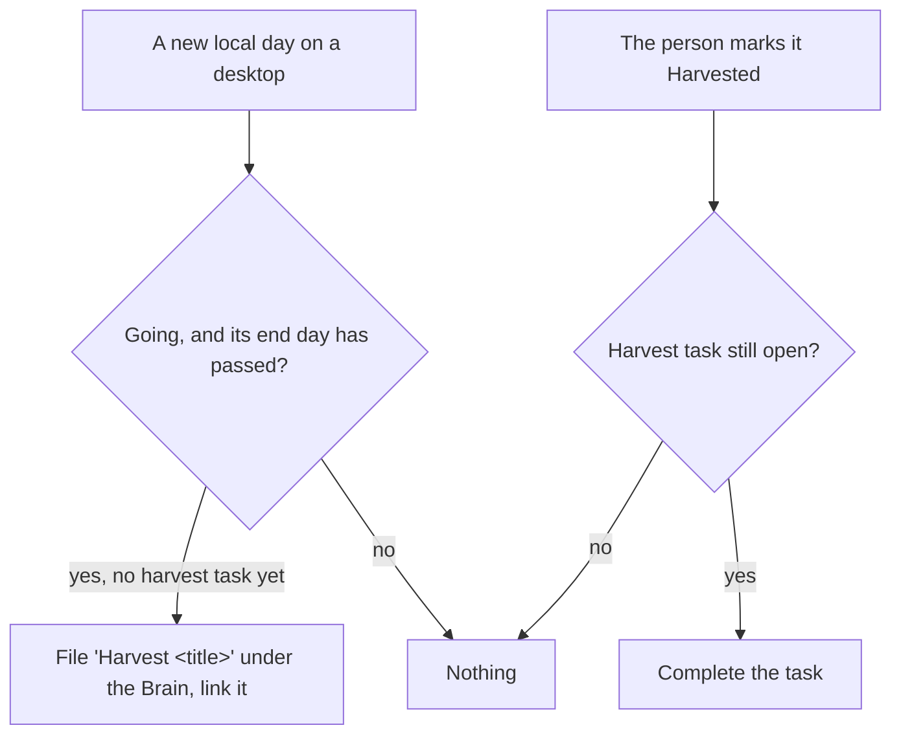

# Domain

```meta
type: domain
```

> One chapter per Aggregate, Domain Service, Domain Event, or Shared Value
> Objects / Shared Enums grouping in this bounded context. An Aggregate's owned
> Entities, Value Objects, and Enums are chapters directly beneath it. Events
> publishes no domain event.

## Knowledge Event

```meta
type: aggregate
related: [.devbook/domain/events/domain.invariants.md#knowledge-event, .devbook/arc42/adr/0050-events-is-its-own-bounded-context.md]
aliases: [KnowledgeEvent, Events]
```



One edition of something the person attends to learn: a conference, a meetup, a
webinar, a workshop. It is never called an *event* alone, because that word means
a domain event, and Tasks has a [Usage Event](../tasks/domain.md#usage-event). The
app labels the area *Events*.

The knowledge event is the consistency boundary for its decision and its harvest.
It holds:

- a title, the only field a new event needs;
- the [Event Series](#event-series) it belongs to, by id;
- a start and an end, each an [Event Date](#event-date), and their
  [Date Source](#date-source);
- a [Place](#place), and a link to the edition's page;
- its [state](#knowledge-event-state), and a [Skip Reason](#skip-reason) once
  Skipped;
- what the person wants to learn, in free text;
- its [Key Dates](#key-date);
- a [Ticket State](#ticket-state) and a [Cost](#cost);
- its [Note Links](#note-link) and [Event Task Links](#event-task-link);
- a [Verdict](#verdict).

Every field but the title is optional. A dotNET Friday afternoon is entered in
seconds, while a three-day conference fills most of them. An event with a start and
no end lasts its start day.

Any of the person's desktops may change an event, and the latest write wins. The
phone writes none: it sends an [Attachment Request](#attachment-request). The rules
it holds are `### Invariant:` chapters in
[`domain.invariants.md`](domain.invariants.md#knowledge-event).

### Event Date

```meta
type: value-object
aliases: [EventDate]
```

A calendar date, plus a time of day and its UTC offset when they are known. A
conference listed as "26 - 28 OCT" has dates only. A meetup listed from 16:30 in
Nieuwegein has a time and the offset `+01:00`. Equality is by value.

### Place

```meta
type: value-object
```

Where the event happens: a venue, in free text, or online. Equality is by value.

### Key Date

```meta
type: value-object
aliases: [KeyDate]
```

A date that matters before the event, with its label: early bird ends,
registration closes, call for speakers closes. A Key Date is a date only, with no
time. Equality is by value.

### Cost

```meta
type: value-object
```

What going costs, as one amount with its currency code, kept trimmed and upper-cased, such as
`EUR`. No list of currencies is checked. Nothing totals or reports it.
Equality is by value.

### Ticket State

```meta
type: enum
aliases: [TicketState]
```

- **Not bought**: the event needs a ticket the person does not have yet.
- **Bought**: the person holds a ticket or a registration.
- **Not needed**: the event is free and open, or needs no registration.

### Date Source

```meta
type: enum
aliases: [DateSource]
```

Where the event's dates came from:

- **Typed**: the person entered them.
- **Event page**: the capture read them from the edition's page.

The steps the capture source takes to read a page belong to that source in
Capture.

### Knowledge Event State

```meta
type: enum
aliases: [KnowledgeEventState]
```

- **Spotted**: found, from a watched page, a colleague or a link. Dates may be
  unknown.
- **Considering**: the person weighs what they would learn and what it costs.
- **Going**: decided. Ticket, travel and prep tasks follow.
- **Attended**: the person was there.
- **Harvested**: the takeaways are written up. Final.
- **Skipped**: decided against, with a reason. Final.

The diagram on [Knowledge Event](#knowledge-event) draws the moves. The rules they
keep are in [`domain.invariants.md`](domain.invariants.md#knowledge-event). What a
Going event that is cancelled becomes is not settled yet.

### Skip Reason

```meta
type: value-object
aliases: [SkipReason]
```

Why the person decided against an event, in their own words. It is plain text and
never empty. Equality is by value.

### Verdict

```meta
type: value-object
```

Whether the event was worth it, in the person's own words. The person writes it
once the event is Attended or Harvested. Equality is by value.

### Note Link

```meta
type: value-object
aliases: [NoteLink, NoteLinkKind]
related: [.devbook/domain/brain/domain.md#knowledge-note, .devbook/domain/inbox/domain.md#note, .devbook/domain/capture/features.md#talk-note]
```

A note the event points at, of one of two kinds:

- **Brain**: a [Knowledge Note](../brain/domain.md#knowledge-note), named by
  its path from the Brain's root, as `ItemTriaged.note_path` names it.
- **Talk**: an Inbox [note](../inbox/domain.md#note), named by its id.

The link also keeps the note's title as it read when linked, or none when it had none. The phone shows a
Brain note by that title only, because it cannot see the Brain. A Brain note moved
or renamed leaves a broken link, which the pane shows as missing. A missing link
can be pointed at the note's new path, in its place among the links. If the event
already links that note, the old link just goes. A link can also be removed. A
task link is not removed in the first version. Two links are equal when they name
the same note.

### Event Task Link

```meta
type: value-object
aliases: [EventTaskLink]
related: [.devbook/domain/tasks/domain.md#task]
```

A task the event points at, named by its id, with its [Task Purpose](#task-purpose).
The task never names the event back. Two links are equal when they name the same
task.

### Task Purpose

```meta
type: enum
aliases: [TaskPurpose]
```

- **Prep**: a task the pane filed from the event, such as booking a hotel.
- **Harvest**: the task the [Harvest Task Policy](#harvest-task-policy) filed.
- **Linked**: an existing task the person linked.

## Event Series

```meta
type: aggregate
related: [.devbook/domain/events/domain.invariants.md#event-series]
aliases: [EventSeries, Series]
```

The organiser's recurring run of knowledge events: Techorama each year, dotNET
Friday each quarter. It holds a name, the organiser, and a link to the series'
page. Each edition is a [Knowledge Event](#knowledge-event) that names the series
by id.

A series watches nothing. The pages Capture monitors for new editions are Capture's
targets, and the series keeps only its link.

## Attachment Request

```meta
type: aggregate
related: [.devbook/domain/events/domain.invariants.md#attachment-request, .devbook/domain/events/features.md#attach-a-talk-note]
aliases: [AttachmentRequest, event-attachment-request]
```

What the phone sends to attach a Talk note to a knowledge event. It names the event
and the Inbox note, and carries the note's title as the phone showed it. It carries
no file: unlike an Inbox [Attachment](../inbox/domain.md#attachment), it is a
request, not content.

The phone writes it once through its device outbox, so a request made offline is
kept. It rides the person's task feed as a kind of its own. A desktop applies it by
adding a [Note Link](#note-link) to the event, which keeps that title, then retires
it with a tombstone. A request for a note the event already links changes nothing,
so a second desktop applying it does no harm.

A desktop that does not hold the event yet keeps the request and tries again after
its next pull. A desktop without Events, or with the `events` flag off, leaves the
request untouched until the flag is on.

## Harvest Task Policy

```meta
type: domain-service
related: [.devbook/domain/events/domain.invariants.md#harvest-task-policy, .devbook/domain/events/features.md#harvest-task, .devbook/domain/events/requirements.md#harvest-task]
```



The policy closes the loop after an event, because the harvest is the step a
person forgets. It files one task `Harvest <event title>` with no repository, so it
lands under the [Brain scope](../brain/features.md#brain-scope). It links that task
to the event as its Harvest [Event Task Link](#event-task-link). Marking the event Harvested
completes that task. The policy raises no notification.

It spans the event and a task in Tasks, which is why it is a service and not a rule
of the event. Tasks knows no event, so completing the task there leaves the event
as it was.

Invocation semantics: scheduled by the [Desktop clock](context.md#desktop-clock)
for filing, and event-triggered policy on the Harvested transition for completing.

Its promises are in [`requirements.md`](requirements.md#harvest-task). The rules it
keeps itself are in
[`domain.invariants.md`](domain.invariants.md#harvest-task-policy).

## Ubiquitous Language

```meta
type: ubiquitous-language
```

### Talk

```meta
type: term
related: [.devbook/domain/capture/features.md#talk-note, .devbook/domain/events/domain.md#knowledge-event]
```

One talk given at a knowledge event. It is never a *session*, because Sessions is a
bounded context of its own. Talks are not modelled yet: the person keeps what a
talk said in a [Talk note](../capture/features.md#talk-note) linked to the event.

### Talk picks

```meta
type: term
related: [.devbook/domain/tasks/domain.md#agenda-time, .devbook/domain/events/domain.md#knowledge-event]
```

The talks the person means to hear at a knowledge event with parallel tracks. It is
never an *agenda*, because Tasks has [Agenda Time](../tasks/domain.md#agenda-time).
Talk picks are not modelled yet.
