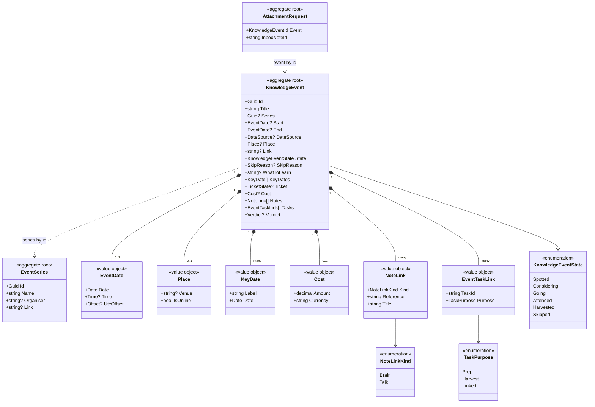

# Model

```meta
type: model
related: [.devbook/domain/events/domain.md#knowledge-event, .devbook/domain/events/domain.md#event-series, .devbook/domain/events/domain.md#attachment-request]
```

> Structural view of the domain model for this bounded context: aggregates,
> value objects, and their relationships. [`domain.md`](domain.md) says what each
> one means and draws the knowledge event's lifecycle.

## Model diagram



## Relationship notes

- A Knowledge Event names its Event Series by id. Each is its own aggregate, so
  editing a series never rewrites its editions.
- An Attachment Request names its event by id. The phone writes it once, and a
  desktop turns it into a Note Link and deletes it.
- A Note Link names a Brain note by its path from the Brain's root, or an Inbox
  note by its id. An Event Task Link names a task by its id. The links run one way:
  Tasks, the Brain and the Inbox hold nothing of the event.
- The Skip Reason, Verdict, Ticket State and Date Source are left out of the
  diagram as types. They are plain text or small enums on the event, described
  in [`domain.md`](domain.md#knowledge-event).
