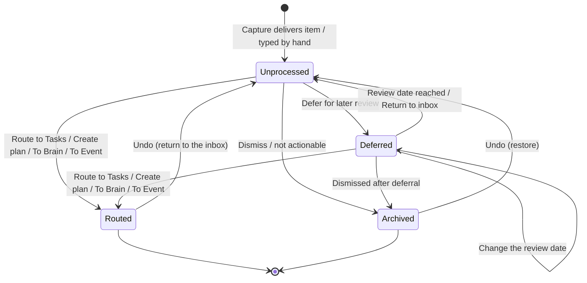
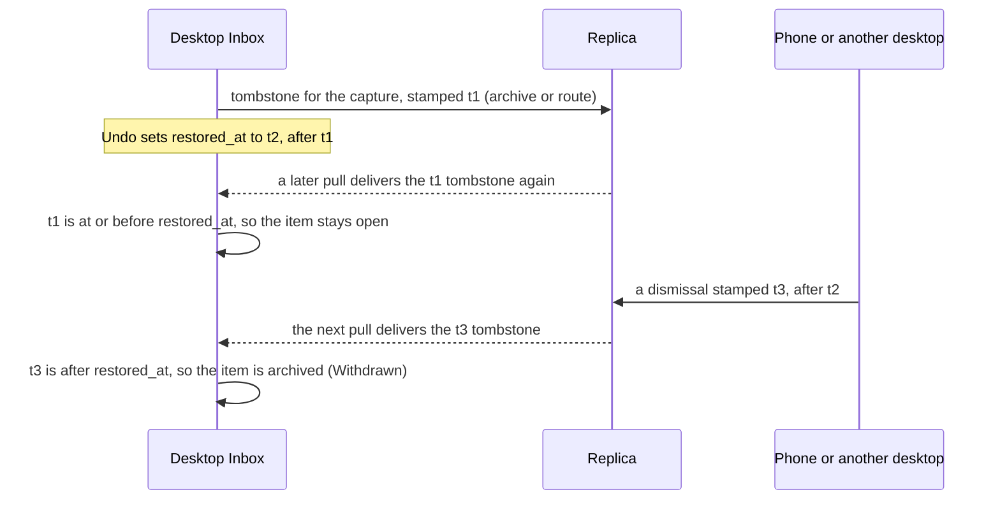
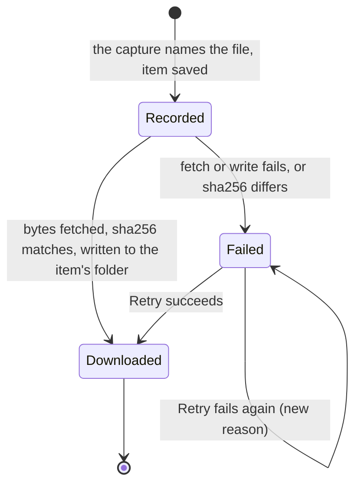

# Inbox

```meta
type: domain
tests: [unit:dotnet:Backlog.Modules.Inbox.UnitTests]
```

> One chapter per Aggregate, Domain Service, Domain Event, or Shared Value
> Objects / Shared Enums grouping in this bounded context; each chapter's
> `type` records which of those it is. An Aggregate's owned Entities, Value
> Objects, and Enums are chapters directly beneath it, typed `entity`,
> `value-object`, and `enum`. Value Objects/Enums shared across multiple
> aggregates get their own chapter at the end instead of being duplicated.

## Inbox Item

```meta
type: aggregate
related: [.devbook/domain/inbox/domain.invariants.md#inbox-item, .devbook/domain/capture/domain.md#capture, .devbook/arc42/08-crosscutting-concepts.md#shared-data-types, .devbook/arc42/adr/0009-captures-are-a-document-kind-on-the-replica.md, .devbook/arc42/adr/0014-attachments-travel-through-a-blob-store-beside-the-replica.md, .devbook/domain/inbox/domain.md#note, .devbook/arc42/06-runtime-view.md#mobile-note-sync]
tests: [unit:dotnet:Backlog.Modules.Inbox.UnitTests.InboxItemTests, unit:dotnet:Backlog.Modules.Inbox.UnitTests.InboxAttachmentTests, unit:dotnet:Backlog.Modules.Inbox.UnitTests.NoteTests, unit:dotnet:Backlog.Modules.Inbox.UnitTests.ReceiveCaptureTests]
aliases: [InboxItem, InboxItemDto, inbox_items, dismissed_suggestions, DuplicateOf, DuplicateOfTask, duplicate_of, duplicate_of_task, RestoredAt, restored_at]
```

**Inbox item lifecycle**



- `Routed` is the stored status `triaged` with a `RoutingTarget`, and
  `ItemTriaged` is emitted on the way in. [Inbox Status](domain.md#inbox-status)
  says why deciding and routing are one step.
- A `triaged` item with no routing target is not routed, so it may still be
  deferred or archived.
- Filing in a list (`list_id`) is not a transition.
- The rules each transition is held to are the `Inbox Item` chapters of
  [`domain.invariants.md`](domain.invariants.md#inbox-item).
- `Deferred → Unprocessed` happens when a person returns the item by hand,
  whatever its date, or when the [resurface sweep](domain.md#resurface-sweep) finds
  its review date reached.
- Undo reopens a decision only within the app session that took it
  ([Undo a decision](features.md#undo-a-decision)).

**Undo and a returning tombstone**

An undo cannot call back a tombstone the desktop already sent, so the intake
reads every later tombstone against the item's `restored_at`.



- The echo may arrive on the next pull or days later, on a full replay.
- The stamps come from different clocks when the tombstone is not this
  desktop's own. A dismissal made after the undo but stamped at or before it by
  a skewed clock is ignored. That is accepted so that an undo holds.

A single unit of captured information moving through triage. The aggregate
guarantees three things:

- the original source link and capture timestamp are always preserved;
- its status moves only along the [lifecycle](domain.md#inbox-item);
- a routing decision records exactly one `Routing Target`.

A deferred item carries an optional `deferred_until` review date, and the
[resurface sweep](#resurface-sweep) returns it when that date is reached. A
deferral with no date comes back only when a person returns it.

Before triage decides where an item goes, a reader has to see what
it is and where it came from. So an item states its `Content Kind`: what the
captured content *is*, a different fact from the `Capture Source`
channel it arrived through. A video is a video whether the YouTube monitor found
it, the phone shared it, or somebody pasted the link. Its `Source` keeps that
channel with the person who shared it, when someone did.

While an item waits, a reader may assign it `Tags`, assign the repositories
(`repo_ids`) the work will belong to, and file
it in an [Inbox List](#inbox-list) through `list_id`. Filing is organisation,
not triage. An item in a list with no routing decision is still `unprocessed`,
and an archived item may still be moved between lists.

The item also remembers which of [Classification](#classification)'s
suggestions the reader turned down, as `dismissed_suggestions`. Each is kept
by its key: `tag:sync`, `repository:owner/name` or `destination:tasks`. The
key names what was proposed, not why, so a refused suggestion is
not offered again, even when something new would propose it. It sits on the
item because the refusal is the reader's decision about this item.

An item archived as the same capture as something else remembers what, as
`DuplicateOf`. It names one of two things, and `DuplicateOfTask` says which:

- another inbox item, for "Archive as duplicate of…": the one kept, at the root
  of its own chain;
- a backlog task the item was merged into ([Triage](#triage)).

The Inbox cannot see a task, so a link to one ends a duplicate chain.

An item is born one of two ways. A capture pulled from the replica becomes an
item that **reuses the capture's id**. That makes intake idempotent: a
replayed page, or the [sync echo](#sync-echo) of the desktop's own
acknowledgement, finds the row it already has. A thought typed into the capture
field in the Inbox header becomes a [Capture (manual)](#capture-manual), with a
fresh id.

An item the reader reopens by undo records when, as `restored_at`. Restoring it
from the archive sets the stamp, and so does returning it from the backlog.
[Undo and a returning tombstone](domain.md#inbox-item) shows how the intake reads
later tombstones against it. The stamp is sync bookkeeping, kept
apart from `updated_at`, because filing and tagging restamp `updated_at` and
would hide a phone dismissal made in between.

A capture can also bring files, such as a photo, a screenshot or a PDF the phone
shared. The item owns them as [Attachments](#attachment). The file belongs to the
thought, so it lives inside the item's boundary and stays with it whatever triage later decides.

An item of kind `note` is a [Note](#note), the one kind that lives on the phone
as well as the desktop. Each side may change its title,
body and files, and both keep the later edit, by the last-write-wins rule the
task feed uses
(`.devbook/arc42/adr/0005-azure-hosted-task-replica-for-multi-device-sync.md`).

A note keeps its id on every device. Unlike a `text` capture, it is not
acknowledged away from the phone when the desktop takes it in or routes
it. A note stops syncing only when the desktop archives or deletes it, and the
phone then drops it from its list.

A note carries its own last-write-wins stamp, `edited_at`, apart from the item's
`updated_at`. It moves when the title, body or files change and when the note is
archived or deleted, and nowhere else. Filing, tagging and a file arriving
restamp `updated_at` only. Otherwise a note pushed for such a change would carry a
stamp later than an edit the phone made meanwhile, and overwrite that edit
with the older text. A note taken in from the phone keeps the phone's stamp.

Triage stays on the desktop for every kind, notes included. The phone may create
a note and edit any note, but it never routes, defers, accepts or archives an
item. A note waits in the queue as `unprocessed` like any other item, and the desktop may triage it like any other.

The rules the item and its attachments are held to are `### Invariant:`
chapters in [`domain.invariants.md`](domain.invariants.md#inbox-item).

### Routing Target

```meta
type: value-object
aliases: [RoutingTarget, InboxRoutingDto]
```

The destination chosen during triage. It holds five fields:

- `domain`: the target, which is tasks, devbook for the To Brain route, events
  for the To Event route, or archive;
- `repo_ids`: the repositories the item was assigned when it was routed;
- `task_ids`: the entries Tasks created for it, one per repository, or one when
  no repository was assigned;
- `event_id`: the knowledge event Events made for it, on the events route only;
- `routed_at`: when it was routed.

It is immutable once set, and equality is by value. The task ids and the event
id name aggregates in another context that may since have been deleted there,
which is why they are ids and not references.

### Tag

```meta
type: value-object
```

A `#keyword` applied during triage. Equality is by canonical `name`, without
regard to case. A person is not a tag: `@name` is recorded on `Source`, not
here.

`auto_generated` is kept for a tag applied without the reader. Nothing applies
one today. A tag [Classification](#classification) suggests is only a
proposal until the reader takes it. A tag the reader took is theirs, so it
is stored with `auto_generated` false like one they typed.

### Source

```meta
type: value-object
related: [.devbook/domain/capture/domain.md#source-metadata]
aliases: [InboxSource, person]
```

Where the item came from: the `Capture Source` channel it arrived through and,
optionally, the `person` who shared it as a stored `@name` tag. These are two
facts, because a link shared by a colleague and the same link clipped alone
mean different things to the reader triaging them. The channel is provenance
mirrored from Capture; the person is provenance the channel cannot carry. It is
immutable once set, and equality is by value.

### Event Facts

```meta
type: value-object
related: [.devbook/domain/capture/domain.md#event-facts, .devbook/domain/inbox/features.md#route-to-event]
tests: [unit:dotnet:Backlog.Modules.Inbox.UnitTests.RouteToEventTests.An_event_page_capture_keeps_its_facts_on_the_item, unit:dotnet:Backlog.Modules.Inbox.UnitTests.RouteToEventTests.A_capture_from_any_other_source_has_no_facts, unit:dotnet:Backlog.Infrastructure.Sqlite.UnitTests.SqliteInboxRepositoryTests.An_items_event_facts_and_its_event_come_back_whole, unit:dotnet:Backlog.Infrastructure.Capture.UnitTests.InboxCaptureDeliveryTests.An_event_page_captures_facts_travel_to_the_intake]
```

The dates, place and watched page an event page capture found, mirrored from
Capture's [Event Facts](../capture/domain.md#event-facts). The item keeps them as
provenance, unchanged, and hands them over when it is routed
[To Event](features.md#route-to-event). An item from any other source has none.
Equality is by value.

### Attachment

```meta
type: value-object
related: [.devbook/domain/inbox/domain.invariants.md#inbox-item, .devbook/domain/inbox/features.md#capture-attachments, .devbook/arc42/adr/0014-attachments-travel-through-a-blob-store-beside-the-replica.md]
tests: [unit:dotnet:Backlog.Modules.Inbox.UnitTests.InboxAttachmentTests]
aliases: [InboxAttachment, InboxAttachmentDto, inbox_item_attachments, file]
```

**Attachment lifecycle**



- A replayed sync page never retries a Failed file; only the person's Retry does.
- Recording the same file again changes nothing, so a replay cannot move a
  Downloaded file back to Recorded.

One file an item arrived with, and whether this machine has it. It has two
halves, because they come from two places and change at different rates.

- **What the capture said** is a record of what was sent, like the capture
  instant, so it does not change after it is recorded. It holds:
  - the id the phone minted for the file;
  - its name;
  - its content type;
  - its size;
  - the sha256 of its bytes.
- **This machine's copy**: where the file is kept (`local_path`), when it was
  written (`downloaded_at`), and why the last attempt failed (`last_error`).
  This half changes each time the desktop tries to fetch the file. Another
  device keeps its own copy.

The bytes do not travel on the replica. The capture names the file, and the
desktop fetches it from the sync service's attachment store afterwards (local
ADR 0014). A Recorded file is shown in the pane as *Waiting
to download*. A Downloaded file is in the item's
[attachment folder](#attachment-folder). A Failed file keeps its reason and
waits for the person to press Retry.

A file that did not arrive does not make the thought any less captured, so the
item is Received whatever happens to its files. A picture is a file whose
content type is `image/*`, the one thing the pane and
[Classification](#classification) ask of a file. Equality is by value. A
change is a new attachment that only the item swaps in.

### Content Kind

```meta
type: enum
related: [.devbook/domain/inbox/domain.md#note]
aliases: [ContentKind, CaptureKinds, kind, KindSlug]
```

What the captured content is, as a reader sorting the queue would name it.
It is distinct from `Capture Source`, which says how it arrived:

- `text` — a plain thought waiting to be sorted; the kind every source can
  produce and the kind an item is until somebody says otherwise.
- `note` — a [Note](#note) the person keeps and edits. Created on the phone's
  Notes tab or as a note from any device, it syncs both ways with the phone.
  An item is a note because it was created as one. Classification never infers
  it from the text, and a note document never turns an item of another kind
  into one.
- `article` — a web page worth reading, clipped or linked.
- `link` — a bare URL not yet known to be an article.
- `youtube` — a video, from the YouTube monitor or a shared link.
- `image` — a picture or screenshot.
- `document` — a file: a PDF, an office document, an archive.
- `email` — a newsletter or mail ingested from an IMAP inbox.
- `code` — a selection from an IDE or an IDE-like tool, or a fenced snippet.
- `voice` — a dictated memo from the mobile app.
- `claude-artifact` — an artifact a Claude session produced and shared.

The set will grow. A kind nobody has drawn yet is shown as its plain word.
Seven of the kinds are [collected material](#collected-material). `note` is the
only kind that changes after it is captured.

### Inbox Status

```meta
type: enum
aliases: [InboxStatus]
```

Lifecycle state of an Inbox Item:

- `unprocessed` — newly received, awaiting triage.
- `triaged` — the item was routed. In this product deciding *is* routing, so
  there is no separate "mark triaged" step. An item becomes `triaged` and gains
  its `Routing Target` in one transition, which the
  [lifecycle](domain.md#inbox-item) draws as `Routed`.
- `deferred` — postponed with an optional review date.
- `archived` — dismissed / not actionable.

### Capture Source

```meta
type: enum
related: [.devbook/domain/capture/domain.md#capture-source, .devbook/arc42/adr/0017-inbox-import-is-a-capture-source-with-a-markdown-manifest.md]
aliases: [CaptureSource, source, channel]
```

Origin of the item, mirrored from Capture as provenance: `mobile`, `youtube`,
`website`, `event_page`, `email`, `web_clipper`, `ide`, `manual`, `import`. `manual` is the
channel of a [Capture (manual)](#capture-manual). `import` is the channel of an
item read from an import manifest, which can arrive filed in the Inbox
List the manifest names. It is still `unprocessed`, because filing is not
triage. A channel token nobody recognises is kept as written.

## Inbox List

```meta
type: aggregate
related: [.devbook/domain/inbox/domain.md#inbox-item, .devbook/domain/inbox/domain.md#inbox-group, .devbook/domain/inbox/domain.invariants.md#inbox-list]
tests: [unit:dotnet:Backlog.Modules.Inbox.UnitTests.OrganizerTests]
aliases: [InboxList, InboxListDto, list_id, inbox_lists]
```

A named place a reader files waiting items, the leaf of the pane's side menu.
It has a `name`, an `order` among its siblings, and optionally the
[Inbox Group](#inbox-group) it sits in. It is its own small root, not a
child of the item, because a list exists before anything is in it and after
everything has left. Deleting one is a write across every item it held, which
returns each to the unfiled inbox. The fixed **Inbox**
entry above the lists in the side menu is not a list: it is the items whose
`list_id` is empty.

Lists are local-only organisation and are hard-deleted. Tombstoning exists for
documents that travel (`.devbook/arc42/adr/0005-azure-hosted-task-replica-for-multi-device-sync.md`),
and nothing replicates a list. Names are unique among siblings without regard
to case. The create and rename commands apply that rule, because the aggregate
cannot see its siblings.

A workspace with neither lists nor groups is seeded once with a default set. The
groups are `Areas`, `Projects` and `Archive`. The lists are `Resources`,
`Someday/Maybe`, `Updates` and `Wishlist`.

## Inbox Group

```meta
type: aggregate
related: [.devbook/domain/inbox/domain.md#inbox-list, .devbook/domain/inbox/domain.invariants.md#inbox-group]
tests: [unit:dotnet:Backlog.Modules.Inbox.UnitTests.OrganizerTests]
aliases: [InboxGroup, InboxGroupDto, group_id, inbox_groups]
```

A fold in the side menu that holds lists. It has a `name` and an `order`. The
membership is recorded on the list (`group_id`), not on the group, so a group
is never the owner of what its lists hold. It is local-only and hard-deleted, for
the reasons `Inbox List` gives. Ungrouping moves the group's lists to the top level
and then removes the group, so no list is ever deleted by deleting its group.

## Triage

```meta
type: domain-service
related: [.devbook/domain/tasks/domain.md#task, .devbook/domain/tasks/features.md#import, .devbook/domain/brain/domain.md#knowledge-note, .devbook/domain/inbox/domain.md#batch, .devbook/domain/inbox/features.md#route-a-batch-to-tasks, .devbook/arc42/adr/0007-import-reuses-the-entry-text-grammar.md]
tests: [unit:dotnet:Backlog.Modules.Inbox.UnitTests.RouteToBacklogTests, unit:dotnet:Backlog.Modules.Inbox.UnitTests.MergeIntoTaskTests, unit:dotnet:Backlog.Infrastructure.FileSystem.UnitTests.InboxMergeIntoTaskTests, unit:dotnet:Backlog.Modules.Inbox.UnitTests.CreatePlanTests, unit:dotnet:Backlog.Modules.Inbox.UnitTests.RouteBatchToBacklogTests, unit:dotnet:Backlog.Modules.Inbox.UnitTests.AttachmentIntakeTests.Routing_hands_the_items_folder_to_the_task_as_its_attachment, unit:dotnet:Backlog.Modules.Inbox.UnitTests.AttachmentIntakeTests.Creating_a_plan_hands_the_items_folder_to_the_import_as_its_attachment]
aliases: [RouteToBacklogCommand, CreatePlanCommand, RouteBatchToBacklogCommand, ArchiveItemCommand, MergeIntoTaskCommand, InboxMergeRequestDto]
```

Coordinates the triage decision for an Inbox Item and the resulting
handoff. It routes the item to Tasks or **To Brain**, or
sets it to deferred or archived. Each route emits `ItemTriaged`:

| Route | `ItemTriaged` carries |
|---|---|
| Tasks | title, `body_md`, `source_url`, tags, `repo_ids`, `source_inbox_id` |
| **To Brain** | title, `body_md`, topic, tags |

It is a service because routing crosses bounded-context boundaries rather
than mutating a single aggregate. A command invokes it on a human or automated
triage decision.

Three decisions route to Tasks, and all end in the same `Routing Target`:

- **Route to Tasks**, the **Move to backlog** button, creates one draft task
  per assigned repository, or one untargeted task when none is assigned. Each
  task is stamped with the item's id as its `source_inbox_id`. A failure from
  Tasks leaves the item unrouted.
- **Create plan** asks an AI drafter for an import plan about the item
  (`.devbook/arc42/adr/0007-import-reuses-the-entry-text-grammar.md`) and hands
  it to Tasks' import. Every entry carries the item's [Plan tag](#plan-tag), so
  two items with one title cannot clear each other's plan. The entries are born
  Draft whatever the plan says, because nobody has read them yet. A plan naming
  a repository the item was not assigned is refused whole before Tasks sees it.
- **Route a batch** sends several items to Tasks as one plan import under a
  fresh [Plan tag](#plan-tag), so routing the same list twice makes two plans.
  Each entry carries its own item's id as its `source_inbox_id`, and every
  entry is born Draft. Tasks takes the document whole or refuses it whole. So
  the Inbox first leaves out by name each item that would spoil it, and the
  rest still go:
  - an item already routed or archived;
  - an item whose notes carry a top-level `#` heading or leave a fence open;
  - an item naming a repository the workspace does not know.

  A batch never registers a repository. The dependencies left on in the panel
  before it goes travel as `after:` tokens; see [Dependency tier](#dependency-tier).
  [Batch route](features.md#routing) shows the path.

An item with attachments hands its [attachment folder](#attachment-folder) to
every task Route to Tasks, Route a batch or Create plan creates, as that task's
attachment.

A fourth decision reaches Tasks without making anything. **Merge into a task**
folds an open item into a task it repeats. The item's title, then its link when
it has one, then its notes become one comment on the task. The comment follows
the rule the `backlog` MCP server's `comment` tool uses.
The item is then archived with `DuplicateOf` naming the task.

The Inbox refuses before it writes anything when the item is already decided or
the backlog no longer has the task. A comment Tasks will not take as prose, because
the notes hold a heading, a checklist item or a fence, leaves the item open.
The comment is written first, so a failure never leaves an item archived against
a task that never heard of it. [Merge and To Brain](features.md#routing) shows
the order.

**To Brain** writes a capture or a note into the person's
[Brain](../brain/domain.md#brain) as a new Knowledge Note in its inbox area,
title and body kept. It records the routing target as `devbook`, with no
repository and no task. Devbook is asked first, through the `IInboxBrainTarget`
port, and the item is routed only once the note is written. The route is
refused when no Brain folder is set up, and a failed write leaves the item
unrouted. A note routed To Brain stays on the phone as the Inbox note it was,
as one routed to Tasks does.

**To Event** hands the item's title, link and [Event Facts](#event-facts) to
Events, which makes a Spotted knowledge event in the Series of its watched page,
or in a new one ([Route to Event](features.md#route-to-event)). It records the
routing target as `events`, with the event's id and no task. Events is asked
first, and the item is routed only once the event exists. The route is withdrawn
while the [Events area](../events/context.md#events-area) is off.

## Classification

```meta
type: domain-service
related: [.devbook/domain/inbox/domain.invariants.md#classification, .devbook/domain/inbox/features.md#classification-and-enrichment, .devbook/domain/inbox/context.md#inbox-routing-rules]
tests: [unit:dotnet:Backlog.Modules.Inbox.UnitTests.ContentKindDetectorTests, unit:dotnet:Backlog.Modules.Inbox.UnitTests.AttachmentIntakeTests.A_picture_and_nothing_else_arrives_as_an_image_and_a_file_as_a_document, unit:dotnet:Backlog.Modules.Inbox.UnitTests.SuggestionTests]
aliases: [ContentKindDetector, InboxClassifier, SuggestQuery, DismissSuggestionCommand, InboxSuggestionDto, suggestion]
```

Reads what an Inbox Item is and proposes where it goes. It has two jobs.

**On intake**, it reads the item's `Content Kind` and its first URL, which
becomes the source link. The kind comes from the captured text:

- a YouTube host;
- a Claude host;
- an image or document extension;
- a bare URL against a titled one;
- a fenced snippet.

An item with [attachments](#attachment) is read by its files first. It is an `image` when its only content is pictures
(no body and no link), and a `document` when any file is not a picture.

**While an item is open**, it proposes *suggestions*. It never applies one.
It reads three things:

- **The item itself.** A `#word` in the title or body is a tag suggestion.
- **The backlog's own tags,** through the `IBacklogTagSource` port. One the
  text mentions as a whole word is a tag suggestion, in the backlog's
  spelling.
- **The reader's routing rules,** through the `IInboxRoutingRules` port (the
  [Inbox routing rules](context.md#inbox-routing-rules) setting). The
  repository of each rule the item matches is a repository suggestion.

It also proposes one destination from the item's own facts:

- `archive` for a newsletter.
- `tasks` for an item with a repository, or a note of the reader's own.
- `devbook` for [collected material](#collected-material), which is the To
  Brain route.

Each suggestion carries a key, the value it would apply, and a sentence saying
why it was proposed. It leaves out anything the item already has, and anything
the reader turned down for it (the item's `dismissed_suggestions`).

Taking a suggestion goes through the ordinary act it names:

- set the tags;
- assign the repositories;
- route;
- archive.

Classification adds no second way to change an item.

It is a service because a suggestion draws on the backlog and on the reader's
rules, which are outside any single item's state.

Modelled and not built:

- Enriching an item with links to related tasks or knowledge notes.
- A rule that applies a decision by itself: every proposal waits for the
  reader.

Invocation semantics:

- On intake, the intake and capture commands call it.
- Otherwise it is a query (`SuggestQuery`) the pane asks for whenever the item
  on screen changes.
- A refusal is the `DismissSuggestionCommand`.

## ItemTriaged

```meta
type: domain-event
related: [.devbook/domain/inbox/domain.md#triage]
```

Published by `Triage` when an Inbox Item is routed out of the inbox. The route
shape is stable although the destination-specific fields differ.

### Payload

- `inbox_item_id` - originating Inbox Item identifier.
- `route` - `tasks`, `devbook` or `events`.
- `note_path` - the note the `devbook` route wrote, relative to the Brain's
  root; answered by Devbook rather than sent to it.
- `title` - normalized title.
- `body_md` - normalized body.
- `source_url` - the preserved source link, when the capture had one.
- `tags` - final tags after classification; bare names, never a person.
- `repo_ids` - targeted repositories when routing to Tasks; one task per entry,
  one untargeted task when empty.
- `type` - requested task type when routing to Tasks.
- `topic` - requested knowledge topic when routing To Brain.
- `event` - the item's `Event Facts` when routing To Event; `event_id`, the
  event Events made, is answered by Events rather than sent to it.
- `source_inbox_id` - preserved source id for traceability.
- `triaged_at` - time of the routing decision.

### Consumers

- Tasks, which creates one draft `Task` per targeted repository, each stamped
  with `source_inbox_id`.
- Devbook, which writes a `Knowledge Note` into the Brain's inbox area for the
  `devbook` route, through the in-process `IInboxBrainTarget` port
  (realised as `InboxBrainNoteRequestDto`), not an event.
- Events, which makes a Spotted `Knowledge Event` for the `events` route,
  through an in-process port in `Backlog.Modules.Inbox.Abstractions` answered by
  an adapter over Events' intake, not an event.

### Published language rules

- Inbox owns the event name and field meanings; consumers conform to it instead of
  depending on `Inbox Item` internals.
- Route-specific fields are optional outside their route; consumers ignore fields
  not relevant to their own destination.
- On the desktop the Tasks route is in-process, not an asynchronous
  event. The payload is `InboxRouteRequestDto` in
  `Backlog.Modules.Inbox.Abstractions`, carried over the `IInboxBacklogTarget`
  port and answered by an adapter over Tasks' published `ITaskItems`.
- The adapter is the only place an inbox item becomes entry text
  (`.devbook/arc42/adr/0002-backlog-module-owns-the-entry-text-language.md`).
  The module hands over facts and never composes markdown.
- The same port carries a drafted plan to Tasks' import, with the item's
  repositories as the only ones the plan may name.

## Shared Enums

```meta
type: shared-enums
```

> Enums used by more than one aggregate in this bounded context.

`Inbox Status`, `Content Kind` and `Capture Source` belong to the Inbox Item
alone; `Inbox List` and `Inbox Group` carry no enums. This chapter is reserved for future cross-aggregate enums.

## Ubiquitous Language

```meta
type: ubiquitous-language
```

### Capture (manual)

```meta
type: term
aliases: [CaptureItemCommand, manual, ManualChannel]
related: [.devbook/domain/inbox/domain.md#capture-source, .devbook/domain/inbox/features.md#add-by-hand]
```

A thought typed into the capture field in the Inbox header: a title and,
optionally, notes that become the item's body. It
becomes an `unprocessed` Inbox Item with a fresh id, channel `manual`, and no
replica behind it. `CaptureItemCommand` makes it, and
`InboxEnumMap.ManualChannel` is the token. It is distinct from a `Capture` in
the Capture context, which arrives from a device through sync.

### Note

```meta
type: term
aliases: [note, NoteItem, Notes tab]
related: [.devbook/domain/inbox/domain.md#content-kind, .devbook/domain/inbox/features.md#notes, .devbook/domain/capture/features.md#talk-note, .devbook/arc42/06-runtime-view.md#mobile-note-sync]
```

An Inbox Item of `Content Kind` `note`: text the person keeps and returns to,
such as what was said in a meeting or a list they add to. A note syncs both
ways between the desktop and the phone, and either side may edit it. A `text`
item is different: it is a thought waiting to be sorted, and the phone forgets
it once the desktop takes it in.

A note is not a *Brain note*, a
[Knowledge Note](../brain/domain.md#knowledge-note), which is a file in
the person's [Brain](../brain/domain.md#brain). The folder's own sync carries
it between machines, never the task feed, so the phone does not see it
(local ADRs 0025 and 0026). Triaging a note
[To Brain](features.md#route-to-brain) writes a Brain note from it. The
Capture context's [talk note](../capture/features.md#talk-note) is a note
written in the Notes tab.

### Plan tag

```meta
type: term
aliases: [PlanTag, InboxPlanTag, import_plan_id]
related: [.devbook/domain/inbox/domain.md#triage, .devbook/domain/inbox/domain.md#batch, .devbook/arc42/adr/0007-import-reuses-the-entry-text-grammar.md]
```

The `+tag` every entry of a plan shares, which Tasks reads as the plan's
identity (`import_plan_id`). It is written with the plan sigil `+`, never `#`:
a `#tag` is a general tag and would be a different plan. The shape is
`+{slug}-{last eight hex digits of an id}`, at most forty characters after the
sigil (`InboxPlanTag.For`).

- For a plan drafted from an item, the slug is the item's title and the id is
  the item's.
- For a [batch](#batch), the slug is the list's name when a list is routed, or
  `inbox-batch` for a selection, and the id is minted fresh for the batch.

Each plan is therefore new, and importing one never clears another's entries.

### Batch

```meta
type: term
aliases: [InboxBatchRouteRequestDto, InboxBatchRoutedDto, RouteBatchToBacklogCommand]
related: [.devbook/domain/inbox/features.md#route-a-batch-to-tasks, .devbook/domain/inbox/domain.md#plan-tag]
```

A set of Inbox Items routed to Tasks together, as one plan import under one
[plan tag](#plan-tag), formed from the reader's selection or from a
list's open items. It lives only for the route: nothing stores it, and
afterwards each item keeps its own Routing Target naming only its tasks.
It is never called a *group*, because an `Inbox Group` is a fold in the
side menu.

### Dependency tier

```meta
type: term
aliases: [DependencyTier, ProposedDependency, Stated, Inferred]
related: [.devbook/domain/inbox/features.md#before-you-route, .devbook/domain/inbox/features.md#order-a-batch-with-the-drafter, .devbook/domain/inbox/domain.md#batch, .devbook/domain/tasks/features.md#import]
```

How sure the Inbox is of a dependency it proposes before a [batch](#batch)
goes. Such a dependency puts one item after another item of the batch, or after an
open task. A dependency is a Tasks fact, written as an `after:` token. The Inbox
only proposes one, as a switch the person turns off or leaves on, and stores
none.

- **Stated** — the item's own text names the other thing: another item's
  source link or title, or an open task's issue, pull request or source link.
  Always proposed, quoting that text.
- **Inferred** — the plan drafter's reading of the whole batch, proposed only
  when the person asks for it, and only between two items of the batch.

A guess from similar wording would sit between the two and is not built.

### Attachment folder

```meta
type: term
aliases: [AttachmentPath, _inbox/attachments]
related: [.devbook/domain/inbox/domain.md#attachment, .devbook/domain/inbox/domain.md#triage]
```

The folder on this machine that holds one item's downloaded files:
`<workspace>/_inbox/attachments/<item id>/`. Each file has one name there, so
a retry writes to the same place the first attempt did. Routing hands the
folder to every task the item becomes, as the task's single attachment
(`AttachmentPath`). The task then points at the files and does not copy them.

### Resurface sweep

```meta
type: term
aliases: [ResurfaceDueItems, ResurfaceDueItemsCommand]
related: [.devbook/domain/inbox/domain.invariants.md#invariant-a-deferred-item-resurfaces, .devbook/domain/inbox/features.md#defer]
```

The pass that returns every deferred item whose `deferred_until` is on or
before today, the local calendar day, to `unprocessed`. The desktop Inbox pane
runs it each time it opens: the first time, and every time after it is closed
and shown again. An item with no review date is never swept.

Nothing runs in the background. For a single reader on one desktop, opening the
pane is the only moment the difference shows, so a timer would wake a queue
nobody is reading. A scheduler can replace the sweep if a second surface ever
reads the queue unattended.

### Collected material

```meta
type: term
aliases: [reference kind]
related: [.devbook/domain/inbox/domain.md#content-kind, .devbook/domain/inbox/domain.md#classification, .devbook/domain/inbox/features.md#route-to-brain]
```

The content kinds that hold material the reader collected rather than a thought
of their own:

- `article`
- `link`
- `youtube`
- `image`
- `document`
- `email`
- `claude-artifact`

[Classification](#classification) proposes the To Brain route for collected
material.

### Slice

```meta
type: term
related: [.devbook/domain/inbox/features.md#organise-into-lists-and-groups, .devbook/domain/inbox/features.md#filter-by-content-kind]
```

The items the pane shows for the side-menu entry the reader has open: the
unfiled **Inbox**, **Deferred**, or one [Inbox List](#inbox-list). The kind
pills narrow the rows of a slice but do not change which slice is open.

### Sync echo

```meta
type: term
aliases: [acknowledgement echo]
related: [.devbook/domain/inbox/features.md#incoming-queue, .devbook/domain/inbox/features.md#undo-a-decision]
```

The tombstone this desktop sent for a decision, delivered back by a later
pull, possibly days later because the replica keeps every tombstone. The intake
answers it `AlreadyKnown` and writes nothing. After an
undo, it reads the echo against the item's `restored_at`
([Undo and a returning tombstone](domain.md#inbox-item)).

### Replica-backed item

```meta
type: term
aliases: [ReplicaBacked]
related: [.devbook/domain/inbox/domain.md#inbox-item, .devbook/domain/inbox/features.md#incoming-queue]
```

An Inbox Item that arrived through sync, so its id is a capture document's id
on the replica. The replica wants to hear what became of it: routing, archiving
or deleting it puts an acknowledgement in the outbox. A
[Capture (manual)](#capture-manual) has no replica behind it and is not
replica-backed.
