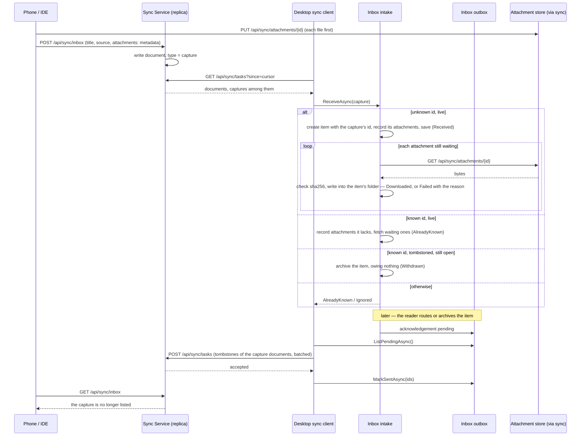
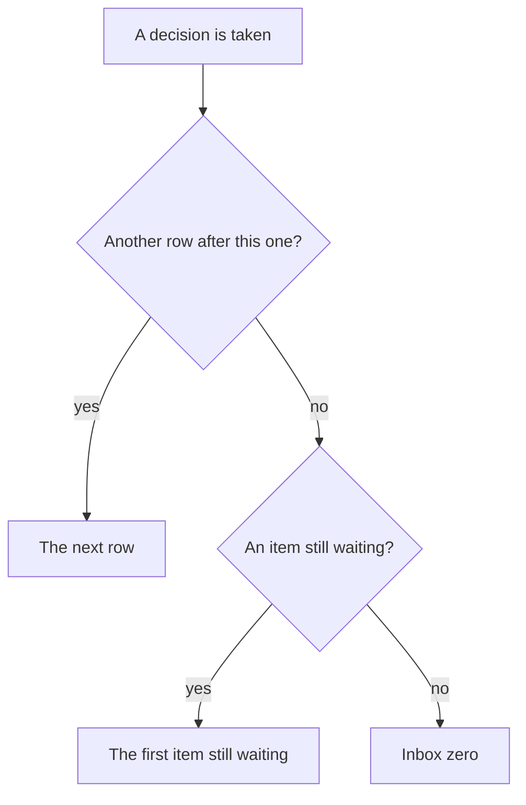
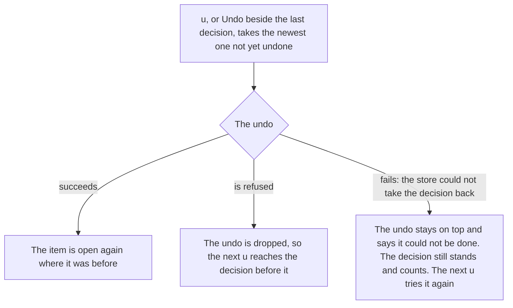
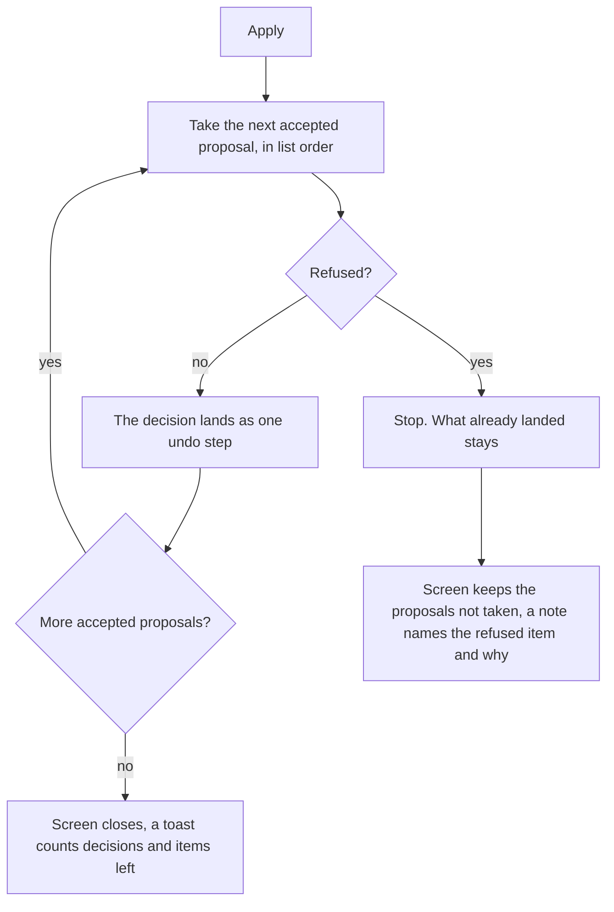
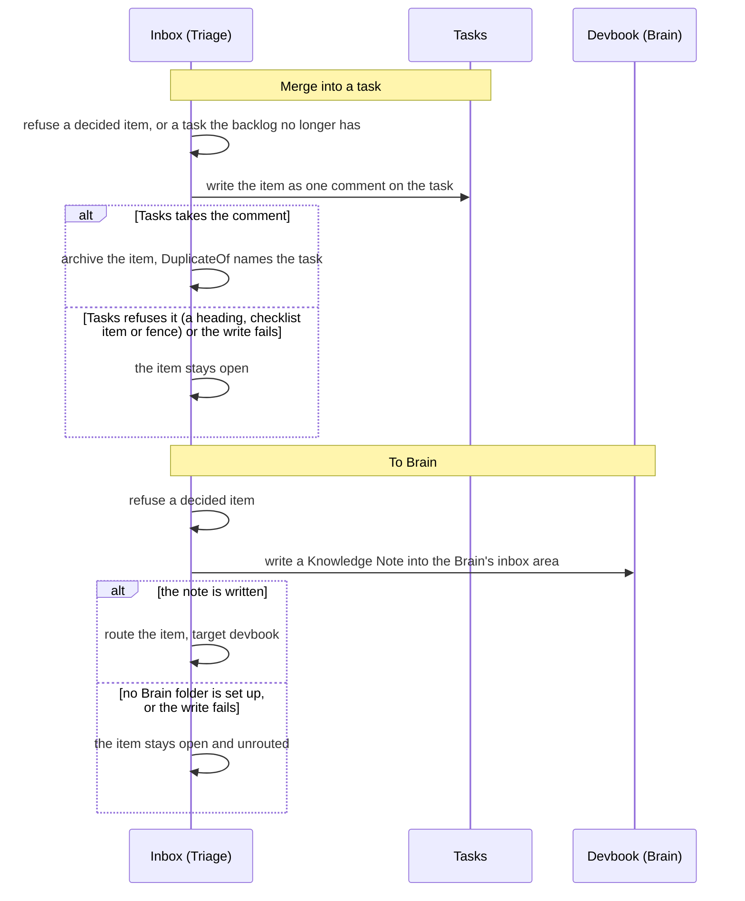
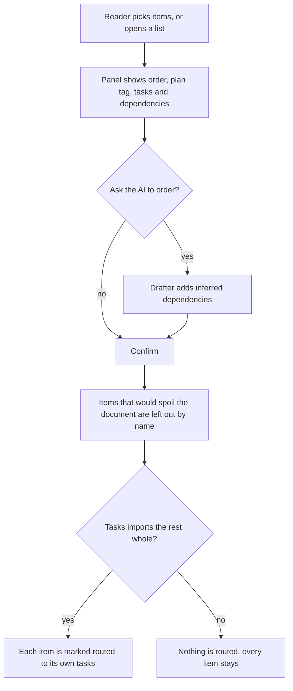
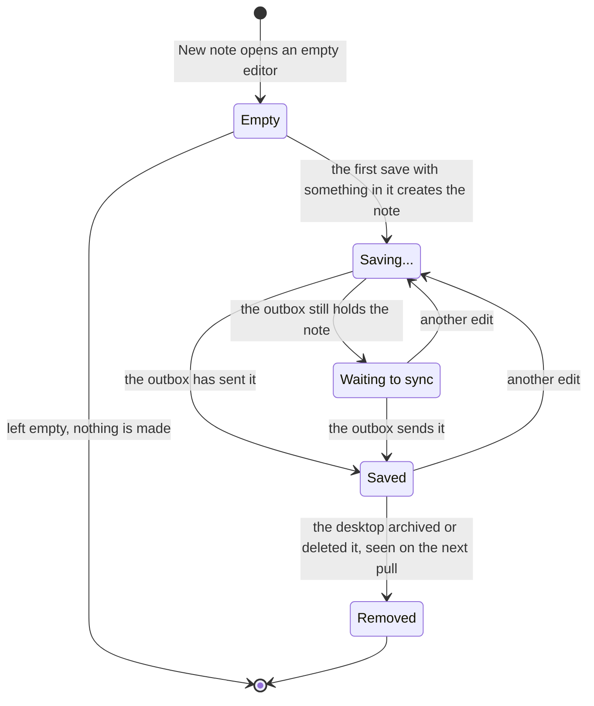

# Inbox

```meta
type: features
```

> Features and sub-features this bounded context supports, described in
> business/ubiquitous language rather than implementation terms.

## Incoming queue

```meta
type: feature
related: [.devbook/domain/capture/features.md#normalized-delivery]
feature-flag: .devbook/domain/inbox/context.md#inbox-pane
```

**Capture intake and acknowledgement**

The replica document and its `capture` kind token are
decided in `.devbook/arc42/adr/0009-captures-are-a-document-kind-on-the-replica.md`.



- The intake decides by id and status and parses no token. Every case has an
  answer and none is an error, because the caller is the sync client and an error
  would replay the page for ever. For the same reason, a file entry
  no fetch could honour is left off the item rather than thrown. A file that
  fails to download leaves the item Received.
- Only a route, archive or delete of a
  [replica-backed item](domain.md#replica-backed-item) puts an acknowledgement
  in the outbox. An item archived *because* the replica already carried a
  tombstone owes nothing.
- The acknowledgement is durable on the item, so a decision taken offline
  reaches the phone on the first push that succeeds.
- A deleted item's acknowledgement is kept beside the item store and is all
  that is left of the item. Until it is sent, a replay of the capture is
  `AlreadyKnown` rather than a new item.
- The desktop's own tombstone, its [sync echo](domain.md#sync-echo), comes back
  on the next pull as a known id it has already decided on: `AlreadyKnown`,
  nothing written. A second desktop still holding the item open archives it
  instead.
- The phone's own "Triage" acknowledges the same way: the service tombstones the
  capture document.

Receive normalized Inbox Items from all Capture sources into a single shared
queue. New items default to `unprocessed` and are read newest first by capture
timestamp. Every row leads with its `Content Kind` and its `Source`, so the
reader sees what a thing is and who sent it before deciding on it. The selected
item opens in a detail view shaped by its kind.

The rows are grouped by the day they were captured: **Today**, **Yesterday**,
then the date ("Thu 10 Sep", with the year when it is not this one), each
heading with its count. A day with no rows has no heading. On the desktop the Inbox takes the whole screen in place of
the main view. It has three columns: the side menu, the rows, and the detail of
the chosen item.

**Deferred** is the one [slice](domain.md#slice) without day
headings. Its rows run in the order they come back, soonest review date first.

A row is a tile with:

- the kind's mark;
- the title;
- a line saying what kind of thing it is and where it came from ("Article · Web
  clipper");
- how long ago it arrived.

A row whose item has a [suggestion](#classification-and-enrichment)
the reader can take says **suggested** under its age. Tags and
repositories are shown in the detail, not on the row.

### Add by hand

```meta
type: sub-feature
related: [.devbook/domain/inbox/domain.md#capture-source, .devbook/domain/capture/domain.md#capture-source, .devbook/domain/capture/features.md#run-capture-now, .devbook/domain/inbox/requirements.md#columns]
feature-flag: .devbook/domain/inbox/context.md#inbox-pane
tests: [unit:dotnet:Backlog.Modules.Inbox.UnitTests.CaptureItemTests]
```

The queue's header offers two ways in. The **capture field** is for a thing the
reader has in their head right now. **Capture now** runs the watched sources,
and the **Sources** button beside it opens them
([Run capture now](../capture/features.md#run-capture-now)).

The capture field sits in the header, always open:

- **Enter** files what is typed as the title.
- **Shift+Enter** opens a notes editor under the field.
- **Ctrl+Enter** files the title and the notes together.
- **Escape** closes the notes editor.

It asks only for a title and optional notes, because a field that asked where
the item goes would ask for triage before the item exists. While the notes are
open, Enter files the notes with the title too, so nothing written under it is
dropped. Escape discards the notes with the editor, so notes nobody can see are
never filed with the next Enter. A capture that fails leaves the title in the
field to try again.

The result is a [Capture (manual)](domain.md#capture-manual), captured and
received at the same instant. It lands unfiled in the queue and opens in the
detail beside it. It needs no paired device, which makes it the offline path and
the way an inbox is seeded without a phone.

### Capture attachments

```meta
type: sub-feature
related: [.devbook/domain/inbox/requirements.md#capture-attachments, .devbook/domain/inbox/domain.md#attachment, .devbook/domain/inbox/domain.md#attachment-folder, .devbook/arc42/adr/0014-attachments-travel-through-a-blob-store-beside-the-replica.md]
feature-flag: .devbook/domain/inbox/context.md#inbox-pane
tests: [unit:dotnet:Backlog.Modules.Inbox.UnitTests.AttachmentIntakeTests, unit:dotnet:Backlog.Infrastructure.FileSystem.UnitTests.InboxBacklogTargetTests.A_plans_task_entries_carry_the_items_attachment_folder, unit:dotnet:Backlog.Desktop.UI.UnitTests.InboxPaneTests.A_captured_picture_is_a_thumbnail_and_a_captured_file_is_a_row_with_open, unit:dotnet:Backlog.Desktop.UI.UnitTests.InboxPaneTests.Clicking_a_picture_previews_it_in_the_app_and_open_in_external_app_hands_it_over, unit:dotnet:Backlog.Desktop.UI.UnitTests.InboxPaneTests.A_file_that_failed_to_download_shows_why_and_retry_brings_it_down, unit:dotnet:Backlog.Desktop.UI.UnitTests.InboxPaneTests.A_file_not_fetched_yet_says_it_is_waiting_and_a_picture_not_on_disk_is_a_row]
```

A thought captured on the phone often comes with a photo, a screenshot or a
PDF. The reader sees it on the desktop while deciding what to do with
the item.

The item arrives first with the list of files the
capture named, and the desktop then downloads each file into the item's
[attachment folder](domain.md#attachment-folder). A file that cannot be
downloaded does not hold up the capture or the rest of the sync. The item still
lands, and the file shows why it did not arrive. Its **Retry** tries it again.

In the detail view, pictures show as thumbnails above the body. Clicking one
previews the picture inside the app, and the preview's **Open in external
app** hands it to the system viewer. Every other file shows as a row with its size and an **Open**
action. A file still on its way reads *Waiting to download*. An item whose
only content is pictures reads as an `image` in the queue, and an item with any
other file reads as a `document`.

When the item is routed to Tasks, every task it becomes carries its attachment
folder as its attachment. Create plan hands it on the same way, and the
drafter itself never sees it.

### Organise into lists and groups

```meta
type: sub-feature
related: [.devbook/domain/inbox/domain.md#inbox-list, .devbook/domain/inbox/domain.md#inbox-group]
feature-flag: .devbook/domain/inbox/context.md#inbox-pane
tests: [unit:dotnet:Backlog.Modules.Inbox.UnitTests.OrganizerTests]
```

A side menu beside the queue holds a fixed **Inbox** entry for what is unfiled
and a fixed **Deferred** entry for what was put aside (see [Defer](#defer)).
The reader's own groups and lists follow, each with a count of the items still
waiting in it. Lists and groups are created, renamed, moved between groups, ungrouped and
deleted in place, from the menu itself. Deleting a list returns its items to the
inbox. They are the reader's own, local to the machine and never synced, and a
fresh workspace is seeded once with a default set.

### Filter by content kind

```meta
type: sub-feature
related: [.devbook/domain/inbox/domain.md#content-kind, .devbook/domain/inbox/requirements.md#columns]
feature-flag: .devbook/domain/inbox/context.md#inbox-pane
```

A row of pills sits over the rows. **All** leads it with the slice's count, then
one pill per `Content Kind` present in the slice, each with its count.
Toggling kind pills narrows the rows to those kinds; **All** clears them and is
the pressed pill while no kind is. The pills are a lens over a list, never a
place an item goes.

## Triage workflow

```meta
type: feature
depends-on: [.devbook/domain/inbox/features.md#incoming-queue]
```

Review unprocessed items one by one or in batch and take an action per item.

### Per-item triage actions

```meta
type: sub-feature
related: [.devbook/domain/inbox/requirements.md#columns, .devbook/domain/inbox/requirements.md#clarify-outcomes, .devbook/arc42/adr/0054-clarify-outcomes-follow-gtd-and-each-item-has-one-home.md]
```

The reader routes an item to Tasks or To Brain, defers, archives or deletes
it. Along the way the reader may tag it, assign repositories and annotate it.
The original source link and capture timestamp are kept whatever is decided.

Each decision is one outcome of the GTD clarify step, and each item ends in one
home (local ADR 0054): the Inbox lets it go, the Brain keeps what is not
actionable, and the backlog holds every commitment.

| Decision | Key | Outcome |
| --- | --- | --- |
| Archive | **a** | Trash, kept findable |
| Delete | — | Trash |
| To Brain | **b** | Reference, filed where the destination picker points |
| Defer | **d** | The tickler: back on its review date |
| Someday | **s** | A note in the Brain's `someday` area |
| Done now | **n** | A task created already ticked |
| Waiting for | **w** | A task with a [waiting-for](../tasks/domain.md#waiting-for) |
| Move to backlog | **r** | A task, optionally with a due date or in My Day |
| Create plan | — | A plan |
| Merge | — | A comment on a task already tracked |

Someday, Done now and Waiting for, the destination picker, and the due date or
My Day on Move to backlog are decided in local ADR 0054 and not yet built.

The decisions sit in a bar fixed at the foot of the detail, each naming its
key: **Move to backlog**, **To Brain**, **Move to list**, **Defer** and
**Archive**. The bar stays in place while the detail scrolls. Delete, tags and
repositories stay in the detail itself, because they are not the decision the
item is waiting for.

### Act on several at once

```meta
type: sub-feature
related: [.devbook/domain/tasks/features.md#bulk-editing, .devbook/domain/inbox/requirements.md#act-on-several-at-once, .devbook/domain/inbox/features.md#filter-by-content-kind]
feature-flag: .devbook/domain/inbox/context.md#inbox-pane
tests: [unit:dotnet:Backlog.Modules.Inbox.UnitTests.BatchTests, unit:dotnet:Backlog.Desktop.UI.UnitTests.InboxPaneTests]
```

Acting on several items mirrors [bulk editing](../tasks/features.md#bulk-editing) in the Tasks pane.
Captures that belong in the same place are handled at once instead of item by
item, and the two panes pick things the same way:

- **Select** puts a box beside every row of the open [slice](domain.md#slice).
- Shift extends a run from the last box pressed.
- A bar over the list keeps a running count of what is picked. It holds a box
  that takes every row shown, and a way back out.

Five acts are offered across the selection:

- **Archive**;
- **Move to list**;
- **Tags**, which adds tags or takes one tag off;
- **Repositories**;
- **Move to backlog**, which routes the selection as one
  [batch](#route-a-batch-to-tasks).

Each of the first four is the same decision the item's own detail makes,
applied to each picked item in turn. So an item the single-item act would
refuse is refused here too. Tags are added to what each item already carries.
Repositories replace what each item targeted before. An item already at the
value is left alone. The tags and repositories of an item already routed or
archived are what that decision was made with, so they are not changed.

Picking a set is separate from choosing the item the detail shows.

### Quick-triage shortcuts

```meta
type: sub-feature
related: [.devbook/domain/inbox/requirements.md#triage-from-the-keyboard, .devbook/design/accessibility.md#keyboard-navigation, .devbook/domain/inbox/requirements.md#clarify-outcomes]
feature-flag: .devbook/domain/inbox/context.md#inbox-pane
tests: [unit:dotnet:Backlog.Desktop.UI.UnitTests.InboxKeyboardTriageTests]
```

With the Inbox pane in use, a triage session runs from the keyboard:

| Key | Act |
|---|---|
| **j** / **k** | Next / previous row |
| **a** | Archive |
| **d** | Offer review dates to defer to: tomorrow, next week, next month, or no date |
| **l** | Open Move to list |
| **r** | Move the item to the backlog |
| **b** | Route it [To Brain](#route-to-brain) |
| **s** | Route it [Someday](#route-to-brain), into the Brain's `someday` area |
| **n** | Done now: route it to a task created already ticked |
| **w** | Waiting for: route it to a task that waits on someone |
| **g** | Go to its tags |
| **x** | Pick it for an [act on several at once](#act-on-several-at-once) |
| **t** | Start [triage mode](#triage-mode), as the header's **Start triage** button does |
| **u** | Undo the latest decision of the session ([Undo a decision](#undo-a-decision)) |
| **?** | Open the **Shortcuts** dialog |
| **Escape** | Leave the mode the reader is in |

**s**, **n** and **w** are decided in local ADR 0054 and not yet built.

The Tasks pane binds no letters, so **Escape** is the one key the two panes
share. A key offers only the acts the item's detail offers: a routed or
archived item is not archived again from the keyboard.

A key pressed while typing is typing. A letter is left to what it was pressed in
when it is pressed:

- in a field;
- anywhere inside a dialog;
- with Ctrl, Alt or Meta held;
- while the focus is in another pane.

The browser decides this as the key goes down, because a decision made on the
server arrives one key late.

The **Shortcuts** dialog in the pane's header lists the keys, and the buttons
they stand for name them in their titles.

### Triage mode

```meta
type: sub-feature
depends-on: [.devbook/domain/inbox/features.md#quick-triage-shortcuts]
related: [.devbook/domain/inbox/requirements.md#triage-from-the-keyboard, .devbook/domain/inbox/features.md#ai-triage-cards, .devbook/domain/inbox/features.md#undo-a-decision, .devbook/domain/inbox/features.md#inbox-zero]
feature-flag: .devbook/domain/inbox/context.md#inbox-pane
tests: [unit:dotnet:Backlog.Desktop.UI.UnitTests.InboxKeyboardTriageTests, unit:dotnet:Backlog.Desktop.UI.UnitTests.InboxTriageModeTests]
```



**Start triage** in the header, or **t**, shows one item at a time, full width.
From the top down the screen holds:

- **Progress.** **Back to the list** (**Esc**), a bar, and beside it the line
  "n of total · m decided this session". The line says where the item stands
  among the rows of the slice still open when triage first saw them. It also
  counts the decisions the reader has taken since the app opened. A row already moved
  to the backlog is stepped over and not counted. The bar fills with the rows
  decided since triage began, and an item that arrives during triage is counted
  after those rows. Previous (**k**) and **Skip** (**j**) step without deciding.
- **The item**: its kind, its source and when it was captured, then its title,
  notes and tags. The tags are the field **g** goes to.
- **AI cards**, up to two, numbered **1** and **2** — see [AI triage
  cards](#ai-triage-cards). The rule-based suggestions follow, numbered after
  them. With no AI card shown, the suggestions are numbered from 1.
- **Move to backlog in**: a repository picker with one box per configured
  repository, each with its [identity
  edge](../../design/color-scheme.md#the-identity-edge). The boxes start from
  the repositories the AI card answer named, marked **AI**, else from the
  item's own; ticking one writes the item's repositories. The hint says what
  **r** makes: "one entry", "n linked entries", or "one entry, in the Brain". With no
  repository ticked, the pickers read **Brain**, where the entry is filed.
  More than one makes one linked task per repository ([Route to Tasks](#route-to-tasks)).
- **The decisions** as large buttons, each naming its key: Move to
  backlog (**r**), To Brain (**b**), Move to list (**l**), Defer (**d**) and Archive (**a**).
  Local ADR 0054 adds Someday (**s**), Done now (**n**) and Waiting for (**w**),
  and a due date or My Day beside Move to backlog; they are not yet built.

Beside the item an **Up next** list shows the next four items in the order
triage will show them. Under it, **Just decided** shows the session's last
decision as "*title* → *what became of it*", with **Undo** (**u**).

The decisions that move on are archive, defer, move to a list, move to the
backlog and merge into a task, and once built Someday, Done now and Waiting for. A reader who skipped items with **j** finds them
again past the last row, and [Inbox zero](#inbox-zero) follows when none is left.
Tags and repositories are not decisions and leave the reader where they are. Escape, or
**Back to the list**, returns to the rows on the item the session stopped at.

### AI triage cards

```meta
type: sub-feature
depends-on: [.devbook/domain/inbox/features.md#triage-mode]
related: [.devbook/arc42/adr/0023-inbox-items-may-be-read-by-the-foundry-model.md, .devbook/domain/inbox/requirements.md#ai-triage, .devbook/domain/inbox/features.md#merge-into-a-task, .devbook/domain/inbox/features.md#route-a-batch-to-tasks]
feature-flag: .devbook/domain/inbox/context.md#inbox-pane
tests: [unit:dotnet:Backlog.Desktop.UI.UnitTests.InboxTriageModeTests, unit:dotnet:Backlog.Desktop.UI.UnitTests.InboxTriageAdviceStateTests]
```

When the reader opens an item in triage, the Azure Foundry model reads it
against the open backlog and the rest of the inbox. Triage shows what it
noticed as at most two cards, under the heading **AI noticed**.
`.devbook/arc42/adr/0023-inbox-items-may-be-read-by-the-foundry-model.md`
settles what is sent, and when.

- **Probably a duplicate.** The open backlog task, or the other unprocessed
  capture, this item seems to repeat, with the reason in a few words, both
  shown side by side. Its main act is **Merge into the entry** ([Merge into a
  task](#merge-into-a-task)); for another capture it is **Archive as a
  duplicate**. When another unprocessed capture also matches the item, it is
  shown too, and **Merge all three** folds both captures into the task as one
  decision. **Compare** opens the two side by side; **Not a duplicate** turns
  the card down.
- **Group into a plan.** A plan name, and the other unprocessed captures that
  belong with this one, with the reason. Its main act, **Make the plan**, opens
  the [batch](#route-a-batch-to-tasks) panel on the item and those captures.
  **Dismiss** turns the card down. **Add to an existing plan…** is planned,
  not yet built, and shows disabled until Tasks lists its plans to the Inbox
  through a port. Picking one will tag the item and those captures with that
  plan's `+tag`.

The model is asked once per item per app session. **Ask again**, in the AI
section, would ask again for the item shown and replace the cards; it is
planned, not yet built.

A card shown is numbered **1**, or **2** when both are, and is taken with its
number key, as a suggestion is. The rule-based suggestions are numbered after
the cards. A card the model has nothing to say about is not shown.

When Foundry is not configured or the call fails, no card is shown.

### Merge into a task

```meta
type: sub-feature
depends-on: [.devbook/domain/inbox/features.md#ai-triage-cards]
related: [.devbook/domain/inbox/requirements.md#merge-into-a-task, .devbook/domain/inbox/features.md#archive, .devbook/domain/tasks/features.md#task-creation]
feature-flag: .devbook/domain/inbox/context.md#inbox-pane
```

A capture that repeats a task already in the backlog is folded into that task
rather than filed a second time. The capture's title, link and notes are added
to the task as a comment. The capture is archived as a duplicate: its
`DuplicateOf` names the task. The task keeps everything it had.
Merging is a decision of the session and can be undone ([Undo a
decision](#undo-a-decision)).

### Undo a decision

```meta
type: sub-feature
related: [.devbook/domain/inbox/requirements.md#undo-a-decision, .devbook/domain/inbox/features.md#triage-mode]
feature-flag: .devbook/domain/inbox/context.md#inbox-pane
tests: [unit:dotnet:Backlog.Desktop.UI.UnitTests.InboxUndoTests, integration:dotnet:Backlog.Desktop.UI.UnitTests.UndoOutlastsSyncEchoTests]
```



Every decision taken in this session can be taken back, newest first, until the
app closes:

- archive;
- defer;
- move to a list;
- move to the backlog;
- merge into a task;
- To Brain.

Two decisions reach outside the Inbox, and undoing them is bounded by that:

- **Move to backlog.** Undo deletes the tasks the move made, but only while
  none of them has started. Once one has, the undo is refused with a sentence
  that names the started task, and nothing changes.
- **Merge into a task.** Undo restores the capture as it was. The comment stays
  on the task, because by then it may have been read or answered.

**Link to task** and **Archive as duplicate** are decisions too and are taken
back the same way. Undoing a link leaves the task it named alone. A bulk act
over several items (a bulk archive, a bulk move, or a batch route with the
duplicates it merged) is one decision to undo and brings every item back at once.

In a bulk act, only the items that failed stay on top. The sentence says what
was refused, what failed and how many items came back.

An undo outlasts the decision's [sync echo](domain.md#sync-echo), even one a
pull delivers days later. [Undo and a returning tombstone](domain.md#inbox-item)
shows the timing. Archiving or moving a capture from the phone sends the replica an
acknowledgement. The item stays open, because that acknowledgement is older than
the undo. A dismissal that the phone or another desktop makes after the undo still
closes the item.

Decisions are not remembered past the app: change an earlier session's decision
by deciding again.

### Inbox zero

```meta
type: sub-feature
related: [.devbook/domain/inbox/requirements.md#inbox-zero, .devbook/domain/inbox/features.md#defer]
feature-flag: .devbook/domain/inbox/context.md#inbox-pane
```

The pane reports the session when nothing in the unfiled Inbox is still
waiting and this session has decided something. It says the inbox is clear and
shows what the session did in place of the list and the detail; the side menu
stays. The report holds:

- how many items the session decided, and its count per decision: moved to
  backlog, filed in lists, deferred, archived, merged. A kind with no
  decisions is left out. A link to a task counts in the total only, because it
  leaves the item where it was;
- **Coming back**: the deferred items whose review date is set, soonest first,
  at most five. Each says when it comes back: today, tomorrow, a weekday
  within the week, else the date;
- **Open *list* · *n***, the list with the most items still waiting, left out
  when no list has any, and **Open Deferred**.

The counts are the undo history's, so a decision taken back stops counting, and
undoing the last one brings the item back into the list. With no decision this
session the plain first-use empty state stays. A list, or Deferred, that is empty
shows its own empty state.

### AI triage pass

```meta
type: sub-feature
depends-on: [.devbook/domain/inbox/features.md#ai-triage-cards]
related: [.devbook/arc42/adr/0023-inbox-items-may-be-read-by-the-foundry-model.md, .devbook/domain/inbox/requirements.md#ai-triage-pass, .devbook/domain/inbox/features.md#route-a-batch-to-tasks, .devbook/domain/inbox/features.md#merge-into-a-task, .devbook/domain/inbox/features.md#undo-a-decision]
feature-flag: .devbook/domain/inbox/context.md#inbox-pane
tests: [unit:dotnet:Backlog.Modules.Inbox.UnitTests.TriagePassApplyTests, unit:dotnet:Backlog.Desktop.UI.UnitTests.InboxTriagePassTests, unit:dotnet:Backlog.Desktop.UI.UnitTests.InboxTriagePassDraftTests]
```

**AI triage pass Apply**

How **Apply** takes the accepted proposals of the
[AI triage pass](features.md#ai-triage-pass).



- A plan that routed only some of its members leaves the screen, and its
  members still waiting are left for the reader.

**Let AI propose the rest**, in triage's header, asks the model to read every
unprocessed item of the slice against the backlog at once. It opens a review
screen of what the model proposes, in place of the item being triaged. The
button is drawn only when Foundry is configured. While the model reads, it says
how many items it is reading. A failed pass is one sentence under the header,
and triage carries on beneath it.

The screen groups the proposals:

- **Plans to make**: items that belong together, to go to the backlog as one
  batch. Each shows a plan name, the members, the repositories, and the
  [plan tag](domain.md#plan-tag) it will carry, minted on Apply. **Edit plan**
  renames it or leaves a member out. A plan left with one member is not
  applied.
- **Likely duplicates**: an item and the open task or capture it repeats, side
  by side, with a choice of acts. For a task: merge into the entry, keep both,
  or archive the capture. For another capture: keep that one and archive this
  one as its duplicate, or keep both.
- **Move to backlog on their own**: single routes, each with the entry type the
  model reads it as and its repositories.
- **The rest**: items to file, one row per list, and items to archive. Each row
  is accepted as a whole, and **Show** opens it to accept them one by one. The
  items the model could not place are **Left for you**, with **Triage them**.

Every proposal carries its reason, and a toggle accepts it or not. A duplicate
is accepted by its choice, and **Keep both** is the unaccepted one. A proposal
below confidence 0.6 starts unaccepted, and the rest start accepted. The header
counts "*accepted* of *total* accepted" and names what Apply will do, "Apply *n*
decisions".

Nothing changes until **Apply**. **Discard**, **Back** and Esc leave
the screen for triage and change nothing. While the screen is open, the
decision keys act on no item.

**Apply** takes every accepted proposal as the decision it names, in the order
the screen lists them:

- a plan, through the batch route with a plan tag of its own;
- a duplicate, through merge into a task or archive as a duplicate;
- a single route, by writing its repositories to the item and moving it to the
  backlog;
- a filing or an archive, through its own act.

[AI triage pass Apply](features.md#ai-triage-pass) shows what happens when a
decision is refused. Each decision lands as one step of the
[undo history](#undo-a-decision), so **u** takes them back newest first. A pass
with nothing to propose opens no screen and says so under triage's header.
**Triage them** puts the pass away and opens triage on the first item left for
the reader.

The entry type a single route shows is the model's reading only: the route makes
the entries Move to backlog makes.

## Classification and enrichment

```meta
type: feature
related: [.devbook/domain/inbox/requirements.md#classification-and-enrichment, .devbook/domain/inbox/domain.md#classification]
feature-flag: .devbook/domain/inbox/context.md#inbox-pane
setting: .devbook/domain/inbox/context.md#inbox-routing-rules
tests: [unit:dotnet:Backlog.Modules.Inbox.UnitTests.SuggestionTests, unit:dotnet:Backlog.Desktop.UI.UnitTests.InboxPaneTests]
```

Read what an item is and propose where it goes, so triage starts from a
proposal. Nothing here is applied without the reader.

On intake, the item's `Content Kind` and source link are read from the
captured text, or from its attachments when it has any.

While an item is open, the detail shows a **Suggested** row above the pickers.
It holds up to three kinds of proposal:

- **Tags.** A `#word` written in the title or the body. Also any tag the
  backlog already files entries under that the text mentions as a whole word.
  The backlog's spelling is used, so the same tag is not spelled two ways. At
  most five tag chips are shown.
- **Repositories.** Every repository whose
  [routing rule](context.md#inbox-routing-rules) the item matches. A tag rule
  reads the tags the item carries, not the ones only suggested, so taking a
  suggested tag can bring its rule's repository onto the row.
- **One destination.**
  - *Archive* for a newsletter: the item offers to unsubscribe.
  - *Move to backlog* for an item that already has a repository, or for a note
    of the reader's own (text, code, a voice memo).
  - *Keep as knowledge* for [collected material](domain.md#collected-material).

Each suggestion is a chip with its reason on it. The reader takes a chip with
its number key (1–9, from the list or the detail but never while typing in a
field), with Enter, or with a click. Taking it does what the chip says:

- A tag chip adds the tag.
- A repository chip assigns the repository.
- *Move to backlog* routes the item.
- *Keep as knowledge* routes it [To Brain](#route-to-brain), and is offered but
  cannot be taken, with the Brain's reason, while the Brain cannot take a note.
- *Archive* archives it.

The × on a chip turns it down. A turned-down suggestion is recorded on the
item and is never offered for that item again, whatever would propose it
next. A routed or archived item is offered nothing.

Enriching an item with links to related tasks or knowledge notes is modelled
and not built.

These suggestions are rules, not AI, with or without a model configured. A model
may also read the item, in triage only
(`.devbook/arc42/adr/0023-inbox-items-may-be-read-by-the-foundry-model.md`).
Its proposals are the [AI triage cards](#ai-triage-cards) and the
[AI triage pass](#ai-triage-pass). In triage the suggestions are numbered after
the AI cards.

## Routing

```meta
type: feature
depends-on: [.devbook/domain/inbox/features.md#triage-workflow]
related: [.devbook/domain/tasks/features.md#task-creation, .devbook/domain/brain/features.md#knowledge-capture]
```

**Merge and To Brain**

Both decisions write into another context first and change the item only once
that write succeeded.



- Writing first means a failure never leaves an item archived against a task
  that never heard of it, or routed to a note that was never written.

**Batch route**

Two or more items routed to Tasks together, as one plan import
([Route a batch to Tasks](features.md#route-a-batch-to-tasks)). A single item
routes on the press, without the panel.



- A loop among the dependencies holds Confirm until a switch breaks it, and
  Confirm waits while an ask is out.

Routing is the terminal outcome of triage and happens exactly once.

### Route to Tasks

```meta
type: sub-feature
related: [.devbook/domain/tasks/features.md#task-creation, .devbook/domain/inbox/domain.md#itemtriaged, .devbook/domain/inbox/domain.md#attachment-folder, .devbook/domain/inbox/requirements.md#route-to-tasks, .devbook/domain/tasks/domain.md#waiting-for, .devbook/arc42/adr/0054-clarify-outcomes-follow-gtd-and-each-item-has-one-home.md]
tests: [unit:dotnet:Backlog.Modules.Inbox.UnitTests.RouteToBacklogTests, unit:dotnet:Backlog.Modules.Inbox.UnitTests.AttachmentIntakeTests.Routing_hands_the_items_folder_to_the_task_as_its_attachment]
```

Create one draft task per repository assigned to the item, or a single
untargeted task when none is. Each task carries the item's id as its
provenance and the item's attachment folder as its attachment. The **Move to
backlog** button (**r**) takes this route. The item records the tasks it became
and is routed exactly once. A failure on the Tasks side leaves it unrouted.

An item assigned to several repositories makes one task per repository, and the
tasks are siblings that know about each other. Each sibling's
body carries the line "Same capture in: <repository> — <title>" for every other
sibling, naming each by its repository id. All of them share the general tag
`#from-inbox-` followed by the last eight hex digits of the item's id. A single
task needs neither. The lines come before the item's notes, so notes ending in a
chapter or an open code block cannot take them in. A batch links the siblings of
each of its items the same way.

Local ADR 0054 adds three variants of this route, not yet built. Each routes the
item once, and a failure on the Tasks side leaves it open:

- **Move to backlog with a date.** Triage may set the task's
  [due date](../tasks/domain.md#due-date) or put it in
  [My Day](../tasks/domain.md#my-day) in the same step.
- **Done now (n).** The task is created already ticked, `completed:` today: the
  two-minute rule.
- **Waiting for (w).** The task is created with a
  [waiting-for](../tasks/domain.md#waiting-for): who it waits on, and an
  optional follow-up date.

### Create plan from an item

```meta
type: sub-feature
depends-on: [.devbook/domain/inbox/features.md#route-to-tasks]
related: [.devbook/domain/tasks/features.md#import, .devbook/arc42/adr/0007-import-reuses-the-entry-text-grammar.md]
tests: [unit:dotnet:Backlog.Modules.Inbox.UnitTests.CreatePlanTests]
```

Ask an AI drafter for an import plan about the item and bring it into the
backlog through the ordinary plan import
(`.devbook/arc42/adr/0007-import-reuses-the-entry-text-grammar.md`). The plan's
entries land as Draft, whatever the drafter wrote, because nobody has read them
yet. They share a [plan tag](domain.md#plan-tag) unique to the item, so two items with one title never clear each other's plan. The plan may
name only the repositories the item was assigned, and a plan that names another
is refused whole. The item is routed to the entries the import created, the same
outcome as Route to Tasks. When no drafter is configured the action stays
visible, disabled, with its reason.

### Route a batch to Tasks

```meta
type: sub-feature
depends-on: [.devbook/domain/inbox/features.md#route-to-tasks, .devbook/domain/inbox/features.md#act-on-several-at-once]
related: [.devbook/domain/inbox/domain.md#batch, .devbook/domain/inbox/requirements.md#route-a-batch-to-tasks, .devbook/domain/tasks/features.md#import, .devbook/arc42/adr/0007-import-reuses-the-entry-text-grammar.md]
feature-flag: .devbook/domain/inbox/context.md#inbox-pane
tests: [unit:dotnet:Backlog.Modules.Inbox.UnitTests.RouteBatchToBacklogTests, unit:dotnet:Backlog.Infrastructure.FileSystem.UnitTests.InboxBacklogTargetTests, unit:dotnet:Backlog.Desktop.UI.UnitTests.InboxPaneTests]
```

A [batch](domain.md#batch) of captures that belong together lands in the
backlog as one plan ([Batch route](features.md#routing)). A batch is formed in two ways:

- **Move to backlog** in the selection bar routes the picked items.
- **Move list to backlog** in the list's toolbar routes every open item of the
  list the reader has open. A confirmation first gives the count and the
  [plan tag](domain.md#plan-tag). The list stays, and routed items leave it.
  Its deferred items stay with it, and the confirmation says so when there are
  any.

Each item becomes what Route to Tasks would make of it, carrying the item's id as
its provenance and its files as the task's attachment. All the entries share the
batch's plan tag. Each item records only the tasks it became.

Some items are named and left out before Tasks is asked, and the rest still go:

- an item already routed or archived;
- an item whose notes carry a top-level `#` heading or an unclosed code fence,
  which would break the document apart (routed on its own, it goes through);
- an item assigned to a repository the workspace no longer knows. A batch never
  registers a repository.

Tasks' import takes the rest as one document, whole or not at all. If Tasks
refuses it, nothing is routed, every item stays in the queue, and the message
says so. Only one route runs at a time: a batch waits for a single route to
finish, and a single route waits for a batch.

An item whose entries were made but which could not then be marked routed is
named along with those entries. The reader then need not route it again and
duplicate them.

[Before you route](#before-you-route) settles which item waits on which.

### Before you route

```meta
type: sub-feature
depends-on: [.devbook/domain/inbox/features.md#route-a-batch-to-tasks]
related: [.devbook/domain/inbox/domain.md#dependency-tier, .devbook/domain/inbox/domain.md#batch, .devbook/domain/tasks/features.md#import]
feature-flag: .devbook/domain/inbox/context.md#inbox-pane
tests: [unit:dotnet:Backlog.Modules.Inbox.UnitTests.ProposeBatchTests, unit:dotnet:Backlog.Modules.Inbox.UnitTests.DependencyProposalTests, unit:dotnet:Backlog.Modules.Inbox.UnitTests.InboxBatchOrderTests, unit:dotnet:Backlog.Desktop.UI.UnitTests.InboxRouteDraftTests, unit:dotnet:Backlog.Desktop.UI.UnitTests.InboxPaneTests, unit:dotnet:Backlog.Infrastructure.FileSystem.UnitTests.InboxBatchDependencyImportTests]
```

Routing two or more items opens a panel that shows what the batch would do
before it does it:

- the order the items go in;
- the plan tag and the task count;
- the repositories per item, or one choice for all;
- the items that will not go, and why;
- the dependencies the Inbox can see.

Each dependency is a switch, on by default, that puts one item after another
item of the batch or after an open task already in the backlog. The
[stated](domain.md#dependency-tier) ones are always proposed, and each switch
quotes the text that names the other thing. A person turns off any that are
wrong. A loop is named and holds Confirm until a switch breaks it. Confirm
routes the batch once, writing the switches left on as `after:` tokens.
Cancel changes nothing.

### Order a batch with the drafter

```meta
type: sub-feature
depends-on: [.devbook/domain/inbox/features.md#before-you-route, .devbook/domain/inbox/features.md#create-plan-from-an-item]
related: [.devbook/domain/inbox/domain.md#dependency-tier, .devbook/domain/inbox/requirements.md#order-a-batch-with-the-drafter, .devbook/arc42/adr/0007-import-reuses-the-entry-text-grammar.md]
feature-flag: .devbook/domain/inbox/context.md#inbox-pane
tests: [unit:dotnet:Backlog.Modules.Inbox.UnitTests.InferBatchOrderTests, unit:dotnet:Backlog.Desktop.UI.UnitTests.InboxRouteDraftTests, unit:dotnet:Backlog.Desktop.UI.UnitTests.InboxPaneTests, unit:dotnet:Backlog.Infrastructure.FileSystem.UnitTests.InboxBacklogTargetTests]
```

**Ask the AI to order** in the panel asks the plan drafter which item of the
batch waits on which. It is opt-in per batch, one model call per press, because
every ask costs one. When no drafter is configured the button stays visible,
disabled, titled with the drafter's reason, as Create plan does.

The drafter is the one Create plan uses, handed the whole batch. It answers in
the import grammar
(`.devbook/arc42/adr/0007-import-reuses-the-entry-text-grammar.md`): one entry
per item, whose `id:` is the item's id and whose `after:` tokens are its
reading of the order. The answer is only read, never imported. It is refused
whole, and no dependency is offered, when it names:

- a repository none of the batch's items goes to, the rule a drafted plan is
  held to;
- an entry or an `after:` that is not one of the batch's items.

What it reads becomes [inferred](domain.md#dependency-tier) dependencies,
between two items of the batch only, added to the panel as switches marked
AI-inferred and on by default. One the panel already shows between the same two
items is not added again. A person turns off any that are wrong; a loop still
holds Confirm, and Confirm waits while the ask is out. A refused or failed ask
says why in the panel and adds nothing. Confirm routes the batch as it would
without the ask.

### Route to Brain

```meta
type: sub-feature
aliases: [Route to Devbook, To Brain]
related: [.devbook/domain/brain/features.md#knowledge-capture, .devbook/domain/brain/features.md#capture-into-the-brain, .devbook/domain/inbox/requirements.md#route-to-brain, .devbook/arc42/adr/0054-clarify-outcomes-follow-gtd-and-each-item-has-one-home.md, .devbook/arc42/adr/0026-the-brain-is-a-personal-devbook-outside-any-repository.md, .devbook/arc42/adr/0025-notes-ride-the-task-feed.md]
feature-flag: .devbook/domain/inbox/context.md#inbox-pane
tests: [unit:dotnet:Backlog.Modules.Inbox.UnitTests.RouteToBrainTests, unit:dotnet:Backlog.Infrastructure.FileSystem.UnitTests.InboxBrainTargetTests, unit:dotnet:Backlog.Desktop.UI.UnitTests.InboxToBrainTests, unit:dotnet:Backlog.Infrastructure.FileSystem.UnitTests.BrainNoteWriterTests.Routing_the_same_item_again_reuses_the_untouched_note_it_wrote, unit:dotnet:Backlog.Infrastructure.Devbook.UnitTests.BrainNoteDestinationsTests, unit:dotnet:Backlog.Modules.Inbox.UnitTests.SuggestionTests.Keep_as_knowledge_says_why_it_cannot_be_taken_while_no_brain_is_set]
```

**To Brain** writes the item into the person's
[Brain](../brain/domain.md#brain) as a new note in the area its destination
picker names, keeping its title and its body. The picker starts on the Brain's
inbox area, under the default [PARA](../brain/domain.md#para-category) areas
the `_inbox` folder. It is the route for [collected material](domain.md#collected-material),
a capture the reader wants to keep rather than act on. It also takes an Inbox
[note](domain.md#note) the reader has finished with on the phone.

It ends the item's triage as Route to Tasks does: the item is routed, once, and
leaves the queue. What it writes is a Brain note, which does not reach the
phone ([Note](domain.md#note) says why). A note routed To Brain stays on the
phone as the Inbox note it was. The item's text is written as text, never as
structure, and a capture that came from a link keeps the link as the note's last
line. With no Brain folder set up the route says so, in the Brain's own words,
and routes nothing.

**To Brain** sits beside Move to backlog in triage and in the item's detail,
and **b** takes it. Taking the *Keep as knowledge* suggestion files the item
into the inbox area at once, without the picker.

The button and **b** open the destination picker (local ADR 0054). It lists the
Brain's [areas](../brain/domain.md#para-category) in tab order, and after the
`projects` area each note under it. The inbox area is first and has the focus.
**Enter** takes the row under the cursor, and **b** again takes the inbox area,
so **b b** files the item where To Brain always did. A note filed into a project
goes beside the project's note: `projects/` for `projects/sync-rewrite.md`,
`projects/launch/` for `projects/launch/brief.md`.

The Brain may be unable to take a note: no folder is set, the folder is
missing, or the host has no Brain. Then the button is shown disabled and the
*Keep as knowledge* chip is offered but cannot be taken. Each gives the Brain's
own reason instead of being refused once pressed.

The toast names the area and the note it wrote. Undo returns the item to the queue and
leaves the note where it is, as the person's file by then. Routing the same item
To Brain again reuses that note, instead of writing a `-2` copy, while the file
still holds exactly the text the route would write. A note somebody has edited is theirs, and a second route writes a new one.
Only a route reuses: two captures in the Brain with the same words are two notes.

Local ADR 0054 also decides **Someday (s)**, not yet built: To Brain with the
`someday` area chosen, in one press. A Brain with no `someday` area offers it
disabled, with the reason.

An item is still routed once whichever destination is chosen, and the Inbox
keeps nothing of it but the record.

### Defer

```meta
type: sub-feature
related: [.devbook/domain/inbox/domain.md#inbox-item]
feature-flag: .devbook/domain/inbox/context.md#inbox-pane
tests: [unit:dotnet:Backlog.Modules.Inbox.UnitTests.DeferAndResurfaceTests, unit:dotnet:Backlog.Desktop.UI.UnitTests.InboxPaneTests.Deferring_with_a_date_moves_the_row_to_the_deferred_slice_and_counts_it_there, unit:dotnet:Backlog.Desktop.UI.UnitTests.HomeInboxWiringTests.Every_opening_of_the_inbox_runs_the_resurface_sweep]
```

Put an item aside with an optional **Review on** date from its detail. The item
leaves the Inbox and appears under the side menu's fixed
**Deferred** row. That row counts every deferred item wherever it is filed and
lists them soonest review date first, undated last. A deferred item keeps its
list and can still be archived or routed. Deferring it again changes the
date, and **Return to inbox** brings it back at once.

It comes back as unprocessed on its own when the review date is reached,
through the [resurface sweep](domain.md#resurface-sweep), and a toast says how
many came back. An item deferred with no date waits until a person returns it.

### Archive

```meta
type: sub-feature
tests: [unit:dotnet:Backlog.Modules.Inbox.UnitTests.InboxItemTests.A_routed_item_cannot_be_archived]
```

Dismiss items that are not actionable while keeping them accessible. An item
that has been routed cannot be archived, because routing is the terminal
outcome. Archiving an item that arrived through sync tells the phone to stop
offering it.

### Delete

```meta
type: sub-feature
related: [.devbook/domain/inbox/requirements.md#delete, .devbook/domain/inbox/features.md#archive, .devbook/arc42/adr/0009-captures-are-a-document-kind-on-the-replica.md]
tests: [unit:dotnet:Backlog.Modules.Inbox.UnitTests.DeleteItemTests, unit:dotnet:Backlog.Desktop.UI.UnitTests.InboxPaneTests]
```

Remove an item for good, for example a mis-capture or an archive being
cleared out. Archive keeps an item findable and delete keeps nothing, so the
detail asks before it acts and says which of the two it is. Delete is offered on
every item, decided or not, because clearing the archive is what it is for.

An item that arrived through sync still owes the phone the same acknowledgement
archiving sends, so the phone stops offering the capture. That acknowledgement is
all that outlives the item, and only until the outbox has pushed it. The item's
downloaded files go with it, unless it was routed, because routing handed that
folder to the task.

### Work the queue over MCP

```meta
type: sub-feature
depends-on: [.devbook/domain/inbox/features.md#archive]
related: [.devbook/arc42/adr/0012-backlog-is-an-mcp-server-inside-the-desktop-app.md, .devbook/domain/inbox/features.md#capture-attachments, .devbook/domain/inbox/requirements.md#capture-to-inbox-over-mcp, .devbook/arc42/adr/0054-clarify-outcomes-follow-gtd-and-each-item-has-one-home.md]
tests: [unit:dotnet:Backlog.Infrastructure.Mcp.UnitTests.InboxToolsTests, unit:dotnet:Backlog.Desktop.UI.UnitTests.InboxMcpToolsOverSqliteTests]
```

Let an assistant file captures elsewhere, such as conference notes into the Brain,
without opening the pane or the database. The app's MCP server carries three tools,
behind the Inbox pane's switch:

| Tool | Does |
| --- | --- |
| `list_inbox_items` | Lists captures newest first, unprocessed unless `status` names another or `all`. Filters by `channel`, `kind` and a `from`–`to` range of capture days, in UTC. Each row has a body length, a short preview and an attachment count. |
| `read_inbox_item` | Answers one capture whole: body, source URL, tags, and each attachment's name, type, size and file path on this machine. The path is empty until the file is downloaded. |
| `archive_inbox_item` | Archives a capture once it is filed, through the same act as [Archive](#archive). The phone stops offering it, and it stays restorable. |

No tool deletes. An unknown id, an unknown status and a reversed range are each
refused with a code.

Local ADR 0054 adds a fourth tool, not yet built: `capture_to_inbox` captures an
action an assistant hears into the Inbox as a new unprocessed item, so it reaches
clarify. `capture_note` stays the Brain's tool for a note already judged worth
keeping ([MCP Brain scope](../brain/features.md#mcp-brain-scope)).

## Queue health

```meta
type: feature
related: [.devbook/domain/monitoring/features.md#inbox-and-queue-health]
```

Track unprocessed count and oldest item age, surface items unprocessed for too
long, and raise configurable alerts when the queue exceeds a threshold.

### Queue health bar

```meta
type: sub-feature
related: [.devbook/domain/inbox/requirements.md#queue-health, .devbook/domain/monitoring/features.md#inbox-and-queue-health]
feature-flag: .devbook/domain/inbox/context.md#inbox-pane
tests: [unit:dotnet:Backlog.Desktop.UI.UnitTests.InboxPaneTests]
```

The Inbox half of queue health sits at the foot of the side menu. It shows how
many items wait unprocessed, and a bar in three parts that splits them by age:

- captured under 3 days ago;
- from 3 days up to the stale threshold;
- over the stale threshold, with the age of the oldest.

The stale threshold is fourteen days. Each part is labelled with its count, and
the bar reads the same counts to a screen reader. A part with no items takes no
room. The header beside the pane's title repeats the short form, "n waiting ·
oldest d days".

It reads the whole queue, whichever list is open. The dashboard half, and the
configurable alerts, are Monitoring's.

## Notes

```meta
type: feature
related: [.devbook/domain/inbox/domain.md#note, .devbook/domain/inbox/domain.md#content-kind, .devbook/arc42/06-runtime-view.md#mobile-note-sync, .devbook/domain/capture/features.md#talk-note, .devbook/domain/inbox/features.md#route-to-brain]
```

**A note on the phone**

How a note saves in the phone's Notes tab
([Notes on the phone](features.md#notes-on-the-phone)).



- A note is kept on the phone first, so it saves with no signal.
- An editor still open on a removed note says its changes are no longer kept.

Keep and edit [notes](domain.md#note) on the phone and the desktop. Every note
reaches the phone, whichever device made it, and an edit on either side
reaches the other. The later edit wins, by the rule the
[Inbox Item](domain.md#inbox-item) sets out. Both sync directions, the desktop
half and the phone's Notes tab are built.

An Inbox note rides the task feed between the desktop and the phone and waits
for triage (local ADR 0025). [Route to Brain](#route-to-brain) turns it into a
Brain note (local ADR 0026); the [Note](domain.md#note) term says how the
two differ.

### Notes on the phone

```meta
type: sub-feature
related: [.devbook/domain/inbox/domain.md#note, .devbook/arc42/06-runtime-view.md#mobile-note-sync, .devbook/domain/inbox/requirements.md#notes-on-the-phone]
```

The phone's Notes tab lists every note, newest change first. Each row shows:

- the title;
- when the note last changed: the time for today, "Yesterday", the weekday
  within the week, then the date;
- the opening of its body, as two lines of plain text.

A search field narrows the list on the phone itself. A note stays when every
word typed is in its title or its body. With no notes the tab says how to start
one, and with no match it repeats the words searched for. **New note** opens an
empty editor, and a tap on a note opens it in the same editor.

The editor holds a title, a Markdown body that dictation appends to, and
attached photos and files, the [talk note's](../capture/features.md#talk-note)
tools.

[A note on the phone](features.md#notes) shows how it saves. The
editor has no save button: the note is saved a second after typing stops.
These save at once:

- leaving a field or the editor;
- picking a file;
- the app going to the background, where the phone may end it before the second
  is up.

Pinning, a linked task, a formatting toolbar and turning a line into an Inbox
item are not part of the phone's Notes tab.

### Notes on the desktop

```meta
type: sub-feature
related: [.devbook/domain/inbox/domain.md#note, .devbook/domain/inbox/features.md#filter-by-content-kind, .devbook/domain/inbox/requirements.md#notes-on-the-desktop]
feature-flag: .devbook/domain/inbox/context.md#inbox-pane
```

A note shows its kind on its row, with a mark of its own, and the kind chips
filter it like any kind. The reader may edit its title and body in place in the
detail column with **Edit note**, and the edit reaches the phone on the next
sync. An archived note offers no edit, because it has left the phone. Routing,
deferring and archiving work as for any item, and [To Brain](#route-to-brain)
files it among the reader's own notes. Routing a note leaves it on the phone.
Archiving or deleting it removes it from the phone.

### Triage stays on the desktop

```meta
type: sub-feature
related: [.devbook/domain/inbox/domain.md#triage, .devbook/domain/capture/features.md#offline-first-sync, .devbook/domain/inbox/requirements.md#triage-stays-on-the-desktop]
```

The phone does not route, defer, accept or archive any Inbox item, notes
included, and offers no button that would. The phone's Inbox tab
shows only the captures the phone made itself, each with its sync state, until
the desktop takes them in. The desktop decides what an item becomes, because the
backlog and the repositories are there.
