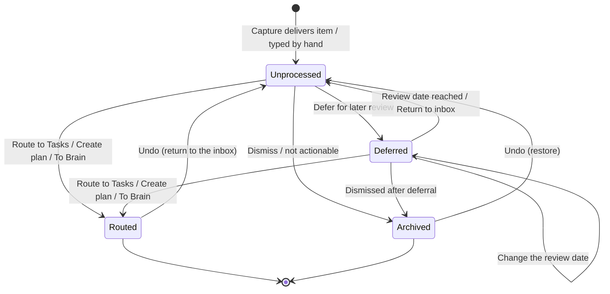
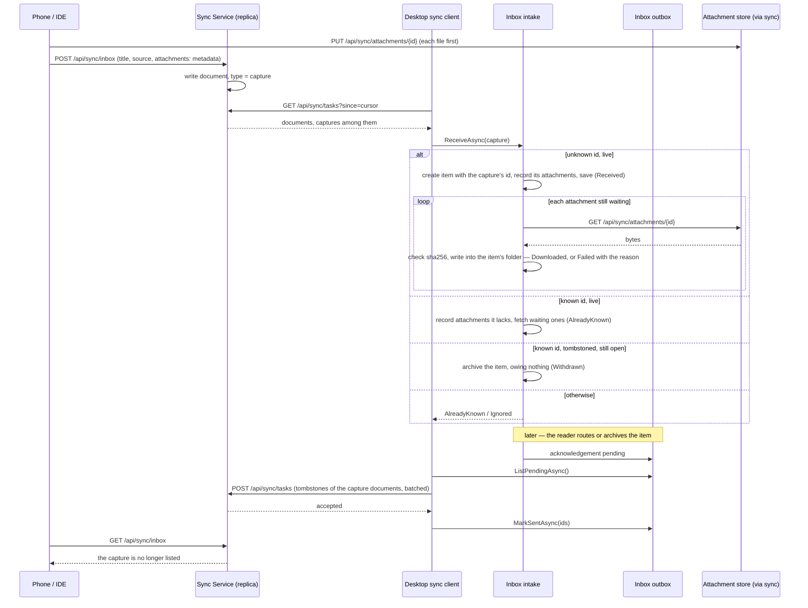
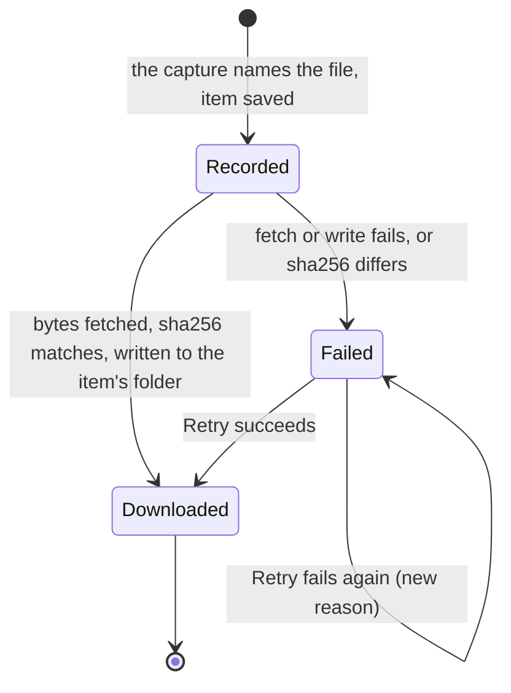
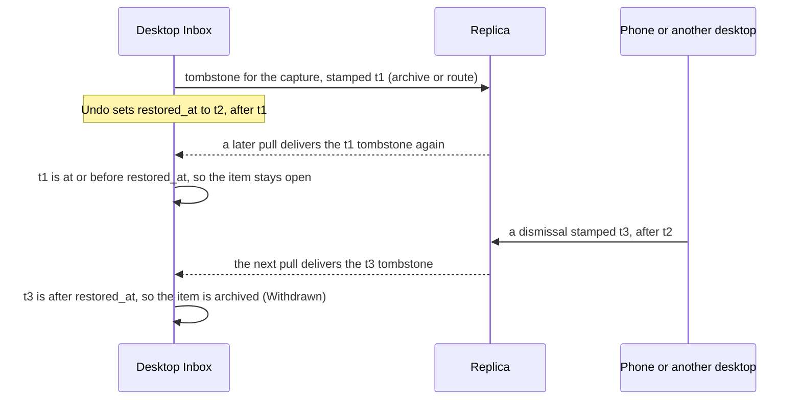
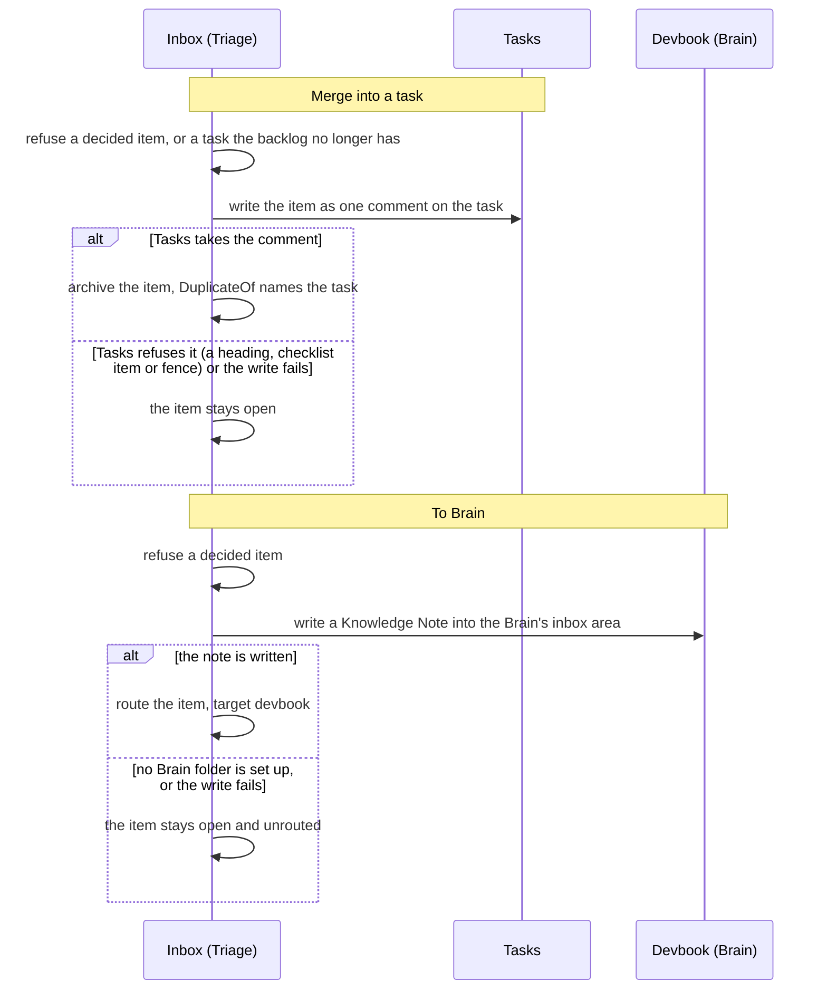
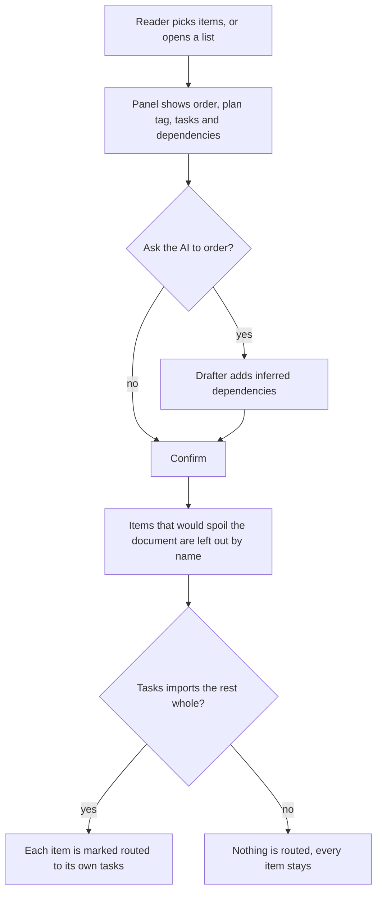
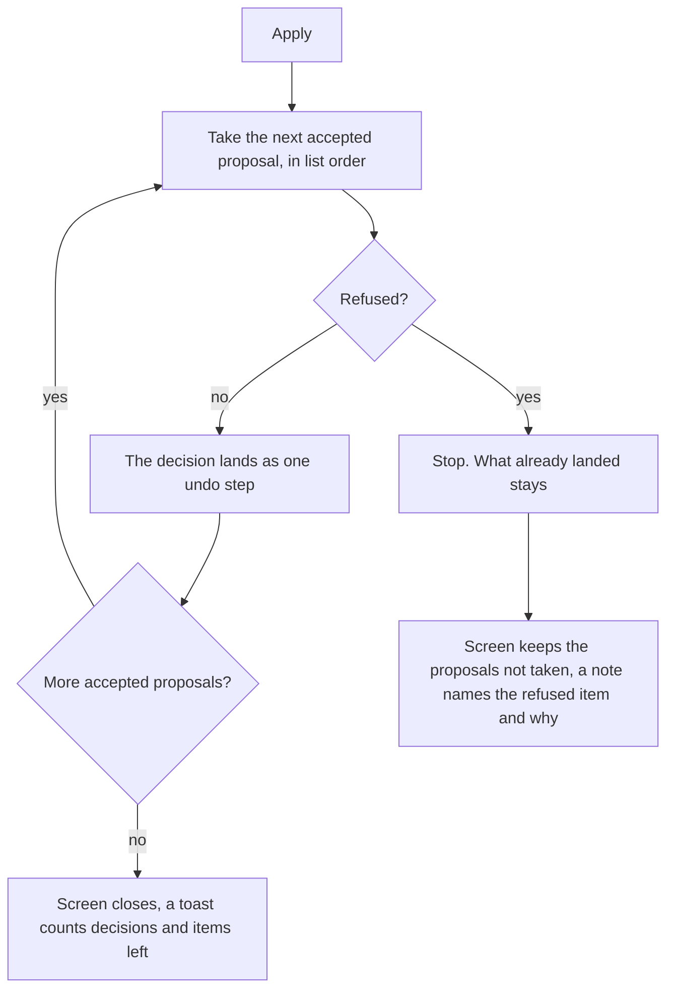
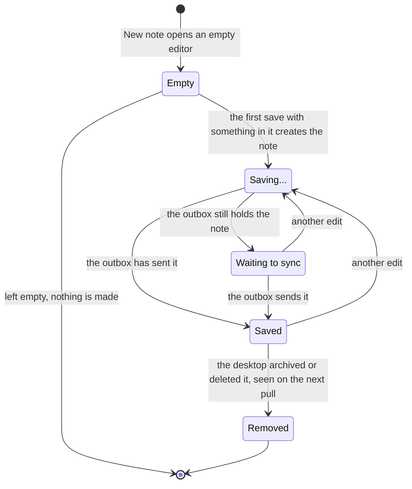

# Inbox

```meta
type: flow
status: draft
related: [.devbook/arc42/adr/0009-captures-are-a-document-kind-on-the-replica.md, .devbook/arc42/adr/0014-attachments-travel-through-a-blob-store-beside-the-replica.md, .devbook/domain/inbox/domain.md#attachment]
```

> Lifecycle and process flows for this bounded context. Flows describe how an
> inbox item moves through its states over time. They complement `model.md`
> (structure), `domain.md` (responsibilities) and `domain.invariants.md` (the
> rules).

## Inbox item lifecycle



- `Routed` is the stored status `triaged` with a `RoutingTarget`, and
  `ItemTriaged` is emitted on the way in. [Inbox Status](domain.md#inbox-status)
  says why deciding and routing are one step.
- A `triaged` item with no routing target is not routed, so it may still be
  deferred or archived.
- Filing in a list (`list_id`) is not a transition.
- The rules each transition is held to are the `Inbox Item` chapters of
  [`domain.invariants.md`](domain.invariants.md#inbox-item).
- `Deferred → Unprocessed` happens two ways. A person returns the item by hand,
  whatever its date, or the [resurface sweep](domain.md#resurface-sweep) finds
  its review date reached.
- Undo reopens a decision only within the app session that took it
  ([Undo a decision](features.md#undo-a-decision)).

## Capture intake and acknowledgement

The replica document and its `capture` kind token are
decided in `.devbook/arc42/adr/0009-captures-are-a-document-kind-on-the-replica.md`.



- The intake decides by id and status and parses no token. Every case has an
  answer and none is an error, because the caller is the sync client, and an
  error there would replay the page for ever. For the same reason, a file entry
  no fetch could honour is left off the item rather than thrown. A file that
  fails to download leaves the item Received.
- Only a route, archive or delete of a
  [replica-backed item](domain.md#replica-backed-item) puts an acknowledgement
  in the outbox. An item archived *because* the replica already carried a
  tombstone owes nothing.
- The acknowledgement is durable on the item, so a decision taken offline
  reaches the phone on the first push that succeeds.
- A deleted item's acknowledgement is kept beside the item store, and it is all
  that is left of the item. Until it is sent, a replay of the capture is
  `AlreadyKnown` rather than a new item.
- The desktop's own tombstone, its [sync echo](domain.md#sync-echo), comes back
  on the next pull as a known id it has already decided on: `AlreadyKnown`,
  nothing written. A second desktop still holding the item open archives it
  instead.
- The phone's own "Triage" acknowledges the same way: the service tombstones the
  capture document.

## Attachment lifecycle

One file on an item, as this machine holds it. The bytes come from the attachment
store (local ADR 0014), never from the replica.



- A replayed sync page never retries a Failed file; only the person's Retry does.
- Recording the same file again changes nothing, so a replay cannot move a
  Downloaded file back to Recorded.

## Undo and a returning tombstone

An undo cannot call back a tombstone the desktop already sent, so the intake
reads every later tombstone against the item's `restored_at`.



- The echo may arrive on the next pull or days later, on a full replay.
- The stamps come from different clocks when the tombstone is not this
  desktop's own. A dismissal made after the undo but stamped at or before it by
  a skewed clock is ignored. That is accepted rather than an undo that does not
  hold.

## Merge and To Brain

Both decisions write into another context first and change the item only once
that write succeeded.



- Writing first means a failure never leaves an item archived against a task
  that never heard of it, or routed to a note that was never written.

## Batch route

Two or more items routed to Tasks together, as one plan import
([Route a batch to Tasks](features.md#route-a-batch-to-tasks)). A single item
routes on the press, without the panel.



- A loop among the dependencies holds Confirm until a switch breaks it, and
  Confirm waits while an ask is out.
- An item whose entries were made but which could not then be marked routed is
  named along with those entries.

## AI triage pass Apply

How **Apply** takes the accepted proposals of the
[AI triage pass](features.md#ai-triage-pass).



- A plan that routed only some of its members leaves the screen, and its
  members still waiting are left for the reader.

## A note on the phone

How a note saves in the phone's Notes tab
([Notes on the phone](features.md#notes-on-the-phone)).



- A note is kept on the phone first, so it saves with no signal.
- An editor still open on a removed note says its changes are no longer kept.
