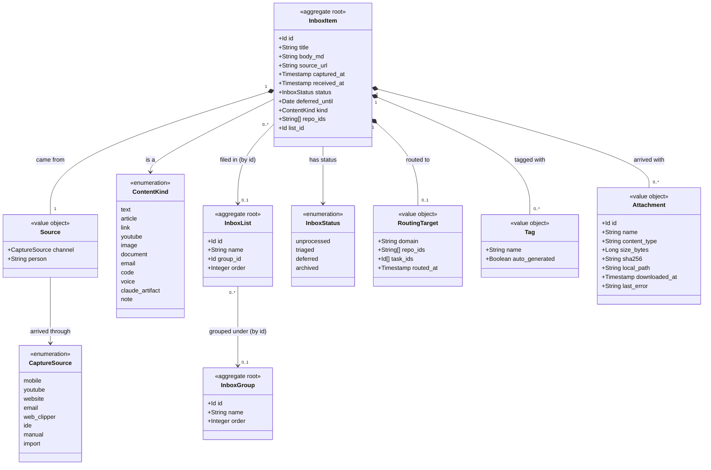

# Inbox

```meta
type: model
status: draft
```

> Structural view of the domain model for this bounded context: aggregates,
> entities, value objects, and their relationships. Keep this in sync with
> `domain.md`, which describes responsibilities, and `domain.invariants.md`,
> which holds the rules. This file shows structure and relationships.

## Model diagram



## Relationship notes

- `InboxItem` is the aggregate root of an item; `Tag`, `RoutingTarget`,
  `Source` and `Attachment` are owned value objects.
- An `Attachment` has two halves: what the capture said about the file (`id`,
  `name`, `content_type`, `size_bytes`, `sha256`), fixed once recorded, and this
  machine's copy (`local_path`, `downloaded_at`, `last_error`), which changes on
  every fetch. The bytes are not on the item; they sit in its
  [attachment folder](domain.md#attachment-folder).
- `InboxList` and `InboxGroup` are two further, small aggregate roots. An item
  relates to a list by `list_id`, and a list to a group by `group_id`. These are
  id references only, never containment. So deleting a list is a write across
  the items it held, clearing each `list_id`, and ungrouping is a write across
  the group's lists. Both are local-only and hard-deleted, and nothing
  replicates them.
- `Source` carries the `CaptureSource` channel, mirrored from Capture, and the
  optional person who shared the item.
- `ContentKind` says what the content is, and `CaptureSource` says how it
  arrived. The two are independent: the same video can arrive through any
  channel.
- `repo_ids` on the root are the repositories a reader assigned while the item
  waits. `RoutingTarget.repo_ids` are the ones it was routed with, frozen at
  that moment. `RoutingTarget.task_ids` name the entries Tasks created, one per
  repository or one when none was assigned. They are ids in another context,
  not references.
- Capture sets `captured_at` and the Inbox preserves it. The Inbox sets
  `received_at` on intake, and the two are kept distinct on purpose. An item
  that arrived through sync reuses the capture's id as its own.
- Routing does not embed the target aggregate. It records the destination
  (`domain`, `repo_ids`, `task_ids`) and hands off via `ItemTriaged`. Tasks and
  Devbook own the created entities.
- The store keeps two sync flags beside the item: whether it is
  [replica-backed](domain.md#replica-backed-item), and whether its
  acknowledgement to the replica is still pending. They are bookkeeping for the
  intake and outbox adapters and are left out of the model on purpose.
