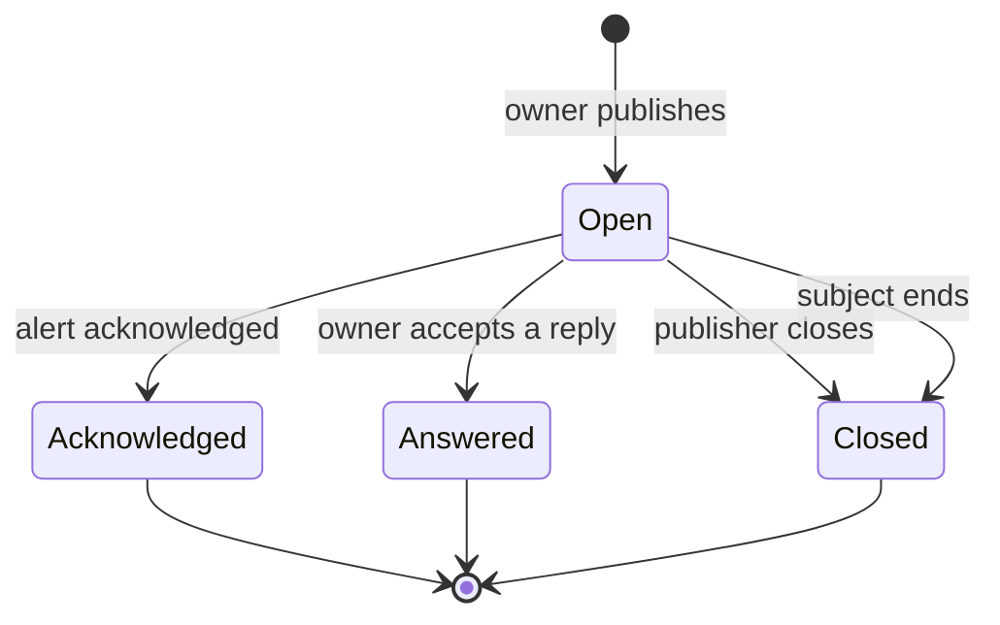

# Domain

```meta
status: proposed
type: domain
```

> One chapter per Aggregate, Domain Service, Domain Event, or Shared Value
> Objects / Shared Enums grouping in this bounded context; each chapter's
> `type` records which of those it is. An Aggregate's owned Entities, Value
> Objects, and Enums are chapters directly beneath it.

## Notification

```meta
status: proposed
type: aggregate
related: [.devbook/domain/notifications/domain.invariants.md#notification, .devbook/arc42/adr/0039-notifications-are-an-owned-document-kind-and-push-only-nudges.md]
aliases: [NotificationDraft, NotificationId]
```

One message a [Source](#source) raises on an [Owner instance](#owner-instance).
It has a [kind](#notification-kind), a [severity](#severity), a title, a short
summary, a Markdown body and a [lifecycle](#notification-state). It may be about
a [Subject](#subject).

The notification is the consistency boundary for its answer. Only the owner
instance writes it, so only the owner decides which [Reply](#reply) becomes the
[Answer](#answer). A viewer that wants to answer writes a reply instead.

Its content is meant to be shown on every channel:

- The title holds at most 80 characters, and the summary at most 180, both plain
  text. They are the only content that leaves the replica in an OS notification
  or a push payload. A push also names the notification's id, kind, severity and
  state, and its [origin](#origin) as "System · Place".
- The body is Markdown, with Mermaid diagrams and images. Images travel as
  attachments through the blob store
  (`.devbook/arc42/adr/0014-attachments-travel-through-a-blob-store-beside-the-replica.md`).
- A source can mark a notification private. Outside the app its summary then
  reads "Backlog has a question for you".
- A notification may carry a deep link that opens the item that raised it.

A notification has no deadline and no default answer. A question stays open until
the owner accepts an answer, the publisher closes it, or its subject ends.

A source that asks about something with an identity of its own may name the
notification's id, derived from that thing. Publishing an id the owner already
holds changes nothing, whatever state it reached, so a source can publish on every
pull. Two desktops that derive the same id both publish it; the replica keeps the
one that pushed it first, and the other closes its own copy as "Owned by another
desktop" and stays a viewer.

The rules it holds are `### Invariant:` chapters in
[`domain.invariants.md`](domain.invariants.md#notification).

### Source

```meta
status: proposed
type: value-object
aliases: [NotificationSource]
```

The boundary that raised the notification, and the key inside it: for example
`sessions` / `run-58`. The owner hands the accepted answer back to the handler
registered for the source's boundary. An alert-only source registers no handler.
The source routes; it is never shown. What a person reads is the
[Origin](#origin).

### Origin

```meta
status: proposed
type: value-object
aliases: [NotificationOrigin]
related: [.devbook/domain/notifications/domain.invariants.md#invariant-an-origin-stays-within-its-bounds]
```

Where the notification came from, in words a person reads. Optional: a
notification without one is drawn by its source, as before.

| Part | Holds | Bound |
|---|---|---|
| System | The system that raised it: "Claude Code", "Backlog", "spec-manager". Required. | 40 characters |
| Place | Where in that system: a repository and run title, a product and item, a chapter. | 120 characters |
| Asked by | The person who asked, when known. | 80 characters |
| Via | How it was asked: "Agent session", "MCP ask". | 40 characters |
| Open link | An `http` or `https` link that opens it at its origin, or none. | |

Every part is one line of plain text. The origin holds no content, so it
travels wherever the title does, a private notification's push included.
"System · Place" is the attribution line of a Windows notification, the
subtitle of the phone's tray entry, and the push's `origin`, cut to 60
characters there. The card draws the system as a badge with the place above
the title, who asked and how under it, and "Open in &lt;System&gt;" when there is
a link. The centre filters by the system.

The sources inside Backlog fill it:

| Source | System | Place | Via |
|---|---|---|---|
| A run's Personal Validation | Claude Code | The repository and the run's title | Agent session |
| Pairing a device | Backlog | Pairing | |
| A Devbook remark | Backlog | The chapter, the remark's author as asked by | |
| MCP `ask` and `notify` | The MCP client's own name; Claude Code for a call that names a Claude session; else "MCP client" | | MCP ask |
| A spec-manager question | spec-manager, with the host for an installation other than the one that ships | The product and `#<number> <title>`, or the product and the OpenSpec change | "Agent session", with the session's title when the item's linked task names exactly one session, or "typed in spec-manager"; the asker as asked by |
| Another spec-manager notification | spec-manager, with the host as above | The product, when the notification is about one | The category in words: "Mention", "Reply", "Change proposal", "Input", "Review work", "Administration" |

### Subject

```meta
status: proposed
type: value-object
aliases: [NotificationSubject]
```

The entity the notification is about, named by its boundary, its type and its
id: for example `sessions` / `session` / `sess-91`. The boundary that owns the
entity says when it ends, and every open notification about it then closes. A
subject that comes back, such as a reopened task, does not reopen its
notifications. Two notifications are equal in subject when all three parts are
equal.

The subjects a notification can be about, and when each ends:

| Subject | Owning context | Ends when | Closed with |
| --- | --- | --- | --- |
| `sessions` / `session` / session id | Sessions | archived or deleted in the Claude desktop app | "Session archived" |
| `sessions` / `run` / run id | Sessions | the delivery run finishes on any status, or no run file holds it any more | "Run finished" |
| `sessions` / `pull-request` / `owner/name#number` | Sessions | merged or closed | "Pull request merged" |
| `tasks` / `task` / task id | Tasks | marked Done or Archived, or deleted | "Task done" |
| `devbook` / `remark` / remark id | Devbook | resolved or deleted | "Remark resolved" |
| `sync` / `pairing` / pairing id | Sync | its pairing code expires unredeemed, or the question about the device that redeemed it is answered; a pairing from an earlier run stays live | "Pairing finished" |
| `spec-manager` / `question` / question id | The spec-manager adapter, for a question whose item is no linked task | answered or deleted in spec-manager | "Answered in spec-manager by &lt;name&gt;: &lt;answer&gt;", or "Withdrawn in spec-manager" |

A spec-manager question whose item is a linked task is about that task instead,
`tasks` / `task` / the task's id, and closes when the item is finished or archived.

The owning context reports the end where it notices it, and answers a probe
about each subject at startup for the ends it missed. An end made on another
device reaches the owner instance as that context's own change, and closes there
the same way.

### Answer Spec

```meta
status: proposed
type: value-object
aliases: [AnswerSpec, AnswerChoice, OpenAnswer]
```

What makes a question a question: the answers the owner will accept. It takes
one of four shapes:

| Shape | What a reply may hold |
|---|---|
| Single choice | Exactly one of two to eight set choices. Each choice has an id, a label, and an optional style: primary or destructive. |
| Multiple choice | Any subset of the set choices, within an optional minimum and maximum. |
| Open | Plain text, with an optional placeholder and length limit. Markdown is not allowed in an answer. |
| Choices with open | One of the set choices, or an open answer instead. |

Any shape may also take a **note**: plain text with an optional placeholder and
length limit, which a reply may fill beside its choice or open answer. A note
never answers on its own, and a question without one takes no note.

An answer spec may also say `answerOn: owner`. Only a reply made on the owner
instance is then accepted. Without it, any paired viewer may answer, critical
questions included.

### Notification Kind

```meta
status: proposed
type: enum
aliases: [NotificationKind]
```

- **Alert** informs. It can be acknowledged, but nothing waits on it.
- **Question** waits for an answer, and carries an [Answer Spec](#answer-spec).

### Severity

```meta
status: proposed
type: enum
aliases: [NotificationSeverity]
```

How urgent the notification is: **info**, **warning** or **critical**. Severity
is independent of kind, so a question can be critical and an alert only
informational. Severity never limits who may answer.

### Notification State

```meta
status: proposed
type: enum
related: [.devbook/arc42/08-crosscutting-concepts.md#notifications]
```



- **Open**: published, and not yet settled.
- **Acknowledged**: an alert that a person acknowledged on any instance.
- **Answered**: a question whose owner accepted a reply as its answer.
- **Closed**: the publisher closed it, or its subject ended. A closed question
  needs no answer, and a reply sent after it is rejected as closed.

Only the owner makes these transitions. Read marks are per device and are not
part of the state. A source may act on a transition outside Backlog: an alert
raised for a spec-manager notification that is acknowledged is marked read in
spec-manager, and the publisher closes one read there.

## Reply

```meta
status: proposed
type: aggregate
related: [.devbook/domain/notifications/domain.invariants.md#reply, .devbook/arc42/06-runtime-view.md#notification-reply]
aliases: [ReplyOutboxKind]
```

What a person submits to answer a question, from any instance. A reply is a
proposal until the owner accepts it. A viewer writes it once and never changes
it; the phone writes it through its device outbox, so a reply made offline is
kept.

The owner reads each reply, checks it against the question's
[Answer Spec](#answer-spec), and accepts or rejects it. It rejects a reply with a
reason: the question is already answered, it is closed, the reply came from a
viewer when the question says `answerOn: owner`, or the reply does not fit the
answer spec. The viewer can then reply again. The owner deletes a reply once it
has processed it.

A reply names the notification, its owner instance, the device it came from, the
chosen choice ids, the open text and the note.

## Answer

```meta
status: proposed
type: value-object
aliases: [NotificationAnswer]
```

The reply the owner accepted. A question has at most one answer. The owner stores
it, hands it to the source's handler, and replays it to a handler that was not
running when the answer arrived. A handler therefore receives an answer at least
once and treats a second delivery for the same notification as the same answer.

## Ubiquitous Language

```meta
status: proposed
type: ubiquitous-language
```

### Owner instance

```meta
status: proposed
type: term
aliases: [ownerInstanceId]
related: [.devbook/domain/tasks/domain.md#device]
```

The desktop app instance that published a notification, named by its device
identity. It is the only writer of that notification and the only instance that
decides its answer. A desktop is the owner of its own notifications and a viewer
of every other desktop's. An owner that is unpaired keeps its notifications: no
other instance takes them over, and they expire.

### Viewer instance

```meta
status: proposed
type: term
related: [.devbook/domain/notifications/domain.md#reply]
```

Any other paired device: the Android phone or another desktop. It shows
notifications and submits replies, and never changes a notification.
