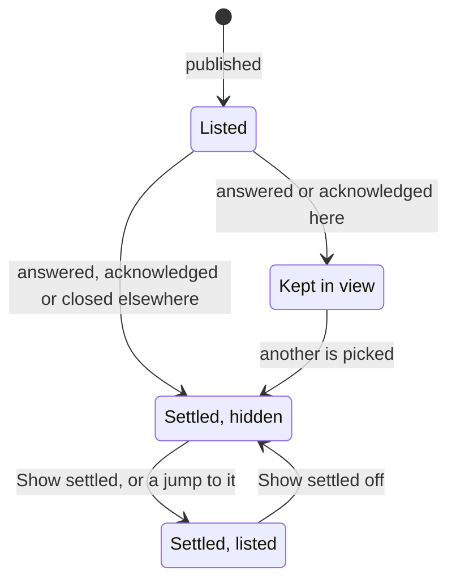
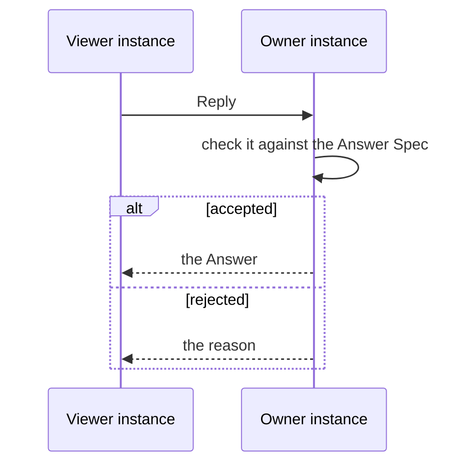

# Features

```meta
type: features
```

> What Notifications lets the person and the other contexts do, in the context's
> own language. What each feature guarantees is in
> [`requirements.md`](requirements.md).

## Publishing a notification

```meta
type: feature
related: [.devbook/domain/notifications/requirements.md#publishing-a-notification]
```

A source on a desktop tells the person something with an alert, or asks them
something with a question, through one port. The desktop that publishes becomes
the notification's owner instance.

A Claude session asking through the MCP `ask` tool is the first case. The tool
returns the notification's id at once. The agent polls `get_answer` for the answer,
or withdraws its question with `close`. The MCP `notify`
tool tells the person something the same way, with nothing to wait for. A session's own hooks ask through the same
tools with its questions in the dialog's shape, and the Sessions
[Question Relay](../sessions/domain.md#question-relay) decides when those reach
the person.

## Answering on the owner desktop

```meta
type: feature
related: [.devbook/domain/notifications/requirements.md#answering-on-the-owner-desktop, .devbook/domain/notifications/context.md#owner-screens, .devbook/arc42/adr/0027-the-brain-is-a-scope-beside-the-repositories.md, .devbook/design/interaction-guidelines.md#focus-and-selection]
```



The person works through what waits on the desktop that owns it, in the
notification centre. The centre lists what is still open, so the list is the
work left to do. What is settled stays a press away, for the answer it got.

The diagram follows one notification while **Show settled** is off. With it on, a
settled notification stays listed. A jump comes from **Open in Backlog** on a
Windows notification, and lasts for that visit.

The centre narrows its list by the header's repository scope and by three filters:
From, Asked by and Kind. It groups the list by **Group by**. The screens themselves
are described under [Owner screens](context.md#owner-screens).

## Answering from another device

```meta
type: feature
related: [.devbook/domain/notifications/requirements.md#answering-from-another-device, .devbook/arc42/06-runtime-view.md#notification-reply, .devbook/domain/notifications/context.md#owner-screens, .devbook/arc42/adr/0027-the-brain-is-a-scope-beside-the-repositories.md]
```



The person sees a notification on the Android phone or on another desktop and
replies there. Every viewer shows which desktop owns the notification
and whether it is online, because an answer counts only once that desktop accepts
it.

On the phone this is the Notifications tab in `Backlog.Mobile.UI`. It pulls the
feed when it opens and when the app comes back to the front. It also pulls every 30 seconds
while a reply made there waits for its owner. Each card shows:

- the kind, the severity and the age;
- the owner desktop's name;
- whether it is online, an owner offline reading "delivers on wake".

The detail draws the Markdown body, Mermaid included. A question takes choice
buttons, checkboxes for multiple choice, or a plain-text answer. The reply leaves
through the device outbox as a `notification-reply` entry, so a reply made offline
is kept. A question that says `answerOn: owner` is read-only there.

Once the owner's verdict syncs back the card reads:

- "Answered from this phone";
- "Answered elsewhere", with the answer that won;
- or the owner's reason for rejecting it, with the controls back.

Each box that takes words (the open answer, a choice's own words, the note) can be dictated into instead of typed. What was heard is added to that box for
the person to read, and nothing is sent until they press Send. One box listens at
a time, and listening stops when the reply is sent or the person moves to another
notification. Words past the box's length limit are left out, and the phone says
so. A phone with no speech recogniser shows the dictation control unavailable,
and the box still takes typing.

An open alert on the phone offers Dismiss, which sends an
[Acknowledgement](domain.md#acknowledgement) to the owner desktop through the same
outbox, as a `notification-reply` entry. Another desktop sends one from its
centre's Acknowledge. The alert leaves the stack of the device that dismissed it at
once, and every other device's stack once the owner takes it. It stays in each
device's list as settled, for as long as answered and closed notifications stay
there, and reads "Acknowledged on this phone" or "Acknowledged elsewhere".

Until the owner takes it, the list reads "Sending" while it is in the outbox, and
"delivers on wake" while the owner is offline. When the alert closes first, it
reads Closed with its reason. When cloud sync refuses the acknowledgement, the
alert comes back into the stack with the reason.

The phone reads presence off the owner's own pushes. An owner desktop pushes each
open question again every 10 minutes, and a phone that has seen no push from it
for 15 minutes reads it as offline.

Two filters sit over the tab and narrow both its views, the pager and the list:

- **From:** the system a notification came from, by the rule the desktop
  centre's From filter keeps: [Origin](domain.md#origin)'s system, else the
  source's label.
- **Repository:** the repository the owner desktop published with the
  notification ([Owner screens](context.md#owner-screens)), and **Brain** for
  those about no repository. A notification whose repository is not known stays
  under every choice, as it does on the desktop.

Each starts at All, and each option counts what it would keep under the other
filter. A filter with fewer than two options is not shown. The phone remembers
both on the device, and **Clear filters** sets both back to All. A filter that
leaves nothing shows an empty state with **Clear filters**, not "No
notifications". The filters change only what the tab shows: the waiting count
counts every open question, and the Android push is sent whatever they hold.

The phone also hears of a notification without being opened, through an Android
push. When a notification is published or changes state, the phone gets an
Android notification with its title and summary. The presence re-push sends
none. What the tray offers depends on the question:

| The question | The tray offers |
| --- | --- |
| Single choice, up to three choices | one action per choice |
| Open answer only | an inline reply |
| Choices with an open answer, up to two choices | the choices, then the inline reply |
| Anything else | no actions |

Anything else covers:

- multiple choice;
- more choices than fit;
- a choice that takes text;
- `answerOn: owner`;
- an alert;
- a reply already on its way.

The Personal Validation question offers Approve, Approve + follow-up,
Revise and Reject. The tray shows it with no actions, and the person taps through to
the app.

An action or an inline reply leaves through the same `notification-reply` outbox
entry as a reply made in the app. A tap opens the notification in the app. A
notification that is answered, acknowledged or closed leaves the tray. Swiping an
alert out of the tray only clears the tray, and acknowledges nothing. The phone
registers for the push once it is paired, and again when Firebase hands it a new
token.

On the owner desktop, the push row of **Settings › Notifications** stays *not
reported*. The push carries no delivery receipt, so the desktop cannot tell
whether a phone showed it.

## Asking from the contexts

```meta
type: feature
related: [.devbook/domain/notifications/requirements.md#asking-from-the-contexts, .devbook/domain/tasks/features.md#filing-a-follow-up-after-an-entry, .devbook/arc42/adr/0038-backlog-queues-session-requests-and-a-manager-session-dispatches-them.md]
```

Three contexts reach the person through notifications. A delivery run that
reaches Personal Validation asks to be approved, and the answer is recorded on the
run; the pull request is still opened at the desktop. A device that redeems a
pairing code is asked about on the desktop that showed the code, and only there:
Allow keeps it, Refuse revokes it. A remark left on a Devbook chapter on another
device raises an alert that links to the chapter.

The Personal Validation question carries the gate's handoff as its body, so the
person can review the run from the phone. The handoff is what the stage reports
for the person: its review links, what to check, the acceptance criteria and the
paths of the evidence. It travels as text, and no image is attached. The question
is asked on the first report of the stage that carries links or handoff text.
A gate that has only gone in progress has nothing to show yet.

| Answer | Recorded on the run | What follows |
| --- | --- | --- |
| Approve | an approval | The flow goes on to the pull request. |
| Approve + follow-up, with text | an approval, with the person's words as its note and the id of the follow-up entry | Tasks files one [follow-up entry](../tasks/features.md#filing-a-follow-up-after-an-entry) after the gated entry, in the same plan. |
| Revise, with text | a rejection in the person's words | The flow starts a [revise round](../sessions/domain.md#revise-round). |
| Reject | a rejection with a fixed note and none of the person's words | `execute-plan` blocks the entry instead of revising it. |

The run's approval also records which choice answered it, and for Approve +
follow-up the id of the follow-up entry. `get_run` returns both, so an
orchestrator tells Reject from Revise by the choice. A decision taken at the
desktop records no choice. An answer to a question an older build asked, open
text with no choice, records as Revise. When the gated entry is gone by the time
the answer arrives, the run records the approval with the person's words and no
follow-up entry.

Approve + follow-up is offered only when the run names the entry it works, by its
id or by its plan and item. The follow-up is a task, never a session request:
[only a click in the app requests a session](../sessions/requirements.md#requirement-only-a-click-in-the-app-requests-a-session),
as §1 of local
[ADR 0038](../../arc42/adr/0038-backlog-queues-session-requests-and-a-manager-session-dispatches-them.md)
decides. An attended `execute-plan` reads the decision from the run, and runs the follow-up
as a ready entry once the gated entry lands.

spec-manager reaches the person the same way. While a desktop is signed in to an
installation, the questions on its connected products that are assigned to the
person, and the unassigned ones they may answer, arrive as questions. Each option
is a choice, "Other" is the open answer, and a note may sit beside either. A
product's "Only questions assigned to me" leaves the unassigned ones out.

spec-manager also pushes each question to a phone subscribed to it, so that phone
gets both pushes. The product's card says to switch off "Backlog question" in
spec-manager's notification preferences on that phone to keep only Backlog's.

The desktop follows spec-manager's notification stream and pulls on each change,
every five minutes besides, and every two minutes while the stream is down. The
answer goes back to spec-manager. If the product does not take answers from a
connected app, or someone answered first, an alert says so. While the desktop is
signed out, the answer waits, and the sign-in line asks the person to sign in.

A question answered, deleted or reassigned away in spec-manager closes here. One
answered while the app was closed closes at the next start with who answered and
what. One that reaches the person again, reassigned back or let in again by turning
"Only questions assigned to me" off, arrives as a new question. The desktop that
held it asks it again, under an id every desktop that held the same earlier rounds
derives alike. One answered never comes back.

The person's other spec-manager notifications arrive as alerts on the same pulls:

- a mention;
- a reply;
- a change proposal's or an input item's fate;
- review work;
- administration.

Only the unread ones come in, and only those created after the
person first signed in to that installation from this desktop. Older ones stay in
spec-manager. A mention is a warning, the rest are info, and each opens where
spec-manager points. Acknowledging the alert here, on any device, marks it read in
spec-manager. One read in spec-manager closes here as "Read in spec-manager".

## Closing a notification

```meta
type: feature
related: [.devbook/domain/notifications/requirements.md#closing-a-notification]
```

A notification stops asking for attention when the publisher closes it or when
the thing it is about ends. Nobody answers a question about work that is already
gone.
