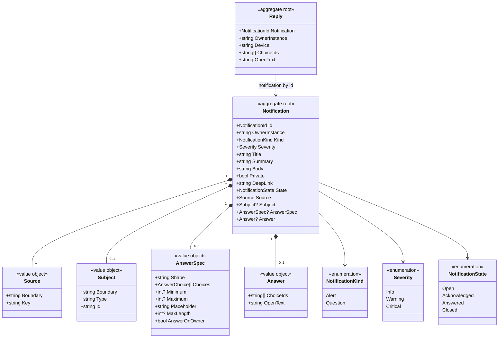

# Model

```meta
type: model
status: draft
related: [.devbook/domain/notifications/domain.md#notification, .devbook/domain/notifications/domain.md#reply, .devbook/domain/notifications/domain.md#answer]
```

> Structural view of the domain model for this bounded context: aggregates,
> entities, value objects, and their relationships. Keep this in sync with
> `domain.md` (which describes responsibilities in prose) — this file focuses on
> structure and relationships.

## Model diagram



## Relationship notes

- A Notification is the consistency boundary for its answer: only its owner
  instance writes it, and only the owner accepts a [Reply](domain.md#reply) as
  its [Answer](domain.md#answer). A question has at most one answer.
- A Reply is its own aggregate. A viewer writes it once and never changes it, and
  it names its notification by id; the owner deletes it once processed.
- The [Subject](domain.md#subject) names an entity another context owns by its
  boundary, type and id. Nothing of that entity is copied.
