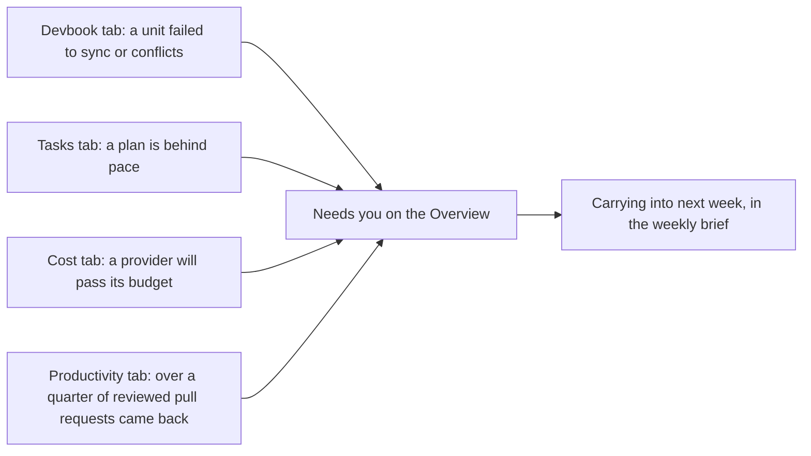
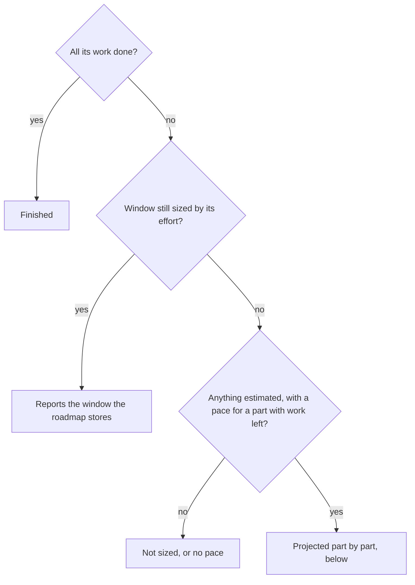
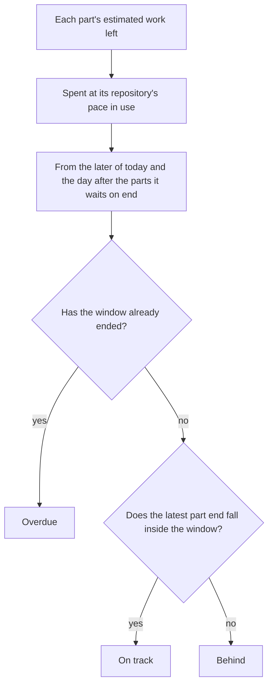

# Productivity

```meta
type: features
status: draft
```

> Features and sub-features this bounded context supports, described in
> business/ubiquitous language rather than implementation terms.

## AI productivity tracking

```meta
type: feature
status: draft
related: [.devbook/domain/productivity/domain.md#productivity-ledger, .devbook/domain/tasks/domain.md#aiworklogged]
```

[AI Productivity Tracking](domain.md#ai-productivity-tracking) shows what changed
because of AI assistance: tasks moved, artifacts created, prompts reused, reviews shortened, or
research summarized.

### AI activity capture

```meta
type: sub-feature
status: draft
```

Record AI-assisted activity from task work, Copilot sessions, IDE chats, and
automation runs with enough context to understand the work without copying tool
internals.

### Productivity summaries

```meta
type: sub-feature
status: draft
```

Summarize AI-assisted work by day, week, repository, activity kind, and tool so
the person can see how AI affects throughput and focus.

### Time-saved estimates

```meta
type: sub-feature
status: draft
```

Capture optional estimates or calibrated defaults for time saved, keeping the
estimate visibly separate from measured activity.

### AI vendor usage import

```meta
type: sub-feature
status: draft
feature-flag: .devbook/domain/productivity/context.md#ai-usage-metrics
related: [.devbook/domain/productivity/dependencies.md#outbound-dependencies]
```

Import token, cost, and session usage from the AI vendors the person works
through, so productivity insight rests on measured usage rather than
recollection. Both vendors report at organization level only: Claude exposes
usage and cost reports to an organization holding an Admin API key, and GitHub
reports Copilot usage per organization to an organization owner. The import is
evidence for the ledger; it never becomes the ledger.

### When each usage source was last read

```meta
type: sub-feature
status: draft
feature-flag: .devbook/domain/productivity/context.md#ai-usage-metrics
related: [.devbook/domain/productivity/features.md#ai-vendor-usage-import]
tests: [unit:dotnet:Backlog.Infrastructure.FileSystem.UnitTests.UsageReadLogStoreTests, unit:dotnet:Backlog.Infrastructure.Claude.UnitTests.ClaudeSpendSourceTests, unit:dotnet:Backlog.Infrastructure.GitHub.UnitTests.CopilotSpendSourceReadTests, unit:dotnet:Backlog.Infrastructure.AzureFoundry.UnitTests.AzureFoundrySpendSourceReadTests]
```

Backlog records when each usage source was last read, so the AI providers
settings can say how fresh each figure is. Each Claude organization is one
source, the GitHub AI-credit report is one more, and Azure Foundry's Cost
Management scope is a third.

Each source keeps the time of its last successful read. When its most recent
read failed, it also keeps that time and a one-line reason. A later success
clears the failure. A Claude organization counts as read when Anthropic answered
any day in the window, because a day still being aggregated is refused as a
matter of course. GitHub counts as read when any month answered, and Azure
Foundry when Cost Management answered, with cost lines or without. A window
answered wholly from the settled-day cache asks the provider nothing and records
nothing, and a cancelled read records nothing either.

The record is runtime state of one device, kept in `usage-reads.json` in the
per-user folder. It never travels through the GitHub settings sync or the
workspace, and it survives a restart. Settings reads it through a read model
that raises a change each time a read is recorded.

### AI providers overview

```meta
type: sub-feature
status: draft
feature-flag: .devbook/domain/productivity/context.md#ai-usage-metrics
related: [.devbook/domain/productivity/features.md#when-each-usage-source-was-last-read]
tests: [unit:dotnet:Backlog.Desktop.UI.UnitTests.AiProvidersOverviewTests, unit:dotnet:Backlog.Desktop.UI.UnitTests.SettingsAiUsageTests]
```

The AI providers settings page opens on one sentence about every provider it
offers: the ones set up, joined, report usage, and the rest are not set up —
"Two Claude organizations and GitHub report usage; Azure Foundry is not set
up." With none set up it says no AI provider is set up yet. Counts up to nine
are words.

Under the sentence, one tile per provider carries the same answer as a figure:
how many Claude organizations hold a key, how many GitHub identities usage is
read as — every configured account, or this machine's own sign-in when there is
none — and whether Azure Foundry is ready. Under each figure the tile says when
that usage was last read on this device, or why the last read failed, or
nothing when it was never read. Several Claude organizations show the most
recent failure while any of them is failing, and the most recent success
otherwise. A provider that is not set up is a dashed tile with no figure but
"Not set up"; Azure Foundry's adds that the AI assistant needs it.

Claude and GitHub are offered with usage metrics, Azure Foundry with the AI
assistant, so a tile never stands over a card that is not there. While the
assistant's feature is on and Azure Foundry is not set up, the Azure Foundry
card says the assistant stays hidden until it is.

### Local usage accumulation

```meta
type: sub-feature
status: draft
related: [.devbook/domain/productivity/features.md#ai-vendor-usage-import]
```

Accumulate usage locally, call by call, for the person who has no organization
behind their AI subscription.

Neither vendor offers a personal usage history. Anthropic documents the Admin
API as unavailable to individual accounts. GitHub has no endpoint at all for an
individual Copilot subscriber's own usage; its billing page, by manual export, is
the only route. For those people the only measurable signal is what each response
reports about itself: Claude returns per-request token counts on every message it
answers.

What is measured is the tokens each Claude response reports, as it arrives. They
are rolled up by day, model, and work subject, the same shape the vendor import
produces, so summaries do not care which route the evidence took.

This is kept as an idea rather than a plan. It only measures work that flows
through Tasks itself, which is a narrower claim than the vendor reports make.
That narrowing has to stay visible to the person reading the numbers.

## Personal productivity dashboard

```meta
type: feature
status: draft
feature-flag: .devbook/domain/productivity/context.md#dashboard
setting: [.devbook/domain/productivity/context.md#working-week, .devbook/domain/productivity/context.md#weekly-usage-reset, .devbook/domain/productivity/context.md#monthly-spend-budget]
related: [.devbook/domain/monitoring/features.md#multi-layer-dashboards, .devbook/domain/productivity/requirements.md, .devbook/domain/repository-management/requirements.md#archiving-a-repository]
```

Expose productivity trends as personal insight rather than team performance
reporting. The view shows patterns and evidence while preserving the user's
control over interpretation.

The dashboard is one pane of six tabs. The Overview answers "how is it going, and
what needs me?" in one screen. The other five tabs each answer one question in
depth. A person can also read the last finished week as a short brief instead of
as charts.

### Six tabs and what each answers

```meta
type: sub-feature
status: draft
related: [.devbook/domain/productivity/features.md#what-needs-you, .devbook/domain/productivity/features.md#spend-against-a-monthly-budget, .devbook/domain/productivity/features.md#the-weekly-brief, .devbook/domain/productivity/features.md#the-header-and-its-controls, .devbook/domain/productivity/features.md#deltas-against-the-previous-window, .devbook/domain/productivity/requirements.md#six-tabs-and-what-each-answers]
tests: [integration:dotnet:Backlog.Desktop.UI.UnitTests.DashboardPaneTests.The_sections_are_a_tablist_that_opens_on_overview, integration:dotnet:Backlog.Desktop.UI.UnitTests.DashboardPaneTests.A_pane_opened_again_starts_on_overview, integration:dotnet:Backlog.Desktop.UI.UnitTests.DashboardPaneTests.The_devbook_tab_carries_the_open_drift_issue_count, integration:dotnet:Backlog.Desktop.UI.UnitTests.DashboardPaneTests.The_devbook_tab_has_no_badge_when_no_issue_is_open_or_none_could_be_read, integration:dotnet:Backlog.Desktop.UI.UnitTests.DashboardPaneTests.The_sessions_part_keeps_its_own_more_fold, integration:dotnet:Backlog.Desktop.UI.UnitTests.DashboardProductivityTabTests, integration:dotnet:Backlog.Desktop.UI.UnitTests.DashboardTasksTabTests, integration:dotnet:Backlog.Desktop.UI.UnitTests.DashboardSessionsTabTests]
```

The pane holds six tabs, in this order:

| Tab | What it answers | What it holds |
| --- | --- | --- |
| Overview | How is it going, and what needs me? | The headline tiles, the main charts and [What needs you](#what-needs-you) |
| Productivity | How much did I ship, and how much came back? | The throughput tiles, volume over time, the Volume and Quality scores, and rework after review |
| Tasks | Is the planned work getting done, and will each plan land? | The six task figures, the [roadmap timeline](#whether-each-plan-will-land-in-its-window), and tasks and story points completed per week |
| Sessions | When and how long did the agents work? | The session figures, agent-active hours per week, the hour grid, [the longest sessions](#the-longest-sessions), [hours worked](#hours-worked), and [what the sessions cost and shipped](#what-the-sessions-cost-and-shipped) |
| Devbook | Which devbook [sync units](../devbook/domain.md#sync-unit) have drifted from their code? | [Drift at a glance](#drift-at-a-glance) |
| Cost | What are my assistants costing this month? | [Spend against a monthly budget](#spend-against-a-monthly-budget) |

The Devbook tab carries a badge with the number of
[drift issues](../../ai/05-unattended-runs.md#scheduled-devbook-upkeep) open. The badge is
hidden when no issue is open, and when the issues could not be read, because a zero or
a dash on a tab gives the reader nothing to act on. Every tab reads its figures as the
pane opens, so the badge is there before anyone opens the Devbook tab.

The pane opens on the Overview every time, and it does not remember which tab was
selected. Nothing on the dashboard outlives the pane being closed: the scope, the
window and the tab are forgotten when it closes. The tabs hold no folds of their own,
because a tab is already the second look a fold used to give. A part that folds some
of its figures away keeps that fold, such as the Sessions tab's More, and the fold
starts closed again each time the pane opens.

The Productivity tab opens with five throughput tiles in one row: pull requests
merged, issues closed, the share that came back after review, how long a first review
took, and commits per pull request. Merged and closed also say how many a week. Each
tile draws its own weeks as a sparkline. A week with no reviewed merge has no review
point, and a week with no detail read has no commits point, so the line shows a gap
rather than a zero. The share that came back reads "N of M", the pull requests that
came back of those reviewed, and shows a dash when none was reviewed.

Below the tiles, the volume chart draws one measure per week, and the person switches
it between pull requests, issues and commits. The tab opens on pull requests and does
not remember the choice.

Beside the chart, two scores rate the window, kept apart so a reader can tell which
one fell:

- The **Volume score** sets merged pull requests and closed issues against the
  person's own record.
- The **Quality score** is made of proportions of what could have counted: review
  promptness, freedom from churn, and two size measures.

Each score shows its inputs as labelled bars, with the reading and the weight
printed under each. The person's own record is the last 24 weeks, read as six
blocks of four weeks. Full marks come from the block with the most merged pull
requests, the **best block**. The record counts merged pull requests and closed
issues only, so lines changed is not a Volume input: there is no best block of
lines to give full marks from. The score's note says so.

Last comes rework after review, as two labelled groups of tiles:

- **After review**: the pull requests that churned, commits after the first review,
  force pushes, files touched again, review rounds and changes requested.
- **Base syncs**: how often a pull request's branch was brought up to date with its
  base. It counts the conflicted syncs out of the pull requests synced, the sync
  merges, and the merges that resolved a conflict.

Beside them, churn by repository ranks the repositories by the pull requests that
came back after review, and ends with a total row.

The Tasks tab opens with its six task figures in one joined row, in this order:

1. Tasks completed, with how many a week.
2. Story points done, of those planned, with its delta.
3. The pace in use.
4. The items in the window, with how many are done and how many are behind pace.
5. The planned effort.
6. Still to do: the planned effort less the done, with the weeks it takes at the pace
   in use.

With no measured pace, the pace says "No pace" and still to do says there is no pace
to tell how long, rather than showing 0 points a week. The backlog and the roadmap
each answer for their own figures, so one failing leaves the other's standing. The
roadmap timeline sits under the row, and the two weekly task charts sit side by side
below it.

The Sessions tab's weekly chart opens on agent-active hours, cut by model, titled
"Agent-active hours per week". The cut is one choice of By model, By repository or
All. A measure select beside it keeps the tab's other weekly measures within reach.
Cut by model, each session's agent-active hours go to the model that wrote most of its
output tokens. The records do not say which model was working at a given moment, so
the chart's caption says the hours are given to a session's main model. A session that
recorded no usage sits in the "Model not recorded" band.

Beside the chart, the hour grid shows one calendar week, Monday to Sunday, from 06:00
to 23:00. It is titled "When the agent worked · week 42", and a legend names the
outlined cells as "Office hours". The chart's columns still run from one
[weekly usage reset](context.md#weekly-usage-reset) to the next. Pressing a column
opens the grid on the calendar week that usage week begins in. Activity before 06:00 is
not drawn on the grid, and the figures above it still count it.

The header and its controls are described in
[The header and its controls](#the-header-and-its-controls), and the deltas in
[Deltas against the previous window](#deltas-against-the-previous-window). What the
tabs promise is in [the requirements](requirements.md#six-tabs-and-what-each-answers).

### The header and its controls

```meta
type: sub-feature
status: draft
related: [.devbook/domain/productivity/features.md#six-tabs-and-what-each-answers, .devbook/domain/sessions/domain.md#session-history]
tests: [integration:dotnet:Backlog.Desktop.UI.UnitTests.DashboardPaneHeaderTests, unit:dotnet:Backlog.Desktop.UI.UnitTests.DashboardHeadlinesTests, unit:dotnet:Backlog.Modules.Dashboard.UnitTests.DashboardScopeTests, unit:dotnet:Backlog.Desktop.UI.UnitTests.DeviceMachineDirectoryTests]
```

The pane's header names the tab on show as an eyebrow, such as "Dashboard · Tasks",
and leads with one sentence about that tab. The sentence is a fixed template filled
from the figures the tab reads, never written by a model:

| Tab | Headline |
| --- | --- |
| Overview | "Week 42 · 4 repositories, last 8 weeks": today's ISO week, the repositories in scope, and the window |
| Productivity | "143 pull requests merged, 17% came back": the share of the reviewed ones, or "none reviewed" when none was |
| Tasks | "41 of 55 points done, 1 behind pace" |
| Sessions | "1,937 sessions, 38 h of agent time" |
| Devbook | "34 of 42 units agree with the code" |
| Cost | "€212 this month, heading for €312" |

With several [spend providers](domain.md#spend-provider), the Cost headline gives one clause per provider, each
named and in its own currency: "Anthropic €178 this month, heading for €266; Azure AI
Foundry €34, heading for €46". It never adds them up, for the reason
[Spend against a monthly budget](#spend-against-a-monthly-budget) gives. When a tab's
figures cannot answer, the header names the tab instead of a sentence. A refresh on
any part reads the sentence again. While the weekly brief is shown, the eyebrow reads
"Dashboard · Weekly brief" and the brief's own title leads.

Three controls narrow what the tabs show. The repository chips stay in the shell
header. The Machine select and the Window toggle sit in the pane header beside the
close button, because only the dashboard reads them.

The Window toggle offers 4, 8, 12 and 26 weeks, and the pane opens on 12. It is one
choice, so a screen reader hears one control. Twenty-six weeks is the longest window,
and it is as far back as [session history](../sessions/domain.md#session-history)
reaches.

On the Devbook tab the header says "Window and machine don't apply" and disables both
controls, because a verdict is the last one a sweep left and an issue is open now. On
the Cost tab the header names the month instead and disables both controls, because
spend is read for the calendar month and no provider reports it per machine. Both
controls come back on every other tab. They are disabled rather than hidden, so the
reader does not have to find them again on the next tab.

The Machine select lists each machine by its name. Two machines can share a name, and
each one is still its own option that narrows to that machine alone. A shared name
therefore carries "(this device)" for this machine, and the first eight characters of
its id for any other: "JS-DESKTOP (0f4c2a9e)".

### Deltas against the previous window

```meta
type: sub-feature
status: draft
related: [.devbook/domain/productivity/features.md#six-tabs-and-what-each-answers, .devbook/domain/productivity/requirements.md#deltas-against-the-previous-window, .devbook/domain/sessions/domain.md#session-history]
tests: [integration:dotnet:Backlog.Desktop.UI.UnitTests.DashboardDeltaPartTests, unit:dotnet:Backlog.Modules.Dashboard.UnitTests.ProductivityInsightsTests, unit:dotnet:Backlog.Modules.Dashboard.UnitTests.SessionInsightsTests, unit:dotnet:Backlog.Modules.Dashboard.UnitTests.TaskInsightsTests, unit:dotnet:Backlog.Modules.Dashboard.UnitTests.CostInsightsTests]
```

A headline figure carries a delta against the previous window of the same length. A
figure over a window of N weeks is compared with the N weeks just before it, so the
person sees which way it moved without choosing a second period. Pull requests merged
and story points done show the difference as a count. Agent-active time shows it as a
share of the earlier figure.

Story points are counted in whole weeks. The earlier window therefore ends on the day
before the first week shown, and it is as long as the current one, so no day is counted
twice. A previous window with no points done is a zero, not a missing figure.

Spend this month is a calendar month, so it is compared with the same days of last
month. When last month was shorter, the comparison runs to its last day. Only Anthropic
and Azure AI Foundry report spend by day, so only they carry this delta. Copilot reports
a whole month at once, and its tile shows no delta. Last month in another currency gives
no delta either, because Backlog holds no exchange rate.

A delta is left out when there is no honest earlier figure to compare with:

- Devbook drift issues open has no delta. The issue source reads only the issues open
  now, so it cannot say how many were open when the window began.
- Agent-active time has a delta only when the session records cover the whole previous
  window. The earliest activity recorded on the machines in scope has to start on or
  before the day that window opens. A machine paired last month therefore has no delta
  over eight weeks, however far back the dashboard asks.
- Agent-active time never has a delta over 26 weeks. Session history goes back 26 weeks,
  so the 26 weeks before them were never read.
- Pull requests merged has no delta while either window's count is incomplete. An
  incomplete count is only a floor, so a delta built on it would show a change that may
  not have happened.

What the deltas promise is in
[the requirements](requirements.md#deltas-against-the-previous-window).

### What needs you

```meta
type: sub-feature
status: draft
related: [.devbook/domain/productivity/features.md#six-tabs-and-what-each-answers, .devbook/domain/productivity/features.md#drift-at-a-glance, .devbook/domain/productivity/features.md#whether-each-plan-will-land-in-its-window, .devbook/domain/productivity/features.md#spend-against-a-monthly-budget, .devbook/domain/productivity/requirements.md#what-needs-you]
tests: [unit:dotnet:Backlog.Modules.Dashboard.UnitTests.AttentionInsightsTests, integration:dotnet:Backlog.Desktop.UI.UnitTests.DashboardOverviewTests, integration:dotnet:Backlog.Desktop.UI.UnitTests.DashboardOverviewBoardTests]
```

The Overview opens with five headline tiles:

- pull requests merged;
- story points done, out of those planned;
- agent-active time;
- spend this month, out of the monthly budget;
- devbook drift issues open.

The spend tile gives each provider its own line, with that provider's spend set
against that provider's budget. It never adds the providers into one total, for the
reason [Spend against a monthly budget](#spend-against-a-monthly-budget) gives.

Each tile carries one chip and, where its figure has weeks behind it, a sparkline. The
chip shows the delta against the previous window: green when the figure moved the good
way, amber when it moved the other way. A warning takes the delta's place. The story
points chip says how many roadmap items are behind pace, and the spend chip says
whether a provider will pass its budget. The drift chip is red while any drift issue is
open. When any of them carries `sync-failed`, the chip counts those: "1 sync failed".
Devbook drift issues open has no sparkline, for the same reason it has no delta. Spend
this month has none either: the only spend by day adds the providers together, and the
tile never shows a total.

A tile whose source could not answer offers to try again. When the source answers, the
figure appears without the person changing the scope.

Below the tiles come two columns. The main column holds throughput and the roadmap
against its pace. The side column holds Needs you, spend by model, and
[hours worked](#hours-worked). Where the pane is narrow, the side column wraps under
the main one.

- Throughput draws pull requests merged and issues closed per week, side by side, with
  the latest week highlighted. Under the chart it gives the median time to a first
  review, the pull requests that came back of those reviewed as "N of M", and the
  median commits per pull request.
- The roadmap against its pace is one row per item: its done effort against its
  planned effort as a bar, and a chip. The chip reads Done, On track, Behind or Not
  started. An item past its end with work left reads Behind. An item that is not late
  and has nothing done reads Not started. With no measured pace the part says so
  rather than showing 0 points a week.
- Spend by model is one bar, a segment per model. A month billed in two currencies
  draws one bar per currency.
- Hours worked is one bar split into the hours inside and outside office hours, with
  the hours worked set against the hours planned.

Every block reads its own tab's figures and shows its own loading and unavailable
state, so a provider that cannot answer leaves the other blocks standing. A refresh on
any block reads its source again, and every other block reading the same source
follows it. A refresh on Needs you reads drift, the plan, spend and productivity again.



Needs you lists what the person should look at, in this order:

1. Devbook units whose drift issue carries `sync-failed`, or whose last verdict is
   conflict. A `sync-failed` issue whose unit no recorded verdict names still counts,
   once.
2. Roadmap items behind pace, with the story points they have left and how many of
   their things carry no estimate. An item past its end says so: "Past its end: 5
   points left".
3. Providers projected to pass their monthly budget by the end of the month, with the
   day the projection crosses it, or that it is past it already.
4. Rework, when the pull requests that came back after review are more than 25% of
   those reviewed in the window. Exactly 25% does not count, and a window with none
   reviewed raises nothing. The title counts them, "6 pull requests came back after
   review", and the detail splits the count by repository.

Rework divides by the pull requests reviewed, as the Productivity tab's rework rate
does, so the two never disagree.

Over the items, Needs you says "Everything below is fine. These are not." Each item
has a title, a one-line detail and a link to its tab. The link names what to do there:
"Open the drift issue", "Review the roadmap", "See spend over time" or "See rework".
The list only points; the tab holds the evidence. When nothing qualifies, the list
says "Nothing needs you."

Each rule reads its tab's own figures, so an item never says what its tab does not
show. A source that cannot be read is skipped rather than failing the list, and the
list keeps the reason, so an empty list over a skipped source is not mistaken for
an all-clear. What Needs you promises is in
[the requirements](requirements.md#what-needs-you).

### Spend against a monthly budget

```meta
type: sub-feature
status: draft
setting: [.devbook/domain/productivity/context.md#monthly-spend-budget]
related: [.devbook/domain/productivity/features.md#ai-vendor-usage-import, .devbook/domain/productivity/features.md#what-needs-you, .devbook/domain/productivity/requirements.md#spend-against-a-monthly-budget]
tests: [unit:dotnet:Backlog.Modules.Dashboard.UnitTests.SpendProjectionTests, unit:dotnet:Backlog.Modules.Dashboard.UnitTests.CostInsightsTests, unit:dotnet:Backlog.Modules.Dashboard.UnitTests.SpendProviderNamesTests, unit:dotnet:Backlog.Modules.Dashboard.UnitTests.DashboardMoneyFormatTests, integration:dotnet:Backlog.Desktop.UI.UnitTests.DashboardCostPartsTests, integration:dotnet:Backlog.Desktop.UI.UnitTests.DashboardCostTabTests]
```

Show what each [spend provider](domain.md#spend-provider) has cost this month, and
whether it will stay inside the budget the person set for it. The providers carry
the same names on the cards, the Overview, the brief, Needs you, the model table
and Dashboard settings.

Each provider has its own monthly budget, set in Dashboard settings. An empty budget
means that provider has none. The dashboard projects each provider's month-end spend
like this:

```text
projected = spend so far this month + (average daily spend over the last 7 days × days left)
```

The days left are the days after today. The 7 days include today and stay inside the month. With fewer than 7 days of the
month gone, the average is over the days there are, so on the first of the month it
is that day's spend. A provider is projected past its budget only when it has a
budget and the projection is above it.

A provider with no spend yet this month is shown, projected and budgeted in the
currency the month's other spend is in. With no spend anywhere this month, it is in US
dollars. A quiet card therefore never reads "of $100" in an otherwise euro month.

Every amount on the dashboard is written one way. Euros, dollars and pounds carry
their sign before the amount, and any other currency its code after it. An amount is
whole from 100 up, or when it has no cents.

The Cost tab holds one card per provider. A card shows the spend so far out of the
budget, with a marker where the projected month-end spend falls. A chip in the card's
top corner, beside the provider's name, says "Will pass budget" or "Within budget".
For a provider that reports what its plan already covered, the card says what was
charged against what was consumed, and over which days: "1–12 Oct". A provider with no
budget shows its spend and its projection, without a meter or a chip.

Below the cards, a chart draws spend over time for every day of the month, either
cumulative or per day. Its axis names the first day, today and the last day: "1 Oct",
"Today, 12 Oct" and "31 Oct". A day after today is projected at the providers' average
daily spend, and drawn faded, so a projection never reads as spend that happened. The
cumulative view draws the budget line, which is the sum of the providers' budgets.
The tab ends with spend by model: each model's share, its input and output tokens,
and its spend. A provider that reports only a token total, or no tokens, shows a dash
in both token columns.

Each card keeps its provider's spend on its own. The figures differ in kind, because
one provider calls its figure an estimate and another reports what it charged, and
they may be in different currencies. The chart is the one place the providers are
added up, because the budget line it draws is a sum. When the providers report in
different currencies, the chart says it cannot add them and draws nothing. No
provider reports spend per repository, so the repository chips do not narrow spend.
What the projection promises is in
[the requirements](requirements.md#spend-against-a-monthly-budget).

### The weekly brief

```meta
type: sub-feature
status: draft
related: [.devbook/domain/productivity/features.md#what-needs-you, .devbook/domain/productivity/features.md#six-tabs-and-what-each-answers]
tests: [unit:dotnet:Backlog.Desktop.UI.UnitTests.WeeklyBriefSentencesTests, unit:dotnet:Backlog.Desktop.UI.UnitTests.SprintWeekBriefTests, integration:dotnet:Backlog.Desktop.UI.UnitTests.DashboardWeeklyBriefTests, integration:dotnet:Backlog.Desktop.UI.UnitTests.DashboardBriefFiguresTests, unit:dotnet:Backlog.Desktop.UI.UnitTests.BriefWeekTests, unit:dotnet:Backlog.Modules.Dashboard.UnitTests.CostInsightsTests]
```

Read the last finished week as a few sentences rather than as charts. The brief
covers the last completed week, Monday to Sunday, and links to the week before it.
The person reaches it from the "Read as brief" link on the tab strip, and "Open
overview" takes them back to the tabs, on the Overview.

The brief's title is a sentence about the week, from a fixed template:

- "Your best shipping week this quarter" when the week merged the most pull requests
  of the weeks read;
- "Your quietest shipping week this quarter" when it merged the fewest;
- otherwise the week's counts: "23 pull requests merged, 18 story points done".

The title adds ", at a cost" when a provider is projected past its budget, and only
on the last completed week, the one the brief opens on. A week paged back to never
says it, because its month may have stayed within budget. When every week of the
quarter merged the same number, the title names neither a best nor a quietest week.
Until the shipping figures answer, the title reads "Weekly brief", which stays the
brief's accessible name throughout.

With the progress feature on, the brief opens with a Sprint block for each sprint
series that shows in the weekly brief and has a sprint overlapping the reported week,
as [Sprints in the briefs](../progress/features.md#sprints-in-the-briefs) describes.
With it off, or no such series, there is no Sprint block.

The brief then has one block each for Shipping, Plan, Sessions and Cost. Each block opens
with a headline sentence built from a template, adds one supporting sentence, and
shows its figure and the eight weeks up to the reported one as bars, that week
highlighted. A block's link opens the tab it reads. It closes with "Carrying into next
week", which holds the items of [What needs you](#what-needs-you).

| Block | Headline | Supporting sentence | Figure |
| --- | --- | --- | --- |
| Shipping | Pull requests merged, against the week before | Issues closed, and the median wait for a first review | Pull requests merged |
| Plan | Story points done, against the week before | Roadmap items behind pace, and the points done of those planned | The points done of those planned: "41 of 55 pts" |
| Sessions | Agent-active hours, against the week before | Sessions last active that week | Agent-active hours |
| Cost | Spend, against the week before | Whether a provider is on course to pass its monthly budget | Each provider's month to date against its budget: "€178 of €250 · €34 of €50" |

The Plan and Cost figures are running totals, so they show only for the week the brief
opens on. A week paged back to shows its own points and its own spend, because the plan
and the month as they stand now say nothing about that week. A provider with no budget
shows its month to date alone.

The sentences are fixed templates, never written by a model, filled from the figures
the tabs read. For example: "23 pull requests merged — 4 more than last week." A figure
that did not move reads "as many as last week", and a count of one is singular. A week
in which no merge was reviewed says so in the Shipping sentence rather than leaving the
wait out. A block whose source cannot answer says so in one line, with the source's
reason, instead of its sentences.

The brief reads twelve weeks whatever window is selected. Eight bars and the week
compared with them have to fit inside what was read, so it goes back four weeks before
the last completed one and no further. Those twelve weeks are the quarter the title
speaks of.

Every block reports the same Monday-to-Sunday week. The Sessions block reads the
sessions' hours on calendar weeks, not on the Sessions tab's usage weeks, which run
from one usage reset to the next. The Cost block adds Anthropic and Azure AI Foundry by
the week. Copilot reports a month at once, so it has no week and is left out. Two
currencies cannot be added, so the block then says it has no figure.

### What the sessions cost and shipped

```meta
type: sub-feature
status: draft
related: [.devbook/domain/sessions/features.md#what-a-session-cost-and-what-it-shipped]
tests: [unit:dotnet:Backlog.Modules.Dashboard.UnitTests.SessionInsightsTests.Limit_hits_are_split_by_what_overage_did_about_them, unit:dotnet:Backlog.Modules.Dashboard.UnitTests.SessionInsightsTests.Refusals_are_counted_over_the_half_open_window_and_agree_with_a_hand_count, integration:dotnet:Backlog.Desktop.UI.UnitTests.DashboardSessionsTabTests.The_limit_hits_tile_says_unstamped_refusals_are_not_counted]
```

This part sits on the Sessions tab. Beside time, it reads what the session records
carry:

- **output tokens**, per usage week and cut by model or by repository;
- **pull requests linked**, per week and by the repository each lives in, counted
  once however many sessions linked one.

Both are charts of their own rather than lines on the hours chart, because a count
of tokens and a count of hours are two measures. Each figure is over the sessions
that could say, and says it is partial when that is fewer than the sessions counted.
Copilot records neither, and a missing figure is never read as zero.

The limit-hits tile says what overage did about each refusal: fell back to overage, a
wall for the reason the assistant gave ("org spend cap reached"), or nothing said.
It counts the refusals inside the window only. An older Claude Code wrote some
refusals without the time the limit resets, and those are not counted, so the tile
says its count can be a floor. A Claude session sits in the band of the registered
clone its folder lies in, rather than in "No repository recorded" with every other
Claude session.

### The longest sessions

```meta
type: sub-feature
status: draft
related: [.devbook/domain/productivity/features.md#six-tabs-and-what-each-answers]
tests: [unit:dotnet:Backlog.Modules.Dashboard.UnitTests.SessionInsightsTests.The_longest_sessions_are_the_six_with_the_most_agent_active_time_in_the_window, unit:dotnet:Backlog.Modules.Dashboard.UnitTests.SessionInsightsTests.The_longest_sessions_follow_the_machine_filter, integration:dotnet:Backlog.Desktop.UI.UnitTests.DashboardPaneTests.The_sessions_tab_lists_the_longest_sessions_beside_the_chart_and_links_to_all_of_them, integration:dotnet:Backlog.Desktop.UI.UnitTests.DashboardSessionsTabTests.The_longest_sessions_read_to_the_minute_and_link_to_all_of_them, unit:dotnet:Backlog.Desktop.UI.UnitTests.DashboardFormatTimeTests]
```

The Sessions tab opens on its six figures as one joined row: sessions, agent-active
time, waiting for a prompt, prompts per session, limit hits and last activity. Under
them the weekly chart with its cut and the hour grid with office hours marked sit in a
wide column, and the **longest sessions** sit beside them. Hours worked follows below.

The list holds the six sessions with the most agent-active time in the window,
longest first. Each row names the session as the Sessions pane does, its agent-active
time, its repository, the model it spent most on and how many prompts the person sent,
with a bar against the longest. Under a day the time reads to the minute, "2 h 40 m".
A part the session did not record is left out of its row rather than shown as a
placeholder. The time is the same measure the agent-active figure sums, so the first
row never exceeds it, and the list follows the window and the machine like the figures
do. A session that left no activity to measure is not listed. A link under the list,
"All 64 sessions →", names how many sessions the window holds and opens the Sessions
pane.

### Hours worked

```meta
type: sub-feature
status: draft
setting: [.devbook/domain/productivity/context.md#working-week]
related: [.devbook/domain/productivity/requirements.md#hours-worked, .devbook/domain/productivity/domain.md#office-hours, .devbook/domain/roadmap/domain.md#actual-hours, .devbook/domain/roadmap/domain.md#working-stretch, .devbook/domain/roadmap/domain.md#day-override, .devbook/domain/productivity/dependencies.md#outbound-dependencies]
tests: [unit:dotnet:Backlog.Modules.Dashboard.UnitTests.HoursWorkedInsightsTests, integration:dotnet:Backlog.Desktop.UI.UnitTests.DashboardHoursWorkedPartTests, integration:dotnet:Backlog.Desktop.UI.UnitTests.DashboardOverviewTests.Hours_worked_splits_inside_and_outside_office_hours]
```

Show how long the person actually worked, and how much of it fell outside the
hours they meant to work. The dashboard shows the person's
[actual hours](../roadmap/domain.md#actual-hours) over the window, split into the
time **inside** and **outside** their [office hours](domain.md#office-hours), beside
the planned hours of the working week. It shows them in two places:

- The Hours worked part on the Sessions tab draws them per day over four weeks, and
  per calendar week, Monday first, over a longer window. Tiles above the chart give
  the window's totals.
- The Overview holds one bar of the window's hours split inside and outside office
  hours, with the hours worked set against the hours planned. It is the sum of the
  Sessions tab's chart.

Per day over four weeks, because a month of weeks is five columns that hide the day
off this part exists to show. Per week over longer windows, because a quarter of days
is ninety columns nobody can read.

Actual hours are the union of the person's
[working stretches](../roadmap/domain.md#working-stretch), as Roadmap Planning
defines them, so the axis and this part count the same time. Office hours apply
the [day overrides](../roadmap/domain.md#day-override) the person set on the
roadmap. A day off they blocked therefore counts all of its work outside, and a
Saturday they unblocked has office hours from its stored times. Neither the
repository chips nor the machine select narrow it, because a working stretch is the
person's own, merged over every machine.

It is presentation only, like the hour grids. No other dashboard figure changes
and no work is left out. What it promises is in
[the requirements](requirements.md#hours-worked).

### Drift at a glance

```meta
type: sub-feature
status: draft
related: [.devbook/domain/devbook/features.md#sync-verdicts-beside-a-chapter, .devbook/domain/devbook/domain.md#sync-verdict, .devbook/ai/05-unattended-runs.md]
tests: [unit:dotnet:Backlog.Modules.Dashboard.UnitTests.DriftInsightsTests, unit:dotnet:Backlog.Infrastructure.GitHub.UnitTests.GitHubDriftIssueSourceTests, unit:dotnet:Backlog.Infrastructure.GitHub.UnitTests.GitHubClientLabelledIssuesTests, integration:dotnet:Backlog.Desktop.UI.UnitTests.DashboardDriftPartTests]
```

Show how far each repository's devbook has drifted from its code, without opening a
chapter. A unit here is a devbook [Sync Unit](../devbook/domain.md#sync-unit), and
its verdict is the [Sync Verdict](../devbook/domain.md#sync-verdict) a sweep left on
it. A drift issue is the
[`devbook-drift` issue](../../ai/05-unattended-runs.md#scheduled-devbook-upkeep) a
sweep opens. This part is the Devbook tab, framed as "Last verdict per unit". Its subtitle
counts what the tab holds: "42 units verified · 5 drift issues open · 1 sync failed".
A stacked bar sums up the last verdict a sweep reached on every unit it has verified:
aligned, code-ahead, spec-ahead, conflict, and unresolved. A legend gives the count of
each. Under it, the units that need a look are listed with their
direction, their last verdict, what the sweep did about it, and when. The aligned
units are folded away behind a "Show all" link that names how many units there are.

When a unit was checked reads as how long ago: "2 h ago", "yesterday" or "4 days ago",
counted on the person's own calendar. The full date shows on hover.

A direction filter narrows the list to All, Code → chapter, or Chapter → code, as one
choice. Code → chapter is the pull direction, and Chapter → code is the push
direction. A unit whose direction is `sync`, `report` or `off` shows under All only. A
verdict leads to the pull request or drift issue the sweep opened.

Beside the units, a side list holds the `devbook-drift` issues still open. Those
labelled `sync-failed` come first, marked with the label's badge. That label means a
sweep tried the unit, did not finish, and will not try again until a person clears
the label. A unit
whose drift issue carries the label is marked in its row too. Each issue has a
sentence and an action. A `sync-failed` issue says the sweep will not retry until the
label is cleared, and its action is "Clear the label". Any other issue takes its
sentence from its unit's last verdict, and its action is "Open issue". Both actions
open the issue on GitHub, where the person clears the label: the dashboard writes
nothing. A long issue title is cut short in its row, and the whole title shows on
hover.

The direction is the one the sweep read when it verified the unit, so the filter also
picks the sweep that owns the units. A unit no sweep has verified is not listed.
The repository chips narrow the tab. The window and the machine do not, because a
verdict is the latest a sweep left and an issue is open now, and the header says so.
The verdicts are this machine's and the issues are GitHub's, and either shows without
the other. Issues that cannot be read leave the units standing and say why. A
repository whose issues cannot be read is named, so the reader knows which account
binding to fix. An issue matches its repository whatever the case of the repository's
alias.

The issues are read from each repository's list of open issues labelled
`devbook-drift`, not through GitHub search. Search refuses a query outright when it
names a repository the account cannot see, and it allows only 30 requests a minute,
shared with the other dashboard reads. The read is kept for the repositories in
scope, so the Devbook tab, its badge, the Overview tile and Needs you share one read.
Moving the window or the machine reads nothing new. A refresh reads again, and so does
a change of repositories. A failed read is tried again the next time it is asked for,
unless GitHub refused it for its rate limit; that one is kept until a refresh.

### Whether each plan will land in its window

```meta
type: sub-feature
status: draft
feature-flag: .devbook/domain/productivity/context.md#dashboard
related: [.devbook/domain/roadmap/features.md#placing-a-plan-in-time, .devbook/domain/roadmap/features.md#forecasting-work-in-flight, .devbook/domain/roadmap/context.md#story-points-a-week, .devbook/arc42/adr/0013-imported-plan-is-a-roadmap-item-laid-out-by-import.md#5-placed_by_import-and-what-a-re-import-may-touch]
tests: [unit:dotnet:Backlog.Modules.Dashboard.UnitTests.TaskInsightsTests, unit:dotnet:Backlog.Infrastructure.FileSystem.UnitTests.RoadmapPlanProgressSourceTests, integration:dotnet:Backlog.Desktop.UI.UnitTests.DashboardPaneTests.An_item_in_two_repositories_says_the_pace_of_each_part_it_was_projected_at, integration:dotnet:Backlog.Desktop.UI.UnitTests.DashboardTasksTabTests, integration:dotnet:Backlog.Desktop.UI.UnitTests.DashboardOverviewBoardTests.The_points_tile_counts_overdue_items_as_behind_as_their_chips_do]
```

See, without opening the roadmap, which plans will land inside the window they
were given. The Tasks tab draws the roadmap as a week-by-week timeline. The timeline holds the plans whose window overlaps
the weeks the selector picks, together with every plan whose window is still sized
by its effort. Each plan says how its work stands: finished, on track, behind,
overdue, not sized, or with no pace to read it at. The Overview's roadmap chart sets
the same plans against their pace, and a plan that is behind pace is listed under
[What needs you](#what-needs-you).

The timeline starts where the window starts and runs past today to the latest end of
the plans it holds, so a plan still running is drawn whole. It stops 26 weeks past
today, and a bar running beyond that stays visibly cut. A "Today" line marks today,
and today's week is emphasised. Without a window, the axis is the plans' own stretch.
Each row has an outlook sentence: one sentence saying how the plan's work stands and
why. It sits behind an info mark beside the row's progress, so a keyboard or touch
user reaches it as well as a mouse user.

A plan is **behind pace** when its projection ends after its window, or when its
window has ended with work still open. The dashboard counts it one way everywhere:
the Tasks tab's figures, the Overview's tile and chips, the header, Needs you and the
brief. Both cases share the Behind tone, and the outlook sentence says which one it
is.

Each plan's outlook is decided in this order:



A plan placed by hand or by its due date is projected one
[part](../roadmap/domain.md#part) at a time, the same parts
[Placing a plan in time](../roadmap/features.md#placing-a-plan-in-time) lays out:



An unestimated task counts nothing here, because the part reports it as unestimated.
A figure that also guessed at its size would count it twice. A plan has no pace only
when no part with work left has one. Where the parts with work left run at different
paces, the plan names each of them, for example "app 8, site 4 points a week".
