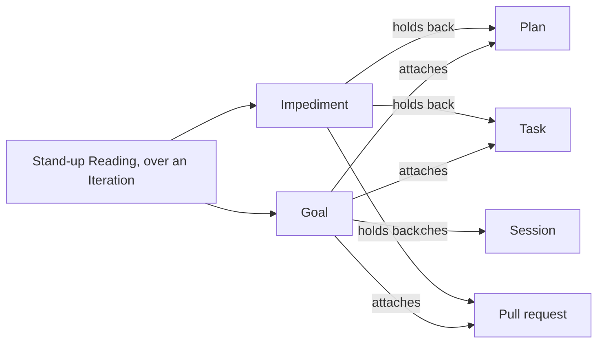

# Progress

```meta
index: root
type: context
deployment: module
related: [.devbook/arc42/05-building-block-view.md#desktop-app, .devbook/arc42/adr/0035-goals-and-impediments-replace-sprints.md]
```

Progress owns the goals a person's work is attached to, the impediments that hold it back, and the stand-up that reads both over an iteration.

Inside the boundary:

- each [Goal](domain.md#goal), with its title, outcome line and due date, and the
  work attached to it: plans, tasks, pull requests and sessions;
- how far a goal has come, counted per item, and whether it is
  [At risk or On track](domain.md#goal-forecast);
- each [Impediment](domain.md#impediment), its state and history, the tasks, pull
  requests and plans it holds back, and whether it is
  [ready to resolve](domain.md#ready-to-resolve);
- the [Iteration](domain.md#iteration) a person reads their work in, and the
  [stand-up](domain.md#stand-up) that reads goals, finished work, planned work and
  impediments over it.

Outside it: the task itself. [Tasks](../tasks/domain.md#task) owns a task's status,
due date, effort, blocked mark and linked pull requests. It knows nothing of goals or
impediments.



Progress reads each piece of work from its owner on every reading, naming it by:

- a task by its id;
- a plan by its [plan tag](../roadmap/domain.md#roadmap-tag);
- a pull request by its repository and number;
- a session by its agent and session id.

An impediment names the work it holds back the same way, sessions excepted. A session is [Sessions](../sessions/context.md)'s, and attaching one writes nothing there.

A task's blocked mark is Tasks' alone and raises nothing in Progress: a person raises an impediment and links the task. Tasks does not call Progress and stores no impediment id. The pace a stand-up plans against is
[Roadmap Planning](../roadmap/context.md#story-points-a-week)'s. Why goals and
impediments sit here is local
[ADR 0035](../../arc42/adr/0035-goals-and-impediments-replace-sprints.md). The
relationships are in [dependencies.md](dependencies.md).

ADR 0035 retires the sprint series Progress used to lay over repositories, with their settings and the parts of local [ADR 0028](../../arc42/adr/0028-progress-is-its-own-boundary-and-tasks-knows-no-sprints.md) that described them. The plan `+goals-standup` retired their code.

Goals, impediments and the stand-up are always on. The `goals` flag switched the context while it was built, and kept the In progress view for a person who had it off. Both are retired (local [ADR 0035 §10](../../arc42/adr/0035-goals-and-impediments-replace-sprints.md#10-the-view-is-goals-always-on)).

## Iteration length

```meta
type: setting
key: goals.iteration-length
scope: user
default: week
related: [.devbook/domain/progress/features.md#choosing-the-iteration, .devbook/domain/progress/domain.md#iteration]
```

How long the window is that a person reads their goals and stand-up in: `day`, `week`, `two-weeks` or `month`. [Iteration](domain.md#iteration) says which days each covers. The choice travels with the person to every device. It also sets the length whose last four iterations a [forecast](domain.md#goal-forecast) reads the done rate from.

## Two-week start

```meta
type: setting
key: goals.iteration-anchor
scope: user
related: [.devbook/domain/progress/features.md#choosing-the-iteration, .devbook/domain/progress/domain.md#iteration]
```

The date two-week iterations are counted from; each window starts on it or a whole number of fourteen days from it. It has no value until the person first chooses `two-weeks`, which asks for it and offers the Monday of the current week. Changing it moves every two-week window and changes no goal or impediment.
