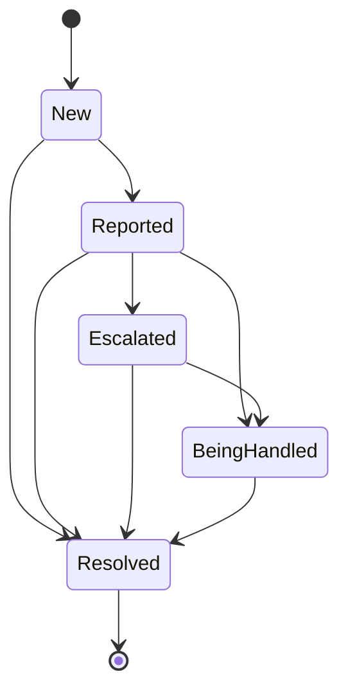

# Domain

```meta
type: domain
status: draft
```

> One chapter per Aggregate, Domain Service, Domain Event, or Shared Value
> Objects / Shared Enums grouping in this bounded context; each chapter's
> `type` records which of those it is. An Aggregate's owned Entities, Value
> Objects, and Enums are chapters directly beneath it, typed `entity`,
> `value-object`, and `enum`. Value Objects/Enums shared across multiple
> aggregates get their own chapter at the end instead of being duplicated.

What Progress owns and what it leaves to Tasks and Roadmap Planning is in
[context.md](context.md). The model holds no copy of a task, a plan or a pull
request. A goal names each by its identity, and asks their owners for their state on
every reading.

## Goal

```meta
type: aggregate
status: draft
related: [.devbook/domain/progress/domain.invariants.md#goal, .devbook/domain/progress/features.md#setting-a-goal, .devbook/domain/progress/features.md#attaching-work-to-a-goal, .devbook/domain/progress/domain.md#iteration]
aliases: [goal, goals]
```

Something a person is working towards, and when it should be reached by. A goal
holds:

- its `title`, such as "Customers get paid faster";
- an optional `outcome`, one line saying what is true once it is reached;
- an optional `due date`;
- its [Goal Attachments](#goal-attachment): the plans, tasks and pull requests whose
  work reaches it;
- the moment it was last changed, which travels with it to every device.

How far it has come is its [Goal Progress](#goal-progress), and whether it lands in
time is its [Goal Forecast](#goal-forecast). Neither is stored: both are read afresh
from the attached work on every reading, so a task finished elsewhere moves the goal
at once.

A goal without a due date is due on the last day of [next](#iteration), in the
person's chosen iteration length. That day is worked out afresh on every reading and
never stored, so the goal moves with the iteration until the person gives it a date.

The goal is the consistency boundary for its own attachments: one item is attached
once, and the counting rules see the whole set. That one item belongs to at most one
goal is a rule across goals, held by [Goal Assignment](#goal-assignment). The rules
the goal holds are in [its invariants](domain.invariants.md#goal).

Deleting a goal removes it and its attachments. The plans, tasks and pull requests
it held are unchanged and belong to no goal from then on.

### Goal Attachment

```meta
type: value-object
status: draft
aliases: [attached item, GoalAttachment]
related: [.devbook/domain/roadmap/domain.md#roadmap-tag, .devbook/domain/tasks/domain.md#task, .devbook/domain/tasks/domain.md#projection-ref]
```

One piece of work attached to a goal, of one of three kinds:

| Kind | Named by | Brings in |
|---|---|---|
| Plan | its [plan tag](../roadmap/domain.md#roadmap-tag), without the `+` sigil | every entry its roadmap item [gathers by tag](../roadmap/domain.md#roadmap-item-gathering), in any repository, finished or not, including entries filed later |
| Task | its task id | the task, and the pull requests it links |
| Pull request | its repository and number | the pull request alone |

A plan counts exactly the entries its roadmap item's bar gathers by tag: the ones
filed under `+tag`, and the ones carrying the bare tag, as an entry filed before the
sigil does or one tagged `#tag` is stored. A person tag spelled like the plan is not
one of them. Tasks owns that rule, and whoever hands Progress its tasks names each
task's slugs by it, so a goal and the roadmap never count a plan differently.

Equality is by kind and identity. The attachment also stores the day it was made.

### Goal Progress

```meta
type: value-object
status: draft
aliases: [progress, done/total, GoalProgress]
related: [.devbook/domain/progress/requirements.md#attaching-work-to-a-goal]
```

How much of a goal is [done](#done), as `done/total` over its items. Each item counts
once:

- an attached plan counts each of its entries;
- an attached task counts 1, and the pull requests it links ride along with it and
  do not count again;
- an attached pull request counts 1;
- a task that is both attached directly and an entry of an attached plan counts once,
  and so does a pull request attached directly that an attached task already links.

Beside `done/total` it carries how the open items stand: doing, blocked and to do. It
also carries how many items were done in the last iteration, shown as `+3`. Equality
is by value.

### Goal Forecast

```meta
type: value-object
status: draft
aliases: [forecast, landing date, lands, At risk, On track, GoalForecast]
related: [.devbook/domain/progress/requirements.md#the-goals-view]
```

When a goal is expected to land, and whether that is in time. The **landing date**
comes from the goal's done rate: the items it had done in each of the last four
iterations of the person's chosen [Iteration](#iteration) length, averaged. The open
items at that rate give how many more iterations it needs, and the landing date is
the last day of the last of them.

A goal is **At risk** when its landing date falls after its due date, or, for a goal
without one, after the last day of [next](#iteration). It is also At risk when an open
[Impediment](#impediment) holds back one of its items. Otherwise it is **On track**.
A goal with no open item is On track. A goal that did no item in the last four
iterations has no landing date, and is At risk while it has open items.

## Goal Assignment

```meta
type: domain-service
status: draft
related: [.devbook/domain/progress/domain.invariants.md#goal-assignment, .devbook/domain/progress/features.md#attaching-work-to-a-goal]
aliases: [GoalAssignment]
```

Attaches an item to a goal, and holds the one rule that spans goals: an item belongs
to at most one goal. It is a service because no single goal can see the others. It
treats a plan's entries the same way: an entry that another goal holds as an attached
task counts in that goal, and not in the goal that holds its plan.

An item another goal holds is refused, naming that goal, unless the attach asks to
move it (`moveFromOtherGoal`). The move is opt-in: the view asks the person first and
attaches again with the move on yes. Then the item leaves the other goal in the same
change, and both goals are saved, so it is never in two.

Invocation semantics: command-invoked, on every attach. Its rules are in
[its invariants](domain.invariants.md#goal-assignment).

## Impediment

```meta
type: aggregate
status: draft
related: [.devbook/domain/progress/domain.invariants.md#impediment, .devbook/domain/progress/features.md#tracking-an-impediment]
aliases: [impediment, impediments, blocker]
```

Something outside the person's own work that holds it back, tracked until it is
resolved. An impediment holds:

- its `title`, such as "Bank sample files missing";
- its [Impediment State](#impediment-state);
- who it was reported or escalated to, as a name in words, such as "bank support" or
  "account manager";
- who handles it, as a name in words;
- an optional `check again` date, the day the person means to look at it next;
- an optional `note`;
- its history of [State Changes](#state-change);
- the tasks it [Holds Back](#holds-back), and through them their goals.

An impediment is open until it is Resolved. Its age is the working days since it was
raised, counted in the person's
[working week](../roadmap/domain.md#working-week). The rules it holds are in
[its invariants](domain.invariants.md#impediment).

### Impediment State

```meta
type: enum
status: draft
aliases: [ImpedimentState, impediment state]
related: [.devbook/domain/progress/requirements.md#tracking-an-impediment]
```



- `New`: raised, and not yet reported to anyone.
- `Reported`: told to whoever can remove it.
- `Escalated`: taken higher because the report was not enough. A state an impediment
  may skip.
- `BeingHandled`: someone is working on removing it. Shown as "Being handled".
- `Resolved`: no longer in the way.

### State Change

```meta
type: entity
status: draft
aliases: [history, StateChange]
```

One step in an impediment's history: the state it moved to, the day it moved, and
who it was with at that step, such as "Reported · bank support". The history is
in the order the steps happened, and the first step is always `New`.

### Holds Back

```meta
type: value-object
status: draft
aliases: [holds back, blocks, HoldsBack]
related: [.devbook/domain/tasks/domain.md#task]
```

A link from an impediment to one task it holds back, by the task's id. Equality is by
the task id. The goal an impediment holds back is read through the task: the goal
that counts the task, if any.

## Blocked Task Policy

```meta
type: domain-service
status: draft
related: [.devbook/domain/progress/features.md#raising-an-impediment-from-a-blocked-task, .devbook/domain/tasks/domain.md#task]
aliases: [BlockedTaskPolicy]
```

Raises an impediment when a task is marked blocked. When a task gains the mark, by its
`blocked:` token or a `set_blocked` call, and no impediment tracks that block, the
policy raises a `New` impediment titled with the task's title that holds the task
back. An impediment tracks a task's block when it holds the task back and is open, or
was raised on or after the day the task was marked blocked. The second half keeps a
person's Resolve from being undone while the task is still marked, and lets a task
marked blocked again later raise a new one. Tasks knows nothing of it: the policy
reads the mark from the task, and stores nothing on the task.

Invocation semantics: event-triggered policy. Tasks' change signal names no task, so
an adapter beside Progress hears every task written on this device and runs the
policy, which reads every blocked task that is not finished and asks each whether
its block is tracked. A task copy pulled by sync is not heard: the device that marked
the task raised the impediment, and it arrives as its own document. What the policy
promises is a requirement of
[Tracking an impediment](requirements.md#tracking-an-impediment).

## Stand-up Reading

```meta
type: domain-service
status: draft
related: [.devbook/domain/progress/features.md#the-stand-up, .devbook/domain/progress/features.md#the-goals-view, .devbook/domain/tasks/domain.md#task-status, .devbook/domain/tasks/domain.md#readiness]
aliases: [StandUpReading]
```

Reads the goals and the impediments against the current state of the work they name,
over one [Iteration](#iteration). It resolves each goal's items, decides which are
[done](#done), and gives each goal its [Goal Progress](#goal-progress) and
[Goal Forecast](#goal-forecast). It gives the four blocks of the
[stand-up](#stand-up): the goals, what was finished in the last window, what is
[planned](#planned) for the next, and the open impediments.

Invocation semantics: query/composition-oriented. It stores nothing.

## Shared Value Objects

```meta
type: shared-value-objects
status: draft
related: [.devbook/domain/progress/domain.invariants.md#iteration]
```

> Value Objects used by more than one aggregate or service in this bounded context.

### Iteration

```meta
type: value-object
status: draft
aliases: [iteration, window, last, next, Iteration]
related: [.devbook/domain/progress/domain.invariants.md#iteration, .devbook/domain/progress/context.md#iteration-length, .devbook/domain/progress/context.md#two-week-start]
```

A viewing window over the calendar, not a thing anyone creates or closes. It is
shared by the goals, the impediments and the stand-up. Its **length** is one of four:

| Length | One window |
|---|---|
| Day | one working day of the person's [working week](../roadmap/domain.md#working-week) |
| Week | Monday to Friday |
| Two weeks | fourteen days from the [two-week start](context.md#two-week-start), or a whole number of fourteen days before or after it; until a start is chosen, from the Monday of the current week |
| Month | one calendar month, from its first day to its last |

**Next** is the window that holds today. When today falls in no window, such as a
Saturday in a Monday-to-Friday week, next is the first window after today. **Last** is
the window just before next. On Saturday 17 October 2026, with Week chosen, last is
12 to 16 October and next is 19 to 23 October.

Equality is by length and first day.

## Ubiquitous Language

```meta
type: ubiquitous-language
status: draft
```

### Done

```meta
type: term
status: draft
related: [.devbook/domain/tasks/domain.md#task-status, .devbook/domain/tasks/domain.md#completed]
```

A task is done when its status is Done, or when every pull request it links is
merged. Either is enough. A task with no linked pull request is done only by its
status. A pull request is done when it is merged. A plan's entry is a task, done the
same way. The day an item was done is the day its task was
[completed](../tasks/domain.md#completed), or the day its last pull request merged.

### Stand-up

```meta
type: term
status: draft
aliases: [standup, stand-up]
related: [.devbook/domain/progress/features.md#the-stand-up, .devbook/domain/progress/domain.md#stand-up-reading]
```

The short reading a person gives of their work, in four blocks: goal progress, what
was finished in the last iteration, what is planned for the next, and the
impediments.

### Planned

```meta
type: term
status: draft
related: [.devbook/domain/progress/features.md#the-stand-up, .devbook/domain/tasks/domain.md#readiness]
```

The work a stand-up expects in the next iteration. Nobody picks it: it is derived from
three sources, each item listed once:

- the items goals hold that are in progress and not blocked;
- the items due inside the next window, under No goal when no goal holds them;
- for each attached plan, its first [ready](../tasks/domain.md#readiness) entry in the
  plan's order that is not in progress, marked blocked or archived yet.

### Pace

```meta
type: term
status: draft
related: [.devbook/domain/roadmap/context.md#story-points-a-week]
```

The story points a person gets done in a working week, as the Roadmap measures it or
the person typed it ([Story points a week](../roadmap/context.md#story-points-a-week)).
A stand-up scales it to the next window: the pace times the window's working days,
divided by the working days of a working week, rounded to whole points.
