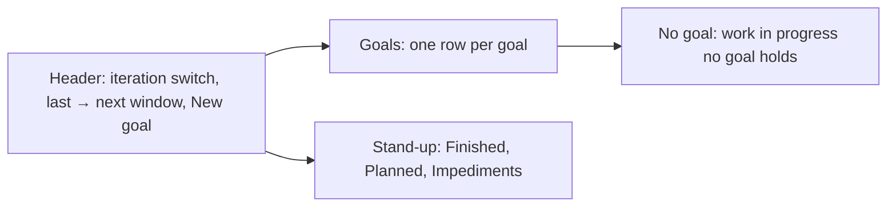
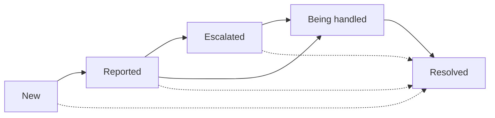

# Features

```meta
type: features
status: draft
```

> Features and sub-features this bounded context supports, described in
> business/ubiquitous language rather than implementation terms.

Every feature here is always on: no flag stands in front of goals, impediments or
the stand-up. Why goals and impediments are the model is local
[ADR 0035](../../arc42/adr/0035-goals-and-impediments-replace-sprints.md).

## The Goals view

```meta
type: feature
status: draft
related: [.devbook/domain/progress/domain.md#goal, .devbook/domain/progress/domain.md#goal-forecast, .devbook/domain/progress/domain.md#stand-up-reading, .devbook/domain/progress/requirements.md#the-goals-view, .devbook/domain/sessions/features.md#in-progress-by-task]
tests: [unit:dotnet:Backlog.UI.Components.UnitTests.GoalsBoardComponentsTests, unit:dotnet:Backlog.Desktop.UI.UnitTests.GoalsHostTests]
```

Answer "where are my goals, and what is in the way" as one desktop view. **Goals** is
the first option of the work in progress group in the header, a main view rather than
a takeover, so the Devbook still opens beside it. It replaced the
[In progress](../sessions/features.md#in-progress-by-task) view, and has no board of
sessions and pull requests by task. It is offered whether or not the Sessions and Pull
requests lists are.



The header holds the [iteration switch](#choosing-the-iteration), the last and next
window, such as "12–16 Oct → 19–23 Oct", **New goal**, **Copy**
([copying the stand-up](#copying-the-stand-up)) and **Refresh**.

Each goal reads as one row: its title, its progress as `done/total`, the items done in
the last iteration as `+3`, its due date, its landing date as "lands ~6 Nov" and an
**At risk** or **On track** badge. A goal without a due date shows the last day of the
next window instead, as "due 23 Oct (end of iteration)". The
[Attach to goal](#attaching-work-to-a-goal) picker lists such a goal as "due end of
iteration", and its **New goal…** needs only a title. A bar shows how much is done, in progress, blocked
and not started, and says it in words to a screen reader. One goal is open at a time,
the first when the view opens. Opened, the row lists what is attached to it under
Plan, Tasks and Pull requests. A plan shows its own `done/total`; a pull request shows
its [status](#pull-request-status), and a merged one reads as its number and "merged".

Below the goals, **No goal** lists the tasks in progress and the open pull requests in
the header's repository scope that no goal holds, each with **Attach…**. The view lists
every goal, whatever the repository scope. With no goals and nothing in progress
outside one, the view says so and offers **New goal**.

Beside them sits the [stand-up](#the-stand-up), read over the same windows. The view is
read when it opens, on a change of iteration, on Refresh, after each change made in
it, and whenever goals, impediments or the iteration setting change elsewhere.

## Setting a goal

```meta
type: feature
status: draft
related: [.devbook/domain/progress/domain.md#goal, .devbook/domain/progress/requirements.md#setting-a-goal]
```

Say what the work is for. **New goal** asks for a title, an optional one-line outcome
and an optional due date, its field labelled **Due date (optional)**. A goal without a
due date is due at the end of the iteration, as [Goal](domain.md#goal) says. A goal's
row offers the same fields to edit, and **Delete goal…**, which asks first. Emptying
the row's due date field and leaving it clears the goal's date, and typing a date sets
it again. Deleting a goal frees what it held: no plan, task or pull request
changes. Goals are set on the desktop only.

## Attaching work to a goal

```meta
type: feature
status: draft
related: [.devbook/domain/progress/domain.md#goal-attachment, .devbook/domain/progress/domain.md#goal-progress, .devbook/domain/progress/domain.md#goal-assignment, .devbook/domain/progress/requirements.md#attaching-work-to-a-goal, .devbook/arc42/adr/0037-a-session-attaches-to-a-goal-as-its-own-item.md]
```

Say which work reaches a goal. Four kinds of item attach:

- a **plan**, by its [plan tag](../roadmap/domain.md#roadmap-tag), which brings in
  every entry its roadmap item gathers by tag — filed under `+tag` or carrying the
  bare `#tag` — including entries filed later;
- a **task**, by its id, whose linked pull requests come with it;
- a **pull request**, by its repository and number, for work no task covers;
- a **session**, by its agent and session id, whose linked tasks and the pull request
  on its branch come with it, for work that has no task or pull request yet.

An open goal offers "Attach a plan, task, pull request or session": typing lists the
matching plans, tasks, pull requests and sessions, each named by its kind, and a pull
request is found by its number too. A session is found by its id, typed whole or as the
eight characters the screens show, with or without the word "Session". Typing a
session's number lists the session first, then the tasks linked to it, then the pull
request on its branch when it has one, so the person attaches whichever fits. With the
[Sessions area](../sessions/context.md#sessions-area) off, no session is offered, and a
session already attached counts by its linked tasks alone. **Attach…** on a No goal row attaches the item to the open goal, or
asks which goal when none is open. Both questions are the same **Attach to goal**
picker every other goal control opens. An item belongs to at most one goal. An item
another goal holds is not attached silently: the picker opens on the goal it was meant
for, names the goal that holds it and says attaching moves it from there, and
**Attach** moves it. Detaching an item changes nothing on it. Attaching is a desktop
action.

[Goal Progress](domain.md#goal-progress) says how the attached work is counted.
Attaching changes nothing on the task, the plan, the pull request or the session.

## Choosing the iteration

```meta
type: feature
status: draft
setting: [.devbook/domain/progress/context.md#iteration-length, .devbook/domain/progress/context.md#two-week-start]
related: [.devbook/domain/progress/domain.md#iteration, .devbook/domain/progress/requirements.md#choosing-the-iteration]
```

Choose the window the goals and the stand-up are read in: **Day**, **Week**,
**2 weeks** or **Month**. The switch sits in the Goals view's header and on the
phone's stand-up, and the choice is the person's own
[Iteration length](context.md#iteration-length) setting. The first time a person
chooses 2 weeks, they give the day two-week iterations count from. The header names
the last and the next window. [Iteration](domain.md#iteration) says which days each
length covers.

## The stand-up

```meta
type: feature
status: draft
related: [.devbook/domain/progress/domain.md#stand-up, .devbook/domain/progress/domain.md#planned, .devbook/domain/progress/domain.md#pace, .devbook/domain/progress/requirements.md#the-stand-up]
```

Read what to say at a stand-up without gathering it by hand. The stand-up has four
blocks, read over the [iteration](#choosing-the-iteration):

| Block | Holds |
|---|---|
| Goals | each goal's progress, `+n` done in the last window, due date and badge |
| Finished | the items the goals count that were done in the last window, grouped by goal |
| Planned | the [planned](domain.md#planned) items for the next window, grouped by goal, with the points tag |
| Impediments | each open impediment with its state, marked when it is [ready to resolve](domain.md#ready-to-resolve), then how many were resolved in the last window |

Each block's heading carries its count. A goal without a due date reads as due at the
end of the next window, such as "due 23 Oct (end of iteration)", here and in the copied
text. A planned item shows its `effort:` in points,
and a planned item with a pull request shows its [status](#pull-request-status).

On the desktop, the Goals block is the goals beside the stand-up, which holds
Finished, Planned and Impediments. Work no goal holds is not listed under Finished:
the stand-up reports what the goals track.

The **points tag** on Planned compares the planned effort with what the person
usually gets done in such a window, such as `21 / 18 pts`. The first figure is the
`effort:` of the planned items added up. The second is the person's
[pace](domain.md#pace) from the Roadmap, scaled to the next window's working days. A
planned item without an effort adds nothing to the first figure. The tag's title says
it in words, such as "21 points planned, you usually finish 18 a week", the period
following the iteration. Without a pace the tag is the planned points alone, such as
`21 pts`.

An impediment's line names who it is with, its age in working days and the goal it
holds back, such as "Account manager · 3 days · Customers get paid faster". A New one
reads "Not reported yet". A check-again date takes the age's place: "check Tue". The
goal is the one that counts a [held-back item](domain.md#holds-back): a task, a pull
request or an entry of a held-back plan. When its items belong to several goals, the
line names the goal of the first item linked.

Under that line the impediment's note shows as written, whichever device wrote it. On
the desktop, **Add note** or **Edit note** opens it in place: leaving the box keeps
it, Escape abandons it, and a blank note clears it. The note is saved like the
phone's, through Progress, and the stand-up is read again.

### Copying the stand-up

```meta
type: sub-feature
status: draft
related: [.devbook/domain/progress/requirements.md#the-stand-up]
```

**Copy** puts the four blocks on the clipboard as plain text, each heading with its
count, Finished grouped by goal, Planned grouped by goal with No goal last, the points tag beside
Planned and "n resolved" after Impediments. Every line is a fixed template filled
from the reading; none is written by a model. Copying is a desktop action. Formatted
(HTML) copy is a later addition.

## Tracking an impediment

```meta
type: feature
status: draft
related: [.devbook/domain/progress/domain.md#impediment, .devbook/domain/progress/domain.md#impediment-state, .devbook/domain/progress/requirements.md#tracking-an-impediment, .devbook/design/color-scheme.md]
tests: [unit:dotnet:Backlog.Modules.Progress.UnitTests.ImpedimentMovesTests]
```

Keep track of what holds work back until it is out of the way. A person raises an
impediment with a title, links the tasks, pull requests and plans it holds back, and
moves it through its states as they chase it:



Escalated may be skipped, and any open state may move straight to Resolved. Each move
records its day, and who the impediment is with at that step. The phone's impediment
page shows that history as a stepper, its check-again date, its note and the items it
holds back, and through them the goal. Each state has its own colour, so a row says
its state at a glance; [the colour scheme](../../design/color-scheme.md) gives them.

In the stand-up, each impediment's state is a picker wearing the state's badge. It
offers only the moves the impediment may make, and picking one keeps who it was last
with. A move the impediment may not make is refused with the reason, and the state
stays as it was.

An open impediment that holds back a goal's item makes that goal
[At risk](domain.md#goal-forecast). It stays At risk until the person resolves the
impediment, even while the impediment reads ready to resolve.

### Raising an impediment

```meta
type: sub-feature
status: draft
related: [.devbook/domain/progress/domain.md#impediment, .devbook/domain/progress/requirements.md#tracking-an-impediment]
```

Track a blocker the moment it shows up. The stand-up's Impediments block on the
desktop offers **Raise impediment**. It asks for a title, an optional note and,
optionally, the first items the impediment holds back, picked as
[linking](#linking-what-an-impediment-holds-back) picks them. The impediment starts
New, dated today, and is listed at once.

Raising is a desktop and agent action. The phone raises nothing, and nothing raises an
impediment on the person's behalf.

### Linking what an impediment holds back

```meta
type: sub-feature
status: draft
related: [.devbook/domain/progress/domain.md#holds-back, .devbook/domain/progress/features.md#attaching-work-to-a-goal, .devbook/domain/progress/requirements.md#tracking-an-impediment]
```

Say what the impediment is in the way of. Each open impediment in the desktop
stand-up offers **Link…**, which opens the same search the
[Attach to goal](#attaching-work-to-a-goal) picker uses, limited to three kinds:

- a **task**, by its id;
- a **pull request**, by its repository and number, found by its number too, for work
  no task covers;
- a **plan**, by its [plan tag](../roadmap/domain.md#roadmap-tag), which holds back
  every entry filed under it, including entries filed later.

A session is not offered. Each linked item shows under the impediment with its kind,
and **Unlink** beside it removes the link. Linking an item the impediment already
holds back changes nothing. Linking and unlinking change nothing on the task, the pull
request or the plan, and add no step to the impediment's history. An item may be held
back by several impediments, and may belong to a goal as well.

### Seeing an impediment ready to resolve

```meta
type: sub-feature
status: draft
related: [.devbook/domain/progress/domain.md#ready-to-resolve, .devbook/domain/progress/domain.md#settled, .devbook/domain/progress/requirements.md#tracking-an-impediment]
```

Notice when a blocker is out of the way without checking each item by hand. Once
every item an open impediment holds back is [settled](domain.md#settled), its row
reads **Ready to resolve** beside its state badge, in the stand-up on the desktop and
on the phone.

The mark is a cue for the person, not a move. The impediment keeps its state and its
place in the list, and the person resolves it with the state picker as before. The
mark goes again when an item comes back, such as a task reopened from Done. An
impediment that holds back nothing never reads ready to resolve.

### Impediments for agents

```meta
type: sub-feature
status: draft
related: [.devbook/domain/progress/domain.md#holds-back, .devbook/domain/progress/requirements.md#tracking-an-impediment]
```

Let an agent track a blocker it runs into. Behind the always-on Tasks key that
`set_blocked` answers to, an agent works with impediments through MCP tools:

- `raise_impediment` raises one with its title, a note and the tasks, pull requests and
  plans it holds back;
- one tool links a task, a pull request or a plan to an impediment, and another
  unlinks one;
- `set_impediment_state` moves one to reported, escalated, being-handled or resolved,
  with who it is with at that step.

An agent names a pull request by its repository and number, and a plan by its tag.
`set_blocked` marks a task only, and raises no impediment.

### Raising an impediment from a blocked task

```meta
type: sub-feature
status: deprecated
related: [.devbook/domain/progress/domain.md#blocked-task-policy, .devbook/domain/tasks/features.md#marking-a-task-blocked, .devbook/arc42/adr/0035-goals-and-impediments-replace-sprints.md]
```

Retired. Marking a task blocked used to raise a New impediment for it. Those
impediments were never resolved for the person, so the stand-up kept listing
blockers whose tasks were long done. A task's
[blocked mark](../tasks/features.md#marking-a-task-blocked) now raises nothing, and a
person [raises an impediment](#raising-an-impediment) themselves.

The impediments it raised stay as they are. Each holds back its one task, so it reads
ready to resolve once that task is settled.

## Pull request status

```meta
type: feature
status: proposed
related: [.devbook/domain/progress/requirements.md#pull-request-status, .devbook/domain/repository-management/features.md#pull-request-status, .devbook/domain/repository-management/features.md#pull-request-readiness, .devbook/design/color-scheme.md, .devbook/arc42/adr/0042-repository-management-owns-pull-request-state.md]
tests: [unit:dotnet:Backlog.Infrastructure.FileSystem.UnitTests.RepositoryManagementGoalPullRequestsTests]
```

Goal rows show the status Repository Management publishes. Every pull request row in
Progress carries its number and the checks and approvals marks of
[Pull request status](../repository-management/features.md#pull-request-status), and
a merged one reads "merged" instead of both. So a pull request reads the same on a
goal as in the [pull requests pane](../repository-management/features.md#pull-request-readiness).

Progress defines neither mark. It names a pull request by its repository and number,
and Repository Management answers with its status. The marks used to be defined here
(local ADR 0035 §7); local
[ADR 0042](../../arc42/adr/0042-repository-management-owns-pull-request-state.md#5-progresss-reader-goes-through-the-contract)
moved them to the context that reads pull requests. The rows draw as they did; only
the owner of what they draw changed.

## Goals on the phone

```meta
type: feature
status: draft
related: [.devbook/domain/progress/requirements.md#goals-on-the-phone, .devbook/arc42/06-runtime-view.md#mobile-my-day-and-task-push]
```

Read the stand-up on the way to it. The phone's **Stand-up** tab shows the four blocks
with the iteration switch. A goal opens on its own page: its badge, due and landing
date, `done/total` with how many items are doing, blocked and to do, and its items
under Plan, Tasks, Pull requests and Sessions. A goal without a due date reads "due 23 Oct
(end of iteration)" on its stand-up card and on its page. An impediment opens on its own page: its age, the
goal it holds back, its history, its check-again date, its note and the tasks, pull
requests and plans it holds back. An impediment whose items are all settled reads
ready to resolve there too.

The phone reads goals, the stand-up and impediments. The one thing it changes is an
impediment: its state, its check-again date and its note. Those changes go through the
device outbox, as the phone's task edits do. The state list offers only the moves the
impediment may make from where it stands. Until a desktop has applied a change, the
impediment's page shows what was asked, with Waiting beside it while the change is
still on the phone. Setting a goal, attaching work, raising an impediment, linking
what it holds back and copying the stand-up are desktop actions.

The stand-up on the phone is the desktop's stand-up of the same work. Pull request
checks and approvals, each attached session's title and state, and the state of each
pull request an open impediment holds back show as a desktop last read them, so the
phone never needs GitHub or the session records. A change made on the phone shows there once a desktop has applied it. When a
desktop changed the same field after the phone last synced, the desktop's change
stands and the phone's is dropped. So does a change a desktop did not apply: once a
newer copy of the impediment reaches the phone without it, the phone shows that copy.

## Syncing goals and impediments

```meta
type: feature
status: draft
depends-on: [.devbook/domain/tasks/features.md#multi-device-sync]
related: [.devbook/arc42/adr/0018-roadmap-plan-and-pace-ride-the-task-feed.md, .devbook/arc42/adr/0035-goals-and-impediments-replace-sprints.md, .devbook/domain/progress/requirements.md#syncing-goals-and-impediments]
```

Keep every goal and impediment the same on every device the person has paired. They
travel beside the tasks the devices already sync
([Multi-device sync](../tasks/features.md#multi-device-sync)), as two document kinds,
`goal` and `impediment`, one document per goal or impediment under its own id. They
travel only while sync is on and the device is paired.

Each document is replaced whole, never merged. When two devices have both changed one
goal or one impediment since they last synced, the newer change wins on every device
and the older one is lost. Two goals are two documents, so a change to one never
displaces a change to the other. A deleted goal is deleted on every device, and the
newer-change rule decides the deletion like any other change. An impediment is never
deleted: it is resolved.

An impediment travels with every item it holds back, of all three kinds. What a
device still on a build from before pull requests and plans could be held back does
with such an impediment, and what that costs, is local
[ADR 0035](../../arc42/adr/0035-goals-and-impediments-replace-sprints.md).

One that arrives from another
device shows at once on every screen that draws it, without the person pressing
Refresh.

A goal without a due date travels with no date in its document. A device that still
runs a build from before due dates were optional shows such a goal as due 1 Jan 0001
until it updates. A newer build reads 0001-01-01 as no date, so a goal that an older
build saves back stays dateless everywhere else.
