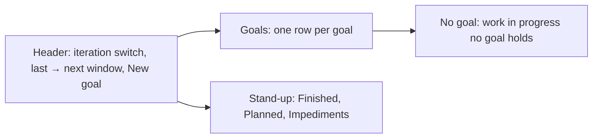
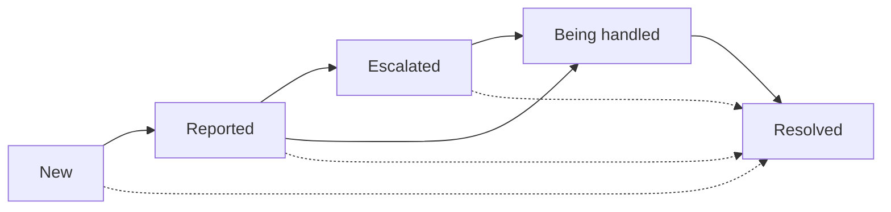
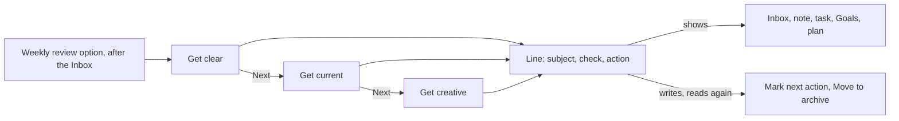
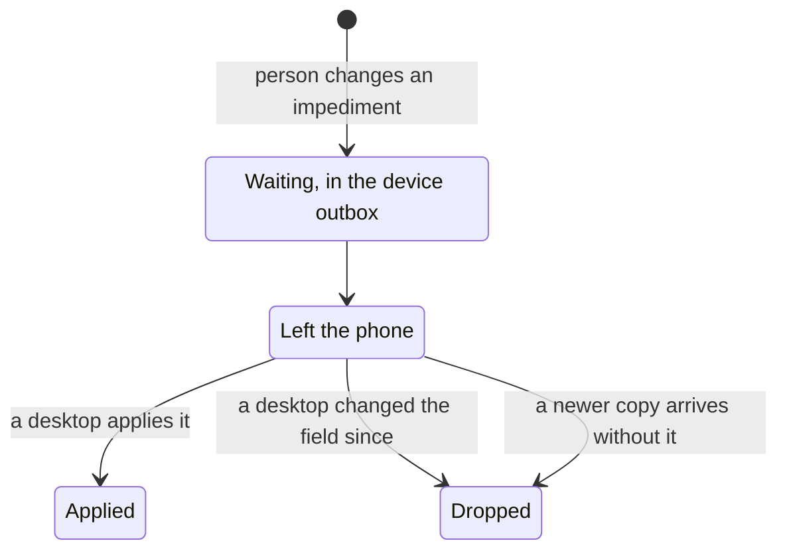

# Features

```meta
type: features
```

> Features and sub-features this bounded context supports, described in
> business/ubiquitous language rather than implementation terms.

Every feature here is always on but [the weekly review](#the-weekly-review), behind the [Weekly review](context.md#weekly-review) flag. Why goals and impediments are the model is local [ADR 0035](../../arc42/adr/0035-goals-and-impediments-replace-sprints.md).

## The Goals view

```meta
type: feature
related: [.devbook/domain/progress/domain.md#goal, .devbook/domain/progress/domain.md#goal-forecast, .devbook/domain/progress/domain.md#stand-up-reading, .devbook/domain/progress/requirements.md#the-goals-view, .devbook/domain/sessions/features.md#in-progress-by-task]
tests: [unit:dotnet:Backlog.UI.Components.UnitTests.GoalsBoardComponentsTests, unit:dotnet:Backlog.Desktop.UI.UnitTests.GoalsHostTests, unit:dotnet:Backlog.Desktop.UI.UnitTests.GoalAttachTests]
```



Answer "where are my goals, and what is in the way" as one desktop view. **Goals** is the first option of the Goals group in the header, a main view rather than a takeover, so the Devbook still opens beside it. It replaced the [In progress](../sessions/features.md#in-progress-by-task) view and has no board of sessions and pull requests by task. It is offered whether or not the Sessions and Pull requests lists are.

The header holds the [iteration switch](#choosing-the-iteration), the last and next window, such as "12–16 Oct → 19–23 Oct", **New goal**, **Copy** ([copying the stand-up](#copying-the-stand-up)) and **Refresh**.

Each goal reads as one row: title, progress as `done/total`, items done in the last iteration as `+3`, due date, landing date as "lands ~6 Nov", and an **At risk** or **On track** badge.

A goal without a due date shows the last day of the next window instead, as "due 23 Oct (end of iteration)". The [Attach to goal](#attaching-work-to-a-goal) picker lists it as "due end of iteration", and its **New goal…** needs only a title.

A bar shows four amounts and says them in words to a screen reader: done, in progress, blocked and not started. One goal is open at a time, the first when the view opens. Opened, the row lists what is attached under Plan, Tasks and Pull requests. A plan shows its own `done/total`; a pull request shows its title above its [status](#pull-request-status), and a merged one reads as its number and "merged".

Below the goals, **No goal** lists the tasks in progress and the open pull requests in the header's repository scope that no goal holds, each with **Attach…**. The view lists every goal, whatever the repository scope. With no goals and nothing in progress outside one, the view says so and offers **New goal**.

Each No goal row says how its work stands: a task carries its status dot, in progress or blocked, and a pull request its [status](#pull-request-status) line in place of its plain number. A row leads with a grip, by which it can be [dragged onto a goal](#attaching-work-to-a-goal) besides **Attach…**.

Beside them sits the [stand-up](#the-stand-up), read over the same windows. The view is read:

- when it opens;
- on a change of iteration;
- on Refresh;
- after each change made in it;
- whenever goals, impediments or the iteration setting change elsewhere.

After an attach, a move or a detach made in it, a goal shows what it now holds at once, and its counts and pull request statuses follow when the view is read again.

## Setting a goal

```meta
type: feature
related: [.devbook/domain/progress/domain.md#goal, .devbook/domain/progress/requirements.md#setting-a-goal, .devbook/domain/progress/features.md#goals-for-agents]
```

Say what the work is for. **New goal** asks for a title, an optional one-line outcome
and an optional due date, its field labelled **Due date (optional)**. A goal without a
due date is due at the end of the iteration, as [Goal](domain.md#goal) says.

A goal's row offers the same fields to edit, and **Delete goal…**, which asks first. Emptying the due date field and leaving it clears the date; typing a date sets it again. Deleting a goal frees what it held and changes no plan, task or pull request. Goals are set on the desktop and by an [agent](#goals-for-agents), never on the phone.

## Attaching work to a goal

```meta
type: feature
related: [.devbook/domain/progress/domain.md#goal-attachment, .devbook/domain/progress/domain.md#goal-progress, .devbook/domain/progress/domain.md#goal-assignment, .devbook/domain/progress/requirements.md#attaching-work-to-a-goal, .devbook/arc42/adr/0037-a-session-attaches-to-a-goal-as-its-own-item.md]
```

Say which work reaches a goal. Four kinds of item attach:

- a **plan**, by its [plan tag](../roadmap/domain.md#roadmap-tag), which brings in every entry its roadmap item gathers by tag, filed under `+tag` or carrying the bare `#tag`, including later ones;
- a **task**, by its id, whose linked pull requests come with it;
- a **pull request**, by its repository and number, for work no task covers;
- a **session**, by its agent and session id, whose linked tasks and branch pull request come with it, for work that has no task or pull request yet.

An open goal offers "Attach a plan, task, pull request or session". Typing lists the matching items, each named by its kind; a pull request is found by its number too. A session is found by its id, typed whole or as the eight characters the screens show, with or without the word "Session". Typing a session's number lists the session first, then its linked tasks, then its branch pull request, so the person attaches whichever fits. With the [Sessions area](../sessions/context.md#sessions-area) off, no session is offered, and one already attached counts by its linked tasks alone.

The search leaves out a done task and a finished plan, one whose entries are all done or archived, as [Settled](domain.md#settled) defines it. A finished plan returns when a person reopens an entry or files an open one. A plan with no entries is still offered. So a finished plan cannot be found to move or attach again until it has an open entry.

**Attach…** on a No goal row attaches the item to the open goal, or asks which goal when none is open, in the same **Attach to goal** picker every other goal control opens.

A No goal row can also be dragged by its grip onto a goal, open or folded. The goal under the pointer is outlined as the drop target; anywhere else the cursor says the drop is not allowed, and a drop there, or Escape, attaches nothing. Once attached, the board says "Attached ‹title› to ‹goal›." to a screen reader; a refused attach is not said. **Attach…** stays the keyboard's way in.

An item another goal holds is not attached silently. The picker opens on the goal it was meant for, names the goal that holds the item and says attaching moves it from there. **Attach** then moves it. Attaching and detaching are desktop and [agent](#goals-for-agents) actions and change nothing on the task, plan, pull request or session. [Goal Progress](domain.md#goal-progress) says how the attached work is counted.

### Goals for agents

```meta
type: sub-feature
related: [.devbook/domain/progress/domain.md#goal, .devbook/domain/progress/domain.md#goal-attachment, .devbook/domain/progress/features.md#setting-a-goal, .devbook/domain/progress/requirements.md#attaching-work-to-a-goal, .devbook/arc42/adr/0037-a-session-attaches-to-a-goal-as-its-own-item.md]
tests: [unit:dotnet:Backlog.Infrastructure.Mcp.UnitTests.GoalToolsTests]
```

Let an agent keep the goals its work is for. Behind the always-on Tasks key, beside the [impediment tools](#impediments-for-agents), an agent works with goals through MCP tools:

- `list_goals` reads every goal with its title, outcome and due date, what it holds and its progress;
- `create_goal` sets one with a title, an optional outcome and an optional due date, and refuses one without a title (`progress.goal_without_title`);
- `update_goal` changes the fields it is given and keeps the rest;
- `delete_goal` deletes one and frees what it held;
- `attach_to_goal` and `detach_from_goal` attach or detach one plan by its tag, one task by its id, or one pull request by its repository and number.

An agent attaches no session: a session attaches on the desktop alone (local [ADR 0037](../../arc42/adr/0037-a-session-attaches-to-a-goal-as-its-own-item.md)). An item another goal holds is refused, naming that goal (`progress.item_in_other_goal`), unless the agent asks to move it. Then it leaves that goal and joins this one, as **Attach** in the picker moves it.

## Choosing the iteration

```meta
type: feature
setting: [.devbook/domain/progress/context.md#iteration-length, .devbook/domain/progress/context.md#two-week-start]
related: [.devbook/domain/progress/domain.md#iteration, .devbook/domain/progress/requirements.md#choosing-the-iteration]
```

Choose the window the goals and the stand-up are read in: **Day**, **Week**, **2 weeks** or **Month**. The switch sits in the Goals view's header and on the phone's stand-up, and the choice is the person's own [Iteration length](context.md#iteration-length) setting. The first time a person chooses 2 weeks, they give the day two-week iterations count from. The header names the last and the next window. [Iteration](domain.md#iteration) says which days each length covers.

## The stand-up

```meta
type: feature
related: [.devbook/domain/progress/domain.md#stand-up, .devbook/domain/progress/domain.md#planned, .devbook/domain/progress/domain.md#pace, .devbook/domain/progress/requirements.md#the-stand-up]
```

Read what to say at a stand-up without gathering it by hand, in four blocks over the [iteration](#choosing-the-iteration):

| Block | Holds |
|---|---|
| Goals | each goal's progress, `+n` done in the last window, due date and badge |
| Finished | the items the goals count that were done in the last window, grouped by goal |
| Planned | the [planned](domain.md#planned) items for the next window, grouped by goal, with the points tag |
| Impediments | each open impediment with its state, then how many were resolved in the last window |

Each block's heading carries its count. An impediment that is [ready to resolve](domain.md#ready-to-resolve) is marked in its block. A goal without a due date reads as due at the end of the next window, such as "due 23 Oct (end of iteration)", here and in the copied text. A planned item shows its `effort:` in points, and one with a pull request shows its [status](#pull-request-status).

On the desktop, the Goals block is the goals beside the stand-up, which holds Finished, Planned and Impediments. Finished lists only what the goals track, never work no goal holds.

The **points tag** on Planned compares the planned effort with what the person usually gets done in such a window, such as `21 / 18 pts`. The first figure is the `effort:` of the planned items added up; an item without an effort adds nothing. The second is the person's [pace](domain.md#pace) from the Roadmap, scaled to the next window's working days. The tag's title says it in words, such as "21 points planned, you usually finish 18 a week", the period following the iteration. Without a pace the tag is the planned points alone, such as `21 pts`.

An impediment's line names who it is with, its age in working days and the goal it holds back, such as "Account manager · 3 days · Customers get paid faster". A New one reads "Not reported yet". A check-again date takes the age's place: "check Tue". The goal is the one that counts a [held-back item](domain.md#holds-back); when the items belong to several goals, the line names the goal of the first item linked.

Under that line the impediment's note shows as written, whichever device wrote it. On the desktop, **Add note** or **Edit note** opens it in place: leaving the box keeps it, Escape abandons it, and a blank note clears it. The note is saved like the phone's, through Progress, and the stand-up is read again.

### Copying the stand-up

```meta
type: sub-feature
related: [.devbook/domain/progress/requirements.md#the-stand-up]
```

**Copy** puts the four blocks on the clipboard as plain text:

- each heading with its count;
- Finished and Planned grouped by goal, No goal last;
- the points tag beside Planned;
- "n resolved" after Impediments.

Every line is a fixed template filled from the reading; none is written by a model. Copying is a desktop action. Formatted (HTML) copy is a later addition.

### Reading the stand-up as an agent

```meta
type: sub-feature
related: [.devbook/domain/progress/domain.md#stand-up-reading, .devbook/domain/progress/context.md#iteration-length, .devbook/domain/progress/requirements.md#the-stand-up, .devbook/domain/progress/features.md#impediments-for-agents]
```

Let an agent report the figures the person sees. Behind the always-on Tasks key, `read_iterations` answers from the same [stand-up reading](domain.md#stand-up-reading) the Goals view draws from:

- the last and next windows;
- each goal with its standing, On track or At risk, the day it lands, and its progress as `done/total` with how many items are doing, blocked and to do and how many were done in the last window;
- the items finished in the last window and planned for the next, grouped by goal as the stand-up groups them;
- the planned effort against the capacity of the [points tag](#the-stand-up), and how many impediments were resolved in the last window;
- each open impediment, as [Impediments for agents](#impediments-for-agents) says.

Without a length, the agent reads by the person's own [Iteration length](context.md#iteration-length). It may name `day`, `week`, `two-weeks` or `month` instead, and then reads that length as of today. Any other length is refused (`progress.iteration_length_unknown`), and nothing is read. The reading moves nothing.

## Tracking an impediment

```meta
type: feature
related: [.devbook/domain/progress/domain.md#impediment, .devbook/domain/progress/domain.md#impediment-state, .devbook/domain/progress/requirements.md#tracking-an-impediment, .devbook/design/color-scheme.md]
tests: [unit:dotnet:Backlog.Modules.Progress.UnitTests.ImpedimentMovesTests]
```



Keep track of what holds work back until it is out of the way. A person raises an impediment with a title, links the tasks, pull requests and plans it holds back, and moves it through these states. Each move records its day and who the impediment is with. The phone's impediment page shows that history as a stepper, its check-again date, its note and the items it holds back, and through them the goal. Each state has its own colour ([the colour scheme](../../design/color-scheme.md)).

In the stand-up, each impediment's state is a picker wearing the state's badge. It offers only the moves the impediment may make, and picking one keeps who it was last with. A move it may not make is refused with the reason, and the state stays.

An open impediment that holds back a goal's item makes that goal [At risk](domain.md#goal-forecast) until the person resolves it, even while it reads ready to resolve.

### Raising an impediment

```meta
type: sub-feature
related: [.devbook/domain/progress/domain.md#impediment, .devbook/domain/progress/requirements.md#tracking-an-impediment]
```

Track a blocker the moment it shows up. The desktop stand-up's Impediments block offers **Raise impediment**. It asks for a title, an optional note and optionally the first items the impediment holds back, picked as [linking](#linking-what-an-impediment-holds-back) picks them. The impediment starts New, dated today, and is listed at once.

Raising is a desktop and agent action. The phone raises nothing, and nothing raises an impediment on the person's behalf.

### Linking what an impediment holds back

```meta
type: sub-feature
related: [.devbook/domain/progress/domain.md#holds-back, .devbook/domain/progress/features.md#attaching-work-to-a-goal, .devbook/domain/progress/requirements.md#tracking-an-impediment]
```

Say what the impediment is in the way of. Each open impediment in the desktop stand-up offers **Link…**, which opens the [Attach to goal](#attaching-work-to-a-goal) picker's search, limited to three kinds. A **task** is found by its id, and a **pull request** by its repository and number (a number alone finds one too). A **plan** is found by its [plan tag](../roadmap/domain.md#roadmap-tag) and holds back every entry filed under it, later ones included. A session is not offered. The search leaves out the same work as the [attach search](#attaching-work-to-a-goal).

Each linked item shows under the impediment with its kind, and **Unlink** beside it removes the link. Linking an item already held back changes nothing. Linking and unlinking change nothing on the work and add no step to the history. An item may be held back by several impediments and belong to a goal as well.

### Seeing an impediment ready to resolve

```meta
type: sub-feature
related: [.devbook/domain/progress/domain.md#ready-to-resolve, .devbook/domain/progress/domain.md#settled, .devbook/domain/progress/requirements.md#tracking-an-impediment]
```

Notice when a blocker is out of the way without checking each item by hand. Once every item an open impediment holds back is [settled](domain.md#settled), its row reads **Ready to resolve** beside its state badge, in the stand-up on the desktop and the phone.

The mark is a cue, not a move. The impediment keeps its state and place, and the person resolves it with the state picker. The mark goes when an item comes back, such as a task reopened from Done. An impediment that holds back nothing never reads ready to resolve.

### Impediments for agents

```meta
type: sub-feature
related: [.devbook/domain/progress/domain.md#holds-back, .devbook/domain/progress/domain.md#ready-to-resolve, .devbook/domain/progress/requirements.md#tracking-an-impediment, .devbook/domain/progress/features.md#reading-the-stand-up-as-an-agent, .devbook/arc42/adr/0035-goals-and-impediments-replace-sprints.md]
```

Let an agent track a blocker it runs into. Behind the always-on Tasks key that `set_blocked` answers to, an agent works with impediments through MCP tools:

- `raise_impediment` raises one with its title, a note and the tasks, pull requests and plans it holds back;
- `link_to_impediment` links a task, pull request or plan, and `unlink_from_impediment` unlinks one;
- `set_impediment_state` moves one to reported, escalated, being-handled or resolved, with who it is with;
- `read_iterations` reads the open ones, as [reading the stand-up](#reading-the-stand-up-as-an-agent) does.

An agent names a pull request by its repository and number, and a plan by its tag. `set_blocked` marks a task only and raises no impediment.

For each open impediment, the reading gives who it is with, its days open, its check-again date, the goal it holds back and its note. It lists each item the impediment holds back and whether that item is [settled](domain.md#settled), and says whether the impediment reads [ready to resolve](#seeing-an-impediment-ready-to-resolve). Resolving stays the person's move: an agent calls `set_impediment_state` to resolve one only on the person's yes (local [ADR 0035](../../arc42/adr/0035-goals-and-impediments-replace-sprints.md)).

### Raising an impediment from a blocked task

```meta
type: sub-feature
related: [.devbook/domain/progress/domain.md#blocked-task-policy, .devbook/domain/tasks/features.md#marking-a-task-blocked, .devbook/arc42/adr/0035-goals-and-impediments-replace-sprints.md]
```

Retired. Marking a task blocked used to raise a New impediment, which nobody resolved for the person, so the stand-up kept listing blockers whose tasks were long done. A task's [blocked mark](../tasks/features.md#marking-a-task-blocked) now raises nothing, and a person [raises an impediment](#raising-an-impediment) themselves.

The impediments it raised stay. Each holds back its one task, so it reads ready to resolve once that task is settled.

## Pull request status

```meta
type: feature
related: [.devbook/domain/progress/requirements.md#pull-request-status, .devbook/domain/repository-management/features.md#pull-request-status, .devbook/domain/repository-management/features.md#pull-request-readiness, .devbook/design/color-scheme.md, .devbook/arc42/adr/0042-repository-management-owns-pull-request-state.md]
tests: [unit:dotnet:Backlog.Infrastructure.FileSystem.UnitTests.RepositoryManagementGoalPullRequestsTests]
```

Goal rows show the status Repository Management publishes. Every pull request row in Progress carries its number and the checks and approvals marks of [Pull request status](../repository-management/features.md#pull-request-status). A merged one reads "merged" instead of both. An open or draft one that asks for your review ends on "your review", on a goal and in the phone's stand-up alike. A pull request so reads the same on a goal as in the [pull requests pane](../repository-management/features.md#pull-request-readiness). An open or draft one on a goal's desktop row also shows its title above that line; with no title known, the line stands alone.

Progress defines neither mark: it names a pull request by its repository and number, and Repository Management answers with its status and title. The title stays on the desktop: the stand-up context a phone reads leaves it out. The marks used to be defined here (local ADR 0035 §7); local [ADR 0042](../../arc42/adr/0042-repository-management-owns-pull-request-state.md#5-progresss-reader-goes-through-the-contract) moved them to the context that reads pull requests. The rows draw as before.

## The weekly review

```meta
type: feature
related: [.devbook/domain/progress/requirements.md#the-weekly-review, .devbook/domain/progress/context.md#weekly-review, .devbook/domain/inbox/context.md#inbox-pane, .devbook/domain/tasks/features.md#next-actions, .devbook/domain/roadmap/features.md#archiving-a-finished-plans-project-note, .devbook/arc42/adr/0022-the-shell-shows-one-main-view-picked-by-a-view-switch.md, .devbook/arc42/adr/0043-a-surface-can-open-in-its-own-window.md]
tests: [unit:dotnet:Backlog.Desktop.UI.UnitTests.WeeklyReviewChecklistBuilderTests, unit:dotnet:Backlog.Desktop.UI.UnitTests.WeeklyReviewSurfaceTests, unit:dotnet:Backlog.Desktop.UI.UnitTests.HomeWorkspaceSurfaceTests.The_weekly_review_takes_the_screen_over_the_view_and_a_second_press_returns_to_it]
```



Walk the GTD weekly review over the three homes — the Inbox, the Brain and the backlog — in the app, the checks the `weekly-review` skill of `backlog-tools` reports. **Weekly review** stands in the Home shell's header right after **Inbox**. It is a takeover, like the Inbox: a press gives the review the whole screen in place of the main view, which waits underneath. A second press, a view option, another takeover or Escape returns to that view. It is offered while the [Weekly review](context.md#weekly-review) flag is on.

The review walks three stages, one at a time: **Get clear**, **Get current** and **Get creative**. A switch at the top shows which stage is on screen and how many lines each holds; **Next** and **Back** step through them. Each line names what it is about — an item or an entry by its title, a note by its path, a plan by its tag — what the check found, and the actions that answer it, in place:

| Stage | A line for | Its action |
|---|---|---|
| Get clear | each unprocessed Inbox item | **Open the Inbox** |
| Get clear | each note in the Brain's inbox area | **Open the note** |
| Get clear | each deferred Inbox item due by the sixth day from today | **Open the Inbox** |
| Get current | each plan with open entries and no [next action](../tasks/features.md#next-actions) | **Mark next action** on its first draft step that can move, else **Open the task** of its first open step |
| Get current | each roadmap plan no entry carries | **Open the plan** |
| Get current | each `projects/` note whose `roadmap` names no plan the roadmap or the backlog carries | **Open the note**, **Move to archive** |
| Get current | each finished plan's project note still in `projects/` | **Move to archive**, **Open the note** |
| Get current | each open entry whose follow-up date has passed | **Open the task** |
| Get current | each open entry whose due date has passed | **Open the task** |
| Get current | each goal with open items, past its due date or with an item blocked | **Open Goals** |
| Get creative | each note in the `someday` area | **Open the note** |
| Get creative | each note whose `review` date has come, or whose value is no date | **Open the note** |
| Get creative | each `areas/` note none of whose tasks was created, started or completed in the last 30 days | **Open the note** |

A press that shows something leaves the review for it: the Inbox, the note in the Devbook on the Brain, the entry in the Tasks view, the Goals view, or the Tasks view on the plan. A press that writes stays and reads the review again, so the line it answered goes. **Mark next action** makes the step ready. **Move to archive** moves the note unchanged into the Brain's archive area, and a finished plan's note has its plan's `#brain:` Knowledge Refs pointed at the new path, as the [roadmap's offer](../roadmap/features.md#archiving-a-finished-plans-project-note) does. A refused action says why on the review and leaves the line.

A stage with nothing left reads done: its option carries a check and the word "done", and the stage says **Clear**. The review reads when it opens, on **Refresh**, after a press that writes, and when the Brain's setting moves or its index is rebuilt. With no Brain readable, or no goals in the host, the review says which part it left out and checks the rest. The areas are found by name or folder from the Brain's conventions, the PARA default otherwise. The tasks are every entry in the backlog, whatever the header's repository scope, since the plans are the whole roadmap's. A read that fails says so and draws no stage as done.

The review lives in the Progress UI, which reaches none of the modules it reads. The window's shell gathers what it checks and carries out each action.

## Goals on the phone

```meta
type: feature
related: [.devbook/domain/progress/requirements.md#goals-on-the-phone, .devbook/arc42/06-runtime-view.md#mobile-my-day-and-task-push]
```

**A phone's change**



Read the stand-up on the way to it. The phone's **Stand-up** tab shows the four blocks with the iteration switch.

A goal opens on its own page. It shows its badge, due date and landing date, `done/total` with how many items are doing, blocked and to do, and its items under Plan, Tasks, Pull requests and Sessions. A goal without a due date reads "due 23 Oct (end of iteration)" on its stand-up card and page.

An impediment opens on its own page. It shows its age, the goal it holds back, its history, check-again date and note, and the tasks, pull requests and plans it holds back. One whose items are all settled reads ready to resolve there too.

The phone reads goals, the stand-up and impediments. It changes only an impediment's state, check-again date and note, through the device outbox as its task edits go. The state list offers only the moves the impediment may make. Until a desktop has applied a change, the impediment's page shows what was asked, with Waiting beside it while the change is still on the phone.

The phone leaves these to the desktop:

- setting a goal;
- attaching work;
- raising an impediment;
- linking what it holds back;
- copying the stand-up.

The phone shows these as a desktop last read them:

- pull request checks and approvals;
- each attached session's title and state;
- the state of each pull request an open impediment holds back.

It never needs GitHub or the session records.

A change made on the phone shows there once a desktop has applied it. When a desktop changed the same field after the phone last synced, the desktop's change stands and the phone's is dropped. So is a change a desktop did not apply, once a newer copy of the impediment reaches the phone without it.

## Syncing goals and impediments

```meta
type: feature
depends-on: [.devbook/domain/tasks/features.md#multi-device-sync]
related: [.devbook/arc42/adr/0018-roadmap-plan-and-pace-ride-the-task-feed.md, .devbook/arc42/adr/0035-goals-and-impediments-replace-sprints.md, .devbook/domain/progress/requirements.md#syncing-goals-and-impediments]
```

Keep every goal and impediment the same on every paired device. They travel beside the tasks the devices already sync ([Multi-device sync](../tasks/features.md#multi-device-sync)), as two document kinds, `goal` and `impediment`, each one document under its own id. They travel only while sync is on and the device is paired.

Each document is replaced whole, never merged. When two devices have both changed one goal or impediment since they last synced, the newer change wins on every device and the older is lost. A change to one goal never displaces a change to another. A deleted goal is deleted on every device, the newer-change rule deciding the deletion like any change. An impediment is never deleted: it is resolved.

An impediment travels with every item it holds back, of all three kinds. A device may
still run a build from before pull requests and plans could be held back. Local
[ADR 0035](../../arc42/adr/0035-goals-and-impediments-replace-sprints.md) says what it
does with such an impediment, and what that costs.

A document that arrives from another device shows at once on every screen that draws
it, without the person pressing Refresh.

A goal without a due date travels with no date in its document. A device that still
runs a build from before due dates were optional shows such a goal as due 1 Jan 0001
until it updates. A newer build reads 0001-01-01 as no date, so a goal that an older
build saves back stays dateless everywhere else.
