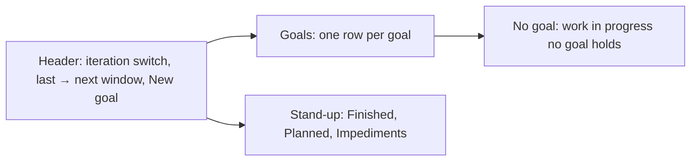
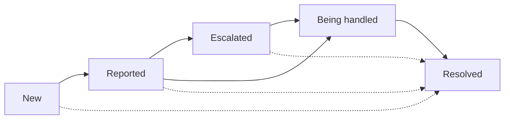

# Features

```meta
type: features
status: draft
```

> Features and sub-features this bounded context supports, described in
> business/ubiquitous language rather than implementation terms.

Every feature here sits behind the [Goals area](context.md#goals-area) flag. Why
goals and impediments are the model is local
[ADR 0035](../../arc42/adr/0035-goals-and-impediments-replace-sprints.md).

## The Goals view

```meta
type: feature
status: draft
feature-flag: .devbook/domain/progress/context.md#goals-area
related: [.devbook/domain/progress/domain.md#goal, .devbook/domain/progress/domain.md#goal-forecast, .devbook/domain/progress/domain.md#stand-up-reading, .devbook/domain/progress/requirements.md#the-goals-view, .devbook/domain/sessions/features.md#in-progress-by-task]
tests: [unit:dotnet:Backlog.UI.Components.UnitTests.GoalsBoardComponentsTests, unit:dotnet:Backlog.Desktop.UI.UnitTests.GoalsHostTests]
```

Answer "where are my goals, and what is in the way" as one desktop view. **Goals** is
the first option of the work in progress group in the header, a main view rather than
a takeover, so the Devbook still opens beside it. It replaces the
[In progress](../sessions/features.md#in-progress-by-task) view, and has no board of
sessions and pull requests by task.



The header holds the [iteration switch](#choosing-the-iteration), the last and next
window, such as "12–16 Oct → 19–23 Oct", **New goal**, **Copy**
([copying the stand-up](#copying-the-stand-up)) and **Refresh**.

Each goal reads as one row: its title, its progress as `done/total`, the items done in
the last iteration as `+3`, its due date, its landing date as "lands ~6 Nov" and an
**At risk** or **On track** badge. A bar shows how much is done, in progress, blocked
and not started, and says it in words to a screen reader. One goal is open at a time,
the first when the view opens. Opened, the row lists what is attached to it under
Plan, Tasks and Pull requests. A plan shows its own `done/total`; a pull request shows
its [status](#pull-request-status), and a merged one reads as its number and "merged".

Below the goals, **No goal** lists the tasks in progress and the open pull requests in
the header's repository scope that no goal holds, each with **Attach…**. The view lists
every goal, whatever the repository scope. With no goals and nothing in progress
outside one, the view says so and offers **New goal**.

Beside them sits the [stand-up](#the-stand-up), read over the same windows. The view is
read when it opens, on a change of iteration, on Refresh, after each change made in
it, and whenever goals, impediments or the iteration setting change elsewhere.

## Setting a goal

```meta
type: feature
status: draft
feature-flag: .devbook/domain/progress/context.md#goals-area
related: [.devbook/domain/progress/domain.md#goal, .devbook/domain/progress/requirements.md#setting-a-goal]
```

Say what the work is for. **New goal** asks for a title, an optional one-line outcome
and a due date. A goal's row offers the same fields to edit, and **Delete goal…**,
which asks first. Deleting a goal frees what it held: no plan, task or pull request
changes. Goals are set on the desktop only.

## Attaching work to a goal

```meta
type: feature
status: draft
feature-flag: .devbook/domain/progress/context.md#goals-area
related: [.devbook/domain/progress/domain.md#goal-attachment, .devbook/domain/progress/domain.md#goal-progress, .devbook/domain/progress/domain.md#goal-assignment, .devbook/domain/progress/requirements.md#attaching-work-to-a-goal]
```

Say which work reaches a goal. Three kinds of item attach:

- a **plan**, by its [plan tag](../roadmap/domain.md#roadmap-tag), which brings in
  every entry its roadmap item gathers by tag — filed under `+tag` or carrying the
  bare `#tag` — including entries filed later;
- a **task**, by its id, whose linked pull requests come with it;
- a **pull request**, by its repository and number, for work no task covers.

An open goal offers "Attach a plan, task or pull request": typing lists the matching
plans, tasks and pull requests, each named by its kind, and a pull request is found by
its number too. **Attach…** on a No goal row attaches the item to the open goal, or
asks which goal when none is open. An item belongs to at most one goal. An item
another goal holds is not attached silently: the view names that goal and asks
whether to move the item, and moves it on yes. Detaching an item changes nothing on
it. Attaching is a desktop action.

[Goal Progress](domain.md#goal-progress) says how the attached work is counted.
Attaching changes nothing on the task, the plan or the pull request.

## Choosing the iteration

```meta
type: feature
status: draft
feature-flag: .devbook/domain/progress/context.md#goals-area
setting: [.devbook/domain/progress/context.md#iteration-length, .devbook/domain/progress/context.md#two-week-start]
related: [.devbook/domain/progress/domain.md#iteration, .devbook/domain/progress/requirements.md#choosing-the-iteration]
```

Choose the window the goals and the stand-up are read in: **Day**, **Week**,
**2 weeks** or **Month**. The switch sits in the Goals view's header and on the
phone's stand-up, and the choice is the person's own
[Iteration length](context.md#iteration-length) setting. The first time a person
chooses 2 weeks, they give the day two-week iterations count from. The header names
the last and the next window. [Iteration](domain.md#iteration) says which days each
length covers.

## The stand-up

```meta
type: feature
status: draft
feature-flag: .devbook/domain/progress/context.md#goals-area
related: [.devbook/domain/progress/domain.md#stand-up, .devbook/domain/progress/domain.md#planned, .devbook/domain/progress/domain.md#pace, .devbook/domain/progress/requirements.md#the-stand-up]
```

Read what to say at a stand-up without gathering it by hand. The stand-up has four
blocks, read over the [iteration](#choosing-the-iteration):

| Block | Holds |
|---|---|
| Goals | each goal's progress, `+n` done in the last window, due date and badge |
| Finished | the items done in the last window, grouped by goal, then "No goal" |
| Planned | the [planned](domain.md#planned) items for the next window, grouped by goal, with the points tag |
| Impediments | each open impediment with its state, then how many were resolved in the last window |

Each block's heading carries its count. A planned item shows its `effort:` in points,
and a planned item with a pull request shows its [status](#pull-request-status).

On the desktop, the Goals block is the goals beside the stand-up, which holds
Finished, Planned and Impediments. A finished item no goal holds reads "… · no goal",
last.

The **points tag** on Planned compares the planned effort with what the person
usually gets done in such a window, such as `21 / 18 pts`. The first figure is the
`effort:` of the planned items added up. The second is the person's
[pace](domain.md#pace) from the Roadmap, scaled to the next window's working days. A
planned item without an effort adds nothing to the first figure. The tag's title says
it in words, such as "21 points planned, you usually finish 18 a week", the period
following the iteration. Without a pace the tag is the planned points alone, such as
`21 pts`.

An impediment's line names who it is with, its age in working days and the goal it
holds back, such as "Account manager · 3 days · Customers get paid faster". A New one
reads "Not reported yet". A check-again date takes the age's place: "check Tue".

### Copying the stand-up

```meta
type: sub-feature
status: draft
related: [.devbook/domain/progress/requirements.md#the-stand-up]
```

**Copy** puts the four blocks on the clipboard as plain text, each heading with its
count, Finished and Planned grouped by goal with No goal last, the points tag beside
Planned and "n resolved" after Impediments. Every line is a fixed template filled
from the reading; none is written by a model. Copying is a desktop action. Formatted
(HTML) copy is a later addition.

## Tracking an impediment

```meta
type: feature
status: draft
feature-flag: .devbook/domain/progress/context.md#goals-area
related: [.devbook/domain/progress/domain.md#impediment, .devbook/domain/progress/domain.md#impediment-state, .devbook/domain/progress/requirements.md#tracking-an-impediment, .devbook/design/color-scheme.md]
tests: [unit:dotnet:Backlog.Modules.Progress.UnitTests.ImpedimentMovesTests]
```

Keep track of what holds work back until it is out of the way. An impediment is raised
with a title, and moves through its states as the person chases it:



Escalated may be skipped, and any open state may move straight to Resolved. Each move
records its day, and who the impediment is with at that step. The impediment's page
shows that history as a stepper, its check-again date, its note and the tasks it
holds back, and through them the goal. Each state has its own colour, so a row says
its state at a glance; [the colour scheme](../../design/color-scheme.md) gives them.

In the stand-up, each impediment's state is a picker wearing the state's badge. It
offers only the moves the impediment may make, and picking one keeps who it was last
with. A move the impediment may not make is refused with the reason, and the state
stays as it was.

An open impediment that holds back a goal's item makes that goal
[At risk](domain.md#goal-forecast).

### Raising an impediment from a blocked task

```meta
type: sub-feature
status: draft
related: [.devbook/domain/progress/domain.md#blocked-task-policy, .devbook/domain/tasks/features.md#marking-a-task-blocked, .devbook/domain/progress/requirements.md#tracking-an-impediment]
```

Marking a task blocked raises an impediment for it, so nothing blocked goes untracked.
A task is [marked blocked](../tasks/features.md#marking-a-task-blocked) by its
`blocked:` token or a `set_blocked` call. When it is marked and no open impediment
holds it back already, Progress raises a New impediment titled with the task's title
that holds the task back. When one already does, nothing is raised, and nor is one
when the person resolved the impediment this block raised while the task is still
marked. Unblocking the task leaves the impediment as it is: the person resolves it.

An agent works with impediments through two MCP tools beside `set_blocked`, behind
the same goals switch: `raise_impediment` raises one with its title, the tasks it
holds back and a note, and `set_impediment_state` moves one to reported, escalated,
being-handled or resolved, with who it is with at that step.

The task gains no impediment field. Progress reacts to the mark, and Tasks never
calls Progress.

## Pull request status

```meta
type: feature
status: draft
feature-flag: .devbook/domain/progress/context.md#goals-area
related: [.devbook/domain/progress/requirements.md#pull-request-status, .devbook/domain/sessions/features.md#pull-request-readiness, .devbook/design/color-scheme.md]
```

See whether a pull request can merge without opening it. Every pull request row in
Progress, and each row of the
[Pull requests pane](../sessions/features.md#pull-request-readiness), carries its
number and two marks:

- **checks**: an icon and `passed/total`, such as `14/14`, with a running variant
  (`9/14`, still running) and a failing one (`2/14`, failing);
- **approvals**: an icon and `approvals/required`, such as `1/2`, where required is
  the number of approvals the base branch's rules ask for: its protection rule or a
  ruleset's pull request rule, whichever asks for more. A base branch no rule asks an
  approval of has no required total, and neither does one whose rules GitHub will not
  show.

The words "checks" and "approvals" are screen-reader labels only, so the row stays
short. A merged pull request reads "merged" instead of both marks. Checks that have
not run draw no checks mark. With no required total, the approvals read as the
number received alone.

## Goals on the phone

```meta
type: feature
status: draft
feature-flag: .devbook/domain/progress/context.md#goals-area
related: [.devbook/domain/progress/requirements.md#goals-on-the-phone, .devbook/arc42/06-runtime-view.md#mobile-my-day-and-task-push]
```

Read the stand-up on the way to it. The phone's **Stand-up** tab shows the four blocks
with the iteration switch. A goal opens on its own page: its badge, due and landing
date, `done/total` with how many items are doing, blocked and to do, and its items
under Plan, Tasks and Pull requests. An impediment opens on its own page: its age, the
goal it holds back, its history, its check-again date, its note and the tasks it
holds back.

The phone reads goals, the stand-up and impediments. The one thing it changes is an
impediment: its state, its check-again date and its note. Those changes go through the
device outbox, as the phone's task edits do. The state list offers only the moves the
impediment may make from where it stands. Until a desktop has applied a change, the
impediment's page shows what was asked, with Waiting beside it while the change is
still on the phone. Setting a goal, attaching work and copying the stand-up are desktop
actions.

The stand-up on the phone is the desktop's stand-up of the same work. Pull request
checks and approvals show as a desktop last read them, so the phone never needs
GitHub. A change made on the phone shows there once a desktop has applied it. When a
desktop changed the same field after the phone last synced, the desktop's change
stands and the phone's is dropped. So does a change a desktop did not apply: once a
newer copy of the impediment reaches the phone without it, the phone shows that copy.

## Syncing goals and impediments

```meta
type: feature
status: draft
depends-on: [.devbook/domain/tasks/features.md#multi-device-sync]
related: [.devbook/arc42/adr/0018-roadmap-plan-and-pace-ride-the-task-feed.md, .devbook/arc42/adr/0035-goals-and-impediments-replace-sprints.md, .devbook/domain/progress/requirements.md#syncing-goals-and-impediments]
```

Keep every goal and impediment the same on every device the person has paired. They
travel beside the tasks the devices already sync
([Multi-device sync](../tasks/features.md#multi-device-sync)), as two document kinds,
`goal` and `impediment`, one document per goal or impediment under its own id. They
travel only while sync is on and the device is paired.

Each document is replaced whole, never merged. When two devices have both changed one
goal or one impediment since they last synced, the newer change wins on every device
and the older one is lost. Two goals are two documents, so a change to one never
displaces a change to the other. A deleted goal or impediment is deleted on every
device, and the newer-change rule decides the deletion like any other change.

Goals and impediments travel whether the [Goals area](context.md#goals-area) is on or
off, because what is recorded while it is off is kept. One that arrives from another
device shows at once on every screen that draws it, without the person pressing
Refresh.
