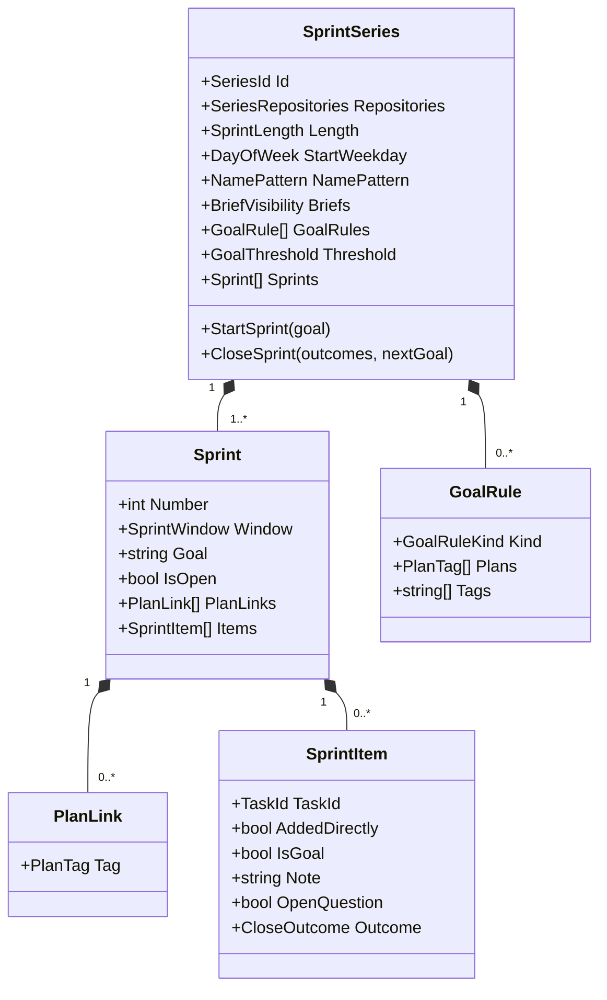

# Progress

```meta
type: model
status: draft
related: [.devbook/domain/progress/domain.md#sprint-series]
```

> Structural view of the domain model for this bounded context: aggregates,
> entities, value objects, and their relationships. Keep this in sync with
> `domain.md` (which describes responsibilities/invariants in prose) — this file
> focuses on structure and relationships. Lifecycle and process flows live in
> `flow.md`.

## Model diagram



## Relationship notes

- A Sprint Series owns its sprints; a sprint never moves to another series.
- A Sprint Item names a [Task](../tasks/domain.md#task) by id and a Plan Link
  names a plan by its [Roadmap Tag](../roadmap/domain.md#roadmap-tag). Neither
  holds a copy of what it names.
- The [Series Assignment](domain.md#series-assignment) service reads every
  series to hold a repository to one of them.
- The [Sprint Progress](domain.md#sprint-progress) service reads a sprint with
  its members' current task state and stores nothing.
