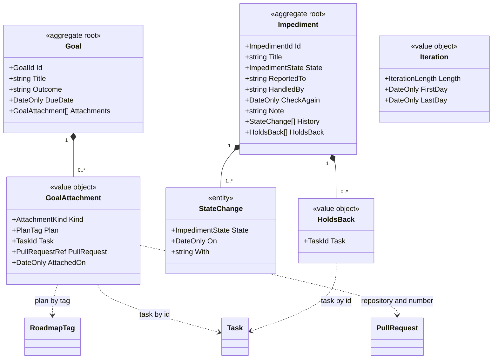

# Model

```meta
type: model
status: draft
related: [.devbook/domain/progress/domain.md#goal, .devbook/domain/progress/domain.md#impediment, .devbook/domain/progress/domain.md#iteration]
```

> Structural view of the domain model for this bounded context: aggregates,
> entities, value objects, and their relationships. Keep this in sync with
> `domain.md` (which describes responsibilities in prose) — this file focuses on
> structure and relationships.

## Model diagram



## Relationship notes

- A Goal owns its attachments, and an Impediment owns its history and its holds-back
  links. Neither aggregate refers to the other: an impediment reaches a goal only
  through a task the goal counts.
- Every arrow out of Progress is a reference by identity. A plan is named by its
  [Roadmap Tag](../roadmap/domain.md#roadmap-tag), a task by its id and a pull request
  by its repository and number. None of them is copied, and none carries a
  stereotype here: `Task` is Tasks', `RoadmapTag` Roadmap Planning's and
  `PullRequest` GitHub's.
- [Goal Progress](domain.md#goal-progress) and [Goal Forecast](domain.md#goal-forecast)
  are not stored. The [Stand-up Reading](domain.md#stand-up-reading) service computes
  them over an [Iteration](domain.md#iteration), which is a window and holds no
  identity of its own.
- [Goal Assignment](domain.md#goal-assignment) reads every goal to hold an item to one
  of them, and the [Blocked Task Policy](domain.md#blocked-task-policy) creates an
  Impediment from a task's blocked mark.
