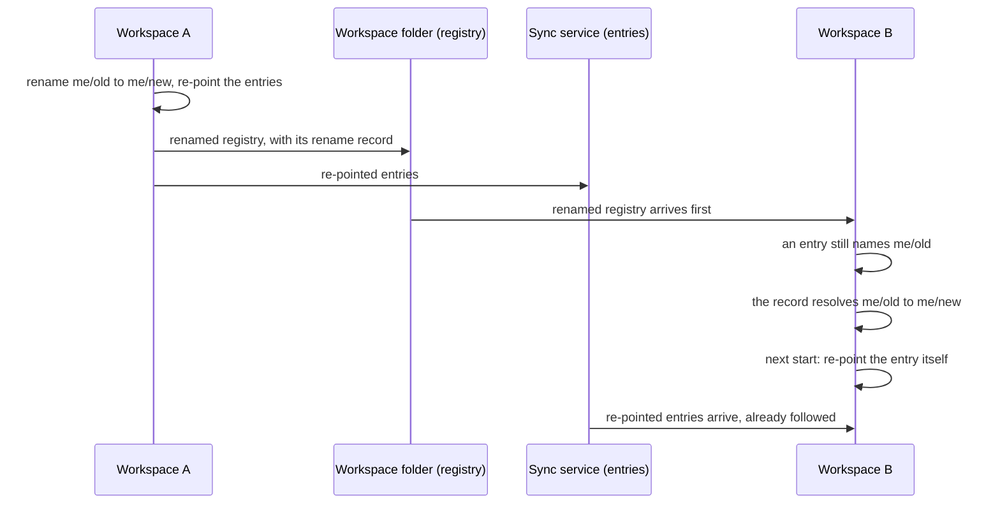

# Repository Management

```meta
type: features
status: draft
```

> Features and sub-features this bounded context supports, described in
> business/ubiquitous language rather than implementation terms.

## Repository registration

```meta
type: feature
status: draft
```

Register the repositories the product works with:

- record each one's metadata: name, clone path, language, team, GitHub URL, and
  type;
- register a repository with a local clone, or remote-only;
- discover repositories automatically from configured folders;
- track when each was last scanned.

### Repository registry configuration

```meta
type: sub-feature
status: draft
feature-flag: .devbook/domain/repository-management/context.md#additional-repositories
related: [.devbook/domain/tasks/features.md#multi-repo-targeting, .devbook/domain/devbook/features.md#repository-devbook-areas]
```

Maintain the [registry](domain.md#repository-registry) of repositories the app
acts on. Each registered repository carries a short
[alias](domain.md#repository-alias), its owner and name, and an optional local
clone directory. The alias is the name the rest of the product uses: a task files
itself against a repository by naming that alias. Registering more than one
repository is itself an opt-in capability, so a single-repository setup stays
uncluttered. While it is off, every entry belongs to the first repository in the
registry.

The working set is read as one list: a row per repository naming its alias with
its colour beside it, where it is cloned on this machine, where its devbook was
found — or that it has none — and the account it is worked as, under a sentence
counting the repositories and how many of them carry a devbook. Everything
decided about one repository is edited under its own row, one repository at a
time, and a repository just registered opens there, ready to be set up. An
[archived](#archiving-a-repository) repository keeps its row, marked Archived.

### Following a repository rename

```meta
type: sub-feature
status: draft
related: [.devbook/domain/repository-management/domain.md#repository, .devbook/domain/tasks/features.md#multi-repo-targeting, .devbook/domain/inbox/features.md#per-item-triage-actions]
```

A registered repository is identified by its owner and name, and every entry and
inbox item filed against it records that coordinate too. Without a rename, a
change of name on GitHub would read as a second repository. Everything filed
against the old name would then point at a coordinate nobody is configured for.

Seven edits to the registry look alike and do different things:

| Edit | How it is made | What follows it | What is kept |
|---|---|---|---|
| Rename | A new owner and name, given on the repository itself | Every entry and inbox item naming the old repository, including an entry's links to issues it created there | The clone directory, colour, account and devbook folder settings, under the new name, and a [Rename Record](domain.md#rename-record) of the old name |
| Merge | A rename to a name another registered repository already has | Everything filed against the old name, to the other repository | The other repository's settings; the renamed one goes |
| Removal | Removing the repository from the list | Nothing | A [Removal Record](domain.md#removal-record); entries keep the removed name and show no repository |
| Archive | Choosing Archive on the repository's row ([Archiving a repository](#archiving-a-repository)) | Nothing is re-pointed; the panes stop reading the repository as active work | Everything: the identity, the settings, the tasks filed against it, and its devbook |
| Unarchive | Choosing Unarchive on the archived row | Nothing; the repository is active work again | Everything, as it was when it was archived |
| Relabel | Changing the alias alone | Nothing, because the same repository is meant | Everything |
| Alias swap | Swapping two aliases between two repositories | Nothing, because it is two relabels | Each repository's own settings |

A rename is asked for on the repository itself and is never inferred from the
list. A list cannot tell a rename from a replacement. For a repository registered
without an alias of its own, whose alias is its name, the two edits are the same
edit. So a change of owner or name made in the list is a removed repository beside
a new one. The repository list says so and points at the rename, which is the
edit that keeps things.

An inbox item's record of where it was routed is left as written, because that is
the record of a decision already taken. The repository list reports what happened
and how many entries and inbox items followed. A new name that is not a
repository coordinate, or is the name the repository already has, is refused.

A merge is how a [placeholder](domain.md#repository-registry) is folded into the
real repository it meant. The list says it merged rather than renamed, on the
card of the repository that was kept.

The list and the entries reach another workspace of the same person by different
routes and in no fixed order:



An entry that still names the old repository must therefore not read as naming a
repository nobody has. The [Rename Record](domain.md#rename-record) says how long
the memory lasts and how a name given up twice is followed. A removal is
remembered for the same reason, in a [Removal Record](domain.md#removal-record).

### Archiving a repository

```meta
type: sub-feature
status: draft
related: [.devbook/domain/repository-management/requirements.md#archiving-a-repository, .devbook/domain/repository-management/domain.md#archived-repository, .devbook/arc42/adr/0029-an-archived-repository-stays-in-the-registry.md]
```

Quiet a repository that is no longer worked on, without forgetting it. An
[archived repository](domain.md#archived-repository) stays in the registry with
its identity, its settings and the tasks filed against it. Backlog stops treating
it as active work: it reads nothing from GitHub for it and leaves it out of the
scope and the pickers. Unarchive brings all of it back.

Removal is the other way to quiet a repository, and it forgets:

| | Removal | Archive |
|---|---|---|
| Reversible | No | Yes, by Unarchive |
| Identity and settings | Gone, with a [Removal Record](domain.md#removal-record) of the name | Kept |
| Tasks filed against it | Keep the name and show no repository | Keep the repository and show it |
| Devbook | Unavailable | Readable, and read-only |
| GitHub reads | None | None |

A person archives a repository from its row in the repository list, and nothing
archives one on its own. When GitHub reports the repository archived, or cannot
find it, the row suggests Archive and waits for the person.

Archiving asks what becomes of the repository's open tasks: move them to another
repository, drop them, or keep them as they are. The same choice stays on the
archived row for later.

What each pane does with an archived repository is in
[its requirements](requirements.md#archiving-a-repository). The registry's own
rules, such as the last active repository staying active, are in
[its invariants](domain.invariants.md#repository-registry). Local ADR 0029
records why the repository stays in the registry rather than being removed.

### Repository identity colour

```meta
type: sub-feature
status: draft
related: [.devbook/design/color-scheme.md#band-identity-tokens, .devbook/domain/roadmap/features.md#telling-one-project-from-another-at-a-glance]
```

Give each registered repository one colour, so a workspace holding several of
them can be read one project at a time. The colour belongs to the repository
rather than to any screen showing it. The same project is the same colour
everywhere it appears:

- on the repository filter;
- on a plan;
- on a task filed against it, and on the agent sessions under that task;
- on the row for a session in the Sessions area.

A screen that decided its own colour would be a second answer to which project is
which.

The registry records *which* of the colours the design system sanctions, never a
colour of its own. Inventing a colour is a design decision, and is made where
design decisions are made. A repository nobody has chosen for is placed
automatically by its position in the registry. The placement steps over the
colours already claimed, so it never lands on the one a neighbour was deliberately
given. Past the end of the set the placement wraps, and two repositories may share
a colour. That is acceptable, because the colour is not the identifier: the alias
is, and it is written wherever the colour is shown.

The choice can be given back, which returns the repository to its automatic
placement rather than leaving it colourless.

### Repository devbook folder settings

```meta
type: sub-feature
status: draft
related: [.devbook/domain/devbook/features.md#repository-devbook-areas]
```

Decide, per repository, which devbook folders the product may read and where
they live. Each folder can be switched off entirely, and most can point at a
non-standard location instead of the conventional one. A folder is readable only
when all three of these hold:

- the repository has a local clone directory;
- the folder is switched on;
- the resolved location actually exists.

Otherwise the product explains which condition is missing rather than silently
showing nothing.

## Package and dependency tracking

```meta
type: feature
status: draft
depends-on: [.devbook/domain/repository-management/features.md#repository-registration]
```

Keep track of each repository's dependencies:

- scan dependency files and parse package versions and constraints;
- track transitive dependencies;
- detect outdated packages against their registries, including custom feeds;
- alert on critical or security patches.

## Technology stack inventory

```meta
type: feature
status: draft
depends-on: [.devbook/domain/repository-management/features.md#repository-registration]
related: [.devbook/domain/technology-stack/features.md#portfolio-wide-adoption-tracking]
```

Detect each repository's primary languages, framework versions, build tools,
runtimes, and use of Docker, Kubernetes and the cloud. A person can also tag a
repository with technologies of their own.

## GitHub integration

```meta
type: feature
status: draft
```

Read each repository's GitHub side:

- metadata: stars, forks, last commit, branch protection;
- open issues and pull requests, and their age;
- whether the repository looks unmaintained;
- the status of its GitHub Actions CI/CD runs.

GitHub keeps an `archived` mark of its own on a repository, and an archived
GitHub repository stays readable. Backlog never copies that mark into the
registry. It suggests [archiving](#archiving-a-repository) the repository instead,
as it does when GitHub cannot find the repository at all, and reads nothing from
GitHub for a repository once it is archived.

The open pull requests counted here for health are the same pull requests whose
[status](#pull-request-status) and [readiness](#pull-request-readiness) this
context publishes. Health counts them per repository; readiness says, for each one,
what it is waiting on.

### GitHub access resolution

```meta
type: sub-feature
status: draft
related: [.devbook/domain/tasks/features.md#projection]
```

Reach GitHub through whichever credential the machine already has. An existing
signed-in GitHub CLI is preferred, so no credential has to be stored in the
product. A per-repository personal access token is the fallback for machines
without it. Access can be checked on demand. The check reports in plain language
which route is in use and whether it currently works. Tokens are kept outside the
backlog folder, so the backlog itself stays safe to sync or commit.

## Pull request status

```meta
type: feature
status: proposed
related: [.devbook/domain/repository-management/requirements.md#pull-request-status, .devbook/domain/repository-management/features.md#pull-request-readiness, .devbook/domain/progress/features.md#pull-request-status, .devbook/design/color-scheme.md, .devbook/arc42/adr/0042-repository-management-owns-pull-request-state.md]
```

See whether a pull request can merge without opening it. Repository Management
publishes one [pull request status](domain.md#pull-request-status) for each pull
request it reads, and every screen that shows a pull request draws from it:

- each row of the [pull requests pane](#pull-request-readiness);
- each pull request row of a goal in [Progress](../progress/features.md#pull-request-status);
- each open pull request card among a task's linked work in its side panel.

Each of them carries the pull request's number and two marks:

- **checks**: an icon and `passed/total`, such as `14/14`, with a running variant
  (`9/14`, still running) and a failing one (`2/14`, failing);
- **approvals**: an icon and `approvals/required`, such as `1/2`, where required is
  the number of approvals the base branch's rules ask for: its protection rule or a
  ruleset's pull request rule, whichever asks for more. A base branch no rule asks an
  approval of has no required total, and neither does one whose rules GitHub will not
  show.

The words "checks" and "approvals" are screen-reader labels only, so the row stays
short. A merged pull request reads "merged" instead of both marks. Checks that have
not run draw no checks mark. With no required total, the approvals read as the
number received alone.

The pull requests pane reads each base branch's rules once, beside its list, and
keeps the answer for ten minutes, so its rows carry the required total too. A
branch whose rules cannot be read leaves its rows' approvals as the number received,
with no verdict either way. A task's linked pull request card draws the marks while
the pull request is open; one the open list did not hold — merged, closed, or in a
repository no longer configured — draws its state alone, because the read by number
behind it asks for no checks or approvals.

The marks are what a row shows of the status. The status itself carries more, and
local ADR 0042 lists what
([§2](../../arc42/adr/0042-repository-management-owns-pull-request-state.md#2-one-published-contract-for-status-and-verdict)).
The marks are built. The one status every screen reads is not: today the pane,
Progress and the side panel each read GitHub their own way, and ADR 0042 makes it
one contract and one cache.

## Pull request readiness

```meta
type: feature
status: proposed
feature-flag: .devbook/domain/repository-management/context.md#pull-requests
related: [.devbook/domain/repository-management/features.md#pull-request-status, .devbook/domain/sessions/features.md#the-detail-of-one-session, .devbook/domain/sessions/features.md#the-work-a-run-is-linked-to, .devbook/arc42/adr/0020-external-items-arrive-as-linked-tasks.md, .devbook/domain/repository-management/requirements.md#archiving-a-repository, .devbook/arc42/adr/0042-repository-management-owns-pull-request-state.md]
tests: [unit:dotnet:Backlog.Desktop.UI.UnitTests.PullRequestsPaneTests, unit:dotnet:Backlog.Desktop.UI.UnitTests.PullRequestVerdictTests, unit:dotnet:Backlog.Infrastructure.GitHub.UnitTests.GitHubClientHeadChecksTests, unit:dotnet:Backlog.Infrastructure.GitHub.UnitTests.GitHubIntegrationPullRequestListTests]
```

The pull requests pane is where a reader follows each open pull request of the
registered repositories to the point where it merges. Sessions and delivery runs
produce many of them, and a person opens others by hand; the pane lists both. It is
this context's screen (local
[ADR 0042](../../arc42/adr/0042-repository-management-owns-pull-request-state.md#6-the-pull-requests-pane-and-the-session-card-read-the-contract)).
Until that record is built, the pane and its rules live in the desktop shell.

The pane has two views, Open and Recently merged. A Mine / Everyone's choice narrows the
rows. Mine is the reader's own pull requests and those related to one of their tasks.
Refresh re-reads the list. A repository's label filter, set in Settings, lets through
only the pull requests carrying one of its labels. A pinned pull request ignores every
filter. It sits in a Pinned group at the top of the list until it is unpinned, even after
it merges or closes.

The pane is a triage list beside a detail panel. Lane tiles say how many pull requests
need what, the list below them is grouped by lane, and the pull request the reader picks
is laid out in full beside the list. Where the pane is narrow, the panel moves under the
list. Each row says one thing: the verdict on whether it is ready, and if not, what it is
waiting on. A reader scanning twenty pull requests should not have to open each to learn
which one needs them.

A row shows:

- the repository's [identity edge](../../design/color-scheme.md#the-identity-edge);
- the number, the verdict chip and the title;
- the head branch, and how long ago it was updated;
- its [pull request status](#pull-request-status) marks: checks as passed over total
  once any ran, and the approvals it has.

A pull request stacked on another is indented and says which one it waits on, so the
reader merges that one first. A pinned one keeps both in the Pinned group, so a pin never
hides what has to merge first.

The pane has no storybook page. The storybook references only `Backlog.UI.Components`,
and the pane lives in `Backlog.Desktop.UI`, which the storybook cannot render. Its states
are proved by the bUnit tests named above instead.

### Lanes that filter the list

```meta
type: sub-feature
related: [.devbook/domain/repository-management/features.md#one-verdict-per-pull-request]
tests: [unit:dotnet:Backlog.Desktop.UI.UnitTests.PullRequestsPaneTests]
```

Four lane tiles sit under the header: Needs you, Ready to merge, Waiting and Drafts. Each
tile shows how many pull requests are in its lane. A line under the count says what put
them there, such as "conflicts · failing checks". Pressing a tile narrows the list to that
lane, and pressing it again lets the lane go. One lane is pressed at a time.

The counts are taken over the rows the other filters leave, so a tile never promises a
pull request the list will not show. A pinned pull request still shows under a pressed
lane, for the reason it ignores every other filter. Recently merged has no tiles, because
a merged pull request is in no lane.

The Mine / Everyone's choice stays, because it answers a different question. Mine says
whose pull requests to look at; a lane says which of them to look at first. The two
combine: Mine and Needs you is the reader's own work that is waiting on them.

### One verdict per pull request

```meta
type: sub-feature
tests: [unit:dotnet:Backlog.Desktop.UI.UnitTests.PullRequestVerdictTests, unit:dotnet:Backlog.Desktop.UI.UnitTests.PullRequestsPaneTests, unit:dotnet:Backlog.Desktop.UI.UnitTests.SessionPullRequestStatusesTests]
```

Each pull request that is still open gets exactly one readiness verdict. Where several
apply, the first in this table wins:

| Precedence | Verdict | Lane | Tone | Act | Second act |
| --- | --- | --- | --- | --- | --- |
| 1 | Conflicts | Needs you | fault | Open on GitHub | — |
| 2 | Failing checks | Needs you | fault | Re-run failed, when a failed check is a GitHub Actions run; else Open on GitHub | Open on GitHub, after Re-run failed |
| 3 | Changes requested | Needs you | fault | Open review on GitHub | — |
| 4 | Behind | Needs you | alert | Update branch | Merge when ready |
| 5 | Draft | Drafts | quiet | Ready for review | — |
| 6 | Checks running | Waiting | live | Merge when ready | — |
| 7 | Review required | Waiting | live | Merge when ready | — |
| 8 | Ready | Ready to merge | settled | Merge | Update branch, when the branch is behind a base that does not require it |

One verdict rather than a row of badges, because a reader acts on one thing at a time. The
order puts first what blocks the most. A conflict has to be resolved before checks or
review mean anything, and a failing check before a review is worth asking for. Behind is
in Needs you because it waits on nobody else: the reader brings the branch up to date
with the act the banner offers, and it can merge. The tones are the badge tone scale of
`.devbook/design/color-scheme.md`, so the verdict chip reads like every other badge.

Each verdict carries a label for its chip, a headline and a one-sentence reason for the
banner, and the acts above. A few rules sit beside the table:

- A failed check decides even while others still run. A reviewer who asked for changes
  counts even where the repository asks for no review.
- Ready offers Merge when ready instead of Merge when GitHub still reports the pull
  request not mergeable, because a merge now would be refused.
- A stacked pull request's reason names the pull request it waits on. It is offered no
  merge act, because merged now it would land on its parent's branch rather than where
  the stack is going. Its other acts stay.
- Behind is GitHub's own `BEHIND` state, which GitHub sets only where the repository
  requires an up-to-date branch. A pull request behind a base that does not require it is
  still Ready, but its reason says how many commits behind it is and that the repository
  does not require it, so it never contradicts the up to date line of the detail panel.
  Update branch is then offered as Ready's second act.
- Whether Re-run failed is offered is read off the pull request's own checks, never
  told to the verdict by whoever asks for it.
- The session list's pull request card gives the same verdict as the pane, stack
  included: it places an open pull request among its repository's open pull requests and
  names the one it waits on.
- A merged pull request reads as Merged, in the settled tone, with no act. A pull request
  closed without merging has no verdict, since there is nothing left to get ready.

### The detail panel of a pull request

```meta
type: sub-feature
related: [.devbook/domain/sessions/features.md#the-detail-of-one-session]
tests: [unit:dotnet:Backlog.Desktop.UI.UnitTests.PullRequestsPaneTests, unit:dotnet:Backlog.Infrastructure.GitHub.UnitTests.GitHubClientHeadChecksTests]
```

Picking a pull request opens a detail panel. The first row the list shows is picked until
the reader picks another, and a pick the filters hide falls back to the first row shown.
From the top, the panel holds:

- the pull request's repository, number, author, title and branches, a link to it on
  GitHub, and its pin;
- a banner with the verdict and the act that fits it, such as Update branch for Behind,
  with the verdict's second act beside it where it has one;
- a merge-readiness list of four lines: checks, review, up to date, and mergeable;
- the checks, failures first, then the ones still running; six are shown and the rest
  are counted;
- the stack the pull request is part of, bottom first;
- the task card and the session card for the work behind it.

The banner leads with one act because the verdict already names the one thing in the way.
GitHub may already hold an auto-merge that the verdict's acts do not touch. The banner
then also offers to cancel it, because that undoes a request rather than making one. The
mergeable line says only whether the pull request has conflicts. It does not count the
conflicted files, because GitHub reports no such count, and a number this product made
up would be wrong in a way nobody could check. The failures come first so the reader sees
the reason before the long list of passing checks.

The list already reads what the panel needs. Each check on the head commit is a check run
or a commit status. It comes with its name, whether it passed, failed or is still running,
and, for a check run that finished, how long it took. The first fifty are listed and the
counts cover the rest. Where the counts report a failed check past those fifty, every
check of the head commit is paged in, so no failed run is missing. Each open pull request from the same repository also carries how
many commits its base has that its branch does not. GitHub cannot compare a fork's branch
from the base repository, so a pull request from a fork has no such count.

### Re-run failed

```meta
type: sub-feature
tests: [unit:dotnet:Backlog.Infrastructure.GitHub.UnitTests.GitHubClientHeadChecksTests, unit:dotnet:Backlog.Infrastructure.GitHub.UnitTests.GitHubIntegrationPullRequestListTests, unit:dotnet:Backlog.Desktop.UI.UnitTests.PullRequestVerdictTests]
```

Re-run failed is offered when a failed check is a GitHub Actions run. It starts the failed
jobs of that run again, and the jobs that depend on them. It covers the most common way a
check goes red without anyone's code being wrong: a runner that flaked.

Where several checks failed, each workflow run behind them is asked once, however many of
its jobs failed. That covers a failed run past the first fifty checks too, because the
list pages those in when the counts say one failed there. Every run is asked even when GitHub refuses one, because the runs are
independent. The refusal then says how many of the others did start again. Afterwards the
pane reads that one repository again, as it does after every other act, so the row shows
the checks running instead of failed.

It is offered only for GitHub Actions because that is the only kind of check this product
can ask GitHub to run again. A check from another service has to be re-run there. The act
sits in the detail panel's banner, as the act of the Failing checks verdict.

There is no act that hands a pull request off to an agent. Starting a session is something
a person does in their agent, with the context they choose. A button here would start work
on the reader's behalf that the pane could neither show nor stop.

## Repository health scoring

```meta
type: feature
status: draft
depends-on: [.devbook/domain/repository-management/features.md#package-and-dependency-tracking, .devbook/domain/repository-management/features.md#github-integration]
related: [.devbook/domain/monitoring/features.md#multi-repo-scanning]
```

Compute a health score from package freshness, the GitHub issue and pull request
backlog, test coverage, and security alerts. Low-health repositories surface on
their own, each with actionable recommendations
([Health scoring flow](flow.md#health-scoring-flow)).

## Technology trend analysis

```meta
type: feature
status: draft
related: [.devbook/domain/technology-stack/features.md#portfolio-wide-adoption-tracking]
```

Aggregate package versions across repositories to see platform-wide adoption.
The analysis surfaces deprecated technology still in use, recommends upgrades,
and tracks how new libraries and frameworks are adopted.

## Bulk operations

```meta
type: feature
status: draft
depends-on: [.devbook/domain/repository-management/features.md#repository-health-scoring]
related: [.devbook/domain/tasks/features.md#task-creation]
```

Act on many repositories at once: queue package updates, coordinate synchronized
upgrades, run custom workflows through GitHub Actions, and generate migration
guides for major versions.
