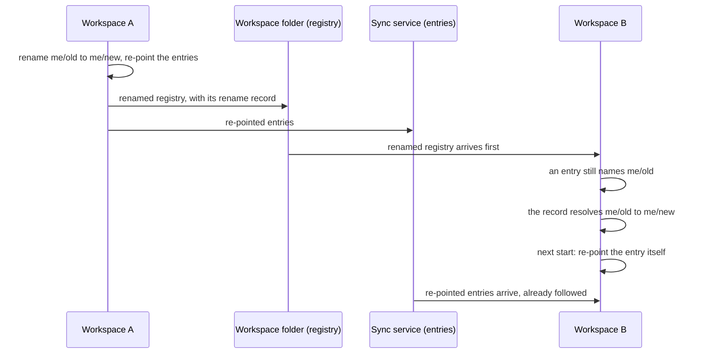

# Repository Management

```meta
type: features
status: draft
```

> Features and sub-features this bounded context supports, described in
> business/ubiquitous language rather than implementation terms.

## Repository registration

```meta
type: feature
status: draft
```

Register the repositories the product works with:

- record each one's metadata: name, clone path, language, team, GitHub URL, and
  type;
- register a repository with a local clone, or remote-only;
- discover repositories automatically from configured folders;
- track when each was last scanned.

### Repository registry configuration

```meta
type: sub-feature
status: draft
feature-flag: .devbook/domain/repository-management/context.md#additional-repositories
related: [.devbook/domain/tasks/features.md#multi-repo-targeting, .devbook/domain/devbook/features.md#repository-devbook-areas]
```

Maintain the [registry](domain.md#repository-registry) of repositories the app
acts on. Each registered repository carries a short
[alias](domain.md#repository-alias), its owner and name, and an optional local
clone directory. The alias is the name the rest of the product uses: a task files
itself against a repository by naming that alias. Registering more than one
repository is itself an opt-in capability, so a single-repository setup stays
uncluttered. While it is off, every entry belongs to the first repository in the
registry.

### Following a repository rename

```meta
type: sub-feature
status: draft
related: [.devbook/domain/repository-management/domain.md#repository, .devbook/domain/tasks/features.md#multi-repo-targeting, .devbook/domain/inbox/features.md#per-item-triage-actions]
```

A registered repository is identified by its owner and name, and every entry and
inbox item filed against it records that coordinate too. Without a rename, a
change of name on GitHub would read as a second repository. Everything filed
against the old name would then point at a coordinate nobody is configured for.

Five edits to the registry look alike and do different things:

| Edit | How it is made | What follows it | What is kept |
|---|---|---|---|
| Rename | A new owner and name, given on the repository itself | Every entry and inbox item naming the old repository, including an entry's links to issues it created there | The clone directory, colour, account and knowledge folder settings, under the new name, and a [Rename Record](domain.md#rename-record) of the old name |
| Merge | A rename to a name another registered repository already has | Everything filed against the old name, to the other repository | The other repository's settings; the renamed one goes |
| Removal | Removing the repository from the list | Nothing | A [Removal Record](domain.md#removal-record); entries keep the removed name and show no repository |
| Relabel | Changing the alias alone | Nothing, because the same repository is meant | Everything |
| Alias swap | Swapping two aliases between two repositories | Nothing, because it is two relabels | Each repository's own settings |

A rename is asked for on the repository itself and is never inferred from the
list. A list cannot tell a rename from a replacement. For a repository registered
without an alias of its own, whose alias is its name, the two edits are the same
edit. So a change of owner or name made in the list is a removed repository beside
a new one. The repository list says so and points at the rename, which is the
edit that keeps things.

An inbox item's record of where it was routed is left as written, because that is
the record of a decision already taken. The repository list reports what happened
and how many entries and inbox items followed. A new name that is not a
repository coordinate, or is the name the repository already has, is refused.

A merge is how a [placeholder](domain.md#repository-registry) is folded into the
real repository it meant. The list says it merged rather than renamed, on the
card of the repository that was kept.

The list and the entries reach another workspace of the same person by different
routes and in no fixed order:



An entry that still names the old repository must therefore not read as naming a
repository nobody has. The [Rename Record](domain.md#rename-record) says how long
the memory lasts and how a name given up twice is followed. A removal is
remembered for the same reason, in a [Removal Record](domain.md#removal-record).

### Repository identity colour

```meta
type: sub-feature
status: draft
related: [.devbook/design/color-scheme.md#band-identity-tokens, .devbook/domain/roadmap/features.md#telling-one-project-from-another-at-a-glance]
```

Give each registered repository one colour, so a workspace holding several of
them can be read one project at a time. The colour belongs to the repository
rather than to any screen showing it. The same project is the same colour
everywhere it appears:

- on the repository filter;
- on a plan;
- on a task filed against it, and on the agent sessions under that task;
- on the row for a session in the Sessions area.

A screen that decided its own colour would be a second answer to which project is
which.

The registry records *which* of the colours the design system sanctions, never a
colour of its own. Inventing a colour is a design decision, and is made where
design decisions are made. A repository nobody has chosen for is placed
automatically by its position in the registry. The placement steps over the
colours already claimed, so it never lands on the one a neighbour was deliberately
given. Past the end of the set the placement wraps, and two repositories may share
a colour. That is acceptable, because the colour is not the identifier: the alias
is, and it is written wherever the colour is shown.

The choice can be given back, which returns the repository to its automatic
placement rather than leaving it colourless.

### Repository knowledge folder settings

```meta
type: sub-feature
status: draft
related: [.devbook/domain/devbook/features.md#repository-devbook-areas]
```

Decide, per repository, which knowledge folders the product may read and where
they live. Each folder can be switched off entirely, and most can point at a
non-standard location instead of the conventional one. A folder is readable only
when all three of these hold:

- the repository has a local clone directory;
- the folder is switched on;
- the resolved location actually exists.

Otherwise the product explains which condition is missing rather than silently
showing nothing.

## Package and dependency tracking

```meta
type: feature
status: draft
depends-on: [.devbook/domain/repository-management/features.md#repository-registration]
```

Keep track of each repository's dependencies:

- scan dependency files and parse package versions and constraints;
- track transitive dependencies;
- detect outdated packages against their registries, including custom feeds;
- alert on critical or security patches.

## Technology stack inventory

```meta
type: feature
status: draft
depends-on: [.devbook/domain/repository-management/features.md#repository-registration]
related: [.devbook/domain/technology-stack/features.md#portfolio-wide-adoption-tracking]
```

Detect each repository's primary languages, framework versions, build tools,
runtimes, and use of Docker, Kubernetes and the cloud. A person can also tag a
repository with technologies of their own.

## GitHub integration

```meta
type: feature
status: draft
```

Read each repository's GitHub side:

- metadata: stars, forks, last commit, branch protection;
- open issues and pull requests, and their age;
- whether the repository looks unmaintained;
- the status of its GitHub Actions CI/CD runs.

### GitHub access resolution

```meta
type: sub-feature
status: draft
related: [.devbook/domain/tasks/features.md#projection]
```

Reach GitHub through whichever credential the machine already has. An existing
signed-in GitHub CLI is preferred, so no credential has to be stored in the
product. A per-repository personal access token is the fallback for machines
without it. Access can be checked on demand. The check reports in plain language
which route is in use and whether it currently works. Tokens are kept outside the
backlog folder, so the backlog itself stays safe to sync or commit.

## Repository health scoring

```meta
type: feature
status: draft
depends-on: [.devbook/domain/repository-management/features.md#package-and-dependency-tracking, .devbook/domain/repository-management/features.md#github-integration]
related: [.devbook/domain/monitoring/features.md#multi-repo-scanning]
```

Compute a health score from package freshness, the GitHub issue and pull request
backlog, test coverage, and security alerts. Low-health repositories surface on
their own, each with actionable recommendations
([Health scoring flow](flow.md#health-scoring-flow)).

## Technology trend analysis

```meta
type: feature
status: draft
related: [.devbook/domain/technology-stack/features.md#portfolio-wide-adoption-tracking]
```

Aggregate package versions across repositories to see platform-wide adoption.
The analysis surfaces deprecated technology still in use, recommends upgrades,
and tracks how new libraries and frameworks are adopted.

## Bulk operations

```meta
type: feature
status: draft
depends-on: [.devbook/domain/repository-management/features.md#repository-health-scoring]
related: [.devbook/domain/tasks/features.md#task-creation]
```

Act on many repositories at once: queue package updates, coordinate synchronized
upgrades, run custom workflows through GitHub Actions, and generate migration
guides for major versions.
